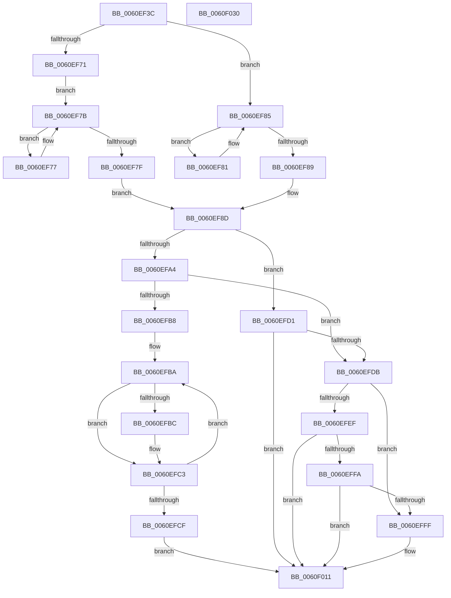

# StEtaIoStart

- RVA: `0x0060EF3C`–`0x0060F031` (길이 `245` bytes)
- VA: `0x000000014060EF3C`
- 실행 섹션: `.text`
- PDB 이름 있음: `예`; PDB Function 태그: `아니요`
- unwind 정보 RVA: `0x00075C18`
- 디코드: `80`개 명령, `245/245` bytes 표시
- 미해석 바이트: `0` (있으면 어셈블리에 `.byte`로 보존)

> 이 문서는 커널 이미지의 기계어와 PDB 기호를 분석해 생성했습니다. 4번과 5번은 함수 원형과 자료형을 바이너리 사용 방식에서 추정한 C 해석이며 원본 소스 복구 결과는 아닙니다.

## 1. Dependencies

- 직접 호출 지점: **2**; 고유 호출 대상: **1**
- 직접 호출자로 확인된 함수: **1**
- RIP 상대 이미지 참조: **0**

### Outgoing calls
- `0x0060EFA6` → [KeQueryPerformanceCounter](../37/KeQueryPerformanceCounter_function_0037E7E0.md) (function, `0x0037E7E0`)
- `0x0060F001` → [KeQueryPerformanceCounter](../37/KeQueryPerformanceCounter_function_0037E7E0.md) (function, `0x0037E7E0`)

### Direct callers
- [ST_STORE&lt;SM_TRAITS&gt;::StDeviceIoIssue](ST_STORE_SM_TRAITS_StDeviceIoIssue_function_0060CFD0.md) at `0x0060D0B1`

### Static image references
- 디코드된 RIP-relative 메모리 참조가 없습니다.

## 2. Other-region calls and transfers

- 다른 실행 섹션으로 향하는 call: **0**
- 별도 외부 분기/꼬리 이동을 확인하지 못했습니다.

## 3. Assembly (complete function range)

```asm
0060EF3C  48 89 5C 24 08                  mov qword ptr [rsp + 8], rbx
0060EF41  48 89 6C 24 10                  mov qword ptr [rsp + 0x10], rbp
0060EF46  48 89 74 24 18                  mov qword ptr [rsp + 0x18], rsi
0060EF4B  57                              push rdi
0060EF4C  41 54                           push r12
0060EF4E  41 55                           push r13
0060EF50  41 56                           push r14
0060EF52  41 57                           push r15
0060EF54  48 83 EC 20                     sub rsp, 0x20
0060EF58  33 F6                           xor esi, esi
0060EF5A  4D 63 E0                        movsxd r12, r8d
0060EF5D  4D 8B F9                        mov r15, r9
0060EF60  48 8B F9                        mov rdi, rcx
0060EF63  4A 8B 5C E1 10                  mov rbx, qword ptr [rcx + r12*8 + 0x10]
0060EF68  44 8D 6E 01                     lea r13d, [rsi + 1]
0060EF6C  45 84 CD                        test r13b, r9b
0060EF6F  74 14                           je 0x14060ef85
0060EF71  49 83 E7 FE                     and r15, 0xfffffffffffffffe
0060EF75  EB 04                           jmp 0x14060ef7b
0060EF77  48 83 C3 20                     add rbx, 0x20
0060EF7B  39 13                           cmp dword ptr [rbx], edx
0060EF7D  72 F8                           jb 0x14060ef77
0060EF7F  EB 0C                           jmp 0x14060ef8d
0060EF81  48 83 C3 20                     add rbx, 0x20
0060EF85  39 13                           cmp dword ptr [rbx], edx
0060EF87  72 F8                           jb 0x14060ef81
0060EF89  66 89 73 04                     mov word ptr [rbx + 4], si
0060EF8D  44 8B 73 08                     mov r14d, dword ptr [rbx + 8]
0060EF91  41 8B C5                        mov eax, r13d
0060EF94  8B 69 0C                        mov ebp, dword ptr [rcx + 0xc]
0060EF97  F0 0F C1 41 08                  lock xadd dword ptr [rcx + 8], eax
0060EF9C  41 03 C5                        add eax, r13d
0060EF9F  41 3B C5                        cmp eax, r13d
0060EFA2  75 2D                           jne 0x14060efd1
0060EFA4  33 C9                           xor ecx, ecx
0060EFA6  E8 35 F8 D6 FF                  call 0x14037e7e0
0060EFAB  48 89 07                        mov qword ptr [rdi], rax
0060EFAE  8B C5                           mov eax, ebp
0060EFB0  F0 44 0F B1 77 0C               lock cmpxchg dword ptr [rdi + 0xc], r14d
0060EFB6  74 23                           je 0x14060efdb
0060EFB8  3B C5                           cmp eax, ebp
0060EFBA  7E 07                           jle 0x14060efc3
0060EFBC  8B C8                           mov ecx, eax
0060EFBE  2B CD                           sub ecx, ebp
0060EFC0  44 03 F1                        add r14d, ecx
0060EFC3  8B E8                           mov ebp, eax
0060EFC5  F0 44 0F B1 77 0C               lock cmpxchg dword ptr [rdi + 0xc], r14d
0060EFCB  3B C5                           cmp eax, ebp
0060EFCD  75 EB                           jne 0x14060efba
0060EFCF  EB 40                           jmp 0x14060f011
0060EFD1  F0 44 01 71 0C                  lock add dword ptr [rcx + 0xc], r14d
0060EFD6  41 3B C5                        cmp eax, r13d
0060EFD9  7F 36                           jg 0x14060f011
0060EFDB  0F B7 43 06                     movzx eax, word ptr [rbx + 6]
0060EFDF  66 41 03 C5                     add ax, r13w
0060EFE3  66 89 43 06                     mov word ptr [rbx + 6], ax
0060EFE7  66 42 3B 44 A7 20               cmp ax, word ptr [rdi + r12*4 + 0x20]
0060EFED  72 10                           jb 0x14060efff
0060EFEF  42 0F B7 4C A7 22               movzx ecx, word ptr [rdi + r12*4 + 0x22]
0060EFF5  66 85 C9                        test cx, cx
0060EFF8  74 17                           je 0x14060f011
0060EFFA  66 85 C8                        test ax, cx
0060EFFD  75 12                           jne 0x14060f011
0060EFFF  33 C9                           xor ecx, ecx
0060F001  E8 DA F7 D6 FF                  call 0x14037e7e0
0060F006  48 89 43 10                     mov qword ptr [rbx + 0x10], rax
0060F00A  41 8B F5                        mov esi, r13d
0060F00D  4C 89 7B 18                     mov qword ptr [rbx + 0x18], r15
0060F011  48 8B 5C 24 50                  mov rbx, qword ptr [rsp + 0x50]
0060F016  8B C6                           mov eax, esi
0060F018  48 8B 74 24 60                  mov rsi, qword ptr [rsp + 0x60]
0060F01D  48 8B 6C 24 58                  mov rbp, qword ptr [rsp + 0x58]
0060F022  48 83 C4 20                     add rsp, 0x20
0060F026  41 5F                           pop r15
0060F028  41 5E                           pop r14
0060F02A  41 5D                           pop r13
0060F02C  41 5C                           pop r12
0060F02E  5F                              pop rdi
0060F02F  C3                              ret
0060F030  CC                              int3
```

## 4. C-style interpretation (structured pseudocode)

```c
__int64 __fastcall StEtaIoStart(__int64 a1, int a2, int a3, __int64 a4)
{
    __int64 result;
    __int64 v_r14;
    __int64 v_r15;
    __int64 v_rbx;
    __int64 v_rsi;
    __int64 v_rsp;
    unsigned __int64 v_stack_p10;
    unsigned __int64 v_stack_p18;
    unsigned __int64 v_stack_p8;

    v_stack_p8 = v_rbx;
    v_stack_p10 = v_rbp;
    v_stack_p18 = v_rsi;
    v_rsp = (v_rsp) - (32);
    v_rsi = 0;
    if ((((unsigned __int8)(v_rsi + 1)) & ((unsigned __int8)(a4))) == 0) goto loc_0060EF85;
    v_r15 = (a4) & (-2);
    goto loc_0060EF7B;
loc_0060EF77:
    v_rbx = (*(unsigned __int64 *)(a1 + (int)(a3) * 8 + 16)) + (32);
loc_0060EF7B:
    if ((*(unsigned int *)(v_rbx)) < a2) goto loc_0060EF77;
    goto loc_0060EF8D;
loc_0060EF81:
    v_rbx = (v_rbx) + (32);
loc_0060EF85:
    if ((*(unsigned int *)(v_rbx)) < a2) goto loc_0060EF81;
    *(unsigned __int16 *)(v_rbx + 4) = 0;
loc_0060EF8D:
    result = (unsigned int)(((unsigned int)((unsigned int)(v_rsi + 1))) + ((unsigned int)(v_rsi + 1)));
    if (((unsigned int)(result)) != ((unsigned int)(v_rsi + 1))) goto loc_0060EFD1;
    a1 = 0;
    result = KeQueryPerformanceCounter(a1, a2, a3, a4);
    *(unsigned __int64 *)(a1) = result;
    if (condition_is_equal) goto loc_0060EFDB;
loc_0060EFBA:
    v_r14 = (unsigned int)(*(unsigned int *)(v_rbx + 8));
    if (((unsigned int)((unsigned int)((unsigned int)((unsigned int)(*(unsigned int *)(a1 + 12)))))) >= = ((unsigned int)((unsigned int)(*(unsigned int *)(a1 + 12))))) {
        a1 = (unsigned int)((unsigned int)((unsigned int)((unsigned int)(*(unsigned int *)(a1 + 12)))));
        a1 = (unsigned int)((a1) - ((unsigned int)((unsigned int)(*(unsigned int *)(a1 + 12)))));
        v_r14 = (unsigned int)(((unsigned int)(*(unsigned int *)(v_rbx + 8))) + ((unsigned int)(a1)));
    }
    if (((unsigned int)((unsigned int)((unsigned int)((unsigned int)(*(unsigned int *)(a1 + 12)))))) != ((unsigned int)((unsigned int)((unsigned int)((unsigned int)((unsigned int)((unsigned int)(*(unsigned int *)(a1 + 12))))))))) goto loc_0060EFBA;
    goto loc_0060F011;
loc_0060EFD1:
    if (((unsigned int)((unsigned int)((unsigned int)((unsigned int)(*(unsigned int *)(a1 + 12)))))) > ((unsigned int)(v_rsi + 1))) goto loc_0060F011;
loc_0060EFDB:
    result = (unsigned __int16)((*(unsigned __int16 *)(v_rbx + 6)) + ((unsigned __int16)(v_rsi + 1)));
    *(unsigned __int16 *)(v_rbx + 6) = (unsigned __int16)(result);
    if (((unsigned __int16)(result)) < (*(unsigned __int16 *)(a1 + (int)(a3) * 4 + 32))) goto loc_0060EFFF;
    if ((unsigned __int16)(*(unsigned __int16 *)(a1 + (int)(a3) * 4 + 34)) == 0) goto loc_0060F011;
    if ((((unsigned __int16)(result)) & ((unsigned __int16)(*(unsigned __int16 *)(a1 + (int)(a3) * 4 + 34)))) == 0) {
        a1 = 0;
        result = KeQueryPerformanceCounter(a1, a2, a3, a4);
        *(unsigned __int64 *)(v_rbx + 16) = result;
        v_rsi = (unsigned int)(v_rsi + 1);
        *(unsigned __int64 *)(v_rbx + 24) = v_r15;
    }
    v_rsp = (v_rsp) + (32);
    return (unsigned int)((unsigned int)(v_rsi));
}
```

## 5. (Beta) C Style

```c
int64_t StEtaIoStart(void *Arg1, int32_t Arg2, int32_t Arg3, int64_t Arg4)
{
    uint8_t *arg1 = (uint8_t *)Arg1;

    int64_t result;
    int64_t local_r14;
    int64_t local_r15;
    int64_t local_rbx;
    int64_t local_rsi;
    int64_t local_rsp;
    uint64_t v_stack_p10;
    uint64_t v_stack_p18;
    uint64_t v_stack_p8;

    v_stack_p8 = local_rbx;
    v_stack_p10 = local_rbp;
    v_stack_p18 = local_rsi;
    local_rsp = (local_rsp) - (32);
    local_rsi = 0;
    if ((((uint8_t)(local_rsi + 1)) & ((uint8_t)(Arg4))) == 0) goto loc_0060EF85;
    local_r15 = (Arg4) & (-2);
    goto loc_0060EF7B;
loc_0060EF77:
    local_rbx = (*(uint64_t *)(arg1 + (int32_t)(Arg3) * 8 + 0x10)) + (32);
loc_0060EF7B:
    if ((*(uint32_t *)(local_rbx)) < Arg2) goto loc_0060EF77;
    goto loc_0060EF8D;
loc_0060EF81:
    local_rbx = (local_rbx) + (32);
loc_0060EF85:
    if ((*(uint32_t *)(local_rbx)) < Arg2) goto loc_0060EF81;
    *(uint16_t *)(local_rbx + 0x4) = 0;
loc_0060EF8D:
    result = (uint32_t)(((uint32_t)((uint32_t)(local_rsi + 1))) + ((uint32_t)(local_rsi + 1)));
    if (((uint32_t)(result)) != ((uint32_t)(local_rsi + 1))) goto loc_0060EFD1;
    Arg1 = 0;
    result = KeQueryPerformanceCounter(Arg1, Arg2, Arg3, Arg4);
    *(uint64_t *)(arg1) = result;
    if (condition_is_equal) goto loc_0060EFDB;
loc_0060EFBA:
    local_r14 = (uint32_t)(*(uint32_t *)(local_rbx + 0x8));
    if (((uint32_t)((uint32_t)((uint32_t)((uint32_t)(*(uint32_t *)(arg1 + 0xC)))))) >= = ((uint32_t)((uint32_t)(*(uint32_t *)(arg1 + 0xC))))) {
        Arg1 = (uint32_t)((uint32_t)((uint32_t)((uint32_t)(*(uint32_t *)(arg1 + 0xC)))));
        Arg1 = (uint32_t)((Arg1) - ((uint32_t)((uint32_t)(*(uint32_t *)(arg1 + 0xC)))));
        local_r14 = (uint32_t)(((uint32_t)(*(uint32_t *)(local_rbx + 0x8))) + ((uint32_t)(Arg1)));
    }
    if (((uint32_t)((uint32_t)((uint32_t)((uint32_t)(*(uint32_t *)(arg1 + 0xC)))))) != ((uint32_t)((uint32_t)((uint32_t)((uint32_t)((uint32_t)((uint32_t)(*(uint32_t *)(arg1 + 0xC))))))))) goto loc_0060EFBA;
    goto loc_0060F011;
loc_0060EFD1:
    if (((uint32_t)((uint32_t)((uint32_t)((uint32_t)(*(uint32_t *)(arg1 + 0xC)))))) > ((uint32_t)(local_rsi + 1))) goto loc_0060F011;
loc_0060EFDB:
    result = (uint16_t)((*(uint16_t *)(local_rbx + 0x6)) + ((uint16_t)(local_rsi + 1)));
    *(uint16_t *)(local_rbx + 0x6) = (uint16_t)(result);
    if (((uint16_t)(result)) < (*(uint16_t *)(arg1 + (int32_t)(Arg3) * 4 + 0x20))) goto loc_0060EFFF;
    if ((uint16_t)(*(uint16_t *)(arg1 + (int32_t)(Arg3) * 4 + 0x22)) == 0) goto loc_0060F011;
    if ((((uint16_t)(result)) & ((uint16_t)(*(uint16_t *)(arg1 + (int32_t)(Arg3) * 4 + 0x22)))) == 0) {
        Arg1 = 0;
        result = KeQueryPerformanceCounter(Arg1, Arg2, Arg3, Arg4);
        *(uint64_t *)(local_rbx + 0x10) = result;
        local_rsi = (uint32_t)(local_rsi + 1);
        *(uint64_t *)(local_rbx + 0x18) = local_r15;
    }
    local_rsp = (local_rsp) + (32);
    return (uint32_t)((uint32_t)(local_rsi));
}
```

### 관측된 메모리 오프셋

구조체 형식이 확인되지 않은 접근은 인자 기준의 오프셋으로만 기록했습니다.

| 기준 인자 | 오프셋 표현 | 폭 (bit) | 접근 |
|---|---:|---:|---|
| `Arg1` | `+ 0x0` | `64` | `W` |
| `Arg1` | `+ 0x8` | `32` | `R/W` |
| `Arg1` | `+ 0xC` | `32` | `R` |
| `Arg1` | `+ 0xC` | `32` | `R/W` |
| `Arg1` | `+ 0x10 + r12*8` | `64` | `R` |
| `Arg1` | `+ 0x20 + r12*4` | `16` | `R` |
| `Arg1` | `+ 0x22 + r12*4` | `16` | `R` |

## 6. Execution-region graph

[열기: 2D/3D 그래프와 함수 탐색 컨트롤 패널](../../../control-panel.html?section=text&rva=0x0060EF3C&view=graph)

- 2D 그래프는 위에서 아래로 흐르고, 3D 그래프는 빈 공간을 드래그해 회전합니다. Shift+드래그는 이동, 휠은 확대·축소, 함수 노드 선택은 대상 보고서 이동입니다.

### Static fallback


