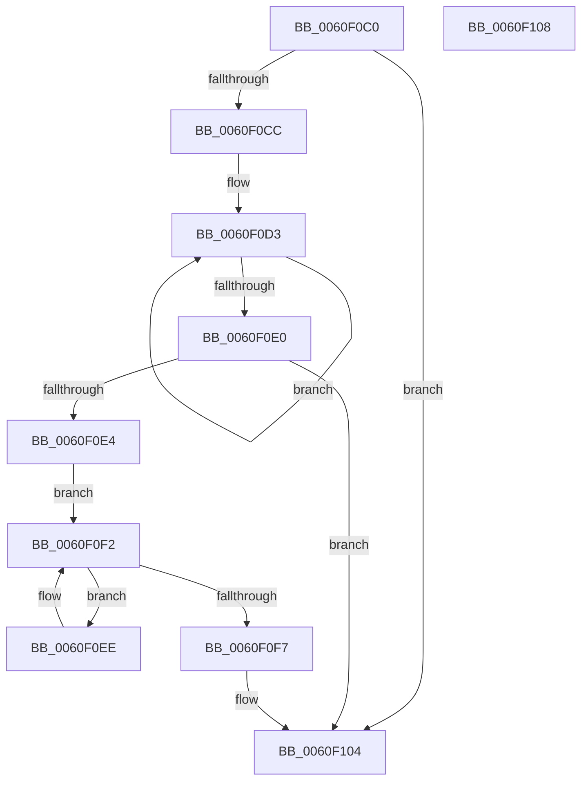

# StEtaStartRefresh

- RVA: `0x0060F0C0`–`0x0060F109` (길이 `73` bytes)
- VA: `0x000000014060F0C0`
- 실행 섹션: `.text`
- PDB 이름 있음: `예`; PDB Function 태그: `아니요`
- unwind 정보 RVA: `0x000DB714`
- 디코드: `23`개 명령, `73/73` bytes 표시
- 미해석 바이트: `0` (있으면 어셈블리에 `.byte`로 보존)

> 이 문서는 커널 이미지의 기계어와 PDB 기호를 분석해 생성했습니다. 4번과 5번은 함수 원형과 자료형을 바이너리 사용 방식에서 추정한 C 해석이며 원본 소스 복구 결과는 아닙니다.

## 1. Dependencies

- 직접 호출 지점: **0**; 고유 호출 대상: **0**
- 직접 호출자로 확인된 함수: **1**
- RIP 상대 이미지 참조: **0**

### Outgoing calls
- 직접 디코드된 call 명령이 없습니다.

### Direct callers
- [ST_STORE&lt;SM_TRAITS&gt;::StDmEtaRefresh](../4D/ST_STORE_SM_TRAITS_StDmEtaRefresh_function_004D71BC.md) at `0x004D723F`

### Static image references
- 디코드된 RIP-relative 메모리 참조가 없습니다.

## 2. Other-region calls and transfers

- 다른 실행 섹션으로 향하는 call: **0**
- 별도 외부 분기/꼬리 이동을 확인하지 못했습니다.

## 3. Assembly (complete function range)

```asm
0060F0C0  45 33 C9                        xor r9d, r9d
0060F0C3  4C 8B D1                        mov r10, rcx
0060F0C6  44 39 49 08                     cmp dword ptr [rcx + 8], r9d
0060F0CA  7F 38                           jg 0x14060f104
0060F0CC  0F 0D 49 30                     prefetchw byte ptr [rcx + 0x30]
0060F0D0  8B 41 30                        mov eax, dword ptr [rcx + 0x30]
0060F0D3  8B C8                           mov ecx, eax
0060F0D5  83 C9 01                        or ecx, 1
0060F0D8  F0 41 0F B1 4A 30               lock cmpxchg dword ptr [r10 + 0x30], ecx
0060F0DE  75 F3                           jne 0x14060f0d3
0060F0E0  A8 01                           test al, 1
0060F0E2  75 20                           jne 0x14060f104
0060F0E4  48 63 C2                        movsxd rax, edx
0060F0E7  49 8B 4C C2 10                  mov rcx, qword ptr [r10 + rax*8 + 0x10]
0060F0EC  EB 04                           jmp 0x14060f0f2
0060F0EE  48 83 C1 20                     add rcx, 0x20
0060F0F2  44 39 01                        cmp dword ptr [rcx], r8d
0060F0F5  72 F7                           jb 0x14060f0ee
0060F0F7  C7 41 04 70 00 00 00            mov dword ptr [rcx + 4], 0x70
0060F0FE  41 B9 01 00 00 00               mov r9d, 1
0060F104  41 8B C1                        mov eax, r9d
0060F107  C3                              ret
0060F108  CC                              int3
```

## 4. C-style interpretation (structured pseudocode)

```c
__int64 __fastcall StEtaStartRefresh(__int64 a1, int a2, int a3, int a4)
{
    a4 = 0;
    if ((*(unsigned int *)(a1 + 8)) > 0) goto loc_0060F104;
loc_0060F0D3:
    a1 = (unsigned int)(((unsigned int)((unsigned int)((unsigned int)(*(unsigned int *)(a1 + 48))))) | (1));
    if (condition_is_not_equal) goto loc_0060F0D3;
    if ((((unsigned __int8)((unsigned int)(*(unsigned int *)(a1 + 48)))) & (1)) != 0) goto loc_0060F104;
    goto loc_0060F0F2;
loc_0060F0EE:
    a1 = (*(unsigned __int64 *)(a1 + (int)(a2) * 8 + 16)) + (32);
loc_0060F0F2:
    if ((*(unsigned int *)(a1)) < a3) goto loc_0060F0EE;
    *(unsigned int *)(a1 + 4) = 112;
loc_0060F104:
    return 1;
}
```

## 5. (Beta) C Style

```c
int64_t StEtaStartRefresh(void *Arg1, int32_t Arg2, int32_t Arg3, int32_t Arg4)
{
    uint8_t *arg1 = (uint8_t *)Arg1;

    Arg4 = 0;
    if ((*(uint32_t *)(arg1 + 0x8)) > 0) goto loc_0060F104;
loc_0060F0D3:
    Arg1 = (uint32_t)(((uint32_t)((uint32_t)((uint32_t)(*(uint32_t *)(arg1 + 0x30))))) | (1));
    if (condition_is_not_equal) goto loc_0060F0D3;
    if ((((uint8_t)((uint32_t)(*(uint32_t *)(arg1 + 0x30)))) & (1)) != 0) goto loc_0060F104;
    goto loc_0060F0F2;
loc_0060F0EE:
    Arg1 = (*(uint64_t *)(arg1 + (int32_t)(Arg2) * 8 + 0x10)) + (32);
loc_0060F0F2:
    if ((*(uint32_t *)(arg1)) < Arg3) goto loc_0060F0EE;
    *(uint32_t *)(arg1 + 0x4) = 112;
loc_0060F104:
    return 1;
}
```

### 관측된 메모리 오프셋

구조체 형식이 확인되지 않은 접근은 인자 기준의 오프셋으로만 기록했습니다.

| 기준 인자 | 오프셋 표현 | 폭 (bit) | 접근 |
|---|---:|---:|---|
| `Arg1` | `+ 0x8` | `32` | `R` |
| `Arg1` | `+ 0x10 + rax*8` | `64` | `R` |
| `Arg1` | `+ 0x30` | `8` | `R` |
| `Arg1` | `+ 0x30` | `32` | `R` |

## 6. Execution-region graph

[열기: 2D/3D 그래프와 함수 탐색 컨트롤 패널](../../../control-panel.html?section=text&rva=0x0060F0C0&view=graph)

- 2D 그래프는 위에서 아래로 흐르고, 3D 그래프는 빈 공간을 드래그해 회전합니다. Shift+드래그는 이동, 휠은 확대·축소, 함수 노드 선택은 대상 보고서 이동입니다.

### Static fallback


