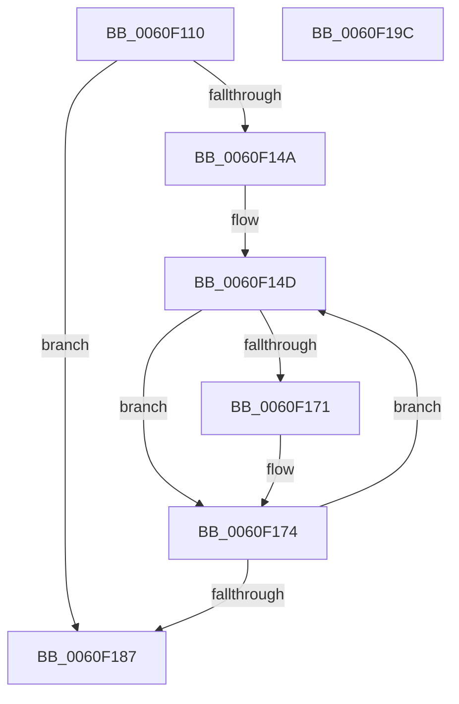

# StLcBucketsCopy

- RVA: `0x0060F110`–`0x0060F19D` (길이 `141` bytes)
- VA: `0x000000014060F110`
- 실행 섹션: `.text`
- PDB 이름 있음: `예`; PDB Function 태그: `아니요`
- unwind 정보 RVA: `0x00066400`
- 디코드: `43`개 명령, `141/141` bytes 표시
- 미해석 바이트: `0` (있으면 어셈블리에 `.byte`로 보존)

> 이 문서는 커널 이미지의 기계어와 PDB 기호를 분석해 생성했습니다. 4번과 5번은 함수 원형과 자료형을 바이너리 사용 방식에서 추정한 C 해석이며 원본 소스 복구 결과는 아닙니다.

## 1. Dependencies

- 직접 호출 지점: **1**; 고유 호출 대상: **1**
- 직접 호출자로 확인된 함수: **2**
- RIP 상대 이미지 참조: **0**

### Outgoing calls
- `0x0060F141` → [KeQueryPerformanceCounter](../37/KeQueryPerformanceCounter_function_0037E7E0.md) (function, `0x0037E7E0`)

### Direct callers
- [ST_STORE&lt;SM_TRAITS&gt;::StGetStatsWorker](../43/ST_STORE_SM_TRAITS_StGetStatsWorker_function_00433C80.md) at `0x00433EFF`
- [SMKM_STORE&lt;SM_TRAITS&gt;::SmStEtwFillStoreStatsEvent](../61/SMKM_STORE_SM_TRAITS_SmStEtwFillStoreStatsEvent_function_006109A4.md) at `0x00610A57`

### Static image references
- 디코드된 RIP-relative 메모리 참조가 없습니다.

## 2. Other-region calls and transfers

- 다른 실행 섹션으로 향하는 call: **0**
- 별도 외부 분기/꼬리 이동을 확인하지 못했습니다.

## 3. Assembly (complete function range)

```asm
0060F110  48 8B C4                        mov rax, rsp
0060F113  48 89 58 08                     mov qword ptr [rax + 8], rbx
0060F117  48 89 68 10                     mov qword ptr [rax + 0x10], rbp
0060F11B  48 89 70 18                     mov qword ptr [rax + 0x18], rsi
0060F11F  57                              push rdi
0060F120  48 83 EC 30                     sub rsp, 0x30
0060F124  48 83 60 E8 00                  and qword ptr [rax - 0x18], 0
0060F129  BD 08 00 00 00                  mov ebp, 8
0060F12E  44 3B CD                        cmp r9d, ebp
0060F131  41 8B F1                        mov esi, r9d
0060F134  48 8B D9                        mov rbx, rcx
0060F137  49 8B F8                        mov rdi, r8
0060F13A  48 8D 48 E8                     lea rcx, [rax - 0x18]
0060F13E  0F 47 F5                        cmova esi, ebp
0060F141  E8 9A F6 D6 FF                  call 0x14037e7e0
0060F146  85 F6                           test esi, esi
0060F148  74 3D                           je 0x14060f187
0060F14A  44 8B C6                        mov r8d, esi
0060F14D  48 69 07 40 42 0F 00            imul rax, qword ptr [rdi], 0xf4240
0060F154  48 99                           cqo
0060F156  48 F7 7C 24 20                  idiv qword ptr [rsp + 0x20]
0060F15B  8D 48 09                        lea ecx, [rax + 9]
0060F15E  B8 CD CC CC CC                  mov eax, 0xcccccccd
0060F163  F7 E1                           mul ecx
0060F165  C1 EA 03                        shr edx, 3
0060F168  8D 04 92                        lea eax, [rdx + rdx*4]
0060F16B  03 C0                           add eax, eax
0060F16D  89 03                           mov dword ptr [rbx], eax
0060F16F  75 03                           jne 0x14060f174
0060F171  83 0B FF                        or dword ptr [rbx], 0xffffffff
0060F174  8B 47 08                        mov eax, dword ptr [rdi + 8]
0060F177  48 83 C7 10                     add rdi, 0x10
0060F17B  89 43 04                        mov dword ptr [rbx + 4], eax
0060F17E  48 03 DD                        add rbx, rbp
0060F181  49 83 E8 01                     sub r8, 1
0060F185  75 C6                           jne 0x14060f14d
0060F187  48 8B 5C 24 40                  mov rbx, qword ptr [rsp + 0x40]
0060F18C  48 8B 6C 24 48                  mov rbp, qword ptr [rsp + 0x48]
0060F191  48 8B 74 24 50                  mov rsi, qword ptr [rsp + 0x50]
0060F196  48 83 C4 30                     add rsp, 0x30
0060F19A  5F                              pop rdi
0060F19B  C3                              ret
0060F19C  CC                              int3
```

## 4. C-style interpretation (structured pseudocode)

```c
__int64 __fastcall StLcBucketsCopy(__int64 a1, int a2, __int64 a3, int a4)
{
    __int64 result;
    __int64 v_rbx;
    __int64 v_rdi;
    __int64 v_rsi;
    __int64 v_rsp;
    unsigned __int64 v_stack_m18;
    unsigned __int64 v_stack_p10;
    unsigned __int64 v_stack_p18;
    unsigned __int64 v_stack_p8;

    *(unsigned __int64 *)(v_rsp + 8) = v_rbx;
    *(unsigned __int64 *)(v_rsp + 16) = v_rbp;
    *(unsigned __int64 *)(v_rsp + 24) = v_rsi;
    v_rsp = (v_rsp) - (48);
    v_rsi = (unsigned int)(a4);
    if (a4 > 8) { v_rsi = 8; }
    result = KeQueryPerformanceCounter(v_rsp - 24, a2, a3, a4);
    if ((unsigned int)(v_rsi) == 0) goto loc_0060F187;
loc_0060F14D:
    result = (result) * (*(unsigned __int64 *)(a3));
    a2 = (unsigned int)((a2) >> (3));
    result = (unsigned int)((a2 + a2 * 4) + ((unsigned int)(a2 + a2 * 4)));
    *(unsigned int *)(a1) = (unsigned int)(result);
    if (!(condition_is_not_equal)) {
    }
    v_rdi = (a3) + (16);
    *(unsigned int *)(a1 + 4) = (unsigned int)((unsigned int)(*(unsigned int *)(a3 + 8)));
    v_rbx = (a1) + (8);
    a3 = ((unsigned int)((unsigned int)(v_rsi))) - (1);
    if (condition_is_not_equal) goto loc_0060F14D;
loc_0060F187:
    v_rsp = (v_rsp) + (48);
    return (unsigned int)(*(unsigned int *)(a3 + 8));
}
```

## 5. (Beta) C Style

```c
int64_t StLcBucketsCopy(void *Arg1, int32_t Arg2, void *Arg3, int32_t Arg4)
{
    uint8_t *arg1 = (uint8_t *)Arg1;
    uint8_t *arg3 = (uint8_t *)Arg3;

    int64_t result;
    int64_t local_rbx;
    int64_t local_rdi;
    int64_t local_rsi;
    int64_t local_rsp;
    uint64_t v_stack_m18;
    uint64_t v_stack_p10;
    uint64_t v_stack_p18;
    uint64_t v_stack_p8;

    *(uint64_t *)(local_rsp + 0x8) = local_rbx;
    *(uint64_t *)(local_rsp + 0x10) = local_rbp;
    *(uint64_t *)(local_rsp + 0x18) = local_rsi;
    local_rsp = (local_rsp) - (48);
    local_rsi = (uint32_t)(Arg4);
    if (Arg4 > 8) { local_rsi = 8; }
    result = KeQueryPerformanceCounter(local_rsp - 24, Arg2, Arg3, Arg4);
    if ((uint32_t)(local_rsi) == 0) goto loc_0060F187;
loc_0060F14D:
    result = (result) * (*(uint64_t *)(arg3));
    Arg2 = (uint32_t)((Arg2) >> (3));
    result = (uint32_t)((Arg2 + Arg2 * 4) + ((uint32_t)(Arg2 + Arg2 * 4)));
    *(uint32_t *)(arg1) = (uint32_t)(result);
    if (!(condition_is_not_equal)) {
    }
    local_rdi = (Arg3) + (16);
    *(uint32_t *)(arg1 + 0x4) = (uint32_t)((uint32_t)(*(uint32_t *)(arg3 + 0x8)));
    local_rbx = (Arg1) + (8);
    Arg3 = ((uint32_t)((uint32_t)(local_rsi))) - (1);
    if (condition_is_not_equal) goto loc_0060F14D;
loc_0060F187:
    local_rsp = (local_rsp) + (48);
    return (uint32_t)(*(uint32_t *)(arg3 + 0x8));
}
```

### 관측된 메모리 오프셋

구조체 형식이 확인되지 않은 접근은 인자 기준의 오프셋으로만 기록했습니다.

| 기준 인자 | 오프셋 표현 | 폭 (bit) | 접근 |
|---|---:|---:|---|
| `Arg1` | `+ 0x0` | `32` | `R/W` |
| `Arg1` | `+ 0x0` | `32` | `W` |
| `Arg1` | `+ 0x4` | `32` | `W` |
| `Arg3` | `+ 0x0` | `64` | `R` |
| `Arg3` | `+ 0x8` | `32` | `R` |

## 6. Execution-region graph

[열기: 2D/3D 그래프와 함수 탐색 컨트롤 패널](../../../control-panel.html?section=text&rva=0x0060F110&view=graph)

- 2D 그래프는 위에서 아래로 흐르고, 3D 그래프는 빈 공간을 드래그해 회전합니다. Shift+드래그는 이동, 휠은 확대·축소, 함수 노드 선택은 대상 보고서 이동입니다.

### Static fallback


