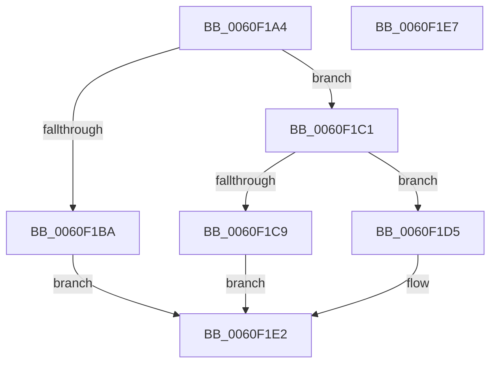

# StringCbCopyNW

- RVA: `0x0060F1A4`–`0x0060F1E8` (길이 `68` bytes)
- VA: `0x000000014060F1A4`
- 실행 섹션: `.text`
- PDB 이름 있음: `예`; PDB Function 태그: `아니요`
- unwind 정보 RVA: `0x0005D2F4`
- 디코드: `21`개 명령, `68/68` bytes 표시
- 미해석 바이트: `0` (있으면 어셈블리에 `.byte`로 보존)

> 이 문서는 커널 이미지의 기계어와 PDB 기호를 분석해 생성했습니다. 4번과 5번은 함수 원형과 자료형을 바이너리 사용 방식에서 추정한 C 해석이며 원본 소스 복구 결과는 아닙니다.

## 1. Dependencies

- 직접 호출 지점: **1**; 고유 호출 대상: **1**
- 직접 호출자로 확인된 함수: **1**
- RIP 상대 이미지 참조: **0**

### Outgoing calls
- `0x0060F1DD` → [StringCopyWorkerW](StringCopyWorkerW_function_0060F1F0.md) (function, `0x0060F1F0`)

### Direct callers
- [SmUniqueIdParseProductName](SmUniqueIdParseProductName_function_0060ECC0.md) at `0x0060ED3D`
- [SmUniqueIdParseProductName](SmUniqueIdParseProductName_function_0060ECC0.md) at `0x0060EDFB`

### Static image references
- 디코드된 RIP-relative 메모리 참조가 없습니다.

## 2. Other-region calls and transfers

- 다른 실행 섹션으로 향하는 call: **0**
- 별도 외부 분기/꼬리 이동을 확인하지 못했습니다.

## 3. Assembly (complete function range)

```asm
0060F1A4  48 83 EC 38                     sub rsp, 0x38
0060F1A8  48 D1 EA                        shr rdx, 1
0060F1AB  41 BA FE FF FF 7F               mov r10d, 0x7ffffffe
0060F1B1  48 8D 42 FF                     lea rax, [rdx - 1]
0060F1B5  49 3B C2                        cmp rax, r10
0060F1B8  76 07                           jbe 0x14060f1c1
0060F1BA  B8 57 00 07 80                  mov eax, 0x80070057
0060F1BF  EB 21                           jmp 0x14060f1e2
0060F1C1  49 D1 E9                        shr r9, 1
0060F1C4  4D 3B CA                        cmp r9, r10
0060F1C7  76 0C                           jbe 0x14060f1d5
0060F1C9  33 D2                           xor edx, edx
0060F1CB  B8 57 00 07 80                  mov eax, 0x80070057
0060F1D0  66 89 11                        mov word ptr [rcx], dx
0060F1D3  EB 0D                           jmp 0x14060f1e2
0060F1D5  4C 89 4C 24 20                  mov qword ptr [rsp + 0x20], r9
0060F1DA  4D 8B C8                        mov r9, r8
0060F1DD  E8 0E 00 00 00                  call 0x14060f1f0
0060F1E2  48 83 C4 38                     add rsp, 0x38
0060F1E6  C3                              ret
0060F1E7  CC                              int3
```

## 4. C-style interpretation (structured pseudocode)

```c
__int64 __fastcall StringCbCopyNW(__int64 a1, __int64 a2, __int64 a3, __int64 a4)
{
    __int64 result;
    __int64 v_rsp;
    unsigned __int64 v_stack_m18;

    v_rsp = (v_rsp) - (56);
    a2 = (a2) >> (1);
    if ((a2 - 1) <= ((unsigned int)(0x7FFFFFFEULL))) goto loc_0060F1C1;
    goto loc_0060F1E2;
loc_0060F1C1:
    a4 = (a4) >> (1);
    if (a4 <= ((unsigned int)(0x7FFFFFFEULL))) goto loc_0060F1D5;
    a2 = 0;
    *(unsigned __int16 *)(a1) = 0;
    goto loc_0060F1E2;
loc_0060F1D5:
    v_stack_m18 = a4;
    result = StringCopyWorkerW(a1, a2, a3, a3);
loc_0060F1E2:
    v_rsp = (v_rsp) + (56);
    return result;
}
```

## 5. (Beta) C Style

```c
int64_t StringCbCopyNW(void *Arg1, int64_t Arg2, int64_t Arg3, int64_t Arg4)
{
    uint8_t *arg1 = (uint8_t *)Arg1;

    int64_t result;
    int64_t local_rsp;
    uint64_t v_stack_m18;

    local_rsp = (local_rsp) - (56);
    Arg2 = (Arg2) >> (1);
    if ((Arg2 - 1) <= ((uint32_t)(0x7FFFFFFEULL))) goto loc_0060F1C1;
    goto loc_0060F1E2;
loc_0060F1C1:
    Arg4 = (Arg4) >> (1);
    if (Arg4 <= ((uint32_t)(0x7FFFFFFEULL))) goto loc_0060F1D5;
    Arg2 = 0;
    *(uint16_t *)(arg1) = 0;
    goto loc_0060F1E2;
loc_0060F1D5:
    v_stack_m18 = Arg4;
    result = StringCopyWorkerW(Arg1, Arg2, Arg3, Arg3);
loc_0060F1E2:
    local_rsp = (local_rsp) + (56);
    return result;
}
```

### 관측된 메모리 오프셋

구조체 형식이 확인되지 않은 접근은 인자 기준의 오프셋으로만 기록했습니다.

| 기준 인자 | 오프셋 표현 | 폭 (bit) | 접근 |
|---|---:|---:|---|
| `Arg1` | `+ 0x0` | `16` | `W` |

## 6. Execution-region graph

[열기: 2D/3D 그래프와 함수 탐색 컨트롤 패널](../../../control-panel.html?section=text&rva=0x0060F1A4&view=graph)

- 2D 그래프는 위에서 아래로 흐르고, 3D 그래프는 빈 공간을 드래그해 회전합니다. Shift+드래그는 이동, 휠은 확대·축소, 함수 노드 선택은 대상 보고서 이동입니다.

### Static fallback


