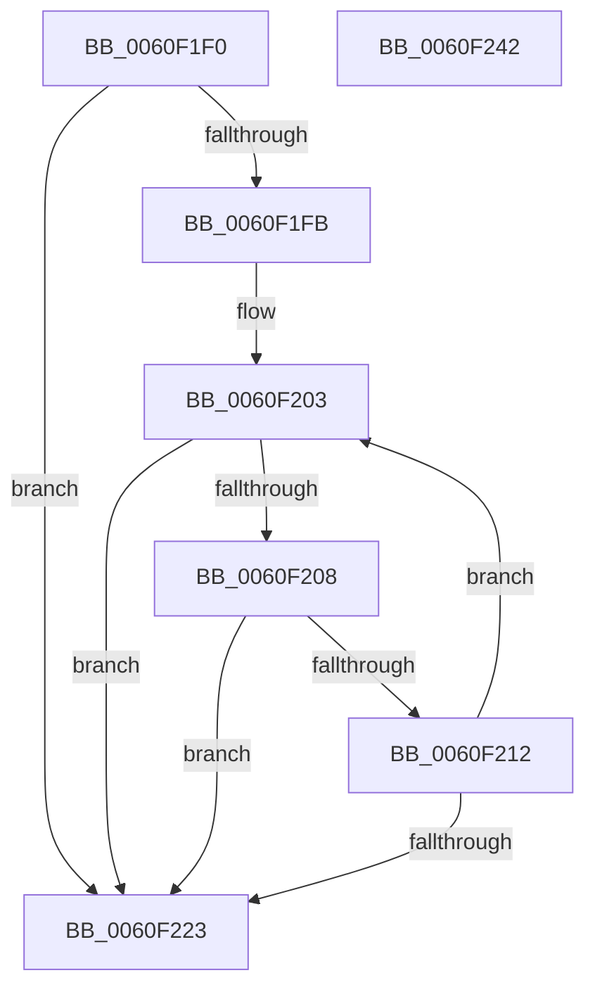

# StringCopyWorkerW

- RVA: `0x0060F1F0`–`0x0060F243` (길이 `83` bytes)
- VA: `0x000000014060F1F0`
- 실행 섹션: `.text`
- PDB 이름 있음: `예`; PDB Function 태그: `예`
- unwind 정보 RVA: `0x000DB714`
- 디코드: `27`개 명령, `83/83` bytes 표시
- 미해석 바이트: `0` (있으면 어셈블리에 `.byte`로 보존)

> 이 문서는 커널 이미지의 기계어와 PDB 기호를 분석해 생성했습니다. 4번과 5번은 함수 원형과 자료형을 바이너리 사용 방식에서 추정한 C 해석이며 원본 소스 복구 결과는 아닙니다.

## 1. Dependencies

- 직접 호출 지점: **0**; 고유 호출 대상: **0**
- 직접 호출자로 확인된 함수: **2**
- RIP 상대 이미지 참조: **0**

### Outgoing calls
- 직접 디코드된 call 명령이 없습니다.

### Direct callers
- [SmUniqueIdParseProductName](SmUniqueIdParseProductName_function_0060ECC0.md) at `0x0060ED99`
- [StringCbCopyNW](StringCbCopyNW_function_0060F1A4.md) at `0x0060F1DD`

### Static image references
- 디코드된 RIP-relative 메모리 참조가 없습니다.

## 2. Other-region calls and transfers

- 다른 실행 섹션으로 향하는 call: **0**
- 별도 외부 분기/꼬리 이동을 확인하지 못했습니다.

## 3. Assembly (complete function range)

```asm
0060F1F0  45 33 D2                        xor r10d, r10d
0060F1F3  4C 8B C1                        mov r8, rcx
0060F1F6  48 85 D2                        test rdx, rdx
0060F1F9  74 28                           je 0x14060f223
0060F1FB  48 8B 44 24 28                  mov rax, qword ptr [rsp + 0x28]
0060F200  4C 2B C9                        sub r9, rcx
0060F203  48 85 C0                        test rax, rax
0060F206  74 1B                           je 0x14060f223
0060F208  43 0F B7 0C 01                  movzx ecx, word ptr [r9 + r8]
0060F20D  66 85 C9                        test cx, cx
0060F210  74 11                           je 0x14060f223
0060F212  66 41 89 08                     mov word ptr [r8], cx
0060F216  48 FF C8                        dec rax
0060F219  49 83 C0 02                     add r8, 2
0060F21D  48 83 EA 01                     sub rdx, 1
0060F221  75 E0                           jne 0x14060f203
0060F223  48 8B C2                        mov rax, rdx
0060F226  49 8D 48 FE                     lea rcx, [r8 - 2]
0060F22A  48 F7 D8                        neg rax
0060F22D  1B C0                           sbb eax, eax
0060F22F  F7 D0                           not eax
0060F231  25 7A 00 07 80                  and eax, 0x8007007a
0060F236  48 85 D2                        test rdx, rdx
0060F239  49 0F 45 C8                     cmovne rcx, r8
0060F23D  66 44 89 11                     mov word ptr [rcx], r10w
0060F241  C3                              ret
0060F242  CC                              int3
```

## 4. C-style interpretation (structured pseudocode)

```c
__int64 __fastcall StringCopyWorkerW(__int64 a1, __int64 a2, __int64 a3, __int64 a4, __int64 a5)
{
    __int64 result;
    __int64 v_r10;

    v_r10 = 0;
    if (a2 == 0) goto loc_0060F223;
    a4 = (a4) - (a1);
loc_0060F203:
    if (a5 == 0) goto loc_0060F223;
    if ((unsigned __int16)(*(unsigned __int16 *)(a4 + a1 * 1)) == 0) goto loc_0060F223;
    *(unsigned __int16 *)(a1) = (unsigned __int16)(*(unsigned __int16 *)(a4 + a1 * 1));
    result = (a5) - 1;
    a3 = (a1) + (2);
    a2 = (a2) - (1);
    if (condition_is_not_equal) goto loc_0060F203;
loc_0060F223:
    result = -(a2);
    result = (unsigned int)(~(result));
    result = (unsigned int)((result) & (0x8007007AULL));
    a1 = a3 - 2;
    if (a2 != 0) { a1 = a3; }
    *(unsigned __int16 *)(a1) = 0;
    return result;
}
```

## 5. (Beta) C Style

```c
int64_t StringCopyWorkerW(void *Arg1, int64_t Arg2, int64_t Arg3, void *Arg4, int64_t Arg5)
{
    uint8_t *arg1 = (uint8_t *)Arg1;
    uint8_t *arg4 = (uint8_t *)Arg4;

    int64_t result;
    int64_t local_r10;

    local_r10 = 0;
    if (Arg2 == 0) goto loc_0060F223;
    Arg4 = (Arg4) - (Arg1);
loc_0060F203:
    if (Arg5 == 0) goto loc_0060F223;
    if ((uint16_t)(*(uint16_t *)(arg4 + arg1 * 1)) == 0) goto loc_0060F223;
    *(uint16_t *)(arg1) = (uint16_t)(*(uint16_t *)(arg4 + arg1 * 1));
    result = (Arg5) - 1;
    Arg3 = (Arg1) + (2);
    Arg2 = (Arg2) - (1);
    if (condition_is_not_equal) goto loc_0060F203;
loc_0060F223:
    result = -(Arg2);
    result = (uint32_t)(~(result));
    result = (uint32_t)((result) & (0x8007007AULL));
    Arg1 = Arg3 - 2;
    if (Arg2 != 0) { Arg1 = Arg3; }
    *(uint16_t *)(arg1) = 0;
    return result;
}
```

### 관측된 메모리 오프셋

구조체 형식이 확인되지 않은 접근은 인자 기준의 오프셋으로만 기록했습니다.

| 기준 인자 | 오프셋 표현 | 폭 (bit) | 접근 |
|---|---:|---:|---|
| `Arg1` | `- 0x2` | `64` | `R` |
| `Arg1` | `+ 0x0` | `16` | `W` |
| `Arg4` | `+ 0x0 + r8*1` | `16` | `R` |

## 6. Execution-region graph

[열기: 2D/3D 그래프와 함수 탐색 컨트롤 패널](../../../control-panel.html?section=text&rva=0x0060F1F0&view=graph)

- 2D 그래프는 위에서 아래로 흐르고, 3D 그래프는 빈 공간을 드래그해 회전합니다. Shift+드래그는 이동, 휠은 확대·축소, 함수 노드 선택은 대상 보고서 이동입니다.

### Static fallback


