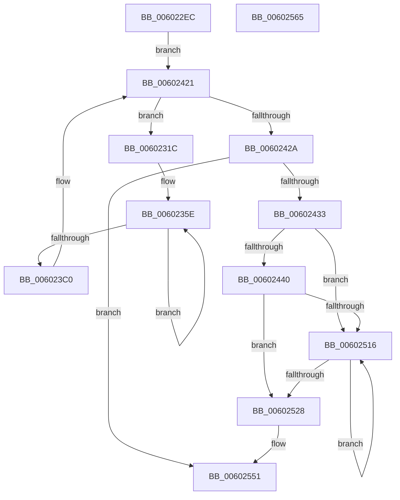

# adler32_simd_

- RVA: `0x006022EC`–`0x00602566` (길이 `634` bytes)
- VA: `0x00000001406022EC`
- 실행 섹션: `.text`
- PDB 이름 있음: `예`; PDB Function 태그: `아니요`
- unwind 정보 RVA: `0x000D054C`
- 디코드: `167`개 명령, `634/634` bytes 표시
- 미해석 바이트: `0` (있으면 어셈블리에 `.byte`로 보존)

> 이 문서는 커널 이미지의 기계어와 PDB 기호를 분석해 생성했습니다. 4번과 5번은 함수 원형과 자료형을 바이너리 사용 방식에서 추정한 C 해석이며 원본 소스 복구 결과는 아닙니다.

## 1. Dependencies

- 직접 호출 지점: **0**; 고유 호출 대상: **0**
- 직접 호출자로 확인된 함수: **1**
- RIP 상대 이미지 참조: **4**

### Outgoing calls
- 직접 디코드된 call 명령이 없습니다.

### Direct callers
- [adler32_z](adler32_z_function_00600344.md) at `0x0060035F`

### Static image references
- `0x00602346` → RVA `0x00010400` (`.rdata`; read)
- `0x00602375` → RVA `0x00042EF0` (`.rdata`; read)
- `0x00602382` → RVA `0x00042EE0` (`.rdata`; read)
- `0x0060239B` → RVA `0x00042EC0` (`.rdata`; read)

## 2. Other-region calls and transfers

- 다른 실행 섹션으로 향하는 call: **0**
- 별도 외부 분기/꼬리 이동을 확인하지 못했습니다.

## 3. Assembly (complete function range)

```asm
006022EC  40 53                           push rbx
006022EE  48 83 EC 10                     sub rsp, 0x10
006022F2  44 8B D1                        mov r10d, ecx
006022F5  44 0F B7 C9                     movzx r9d, cx
006022F9  49 8B C8                        mov rcx, r8
006022FC  41 C1 EA 10                     shr r10d, 0x10
00602300  48 C1 E9 05                     shr rcx, 5
00602304  4C 8B DA                        mov r11, rdx
00602307  48 8B C1                        mov rax, rcx
0060230A  0F 29 34 24                     movaps xmmword ptr [rsp], xmm6
0060230E  48 C1 E0 05                     shl rax, 5
00602312  4C 2B C0                        sub r8, rax
00602315  33 DB                           xor ebx, ebx
00602317  E9 05 01 00 00                  jmp 0x140602421
0060231C  BA AD 00 00 00                  mov edx, 0xad
00602321  66 0F 6E C3                     movd xmm0, ebx
00602325  48 3B CA                        cmp rcx, rdx
00602328  66 41 0F 6E EA                  movd xmm5, r10d
0060232D  0F 57 F6                        xorps xmm6, xmm6
00602330  0F 42 D1                        cmovb edx, ecx
00602333  8B C2                           mov eax, edx
00602335  48 2B C8                        sub rcx, rax
00602338  8B C2                           mov eax, edx
0060233A  41 0F AF C1                     imul eax, r9d
0060233E  66 0F 6E E0                     movd xmm4, eax
00602342  66 0F 62 E0                     punpckldq xmm4, xmm0
00602346  66 0F 62 25 B2 E0 A0 FF         punpckldq xmm4, xmmword ptr [rip - 0x5f1f4e]
0060234E  66 0F 6E C3                     movd xmm0, ebx
00602352  66 0F 62 E8                     punpckldq xmm5, xmm0
00602356  66 0F 62 2D A2 E0 A0 FF         punpckldq xmm5, xmmword ptr [rip - 0x5f1f5e]
0060235E  F3 41 0F 6F 13                  movdqu xmm2, xmmword ptr [r11]
00602363  F3 41 0F 6F 5B 10               movdqu xmm3, xmmword ptr [r11 + 0x10]
00602369  49 83 C3 20                     add r11, 0x20
0060236D  66 0F 6F CA                     movdqa xmm1, xmm2
00602371  66 0F FE E6                     paddd xmm4, xmm6
00602375  66 0F 38 04 15 72 0B A4 FF      pmaddubsw xmm2, xmmword ptr [rip - 0x5bf48e]
0060237E  66 0F 6F C3                     movdqa xmm0, xmm3
00602382  66 0F 38 04 1D 55 0B A4 FF      pmaddubsw xmm3, xmmword ptr [rip - 0x5bf4ab]
0060238B  66 0F F6 0D 6D E0 A0 FF         psadbw xmm1, xmmword ptr [rip - 0x5f1f93]
00602393  66 0F F6 05 65 E0 A0 FF         psadbw xmm0, xmmword ptr [rip - 0x5f1f9b]
0060239B  66 0F F5 15 1D 0B A4 FF         pmaddwd xmm2, xmmword ptr [rip - 0x5bf4e3]
006023A3  66 0F F5 1D 15 0B A4 FF         pmaddwd xmm3, xmmword ptr [rip - 0x5bf4eb]
006023AB  66 0F FE F1                     paddd xmm6, xmm1
006023AF  66 0F FE F0                     paddd xmm6, xmm0
006023B3  66 0F FE EA                     paddd xmm5, xmm2
006023B7  66 0F FE EB                     paddd xmm5, xmm3
006023BB  83 C2 FF                        add edx, -1
006023BE  75 9E                           jne 0x14060235e
006023C0  66 0F 70 CE B1                  pshufd xmm1, xmm6, 0xb1
006023C5  66 0F FE CE                     paddd xmm1, xmm6
006023C9  66 0F 72 F4 05                  pslld xmm4, 5
006023CE  66 0F 70 C1 4E                  pshufd xmm0, xmm1, 0x4e
006023D3  66 0F FE E5                     paddd xmm4, xmm5
006023D7  66 0F FE C1                     paddd xmm0, xmm1
006023DB  66 0F 70 CC B1                  pshufd xmm1, xmm4, 0xb1
006023E0  66 0F 7E C0                     movd eax, xmm0
006023E4  66 0F FE CC                     paddd xmm1, xmm4
006023E8  66 0F 70 C1 4E                  pshufd xmm0, xmm1, 0x4e
006023ED  66 0F FE C1                     paddd xmm0, xmm1
006023F1  44 03 C8                        add r9d, eax
006023F4  66 41 0F 7E C2                  movd r10d, xmm0
006023F9  B8 71 80 07 80                  mov eax, 0x80078071
006023FE  41 F7 E1                        mul r9d
00602401  C1 EA 0F                        shr edx, 0xf
00602404  69 C2 0F 00 FF FF               imul eax, edx, 0xffff000f
0060240A  44 03 C8                        add r9d, eax
0060240D  B8 71 80 07 80                  mov eax, 0x80078071
00602412  41 F7 E2                        mul r10d
00602415  C1 EA 0F                        shr edx, 0xf
00602418  69 C2 0F 00 FF FF               imul eax, edx, 0xffff000f
0060241E  44 03 D0                        add r10d, eax
00602421  48 85 C9                        test rcx, rcx
00602424  0F 85 F2 FE FF FF               jne 0x14060231c
0060242A  4D 85 C0                        test r8, r8
0060242D  0F 84 1E 01 00 00               je 0x140602551
00602433  8D 51 01                        lea edx, [rcx + 1]
00602436  49 83 F8 10                     cmp r8, 0x10
0060243A  0F 82 D6 00 00 00               jb 0x140602516
00602440  41 0F B6 03                     movzx eax, byte ptr [r11]
00602444  4C 03 DA                        add r11, rdx
00602447  44 03 C8                        add r9d, eax
0060244A  45 03 D1                        add r10d, r9d
0060244D  41 0F B6 03                     movzx eax, byte ptr [r11]
00602451  4C 03 DA                        add r11, rdx
00602454  44 03 C8                        add r9d, eax
00602457  45 03 D1                        add r10d, r9d
0060245A  41 0F B6 03                     movzx eax, byte ptr [r11]
0060245E  4C 03 DA                        add r11, rdx
00602461  44 03 C8                        add r9d, eax
00602464  45 03 D1                        add r10d, r9d
00602467  41 0F B6 03                     movzx eax, byte ptr [r11]
0060246B  4C 03 DA                        add r11, rdx
0060246E  44 03 C8                        add r9d, eax
00602471  45 03 D1                        add r10d, r9d
00602474  41 0F B6 03                     movzx eax, byte ptr [r11]
00602478  4C 03 DA                        add r11, rdx
0060247B  44 03 C8                        add r9d, eax
0060247E  45 03 D1                        add r10d, r9d
00602481  41 0F B6 03                     movzx eax, byte ptr [r11]
00602485  4C 03 DA                        add r11, rdx
00602488  44 03 C8                        add r9d, eax
0060248B  45 03 D1                        add r10d, r9d
0060248E  41 0F B6 03                     movzx eax, byte ptr [r11]
00602492  4C 03 DA                        add r11, rdx
00602495  44 03 C8                        add r9d, eax
00602498  45 03 D1                        add r10d, r9d
0060249B  41 0F B6 03                     movzx eax, byte ptr [r11]
0060249F  4C 03 DA                        add r11, rdx
006024A2  44 03 C8                        add r9d, eax
006024A5  45 03 D1                        add r10d, r9d
006024A8  41 0F B6 03                     movzx eax, byte ptr [r11]
006024AC  4C 03 DA                        add r11, rdx
006024AF  44 03 C8                        add r9d, eax
006024B2  45 03 D1                        add r10d, r9d
006024B5  41 0F B6 03                     movzx eax, byte ptr [r11]
006024B9  4C 03 DA                        add r11, rdx
006024BC  44 03 C8                        add r9d, eax
006024BF  45 03 D1                        add r10d, r9d
006024C2  41 0F B6 03                     movzx eax, byte ptr [r11]
006024C6  4C 03 DA                        add r11, rdx
006024C9  44 03 C8                        add r9d, eax
006024CC  45 03 D1                        add r10d, r9d
006024CF  41 0F B6 03                     movzx eax, byte ptr [r11]
006024D3  4C 03 DA                        add r11, rdx
006024D6  44 03 C8                        add r9d, eax
006024D9  45 03 D1                        add r10d, r9d
006024DC  41 0F B6 03                     movzx eax, byte ptr [r11]
006024E0  4C 03 DA                        add r11, rdx
006024E3  44 03 C8                        add r9d, eax
006024E6  45 03 D1                        add r10d, r9d
006024E9  41 0F B6 03                     movzx eax, byte ptr [r11]
006024ED  4C 03 DA                        add r11, rdx
006024F0  44 03 C8                        add r9d, eax
006024F3  45 03 D1                        add r10d, r9d
006024F6  41 0F B6 03                     movzx eax, byte ptr [r11]
006024FA  4C 03 DA                        add r11, rdx
006024FD  44 03 C8                        add r9d, eax
00602500  45 03 D1                        add r10d, r9d
00602503  41 0F B6 03                     movzx eax, byte ptr [r11]
00602507  4C 03 DA                        add r11, rdx
0060250A  44 03 C8                        add r9d, eax
0060250D  45 03 D1                        add r10d, r9d
00602510  49 83 E8 10                     sub r8, 0x10
00602514  74 12                           je 0x140602528
00602516  41 0F B6 0B                     movzx ecx, byte ptr [r11]
0060251A  4C 03 DA                        add r11, rdx
0060251D  44 03 C9                        add r9d, ecx
00602520  45 03 D1                        add r10d, r9d
00602523  4C 2B C2                        sub r8, rdx
00602526  75 EE                           jne 0x140602516
00602528  B8 71 80 07 80                  mov eax, 0x80078071
0060252D  41 F7 E2                        mul r10d
00602530  C1 EA 0F                        shr edx, 0xf
00602533  69 C2 0F 00 FF FF               imul eax, edx, 0xffff000f
00602539  44 03 D0                        add r10d, eax
0060253C  41 8D 81 0F 00 FF FF            lea eax, [r9 - 0xfff1]
00602543  41 81 F9 F1 FF 00 00            cmp r9d, 0xfff1
0060254A  41 0F 42 C1                     cmovb eax, r9d
0060254E  44 8B C8                        mov r9d, eax
00602551  0F 28 34 24                     movaps xmm6, xmmword ptr [rsp]
00602555  41 C1 E2 10                     shl r10d, 0x10
00602559  45 0B D1                        or r10d, r9d
0060255C  41 8B C2                        mov eax, r10d
0060255F  48 83 C4 10                     add rsp, 0x10
00602563  5B                              pop rbx
00602564  C3                              ret
00602565  CC                              int3
```

## 4. C-style interpretation (structured pseudocode)

```c
__int64 __fastcall adler32_simd_(int a1, __int64 a2, __int64 a3)
{
    __int64 result;
    __int64 v_r10;
    __int64 v_r11;
    __int64 v_rbx;
    __int64 v_rsp;
    unsigned __int64 v_stack_m18;

    v_rsp = (v_rsp) - (16);
    v_r10 = (unsigned int)(((unsigned int)(a1)) >> (16));
    a1 = (a3) >> (5);
    v_stack_m18 = v_xmm6;
    result = (a1) << (5);
    a3 = (a3) - (result);
    v_rbx = 0;
    goto loc_00602421;
loc_0060231C:
    a2 = 173;
    if (a1 < 173) { a2 = a1; }
    a1 = (a1) - ((unsigned int)((unsigned int)(a2)));
    result = (unsigned int)(((unsigned int)((unsigned int)(a2))) * ((unsigned int)((unsigned __int16)(a1))));
loc_0060235E:
    v_r11 = (a2) + (32);
    a2 = (unsigned int)((a2) + (-1));
    if (condition_is_not_equal) goto loc_0060235E;
    a4 = (unsigned int)(((unsigned __int16)(a1)) + ((unsigned int)(result)));
    a2 = (unsigned int)((a2) >> (15));
    result = (unsigned int)(((unsigned int)(0x80078071ULL)) * ((unsigned int)(a2)));
    a4 = (unsigned int)((a4) + ((unsigned int)(result)));
    a2 = (unsigned int)((a2) >> (15));
    result = (unsigned int)(((unsigned int)(0x80078071ULL)) * ((unsigned int)(a2)));
    v_r10 = (unsigned int)((v_r10) + ((unsigned int)(result)));
loc_00602421:
    if (a1 != 0) goto loc_0060231C;
    if (a3 == 0) goto loc_00602551;
    if (a3 < 16) goto loc_00602516;
    v_r11 = (v_r11) + (a1 + 1);
    a4 = (unsigned int)((a4) + ((unsigned int)(*(unsigned __int8 *)(v_r11))));
    v_r10 = (unsigned int)((v_r10) + ((unsigned int)(a4)));
    v_r11 = (v_r11) + (a1 + 1);
    a4 = (unsigned int)((a4) + ((unsigned int)(*(unsigned __int8 *)(v_r11))));
    v_r10 = (unsigned int)((v_r10) + ((unsigned int)(a4)));
    v_r11 = (v_r11) + (a1 + 1);
    a4 = (unsigned int)((a4) + ((unsigned int)(*(unsigned __int8 *)(v_r11))));
    v_r10 = (unsigned int)((v_r10) + ((unsigned int)(a4)));
    v_r11 = (v_r11) + (a1 + 1);
    a4 = (unsigned int)((a4) + ((unsigned int)(*(unsigned __int8 *)(v_r11))));
    v_r10 = (unsigned int)((v_r10) + ((unsigned int)(a4)));
    v_r11 = (v_r11) + (a1 + 1);
    a4 = (unsigned int)((a4) + ((unsigned int)(*(unsigned __int8 *)(v_r11))));
    v_r10 = (unsigned int)((v_r10) + ((unsigned int)(a4)));
    v_r11 = (v_r11) + (a1 + 1);
    a4 = (unsigned int)((a4) + ((unsigned int)(*(unsigned __int8 *)(v_r11))));
    v_r10 = (unsigned int)((v_r10) + ((unsigned int)(a4)));
    v_r11 = (v_r11) + (a1 + 1);
    a4 = (unsigned int)((a4) + ((unsigned int)(*(unsigned __int8 *)(v_r11))));
    v_r10 = (unsigned int)((v_r10) + ((unsigned int)(a4)));
    v_r11 = (v_r11) + (a1 + 1);
    a4 = (unsigned int)((a4) + ((unsigned int)(*(unsigned __int8 *)(v_r11))));
    v_r10 = (unsigned int)((v_r10) + ((unsigned int)(a4)));
    v_r11 = (v_r11) + (a1 + 1);
    a4 = (unsigned int)((a4) + ((unsigned int)(*(unsigned __int8 *)(v_r11))));
    v_r10 = (unsigned int)((v_r10) + ((unsigned int)(a4)));
    v_r11 = (v_r11) + (a1 + 1);
    a4 = (unsigned int)((a4) + ((unsigned int)(*(unsigned __int8 *)(v_r11))));
    v_r10 = (unsigned int)((v_r10) + ((unsigned int)(a4)));
    v_r11 = (v_r11) + (a1 + 1);
    a4 = (unsigned int)((a4) + ((unsigned int)(*(unsigned __int8 *)(v_r11))));
    v_r10 = (unsigned int)((v_r10) + ((unsigned int)(a4)));
    v_r11 = (v_r11) + (a1 + 1);
    a4 = (unsigned int)((a4) + ((unsigned int)(*(unsigned __int8 *)(v_r11))));
    v_r10 = (unsigned int)((v_r10) + ((unsigned int)(a4)));
    v_r11 = (v_r11) + (a1 + 1);
    a4 = (unsigned int)((a4) + ((unsigned int)(*(unsigned __int8 *)(v_r11))));
    v_r10 = (unsigned int)((v_r10) + ((unsigned int)(a4)));
    v_r11 = (v_r11) + (a1 + 1);
    a4 = (unsigned int)((a4) + ((unsigned int)(*(unsigned __int8 *)(v_r11))));
    v_r10 = (unsigned int)((v_r10) + ((unsigned int)(a4)));
    v_r11 = (v_r11) + (a1 + 1);
    a4 = (unsigned int)((a4) + ((unsigned int)(*(unsigned __int8 *)(v_r11))));
    v_r10 = (unsigned int)((v_r10) + ((unsigned int)(a4)));
    v_r11 = (v_r11) + (a1 + 1);
    a4 = (unsigned int)((a4) + ((unsigned int)(*(unsigned __int8 *)(v_r11))));
    v_r10 = (unsigned int)((v_r10) + ((unsigned int)(a4)));
    a3 = (a3) - (16);
    if (condition_is_equal) goto loc_00602528;
loc_00602516:
    v_r11 = (v_r11) + (a1 + 1);
    a4 = (unsigned int)((a4) + ((unsigned int)(*(unsigned __int8 *)(v_r11))));
    v_r10 = (unsigned int)((v_r10) + ((unsigned int)(a4)));
    a3 = (a3) - (a1 + 1);
    if (condition_is_not_equal) goto loc_00602516;
loc_00602528:
    a2 = (unsigned int)((a1 + 1) >> (15));
    result = (unsigned int)(((unsigned int)(0x80078071ULL)) * ((unsigned int)(a2)));
    v_r10 = (unsigned int)((v_r10) + ((unsigned int)(result)));
    result = a4 - 65521;
    if (((unsigned int)(a4)) < 0xFFF1ULL) { result = (unsigned int)(a4); }
loc_00602551:
    v_r10 = (unsigned int)((v_r10) << (16));
    v_r10 = (unsigned int)((v_r10) | ((unsigned int)((unsigned int)((unsigned int)(result)))));
    v_rsp = (v_rsp) + (16);
    return (unsigned int)((unsigned int)(v_r10));
}
```

## 5. (Beta) C Style

```c
int64_t adler32_simd_(int32_t Arg1, void *Arg2, int64_t Arg3)
{
    uint8_t *arg2 = (uint8_t *)Arg2;

    int64_t result;
    int64_t local_r10;
    int64_t local_r11;
    int64_t local_rbx;
    int64_t local_rsp;
    uint64_t v_stack_m18;

    local_rsp = (local_rsp) - (16);
    local_r10 = (uint32_t)(((uint32_t)(Arg1)) >> (16));
    Arg1 = (Arg3) >> (5);
    v_stack_m18 = v_xmm6;
    result = (Arg1) << (5);
    Arg3 = (Arg3) - (result);
    local_rbx = 0;
    goto loc_00602421;
loc_0060231C:
    Arg2 = 173;
    if (Arg1 < 173) { Arg2 = Arg1; }
    Arg1 = (Arg1) - ((uint32_t)((uint32_t)(Arg2)));
    result = (uint32_t)(((uint32_t)((uint32_t)(Arg2))) * ((uint32_t)((uint16_t)(Arg1))));
loc_0060235E:
    local_r11 = (Arg2) + (32);
    Arg2 = (uint32_t)((Arg2) + (-1));
    if (condition_is_not_equal) goto loc_0060235E;
    a4 = (uint32_t)(((uint16_t)(Arg1)) + ((uint32_t)(result)));
    Arg2 = (uint32_t)((Arg2) >> (15));
    result = (uint32_t)(((uint32_t)(0x80078071ULL)) * ((uint32_t)(Arg2)));
    a4 = (uint32_t)((a4) + ((uint32_t)(result)));
    Arg2 = (uint32_t)((Arg2) >> (15));
    result = (uint32_t)(((uint32_t)(0x80078071ULL)) * ((uint32_t)(Arg2)));
    local_r10 = (uint32_t)((local_r10) + ((uint32_t)(result)));
loc_00602421:
    if (Arg1 != 0) goto loc_0060231C;
    if (Arg3 == 0) goto loc_00602551;
    if (Arg3 < 16) goto loc_00602516;
    local_r11 = (local_r11) + (Arg1 + 1);
    a4 = (uint32_t)((a4) + ((uint32_t)(*(uint8_t *)(local_r11))));
    local_r10 = (uint32_t)((local_r10) + ((uint32_t)(a4)));
    local_r11 = (local_r11) + (Arg1 + 1);
    a4 = (uint32_t)((a4) + ((uint32_t)(*(uint8_t *)(local_r11))));
    local_r10 = (uint32_t)((local_r10) + ((uint32_t)(a4)));
    local_r11 = (local_r11) + (Arg1 + 1);
    a4 = (uint32_t)((a4) + ((uint32_t)(*(uint8_t *)(local_r11))));
    local_r10 = (uint32_t)((local_r10) + ((uint32_t)(a4)));
    local_r11 = (local_r11) + (Arg1 + 1);
    a4 = (uint32_t)((a4) + ((uint32_t)(*(uint8_t *)(local_r11))));
    local_r10 = (uint32_t)((local_r10) + ((uint32_t)(a4)));
    local_r11 = (local_r11) + (Arg1 + 1);
    a4 = (uint32_t)((a4) + ((uint32_t)(*(uint8_t *)(local_r11))));
    local_r10 = (uint32_t)((local_r10) + ((uint32_t)(a4)));
    local_r11 = (local_r11) + (Arg1 + 1);
    a4 = (uint32_t)((a4) + ((uint32_t)(*(uint8_t *)(local_r11))));
    local_r10 = (uint32_t)((local_r10) + ((uint32_t)(a4)));
    local_r11 = (local_r11) + (Arg1 + 1);
    a4 = (uint32_t)((a4) + ((uint32_t)(*(uint8_t *)(local_r11))));
    local_r10 = (uint32_t)((local_r10) + ((uint32_t)(a4)));
    local_r11 = (local_r11) + (Arg1 + 1);
    a4 = (uint32_t)((a4) + ((uint32_t)(*(uint8_t *)(local_r11))));
    local_r10 = (uint32_t)((local_r10) + ((uint32_t)(a4)));
    local_r11 = (local_r11) + (Arg1 + 1);
    a4 = (uint32_t)((a4) + ((uint32_t)(*(uint8_t *)(local_r11))));
    local_r10 = (uint32_t)((local_r10) + ((uint32_t)(a4)));
    local_r11 = (local_r11) + (Arg1 + 1);
    a4 = (uint32_t)((a4) + ((uint32_t)(*(uint8_t *)(local_r11))));
    local_r10 = (uint32_t)((local_r10) + ((uint32_t)(a4)));
    local_r11 = (local_r11) + (Arg1 + 1);
    a4 = (uint32_t)((a4) + ((uint32_t)(*(uint8_t *)(local_r11))));
    local_r10 = (uint32_t)((local_r10) + ((uint32_t)(a4)));
    local_r11 = (local_r11) + (Arg1 + 1);
    a4 = (uint32_t)((a4) + ((uint32_t)(*(uint8_t *)(local_r11))));
    local_r10 = (uint32_t)((local_r10) + ((uint32_t)(a4)));
    local_r11 = (local_r11) + (Arg1 + 1);
    a4 = (uint32_t)((a4) + ((uint32_t)(*(uint8_t *)(local_r11))));
    local_r10 = (uint32_t)((local_r10) + ((uint32_t)(a4)));
    local_r11 = (local_r11) + (Arg1 + 1);
    a4 = (uint32_t)((a4) + ((uint32_t)(*(uint8_t *)(local_r11))));
    local_r10 = (uint32_t)((local_r10) + ((uint32_t)(a4)));
    local_r11 = (local_r11) + (Arg1 + 1);
    a4 = (uint32_t)((a4) + ((uint32_t)(*(uint8_t *)(local_r11))));
    local_r10 = (uint32_t)((local_r10) + ((uint32_t)(a4)));
    local_r11 = (local_r11) + (Arg1 + 1);
    a4 = (uint32_t)((a4) + ((uint32_t)(*(uint8_t *)(local_r11))));
    local_r10 = (uint32_t)((local_r10) + ((uint32_t)(a4)));
    Arg3 = (Arg3) - (16);
    if (condition_is_equal) goto loc_00602528;
loc_00602516:
    local_r11 = (local_r11) + (Arg1 + 1);
    a4 = (uint32_t)((a4) + ((uint32_t)(*(uint8_t *)(local_r11))));
    local_r10 = (uint32_t)((local_r10) + ((uint32_t)(a4)));
    Arg3 = (Arg3) - (Arg1 + 1);
    if (condition_is_not_equal) goto loc_00602516;
loc_00602528:
    Arg2 = (uint32_t)((Arg1 + 1) >> (15));
    result = (uint32_t)(((uint32_t)(0x80078071ULL)) * ((uint32_t)(Arg2)));
    local_r10 = (uint32_t)((local_r10) + ((uint32_t)(result)));
    result = a4 - 65521;
    if (((uint32_t)(a4)) < 0xFFF1ULL) { result = (uint32_t)(a4); }
loc_00602551:
    local_r10 = (uint32_t)((local_r10) << (16));
    local_r10 = (uint32_t)((local_r10) | ((uint32_t)((uint32_t)((uint32_t)(result)))));
    local_rsp = (local_rsp) + (16);
    return (uint32_t)((uint32_t)(local_r10));
}
```

### 관측된 메모리 오프셋

구조체 형식이 확인되지 않은 접근은 인자 기준의 오프셋으로만 기록했습니다.

| 기준 인자 | 오프셋 표현 | 폭 (bit) | 접근 |
|---|---:|---:|---|
| `Arg2` | `+ 0x0` | `8` | `R` |
| `Arg2` | `+ 0x0` | `128` | `R` |
| `Arg2` | `+ 0x10` | `128` | `R` |

## 6. Execution-region graph

[열기: 2D/3D 그래프와 함수 탐색 컨트롤 패널](../../../control-panel.html?section=text&rva=0x006022EC&view=graph)

- 2D 그래프는 위에서 아래로 흐르고, 3D 그래프는 빈 공간을 드래그해 회전합니다. Shift+드래그는 이동, 휠은 확대·축소, 함수 노드 선택은 대상 보고서 이동입니다.

### Static fallback


