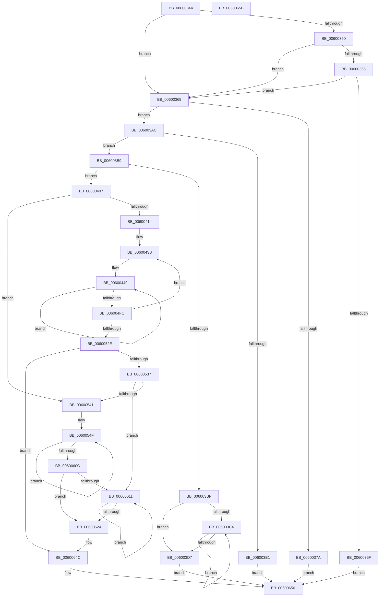

# adler32_z

- RVA: `0x00600344`–`0x0060065C` (길이 `792` bytes)
- VA: `0x0000000140600344`
- 실행 섹션: `.text`
- PDB 이름 있음: `예`; PDB Function 태그: `아니요`
- unwind 정보 RVA: `0x0005C788`
- 디코드: `212`개 명령, `792/792` bytes 표시
- 미해석 바이트: `0` (있으면 어셈블리에 `.byte`로 보존)

> 이 문서는 커널 이미지의 기계어와 PDB 기호를 분석해 생성했습니다. 4번과 5번은 함수 원형과 자료형을 바이너리 사용 방식에서 추정한 C 해석이며 원본 소스 복구 결과는 아닙니다.

## 1. Dependencies

- 직접 호출 지점: **1**; 고유 호출 대상: **1**
- 직접 호출자로 확인된 함수: **4**
- RIP 상대 이미지 참조: **1**

### Outgoing calls
- `0x0060035F` → [adler32_simd_](adler32_simd__function_006022EC.md) (function, `0x006022EC`)

### Direct callers
- [inflate](../5F/inflate_function_005F2280.md) at `0x005F23EF`
- [inflate](../5F/inflate_function_005F2280.md) at `0x005F25A2`
- [inflate](../5F/inflate_function_005F2280.md) at `0x005F317C`
- [inflate](../5F/inflate_function_005F2280.md) at `0x005F32B9`
- [deflate](../5F/deflate_function_005F35C8.md) at `0x005F3769`
- [deflateResetKeep](../5F/deflateResetKeep_function_005F3934.md) at `0x005F3993`
- [read_buf](../5F/read_buf_function_005F555C.md) at `0x005F55B2`

### Static image references
- `0x00600356` → RVA `0x00E67B44` (`.data`; read)

## 2. Other-region calls and transfers

- 다른 실행 섹션으로 향하는 call: **0**
- 별도 외부 분기/꼬리 이동을 확인하지 못했습니다.

## 3. Assembly (complete function range)

```asm
00600344  48 83 EC 28                     sub rsp, 0x28
00600348  4C 8B DA                        mov r11, rdx
0060034B  48 85 D2                        test rdx, rdx
0060034E  74 19                           je 0x140600369
00600350  49 83 F8 40                     cmp r8, 0x40
00600354  72 13                           jb 0x140600369
00600356  83 3D E7 77 86 00 00            cmp dword ptr [rip + 0x8677e7], 0
0060035D  74 0A                           je 0x140600369
0060035F  E8 88 1F 00 00                  call 0x1406022ec
00600364  E9 ED 02 00 00                  jmp 0x140600656
00600369  44 8B D1                        mov r10d, ecx
0060036C  44 0F B7 C9                     movzx r9d, cx
00600370  41 C1 EA 10                     shr r10d, 0x10
00600374  49 83 F8 01                     cmp r8, 1
00600378  75 32                           jne 0x1406003ac
0060037A  0F B6 0A                        movzx ecx, byte ptr [rdx]
0060037D  41 BB F1 FF 00 00               mov r11d, 0xfff1
00600383  41 03 C9                        add ecx, r9d
00600386  41 3B CB                        cmp ecx, r11d
00600389  8D 91 0F 00 FF FF               lea edx, [rcx - 0xfff1]
0060038F  0F 42 D1                        cmovb edx, ecx
00600392  42 8D 0C 12                     lea ecx, [rdx + r10]
00600396  41 3B CB                        cmp ecx, r11d
00600399  8D 81 0F 00 FF FF               lea eax, [rcx - 0xfff1]
0060039F  0F 42 C1                        cmovb eax, ecx
006003A2  C1 E0 10                        shl eax, 0x10
006003A5  0B C2                           or eax, edx
006003A7  E9 AA 02 00 00                  jmp 0x140600656
006003AC  48 85 D2                        test rdx, rdx
006003AF  75 08                           jne 0x1406003b9
006003B1  8D 42 01                        lea eax, [rdx + 1]
006003B4  E9 9D 02 00 00                  jmp 0x140600656
006003B9  49 83 F8 10                     cmp r8, 0x10
006003BD  73 48                           jae 0x140600407
006003BF  4D 85 C0                        test r8, r8
006003C2  74 13                           je 0x1406003d7
006003C4  41 0F B6 03                     movzx eax, byte ptr [r11]
006003C8  49 FF C3                        inc r11
006003CB  44 03 C8                        add r9d, eax
006003CE  45 03 D1                        add r10d, r9d
006003D1  49 83 E8 01                     sub r8, 1
006003D5  75 ED                           jne 0x1406003c4
006003D7  41 BB F1 FF 00 00               mov r11d, 0xfff1
006003DD  45 8D 81 0F 00 FF FF            lea r8d, [r9 - 0xfff1]
006003E4  45 3B CB                        cmp r9d, r11d
006003E7  B8 71 80 07 80                  mov eax, 0x80078071
006003EC  45 0F 42 C1                     cmovb r8d, r9d
006003F0  41 F7 E2                        mul r10d
006003F3  C1 EA 0F                        shr edx, 0xf
006003F6  6B C2 0F                        imul eax, edx, 0xf
006003F9  41 03 C2                        add eax, r10d
006003FC  C1 E0 10                        shl eax, 0x10
006003FF  41 0B C0                        or eax, r8d
00600402  E9 4F 02 00 00                  jmp 0x140600656
00600407  49 81 F8 B0 15 00 00            cmp r8, 0x15b0
0060040E  0F 82 2D 01 00 00               jb 0x140600541
00600414  49 8B C8                        mov rcx, r8
00600417  48 B8 F7 B6 98 63 BB A6 BA 79   movabs rax, 0x79baa6bb6398b6f7
00600421  49 F7 E0                        mul r8
00600424  48 2B CA                        sub rcx, rdx
00600427  48 D1 E9                        shr rcx, 1
0060042A  48 03 CA                        add rcx, rdx
0060042D  48 C1 E9 0C                     shr rcx, 0xc
00600431  48 69 C1 50 EA FF FF            imul rax, rcx, -0x15b0
00600438  4C 03 C0                        add r8, rax
0060043B  BA 5B 01 00 00                  mov edx, 0x15b
00600440  41 0F B6 03                     movzx eax, byte ptr [r11]
00600444  44 03 C8                        add r9d, eax
00600447  41 0F B6 43 01                  movzx eax, byte ptr [r11 + 1]
0060044C  45 03 D1                        add r10d, r9d
0060044F  44 03 C8                        add r9d, eax
00600452  41 0F B6 43 02                  movzx eax, byte ptr [r11 + 2]
00600457  45 03 D1                        add r10d, r9d
0060045A  44 03 C8                        add r9d, eax
0060045D  41 0F B6 43 03                  movzx eax, byte ptr [r11 + 3]
00600462  45 03 D1                        add r10d, r9d
00600465  44 03 C8                        add r9d, eax
00600468  41 0F B6 43 04                  movzx eax, byte ptr [r11 + 4]
0060046D  45 03 D1                        add r10d, r9d
00600470  44 03 C8                        add r9d, eax
00600473  41 0F B6 43 05                  movzx eax, byte ptr [r11 + 5]
00600478  45 03 D1                        add r10d, r9d
0060047B  44 03 C8                        add r9d, eax
0060047E  41 0F B6 43 06                  movzx eax, byte ptr [r11 + 6]
00600483  45 03 D1                        add r10d, r9d
00600486  44 03 C8                        add r9d, eax
00600489  41 0F B6 43 07                  movzx eax, byte ptr [r11 + 7]
0060048E  45 03 D1                        add r10d, r9d
00600491  44 03 C8                        add r9d, eax
00600494  41 0F B6 43 08                  movzx eax, byte ptr [r11 + 8]
00600499  45 03 D1                        add r10d, r9d
0060049C  44 03 C8                        add r9d, eax
0060049F  41 0F B6 43 09                  movzx eax, byte ptr [r11 + 9]
006004A4  45 03 D1                        add r10d, r9d
006004A7  44 03 C8                        add r9d, eax
006004AA  41 0F B6 43 0A                  movzx eax, byte ptr [r11 + 0xa]
006004AF  45 03 D1                        add r10d, r9d
006004B2  44 03 C8                        add r9d, eax
006004B5  41 0F B6 43 0B                  movzx eax, byte ptr [r11 + 0xb]
006004BA  45 03 D1                        add r10d, r9d
006004BD  44 03 C8                        add r9d, eax
006004C0  41 0F B6 43 0C                  movzx eax, byte ptr [r11 + 0xc]
006004C5  45 03 D1                        add r10d, r9d
006004C8  44 03 C8                        add r9d, eax
006004CB  41 0F B6 43 0D                  movzx eax, byte ptr [r11 + 0xd]
006004D0  45 03 D1                        add r10d, r9d
006004D3  44 03 C8                        add r9d, eax
006004D6  41 0F B6 43 0E                  movzx eax, byte ptr [r11 + 0xe]
006004DB  45 03 D1                        add r10d, r9d
006004DE  44 03 C8                        add r9d, eax
006004E1  41 0F B6 43 0F                  movzx eax, byte ptr [r11 + 0xf]
006004E6  45 03 D1                        add r10d, r9d
006004E9  49 83 C3 10                     add r11, 0x10
006004ED  44 03 C8                        add r9d, eax
006004F0  45 03 D1                        add r10d, r9d
006004F3  83 C2 FF                        add edx, -1
006004F6  0F 85 44 FF FF FF               jne 0x140600440
006004FC  B8 71 80 07 80                  mov eax, 0x80078071
00600501  41 F7 E1                        mul r9d
00600504  C1 EA 0F                        shr edx, 0xf
00600507  69 C2 0F 00 FF FF               imul eax, edx, 0xffff000f
0060050D  44 03 C8                        add r9d, eax
00600510  B8 71 80 07 80                  mov eax, 0x80078071
00600515  41 F7 E2                        mul r10d
00600518  C1 EA 0F                        shr edx, 0xf
0060051B  69 C2 0F 00 FF FF               imul eax, edx, 0xffff000f
00600521  44 03 D0                        add r10d, eax
00600524  48 83 E9 01                     sub rcx, 1
00600528  0F 85 0D FF FF FF               jne 0x14060043b
0060052E  4D 85 C0                        test r8, r8
00600531  0F 84 15 01 00 00               je 0x14060064c
00600537  49 83 F8 10                     cmp r8, 0x10
0060053B  0F 82 D0 00 00 00               jb 0x140600611
00600541  49 8B C8                        mov rcx, r8
00600544  48 C1 E9 04                     shr rcx, 4
00600548  48 6B C1 F0                     imul rax, rcx, -0x10
0060054C  4C 03 C0                        add r8, rax
0060054F  41 0F B6 03                     movzx eax, byte ptr [r11]
00600553  44 03 C8                        add r9d, eax
00600556  41 0F B6 43 01                  movzx eax, byte ptr [r11 + 1]
0060055B  45 03 D1                        add r10d, r9d
0060055E  44 03 C8                        add r9d, eax
00600561  41 0F B6 43 02                  movzx eax, byte ptr [r11 + 2]
00600566  45 03 D1                        add r10d, r9d
00600569  44 03 C8                        add r9d, eax
0060056C  41 0F B6 43 03                  movzx eax, byte ptr [r11 + 3]
00600571  45 03 D1                        add r10d, r9d
00600574  44 03 C8                        add r9d, eax
00600577  41 0F B6 43 04                  movzx eax, byte ptr [r11 + 4]
0060057C  45 03 D1                        add r10d, r9d
0060057F  44 03 C8                        add r9d, eax
00600582  41 0F B6 43 05                  movzx eax, byte ptr [r11 + 5]
00600587  45 03 D1                        add r10d, r9d
0060058A  44 03 C8                        add r9d, eax
0060058D  41 0F B6 43 06                  movzx eax, byte ptr [r11 + 6]
00600592  45 03 D1                        add r10d, r9d
00600595  44 03 C8                        add r9d, eax
00600598  41 0F B6 43 07                  movzx eax, byte ptr [r11 + 7]
0060059D  45 03 D1                        add r10d, r9d
006005A0  44 03 C8                        add r9d, eax
006005A3  41 0F B6 43 08                  movzx eax, byte ptr [r11 + 8]
006005A8  45 03 D1                        add r10d, r9d
006005AB  44 03 C8                        add r9d, eax
006005AE  41 0F B6 43 09                  movzx eax, byte ptr [r11 + 9]
006005B3  45 03 D1                        add r10d, r9d
006005B6  44 03 C8                        add r9d, eax
006005B9  41 0F B6 43 0A                  movzx eax, byte ptr [r11 + 0xa]
006005BE  45 03 D1                        add r10d, r9d
006005C1  44 03 C8                        add r9d, eax
006005C4  41 0F B6 43 0B                  movzx eax, byte ptr [r11 + 0xb]
006005C9  45 03 D1                        add r10d, r9d
006005CC  44 03 C8                        add r9d, eax
006005CF  41 0F B6 43 0C                  movzx eax, byte ptr [r11 + 0xc]
006005D4  45 03 D1                        add r10d, r9d
006005D7  44 03 C8                        add r9d, eax
006005DA  41 0F B6 43 0D                  movzx eax, byte ptr [r11 + 0xd]
006005DF  45 03 D1                        add r10d, r9d
006005E2  44 03 C8                        add r9d, eax
006005E5  41 0F B6 43 0E                  movzx eax, byte ptr [r11 + 0xe]
006005EA  45 03 D1                        add r10d, r9d
006005ED  44 03 C8                        add r9d, eax
006005F0  41 0F B6 43 0F                  movzx eax, byte ptr [r11 + 0xf]
006005F5  45 03 D1                        add r10d, r9d
006005F8  49 83 C3 10                     add r11, 0x10
006005FC  44 03 C8                        add r9d, eax
006005FF  45 03 D1                        add r10d, r9d
00600602  48 83 E9 01                     sub rcx, 1
00600606  0F 85 43 FF FF FF               jne 0x14060054f
0060060C  4D 85 C0                        test r8, r8
0060060F  74 13                           je 0x140600624
00600611  41 0F B6 03                     movzx eax, byte ptr [r11]
00600615  49 FF C3                        inc r11
00600618  44 03 C8                        add r9d, eax
0060061B  45 03 D1                        add r10d, r9d
0060061E  49 83 E8 01                     sub r8, 1
00600622  75 ED                           jne 0x140600611
00600624  B8 71 80 07 80                  mov eax, 0x80078071
00600629  41 F7 E1                        mul r9d
0060062C  B8 71 80 07 80                  mov eax, 0x80078071
00600631  C1 EA 0F                        shr edx, 0xf
00600634  69 CA 0F 00 FF FF               imul ecx, edx, 0xffff000f
0060063A  41 F7 E2                        mul r10d
0060063D  44 03 C9                        add r9d, ecx
00600640  C1 EA 0F                        shr edx, 0xf
00600643  69 CA 0F 00 FF FF               imul ecx, edx, 0xffff000f
00600649  44 03 D1                        add r10d, ecx
0060064C  41 C1 E2 10                     shl r10d, 0x10
00600650  45 0B D1                        or r10d, r9d
00600653  41 8B C2                        mov eax, r10d
00600656  48 83 C4 28                     add rsp, 0x28
0060065A  C3                              ret
0060065B  CC                              int3
```

## 4. C-style interpretation (structured pseudocode)

```c
__int64 __fastcall adler32_z(int a1, __int64 a2, __int64 a3)
{
    __int64 result;
    __int64 v_r10;
    __int64 v_r11;
    __int64 v_rsp;

    v_rsp = (v_rsp) - (40);
    if (a2 == 0) goto loc_00600369;
    if (a3 < 64) goto loc_00600369;
    if ((*(unsigned int *)(v_rip + 8812519)) == 0) goto loc_00600369;
    result = adler32_simd_(a1, a2, a3, a4);
    goto loc_00600656;
loc_00600369:
    v_r10 = (unsigned int)(((unsigned int)(a1)) >> (16));
    if (a3 != 1) goto loc_006003AC;
    a1 = (unsigned int)((*(unsigned __int8 *)(a2)) + ((unsigned int)((unsigned __int16)(a1))));
    a2 = a1 - 65521;
    if (a1 < ((unsigned int)((unsigned int)(0xFFF1ULL)))) { a2 = a1; }
    result = a2 + v_r10 * 1 - 65521;
    if (((unsigned int)(a2 + v_r10 * 1)) < ((unsigned int)((unsigned int)(0xFFF1ULL)))) { result = (unsigned int)(a2 + v_r10 * 1); }
    result = (unsigned int)((result) << (16));
    result = (unsigned int)((result) | ((unsigned int)(a2)));
    goto loc_00600656;
loc_006003AC:
    if (a2 != 0) goto loc_006003B9;
    goto loc_00600656;
loc_006003B9:
    if (a3 >= 16) goto loc_00600407;
    if (a3 == 0) goto loc_006003D7;
loc_006003C4:
    v_r11 = ((unsigned int)(0xFFF1ULL)) + 1;
    a4 = (unsigned int)(((unsigned __int16)(a1)) + ((unsigned int)(*(unsigned __int8 *)((unsigned int)(0xFFF1ULL)))));
    v_r10 = (unsigned int)((v_r10) + ((unsigned int)(a4)));
    a3 = (a3) - (1);
    if (condition_is_not_equal) goto loc_006003C4;
loc_006003D7:
    a3 = a4 - 65521;
    if (((unsigned int)(a4)) < ((unsigned int)((unsigned int)(0xFFF1ULL)))) { a3 = (unsigned int)(a4); }
    a2 = (unsigned int)((a2) >> (15));
    result = (unsigned int)(((unsigned int)(0x80078071ULL)) * ((unsigned int)(a2)));
    result = (unsigned int)((result) + ((unsigned int)(v_r10)));
    result = (unsigned int)((result) << (16));
    result = (unsigned int)((result) | ((unsigned int)(a3)));
    goto loc_00600656;
loc_00600407:
    if (a3 < 0x15B0ULL) goto loc_00600541;
    a1 = (a3) - (a2);
    a1 = (a1) >> (1);
    a1 = (a1) + (a2);
    a1 = (a1) >> (12);
    result = (result) * (a1);
    a3 = (a3) + (result);
loc_0060043B:
loc_00600440:
    a4 = (unsigned int)((a4) + ((unsigned int)(*(unsigned __int8 *)((unsigned int)(0xFFF1ULL)))));
    v_r10 = (unsigned int)((v_r10) + ((unsigned int)(a4)));
    a4 = (unsigned int)((a4) + ((unsigned int)(*(unsigned __int8 *)((unsigned int)(0xFFF1ULL) + 1))));
    v_r10 = (unsigned int)((v_r10) + ((unsigned int)(a4)));
    a4 = (unsigned int)((a4) + ((unsigned int)(*(unsigned __int8 *)((unsigned int)(0xFFF1ULL) + 2))));
    v_r10 = (unsigned int)((v_r10) + ((unsigned int)(a4)));
    a4 = (unsigned int)((a4) + ((unsigned int)(*(unsigned __int8 *)((unsigned int)(0xFFF1ULL) + 3))));
    v_r10 = (unsigned int)((v_r10) + ((unsigned int)(a4)));
    a4 = (unsigned int)((a4) + ((unsigned int)(*(unsigned __int8 *)((unsigned int)(0xFFF1ULL) + 4))));
    v_r10 = (unsigned int)((v_r10) + ((unsigned int)(a4)));
    a4 = (unsigned int)((a4) + ((unsigned int)(*(unsigned __int8 *)((unsigned int)(0xFFF1ULL) + 5))));
    v_r10 = (unsigned int)((v_r10) + ((unsigned int)(a4)));
    a4 = (unsigned int)((a4) + ((unsigned int)(*(unsigned __int8 *)((unsigned int)(0xFFF1ULL) + 6))));
    v_r10 = (unsigned int)((v_r10) + ((unsigned int)(a4)));
    a4 = (unsigned int)((a4) + ((unsigned int)(*(unsigned __int8 *)((unsigned int)(0xFFF1ULL) + 7))));
    v_r10 = (unsigned int)((v_r10) + ((unsigned int)(a4)));
    a4 = (unsigned int)((a4) + ((unsigned int)(*(unsigned __int8 *)((unsigned int)(0xFFF1ULL) + 8))));
    v_r10 = (unsigned int)((v_r10) + ((unsigned int)(a4)));
    a4 = (unsigned int)((a4) + ((unsigned int)(*(unsigned __int8 *)((unsigned int)(0xFFF1ULL) + 9))));
    v_r10 = (unsigned int)((v_r10) + ((unsigned int)(a4)));
    a4 = (unsigned int)((a4) + ((unsigned int)(*(unsigned __int8 *)((unsigned int)(0xFFF1ULL) + 10))));
    v_r10 = (unsigned int)((v_r10) + ((unsigned int)(a4)));
    a4 = (unsigned int)((a4) + ((unsigned int)(*(unsigned __int8 *)((unsigned int)(0xFFF1ULL) + 11))));
    v_r10 = (unsigned int)((v_r10) + ((unsigned int)(a4)));
    a4 = (unsigned int)((a4) + ((unsigned int)(*(unsigned __int8 *)((unsigned int)(0xFFF1ULL) + 12))));
    v_r10 = (unsigned int)((v_r10) + ((unsigned int)(a4)));
    a4 = (unsigned int)((a4) + ((unsigned int)(*(unsigned __int8 *)((unsigned int)(0xFFF1ULL) + 13))));
    v_r10 = (unsigned int)((v_r10) + ((unsigned int)(a4)));
    a4 = (unsigned int)((a4) + ((unsigned int)(*(unsigned __int8 *)((unsigned int)(0xFFF1ULL) + 14))));
    v_r10 = (unsigned int)((v_r10) + ((unsigned int)(a4)));
    v_r11 = ((unsigned int)(0xFFF1ULL)) + (16);
    a4 = (unsigned int)((a4) + ((unsigned int)(*(unsigned __int8 *)((unsigned int)(0xFFF1ULL) + 15))));
    v_r10 = (unsigned int)((v_r10) + ((unsigned int)(a4)));
    a2 = (unsigned int)((347) + (-1));
    if (condition_is_not_equal) goto loc_00600440;
    a2 = (unsigned int)((a2) >> (15));
    result = (unsigned int)(((unsigned int)(0x80078071ULL)) * ((unsigned int)(a2)));
    a4 = (unsigned int)((a4) + ((unsigned int)(result)));
    a2 = (unsigned int)((a2) >> (15));
    result = (unsigned int)(((unsigned int)(0x80078071ULL)) * ((unsigned int)(a2)));
    v_r10 = (unsigned int)((v_r10) + ((unsigned int)(result)));
    a1 = (a1) - (1);
    if (condition_is_not_equal) goto loc_0060043B;
    if (a3 == 0) goto loc_0060064C;
    if (a3 < 16) goto loc_00600611;
loc_00600541:
    a1 = (a3) >> (4);
    result = (result) * (a1);
    a3 = (a3) + (result);
loc_0060054F:
    a4 = (unsigned int)((a4) + ((unsigned int)(*(unsigned __int8 *)(v_r11))));
    v_r10 = (unsigned int)((v_r10) + ((unsigned int)(a4)));
    a4 = (unsigned int)((a4) + ((unsigned int)(*(unsigned __int8 *)(v_r11 + 1))));
    v_r10 = (unsigned int)((v_r10) + ((unsigned int)(a4)));
    a4 = (unsigned int)((a4) + ((unsigned int)(*(unsigned __int8 *)(v_r11 + 2))));
    v_r10 = (unsigned int)((v_r10) + ((unsigned int)(a4)));
    a4 = (unsigned int)((a4) + ((unsigned int)(*(unsigned __int8 *)(v_r11 + 3))));
    v_r10 = (unsigned int)((v_r10) + ((unsigned int)(a4)));
    a4 = (unsigned int)((a4) + ((unsigned int)(*(unsigned __int8 *)(v_r11 + 4))));
    v_r10 = (unsigned int)((v_r10) + ((unsigned int)(a4)));
    a4 = (unsigned int)((a4) + ((unsigned int)(*(unsigned __int8 *)(v_r11 + 5))));
    v_r10 = (unsigned int)((v_r10) + ((unsigned int)(a4)));
    a4 = (unsigned int)((a4) + ((unsigned int)(*(unsigned __int8 *)(v_r11 + 6))));
    v_r10 = (unsigned int)((v_r10) + ((unsigned int)(a4)));
    a4 = (unsigned int)((a4) + ((unsigned int)(*(unsigned __int8 *)(v_r11 + 7))));
    v_r10 = (unsigned int)((v_r10) + ((unsigned int)(a4)));
    a4 = (unsigned int)((a4) + ((unsigned int)(*(unsigned __int8 *)(v_r11 + 8))));
    v_r10 = (unsigned int)((v_r10) + ((unsigned int)(a4)));
    a4 = (unsigned int)((a4) + ((unsigned int)(*(unsigned __int8 *)(v_r11 + 9))));
    v_r10 = (unsigned int)((v_r10) + ((unsigned int)(a4)));
    a4 = (unsigned int)((a4) + ((unsigned int)(*(unsigned __int8 *)(v_r11 + 10))));
    v_r10 = (unsigned int)((v_r10) + ((unsigned int)(a4)));
    a4 = (unsigned int)((a4) + ((unsigned int)(*(unsigned __int8 *)(v_r11 + 11))));
    v_r10 = (unsigned int)((v_r10) + ((unsigned int)(a4)));
    a4 = (unsigned int)((a4) + ((unsigned int)(*(unsigned __int8 *)(v_r11 + 12))));
    v_r10 = (unsigned int)((v_r10) + ((unsigned int)(a4)));
    a4 = (unsigned int)((a4) + ((unsigned int)(*(unsigned __int8 *)(v_r11 + 13))));
    v_r10 = (unsigned int)((v_r10) + ((unsigned int)(a4)));
    a4 = (unsigned int)((a4) + ((unsigned int)(*(unsigned __int8 *)(v_r11 + 14))));
    v_r10 = (unsigned int)((v_r10) + ((unsigned int)(a4)));
    v_r11 = (v_r11) + (16);
    a4 = (unsigned int)((a4) + ((unsigned int)(*(unsigned __int8 *)(v_r11 + 15))));
    v_r10 = (unsigned int)((v_r10) + ((unsigned int)(a4)));
    a1 = (a1) - (1);
    if (condition_is_not_equal) goto loc_0060054F;
    if (a3 == 0) goto loc_00600624;
loc_00600611:
    v_r11 = (v_r11) + 1;
    a4 = (unsigned int)((a4) + ((unsigned int)(*(unsigned __int8 *)(v_r11))));
    v_r10 = (unsigned int)((v_r10) + ((unsigned int)(a4)));
    a3 = (a3) - (1);
    if (condition_is_not_equal) goto loc_00600611;
loc_00600624:
    a2 = (unsigned int)((a2) >> (15));
    a1 = (unsigned int)((a1) * ((unsigned int)(a2)));
    a4 = (unsigned int)((a4) + (a1));
    a2 = (unsigned int)((a2) >> (15));
    a1 = (unsigned int)((a1) * ((unsigned int)(a2)));
    v_r10 = (unsigned int)((v_r10) + (a1));
loc_0060064C:
    v_r10 = (unsigned int)((v_r10) << (16));
    v_r10 = (unsigned int)((v_r10) | ((unsigned int)(a4)));
loc_00600656:
    v_rsp = (v_rsp) + (40);
    return (unsigned int)((unsigned int)(v_r10));
}
```

## 5. (Beta) C Style

```c
int64_t adler32_z(void *Arg1, void *Arg2, int64_t Arg3)
{
    uint8_t *arg1 = (uint8_t *)Arg1;
    uint8_t *arg2 = (uint8_t *)Arg2;

    int64_t result;
    int64_t local_r10;
    int64_t local_r11;
    int64_t local_rsp;

    local_rsp = (local_rsp) - (40);
    if (Arg2 == NULL) goto loc_00600369;
    if (Arg3 < 64) goto loc_00600369;
    if ((*(uint32_t *)(v_rip + 0x8677E7)) == 0) goto loc_00600369;
    result = adler32_simd_(Arg1, Arg2, Arg3, a4);
    goto loc_00600656;
loc_00600369:
    local_r10 = (uint32_t)(((uint32_t)(Arg1)) >> (16));
    if (Arg3 != 1) goto loc_006003AC;
    Arg1 = (uint32_t)((*(uint8_t *)(arg2)) + ((uint32_t)((uint16_t)(Arg1))));
    Arg2 = Arg1 - 65521;
    if (Arg1 < ((uint32_t)((uint32_t)(0xFFF1ULL)))) { Arg2 = Arg1; }
    result = Arg2 + local_r10 * 1 - 65521;
    if (((uint32_t)(Arg2 + local_r10 * 1)) < ((uint32_t)((uint32_t)(0xFFF1ULL)))) { result = (uint32_t)(Arg2 + local_r10 * 1); }
    result = (uint32_t)((result) << (16));
    result = (uint32_t)((result) | ((uint32_t)(Arg2)));
    goto loc_00600656;
loc_006003AC:
    if (Arg2 != NULL) goto loc_006003B9;
    goto loc_00600656;
loc_006003B9:
    if (Arg3 >= 16) goto loc_00600407;
    if (Arg3 == 0) goto loc_006003D7;
loc_006003C4:
    local_r11 = ((uint32_t)(0xFFF1ULL)) + 1;
    a4 = (uint32_t)(((uint16_t)(Arg1)) + ((uint32_t)(*(uint8_t *)((uint32_t)(0xFFF1ULL)))));
    local_r10 = (uint32_t)((local_r10) + ((uint32_t)(a4)));
    Arg3 = (Arg3) - (1);
    if (condition_is_not_equal) goto loc_006003C4;
loc_006003D7:
    Arg3 = a4 - 65521;
    if (((uint32_t)(a4)) < ((uint32_t)((uint32_t)(0xFFF1ULL)))) { Arg3 = (uint32_t)(a4); }
    Arg2 = (uint32_t)((Arg2) >> (15));
    result = (uint32_t)(((uint32_t)(0x80078071ULL)) * ((uint32_t)(Arg2)));
    result = (uint32_t)((result) + ((uint32_t)(local_r10)));
    result = (uint32_t)((result) << (16));
    result = (uint32_t)((result) | ((uint32_t)(Arg3)));
    goto loc_00600656;
loc_00600407:
    if (Arg3 < 0x15B0ULL) goto loc_00600541;
    Arg1 = (Arg3) - (Arg2);
    Arg1 = (Arg1) >> (1);
    Arg1 = (Arg1) + (Arg2);
    Arg1 = (Arg1) >> (12);
    result = (result) * (Arg1);
    Arg3 = (Arg3) + (result);
loc_0060043B:
loc_00600440:
    a4 = (uint32_t)((a4) + ((uint32_t)(*(uint8_t *)((uint32_t)(0xFFF1ULL)))));
    local_r10 = (uint32_t)((local_r10) + ((uint32_t)(a4)));
    a4 = (uint32_t)((a4) + ((uint32_t)(*(uint8_t *)((uint32_t)(0xFFF1ULL) + 0x1))));
    local_r10 = (uint32_t)((local_r10) + ((uint32_t)(a4)));
    a4 = (uint32_t)((a4) + ((uint32_t)(*(uint8_t *)((uint32_t)(0xFFF1ULL) + 0x2))));
    local_r10 = (uint32_t)((local_r10) + ((uint32_t)(a4)));
    a4 = (uint32_t)((a4) + ((uint32_t)(*(uint8_t *)((uint32_t)(0xFFF1ULL) + 0x3))));
    local_r10 = (uint32_t)((local_r10) + ((uint32_t)(a4)));
    a4 = (uint32_t)((a4) + ((uint32_t)(*(uint8_t *)((uint32_t)(0xFFF1ULL) + 0x4))));
    local_r10 = (uint32_t)((local_r10) + ((uint32_t)(a4)));
    a4 = (uint32_t)((a4) + ((uint32_t)(*(uint8_t *)((uint32_t)(0xFFF1ULL) + 0x5))));
    local_r10 = (uint32_t)((local_r10) + ((uint32_t)(a4)));
    a4 = (uint32_t)((a4) + ((uint32_t)(*(uint8_t *)((uint32_t)(0xFFF1ULL) + 0x6))));
    local_r10 = (uint32_t)((local_r10) + ((uint32_t)(a4)));
    a4 = (uint32_t)((a4) + ((uint32_t)(*(uint8_t *)((uint32_t)(0xFFF1ULL) + 0x7))));
    local_r10 = (uint32_t)((local_r10) + ((uint32_t)(a4)));
    a4 = (uint32_t)((a4) + ((uint32_t)(*(uint8_t *)((uint32_t)(0xFFF1ULL) + 0x8))));
    local_r10 = (uint32_t)((local_r10) + ((uint32_t)(a4)));
    a4 = (uint32_t)((a4) + ((uint32_t)(*(uint8_t *)((uint32_t)(0xFFF1ULL) + 0x9))));
    local_r10 = (uint32_t)((local_r10) + ((uint32_t)(a4)));
    a4 = (uint32_t)((a4) + ((uint32_t)(*(uint8_t *)((uint32_t)(0xFFF1ULL) + 0xA))));
    local_r10 = (uint32_t)((local_r10) + ((uint32_t)(a4)));
    a4 = (uint32_t)((a4) + ((uint32_t)(*(uint8_t *)((uint32_t)(0xFFF1ULL) + 0xB))));
    local_r10 = (uint32_t)((local_r10) + ((uint32_t)(a4)));
    a4 = (uint32_t)((a4) + ((uint32_t)(*(uint8_t *)((uint32_t)(0xFFF1ULL) + 0xC))));
    local_r10 = (uint32_t)((local_r10) + ((uint32_t)(a4)));
    a4 = (uint32_t)((a4) + ((uint32_t)(*(uint8_t *)((uint32_t)(0xFFF1ULL) + 0xD))));
    local_r10 = (uint32_t)((local_r10) + ((uint32_t)(a4)));
    a4 = (uint32_t)((a4) + ((uint32_t)(*(uint8_t *)((uint32_t)(0xFFF1ULL) + 0xE))));
    local_r10 = (uint32_t)((local_r10) + ((uint32_t)(a4)));
    local_r11 = ((uint32_t)(0xFFF1ULL)) + (16);
    a4 = (uint32_t)((a4) + ((uint32_t)(*(uint8_t *)((uint32_t)(0xFFF1ULL) + 0xF))));
    local_r10 = (uint32_t)((local_r10) + ((uint32_t)(a4)));
    Arg2 = (uint32_t)((347) + (-1));
    if (condition_is_not_equal) goto loc_00600440;
    Arg2 = (uint32_t)((Arg2) >> (15));
    result = (uint32_t)(((uint32_t)(0x80078071ULL)) * ((uint32_t)(Arg2)));
    a4 = (uint32_t)((a4) + ((uint32_t)(result)));
    Arg2 = (uint32_t)((Arg2) >> (15));
    result = (uint32_t)(((uint32_t)(0x80078071ULL)) * ((uint32_t)(Arg2)));
    local_r10 = (uint32_t)((local_r10) + ((uint32_t)(result)));
    Arg1 = (Arg1) - (1);
    if (condition_is_not_equal) goto loc_0060043B;
    if (Arg3 == 0) goto loc_0060064C;
    if (Arg3 < 16) goto loc_00600611;
loc_00600541:
    Arg1 = (Arg3) >> (4);
    result = (result) * (Arg1);
    Arg3 = (Arg3) + (result);
loc_0060054F:
    a4 = (uint32_t)((a4) + ((uint32_t)(*(uint8_t *)(local_r11))));
    local_r10 = (uint32_t)((local_r10) + ((uint32_t)(a4)));
    a4 = (uint32_t)((a4) + ((uint32_t)(*(uint8_t *)(local_r11 + 0x1))));
    local_r10 = (uint32_t)((local_r10) + ((uint32_t)(a4)));
    a4 = (uint32_t)((a4) + ((uint32_t)(*(uint8_t *)(local_r11 + 0x2))));
    local_r10 = (uint32_t)((local_r10) + ((uint32_t)(a4)));
    a4 = (uint32_t)((a4) + ((uint32_t)(*(uint8_t *)(local_r11 + 0x3))));
    local_r10 = (uint32_t)((local_r10) + ((uint32_t)(a4)));
    a4 = (uint32_t)((a4) + ((uint32_t)(*(uint8_t *)(local_r11 + 0x4))));
    local_r10 = (uint32_t)((local_r10) + ((uint32_t)(a4)));
    a4 = (uint32_t)((a4) + ((uint32_t)(*(uint8_t *)(local_r11 + 0x5))));
    local_r10 = (uint32_t)((local_r10) + ((uint32_t)(a4)));
    a4 = (uint32_t)((a4) + ((uint32_t)(*(uint8_t *)(local_r11 + 0x6))));
    local_r10 = (uint32_t)((local_r10) + ((uint32_t)(a4)));
    a4 = (uint32_t)((a4) + ((uint32_t)(*(uint8_t *)(local_r11 + 0x7))));
    local_r10 = (uint32_t)((local_r10) + ((uint32_t)(a4)));
    a4 = (uint32_t)((a4) + ((uint32_t)(*(uint8_t *)(local_r11 + 0x8))));
    local_r10 = (uint32_t)((local_r10) + ((uint32_t)(a4)));
    a4 = (uint32_t)((a4) + ((uint32_t)(*(uint8_t *)(local_r11 + 0x9))));
    local_r10 = (uint32_t)((local_r10) + ((uint32_t)(a4)));
    a4 = (uint32_t)((a4) + ((uint32_t)(*(uint8_t *)(local_r11 + 0xA))));
    local_r10 = (uint32_t)((local_r10) + ((uint32_t)(a4)));
    a4 = (uint32_t)((a4) + ((uint32_t)(*(uint8_t *)(local_r11 + 0xB))));
    local_r10 = (uint32_t)((local_r10) + ((uint32_t)(a4)));
    a4 = (uint32_t)((a4) + ((uint32_t)(*(uint8_t *)(local_r11 + 0xC))));
    local_r10 = (uint32_t)((local_r10) + ((uint32_t)(a4)));
    a4 = (uint32_t)((a4) + ((uint32_t)(*(uint8_t *)(local_r11 + 0xD))));
    local_r10 = (uint32_t)((local_r10) + ((uint32_t)(a4)));
    a4 = (uint32_t)((a4) + ((uint32_t)(*(uint8_t *)(local_r11 + 0xE))));
    local_r10 = (uint32_t)((local_r10) + ((uint32_t)(a4)));
    local_r11 = (local_r11) + (16);
    a4 = (uint32_t)((a4) + ((uint32_t)(*(uint8_t *)(local_r11 + 0xF))));
    local_r10 = (uint32_t)((local_r10) + ((uint32_t)(a4)));
    Arg1 = (Arg1) - (1);
    if (condition_is_not_equal) goto loc_0060054F;
    if (Arg3 == 0) goto loc_00600624;
loc_00600611:
    local_r11 = (local_r11) + 1;
    a4 = (uint32_t)((a4) + ((uint32_t)(*(uint8_t *)(local_r11))));
    local_r10 = (uint32_t)((local_r10) + ((uint32_t)(a4)));
    Arg3 = (Arg3) - (1);
    if (condition_is_not_equal) goto loc_00600611;
loc_00600624:
    Arg2 = (uint32_t)((Arg2) >> (15));
    Arg1 = (uint32_t)((Arg1) * ((uint32_t)(Arg2)));
    a4 = (uint32_t)((a4) + (Arg1));
    Arg2 = (uint32_t)((Arg2) >> (15));
    Arg1 = (uint32_t)((Arg1) * ((uint32_t)(Arg2)));
    local_r10 = (uint32_t)((local_r10) + (Arg1));
loc_0060064C:
    local_r10 = (uint32_t)((local_r10) << (16));
    local_r10 = (uint32_t)((local_r10) | ((uint32_t)(a4)));
loc_00600656:
    local_rsp = (local_rsp) + (40);
    return (uint32_t)((uint32_t)(local_r10));
}
```

### 관측된 메모리 오프셋

구조체 형식이 확인되지 않은 접근은 인자 기준의 오프셋으로만 기록했습니다.

| 기준 인자 | 오프셋 표현 | 폭 (bit) | 접근 |
|---|---:|---:|---|
| `Arg1` | `- 0xFFF1` | `32` | `R` |
| `Arg2` | `+ 0x0` | `8` | `R` |
| `Arg2` | `+ 0x1` | `8` | `R` |
| `Arg2` | `+ 0x2` | `8` | `R` |
| `Arg2` | `+ 0x3` | `8` | `R` |
| `Arg2` | `+ 0x4` | `8` | `R` |
| `Arg2` | `+ 0x5` | `8` | `R` |
| `Arg2` | `+ 0x6` | `8` | `R` |
| `Arg2` | `+ 0x7` | `8` | `R` |
| `Arg2` | `+ 0x8` | `8` | `R` |
| `Arg2` | `+ 0x9` | `8` | `R` |
| `Arg2` | `+ 0xA` | `8` | `R` |
| `Arg2` | `+ 0xB` | `8` | `R` |
| `Arg2` | `+ 0xC` | `8` | `R` |
| `Arg2` | `+ 0xD` | `8` | `R` |
| `Arg2` | `+ 0xE` | `8` | `R` |
| `Arg2` | `+ 0xF` | `8` | `R` |

## 6. Execution-region graph

[열기: 2D/3D 그래프와 함수 탐색 컨트롤 패널](../../../control-panel.html?section=text&rva=0x00600344&view=graph)

- 2D 그래프는 위에서 아래로 흐르고, 3D 그래프는 빈 공간을 드래그해 회전합니다. Shift+드래그는 이동, 휠은 확대·축소, 함수 노드 선택은 대상 보고서 이동입니다.

### Static fallback


