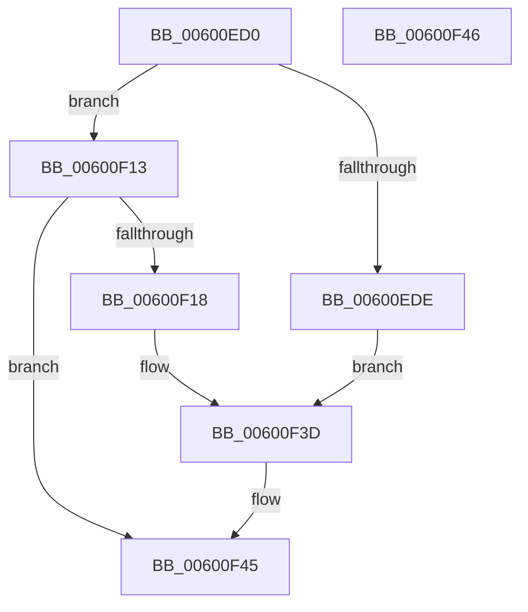

# bi_flush

- RVA: `0x00600ED0`–`0x00600F47` (길이 `119` bytes)
- VA: `0x0000000140600ED0`
- 실행 섹션: `.text`
- PDB 이름 있음: `예`; PDB Function 태그: `예`
- unwind 정보 RVA: `0x000DB714`
- 디코드: `29`개 명령, `119/119` bytes 표시
- 미해석 바이트: `0` (있으면 어셈블리에 `.byte`로 보존)

> 이 문서는 커널 이미지의 기계어와 PDB 기호를 분석해 생성했습니다. 4번과 5번은 함수 원형과 자료형을 바이너리 사용 방식에서 추정한 C 해석이며 원본 소스 복구 결과는 아닙니다.

## 1. Dependencies

- 직접 호출 지점: **0**; 고유 호출 대상: **0**
- 직접 호출자로 확인된 함수: **1**
- RIP 상대 이미지 참조: **0**

### Outgoing calls
- 직접 디코드된 call 명령이 없습니다.

### Direct callers
- [flush_pending](../5F/flush_pending_function_005F5258.md) at `0x005F5276`

### Static image references
- 디코드된 RIP-relative 메모리 참조가 없습니다.

## 2. Other-region calls and transfers

- 다른 실행 섹션으로 향하는 call: **0**
- 별도 외부 분기/꼬리 이동을 확인하지 못했습니다.

## 3. Assembly (complete function range)

```asm
00600ED0  8B 81 60 17 00 00               mov eax, dword ptr [rcx + 0x1760]
00600ED6  4C 8B C9                        mov r9, rcx
00600ED9  83 F8 10                        cmp eax, 0x10
00600EDC  75 35                           jne 0x140600f13
00600EDE  44 8B 41 28                     mov r8d, dword ptr [rcx + 0x28]
00600EE2  8A 81 5C 17 00 00               mov al, byte ptr [rcx + 0x175c]
00600EE8  48 8B 51 10                     mov rdx, qword ptr [rcx + 0x10]
00600EEC  41 88 04 10                     mov byte ptr [r8 + rdx], al
00600EF0  FF 41 28                        inc dword ptr [rcx + 0x28]
00600EF3  8B 51 28                        mov edx, dword ptr [rcx + 0x28]
00600EF6  41 8A 81 5D 17 00 00            mov al, byte ptr [r9 + 0x175d]
00600EFD  48 8B 49 10                     mov rcx, qword ptr [rcx + 0x10]
00600F01  88 04 0A                        mov byte ptr [rdx + rcx], al
00600F04  41 FF 41 28                     inc dword ptr [r9 + 0x28]
00600F08  33 C0                           xor eax, eax
00600F0A  41 89 81 60 17 00 00            mov dword ptr [r9 + 0x1760], eax
00600F11  EB 2A                           jmp 0x140600f3d
00600F13  83 F8 08                        cmp eax, 8
00600F16  7C 2D                           jl 0x140600f45
00600F18  8B 51 28                        mov edx, dword ptr [rcx + 0x28]
00600F1B  41 8A 81 5C 17 00 00            mov al, byte ptr [r9 + 0x175c]
00600F22  48 8B 49 10                     mov rcx, qword ptr [rcx + 0x10]
00600F26  88 04 0A                        mov byte ptr [rdx + rcx], al
00600F29  41 FF 41 28                     inc dword ptr [r9 + 0x28]
00600F2D  41 83 81 60 17 00 00 F8         add dword ptr [r9 + 0x1760], -8
00600F35  41 0F B6 81 5D 17 00 00         movzx eax, byte ptr [r9 + 0x175d]
00600F3D  66 41 89 81 5C 17 00 00         mov word ptr [r9 + 0x175c], ax
00600F45  C3                              ret
00600F46  CC                              int3
```

## 4. C-style interpretation (structured pseudocode)

```c
__int64 __fastcall bi_flush(__int64 a1)
{
    __int64 result;

    if (((unsigned int)((unsigned int)(*(unsigned int *)(a1 + 5984)))) != 16) goto loc_00600F13;
    *(unsigned __int8 *)((unsigned int)(*(unsigned int *)(a1 + 40)) + *(unsigned __int64 *)(a1 + 16) * 1) = (unsigned __int8)(*(unsigned __int8 *)(a1 + 5980));
    *(unsigned __int8 *)((unsigned int)(*(unsigned int *)(a1 + 40)) + *(unsigned __int64 *)(a1 + 16) * 1) = (unsigned __int8)(*(unsigned __int8 *)(a1 + 5981));
    result = 0;
    *(unsigned int *)(a1 + 5984) = 0;
    goto loc_00600F3D;
loc_00600F13:
    if (0 < 8) goto loc_00600F45;
    *(unsigned __int8 *)((unsigned int)(*(unsigned int *)(*(unsigned __int64 *)(a1 + 16) + 40)) + *(unsigned __int64 *)(*(unsigned __int64 *)(a1 + 16) + 16) * 1) = (unsigned __int8)(*(unsigned __int8 *)(a1 + 5980));
loc_00600F3D:
    *(unsigned __int16 *)(a1 + 5980) = (unsigned __int16)(*(unsigned __int8 *)(a1 + 5981));
loc_00600F45:
    return *(unsigned __int8 *)(a1 + 5981);
}
```

## 5. (Beta) C Style

```c
int64_t bi_flush(void *Arg1)
{
    uint8_t *arg1 = (uint8_t *)Arg1;

    int64_t result;

    if (((uint32_t)((uint32_t)(*(uint32_t *)(arg1 + 0x1760)))) != 16) goto loc_00600F13;
    *(uint8_t *)((uint32_t)(*(uint32_t *)(arg1 + 0x28)) + *(uint64_t *)(arg1 + 0x10) * 1) = (uint8_t)(*(uint8_t *)(arg1 + 0x175C));
    *(uint8_t *)((uint32_t)(*(uint32_t *)(arg1 + 0x28)) + *(uint64_t *)(arg1 + 0x10) * 1) = (uint8_t)(*(uint8_t *)(arg1 + 0x175D));
    result = 0;
    *(uint32_t *)(arg1 + 0x1760) = 0;
    goto loc_00600F3D;
loc_00600F13:
    if (0 < 8) goto loc_00600F45;
    *(uint8_t *)((uint32_t)(*(uint32_t *)(*(uint64_t *)(arg1 + 0x10) + 0x28)) + *(uint64_t *)(*(uint64_t *)(arg1 + 0x10) + 0x10) * 1) = (uint8_t)(*(uint8_t *)(arg1 + 0x175C));
loc_00600F3D:
    *(uint16_t *)(arg1 + 0x175C) = (uint16_t)(*(uint8_t *)(arg1 + 0x175D));
loc_00600F45:
    return *(uint8_t *)(arg1 + 0x175D);
}
```

### 관측된 메모리 오프셋

구조체 형식이 확인되지 않은 접근은 인자 기준의 오프셋으로만 기록했습니다.

| 기준 인자 | 오프셋 표현 | 폭 (bit) | 접근 |
|---|---:|---:|---|
| `Arg1` | `+ 0x10` | `64` | `R` |
| `Arg1` | `+ 0x28` | `32` | `R` |
| `Arg1` | `+ 0x28` | `32` | `R/W` |
| `Arg1` | `+ 0x175C` | `8` | `R` |
| `Arg1` | `+ 0x175C` | `16` | `W` |
| `Arg1` | `+ 0x175D` | `8` | `R` |
| `Arg1` | `+ 0x1760` | `32` | `R` |
| `Arg1` | `+ 0x1760` | `32` | `R/W` |
| `Arg1` | `+ 0x1760` | `32` | `W` |

## 6. Execution-region graph

[열기: 2D/3D 그래프와 함수 탐색 컨트롤 패널](../../../control-panel.html?section=text&rva=0x00600ED0&view=graph)

- 2D 그래프는 위에서 아래로 흐르고, 3D 그래프는 빈 공간을 드래그해 회전합니다. Shift+드래그는 이동, 휠은 확대·축소, 함수 노드 선택은 대상 보고서 이동입니다.

### Static fallback


