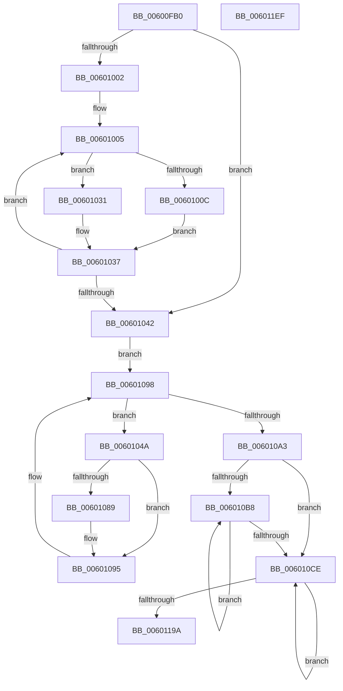

# build_tree

- RVA: `0x00600FB0`–`0x006011F0` (길이 `576` bytes)
- VA: `0x0000000140600FB0`
- 실행 섹션: `.text`
- PDB 이름 있음: `예`; PDB Function 태그: `예`
- unwind 정보 RVA: `0x00075C18`
- 디코드: `137`개 명령, `576/576` bytes 표시
- 미해석 바이트: `0` (있으면 어셈블리에 `.byte`로 보존)

> 이 문서는 커널 이미지의 기계어와 PDB 기호를 분석해 생성했습니다. 4번과 5번은 함수 원형과 자료형을 바이너리 사용 방식에서 추정한 C 해석이며 원본 소스 복구 결과는 아닙니다.

## 1. Dependencies

- 직접 호출 지점: **5**; 고유 호출 대상: **3**
- 직접 호출자로 확인된 함수: **1**
- RIP 상대 이미지 참조: **0**

### Outgoing calls
- `0x006010C1` → [pqdownheap](pqdownheap_function_006019B4.md) (function, `0x006019B4`)
- `0x006010FB` → [pqdownheap](pqdownheap_function_006019B4.md) (function, `0x006019B4`)
- `0x00601188` → [pqdownheap](pqdownheap_function_006019B4.md) (function, `0x006019B4`)
- `0x006011BC` → [gen_bitlen](gen_bitlen_function_00601678.md) (function, `0x00601678`)
- `0x006011CD` → [gen_codes](gen_codes_function_0060189C.md) (function, `0x0060189C`)

### Direct callers
- [tr_flush_block](tr_flush_block_function_00600AF8.md) at `0x00600B59`
- [tr_flush_block](tr_flush_block_function_00600AF8.md) at `0x00600B68`
- [tr_flush_block](tr_flush_block_function_00600AF8.md) at `0x00600BA3`

### Static image references
- 디코드된 RIP-relative 메모리 참조가 없습니다.

## 2. Other-region calls and transfers

- 다른 실행 섹션으로 향하는 call: **0**
- 별도 외부 분기/꼬리 이동을 확인하지 못했습니다.

## 3. Assembly (complete function range)

```asm
00600FB0  48 89 5C 24 08                  mov qword ptr [rsp + 8], rbx
00600FB5  48 89 6C 24 10                  mov qword ptr [rsp + 0x10], rbp
00600FBA  48 89 74 24 18                  mov qword ptr [rsp + 0x18], rsi
00600FBF  57                              push rdi
00600FC0  41 54                           push r12
00600FC2  41 55                           push r13
00600FC4  41 56                           push r14
00600FC6  41 57                           push r15
00600FC8  48 83 EC 20                     sub rsp, 0x20
00600FCC  48 8B 42 10                     mov rax, qword ptr [rdx + 0x10]
00600FD0  45 33 DB                        xor r11d, r11d
00600FD3  4C 8B 32                        mov r14, qword ptr [rdx]
00600FD6  83 CE FF                        or esi, 0xffffffff
00600FD9  4C 8B FA                        mov r15, rdx
00600FDC  48 8B F9                        mov rdi, rcx
00600FDF  45 8B C3                        mov r8d, r11d
00600FE2  48 63 68 14                     movsxd rbp, dword ptr [rax + 0x14]
00600FE6  4C 8B 10                        mov r10, qword ptr [rax]
00600FE9  44 8D 66 02                     lea r12d, [rsi + 2]
00600FED  44 89 99 EC 14 00 00            mov dword ptr [rcx + 0x14ec], r11d
00600FF4  C7 81 F0 14 00 00 3D 02 00 00   mov dword ptr [rcx + 0x14f0], 0x23d
00600FFE  85 ED                           test ebp, ebp
00601000  7E 40                           jle 0x140601042
00601002  41 8B D3                        mov edx, r11d
00601005  66 45 39 1C 96                  cmp word ptr [r14 + rdx*4], r11w
0060100A  74 25                           je 0x140601031
0060100C  48 63 8F EC 14 00 00            movsxd rcx, dword ptr [rdi + 0x14ec]
00601013  41 8B F0                        mov esi, r8d
00601016  8D 41 01                        lea eax, [rcx + 1]
00601019  89 87 EC 14 00 00               mov dword ptr [rdi + 0x14ec], eax
0060101F  44 89 84 8F FC 0B 00 00         mov dword ptr [rdi + rcx*4 + 0xbfc], r8d
00601027  44 88 9C 3A F4 14 00 00         mov byte ptr [rdx + rdi + 0x14f4], r11b
0060102F  EB 06                           jmp 0x140601037
00601031  66 45 89 5C 96 02               mov word ptr [r14 + rdx*4 + 2], r11w
00601037  45 03 C4                        add r8d, r12d
0060103A  49 03 D4                        add rdx, r12
0060103D  48 3B D5                        cmp rdx, rbp
00601040  7C C3                           jl 0x140601005
00601042  41 BD 02 00 00 00               mov r13d, 2
00601048  EB 4E                           jmp 0x140601098
0060104A  41 3B F5                        cmp esi, r13d
0060104D  8D 42 01                        lea eax, [rdx + 1]
00601050  89 87 EC 14 00 00               mov dword ptr [rdi + 0x14ec], eax
00601056  8D 4E 01                        lea ecx, [rsi + 1]
00601059  48 63 C2                        movsxd rax, edx
0060105C  44 8B C1                        mov r8d, ecx
0060105F  41 0F 4D CB                     cmovge ecx, r11d
00601063  44 0F 4D C6                     cmovge r8d, esi
00601067  89 8C 87 FC 0B 00 00            mov dword ptr [rdi + rax*4 + 0xbfc], ecx
0060106E  48 63 C1                        movsxd rax, ecx
00601071  66 45 89 24 86                  mov word ptr [r14 + rax*4], r12w
00601076  44 88 9C 38 F4 14 00 00         mov byte ptr [rax + rdi + 0x14f4], r11b
0060107E  FF 8F 4C 17 00 00               dec dword ptr [rdi + 0x174c]
00601084  4D 85 D2                        test r10, r10
00601087  74 0C                           je 0x140601095
00601089  41 0F B7 44 82 02               movzx eax, word ptr [r10 + rax*4 + 2]
0060108F  29 87 50 17 00 00               sub dword ptr [rdi + 0x1750], eax
00601095  41 8B F0                        mov esi, r8d
00601098  8B 97 EC 14 00 00               mov edx, dword ptr [rdi + 0x14ec]
0060109E  41 3B D5                        cmp edx, r13d
006010A1  7C A7                           jl 0x14060104a
006010A3  41 89 77 08                     mov dword ptr [r15 + 8], esi
006010A7  8B 87 EC 14 00 00               mov eax, dword ptr [rdi + 0x14ec]
006010AD  99                              cdq
006010AE  41 F7 FD                        idiv r13d
006010B1  8B D8                           mov ebx, eax
006010B3  41 3B C4                        cmp eax, r12d
006010B6  7C 16                           jl 0x1406010ce
006010B8  44 8B C3                        mov r8d, ebx
006010BB  49 8B D6                        mov rdx, r14
006010BE  48 8B CF                        mov rcx, rdi
006010C1  E8 EE 08 00 00                  call 0x1406019b4
006010C6  41 2B DC                        sub ebx, r12d
006010C9  41 3B DC                        cmp ebx, r12d
006010CC  7D EA                           jge 0x1406010b8
006010CE  48 63 97 EC 14 00 00            movsxd rdx, dword ptr [rdi + 0x14ec]
006010D5  45 8B C4                        mov r8d, r12d
006010D8  48 63 9F FC 0B 00 00            movsxd rbx, dword ptr [rdi + 0xbfc]
006010DF  8B 8C 97 F8 0B 00 00            mov ecx, dword ptr [rdi + rdx*4 + 0xbf8]
006010E6  8D 42 FF                        lea eax, [rdx - 1]
006010E9  89 8F FC 0B 00 00               mov dword ptr [rdi + 0xbfc], ecx
006010EF  49 8B D6                        mov rdx, r14
006010F2  48 8B CF                        mov rcx, rdi
006010F5  89 87 EC 14 00 00               mov dword ptr [rdi + 0x14ec], eax
006010FB  E8 B4 08 00 00                  call 0x1406019b4
00601100  48 63 8F F0 14 00 00            movsxd rcx, dword ptr [rdi + 0x14f0]
00601107  45 8B C4                        mov r8d, r12d
0060110A  48 63 97 FC 0B 00 00            movsxd rdx, dword ptr [rdi + 0xbfc]
00601111  4C 8B CA                        mov r9, rdx
00601114  8D 41 FF                        lea eax, [rcx - 1]
00601117  89 87 F0 14 00 00               mov dword ptr [rdi + 0x14f0], eax
0060111D  89 9C 8F F4 0B 00 00            mov dword ptr [rdi + rcx*4 + 0xbf4], ebx
00601124  48 63 8F F0 14 00 00            movsxd rcx, dword ptr [rdi + 0x14f0]
0060112B  8D 41 FF                        lea eax, [rcx - 1]
0060112E  89 87 F0 14 00 00               mov dword ptr [rdi + 0x14f0], eax
00601134  89 94 8F F4 0B 00 00            mov dword ptr [rdi + rcx*4 + 0xbf4], edx
0060113B  41 0F B7 0C 9E                  movzx ecx, word ptr [r14 + rbx*4]
00601140  66 43 03 0C 8E                  add cx, word ptr [r14 + r9*4]
00601145  48 63 D5                        movsxd rdx, ebp
00601148  66 41 89 0C 96                  mov word ptr [r14 + rdx*4], cx
0060114D  0F B6 8C 3B F4 14 00 00         movzx ecx, byte ptr [rbx + rdi + 0x14f4]
00601155  41 0F B6 84 39 F4 14 00 00      movzx eax, byte ptr [r9 + rdi + 0x14f4]
0060115E  3A C8                           cmp cl, al
00601160  0F 42 C8                        cmovb ecx, eax
00601163  41 02 CC                        add cl, r12b
00601166  88 8C 3A F4 14 00 00            mov byte ptr [rdx + rdi + 0x14f4], cl
0060116D  49 8B D6                        mov rdx, r14
00601170  66 43 89 6C 8E 02               mov word ptr [r14 + r9*4 + 2], bp
00601176  48 8B CF                        mov rcx, rdi
00601179  66 41 89 6C 9E 02               mov word ptr [r14 + rbx*4 + 2], bp
0060117F  89 AF FC 0B 00 00               mov dword ptr [rdi + 0xbfc], ebp
00601185  41 03 EC                        add ebp, r12d
00601188  E8 27 08 00 00                  call 0x1406019b4
0060118D  44 39 AF EC 14 00 00            cmp dword ptr [rdi + 0x14ec], r13d
00601194  0F 8D 34 FF FF FF               jge 0x1406010ce
0060119A  4C 63 87 F0 14 00 00            movsxd r8, dword ptr [rdi + 0x14f0]
006011A1  49 8B D7                        mov rdx, r15
006011A4  41 8D 40 FF                     lea eax, [r8 - 1]
006011A8  89 87 F0 14 00 00               mov dword ptr [rdi + 0x14f0], eax
006011AE  8B 87 FC 0B 00 00               mov eax, dword ptr [rdi + 0xbfc]
006011B4  42 89 84 87 F4 0B 00 00         mov dword ptr [rdi + r8*4 + 0xbf4], eax
006011BC  E8 B7 04 00 00                  call 0x140601678
006011C1  4C 8D 87 D8 0B 00 00            lea r8, [rdi + 0xbd8]
006011C8  8B D6                           mov edx, esi
006011CA  49 8B CE                        mov rcx, r14
006011CD  E8 CA 06 00 00                  call 0x14060189c
006011D2  48 8B 5C 24 50                  mov rbx, qword ptr [rsp + 0x50]
006011D7  48 8B 6C 24 58                  mov rbp, qword ptr [rsp + 0x58]
006011DC  48 8B 74 24 60                  mov rsi, qword ptr [rsp + 0x60]
006011E1  48 83 C4 20                     add rsp, 0x20
006011E5  41 5F                           pop r15
006011E7  41 5E                           pop r14
006011E9  41 5D                           pop r13
006011EB  41 5C                           pop r12
006011ED  5F                              pop rdi
006011EE  C3                              ret
006011EF  CC                              int3
```

## 4. C-style interpretation (structured pseudocode)

```c
__int64 __fastcall build_tree(__int64 a1, __int64 a2)
{
    __int64 result;
    __int64 v_r11;
    __int64 v_rbp;
    __int64 v_rbx;
    __int64 v_rsi;
    __int64 v_rsp;
    unsigned __int64 v_stack_p10;
    unsigned __int64 v_stack_p18;
    unsigned __int64 v_stack_p8;

    v_stack_p8 = v_rbx;
    v_stack_p10 = v_rbp;
    v_stack_p18 = v_rsi;
    v_rsp = (v_rsp) - (32);
    v_r11 = 0;
    v_rsi = (unsigned int)((v_rsi) | (0xFFFFFFFFULL));
    *(unsigned int *)(a1 + 5356) = 0;
    *(unsigned int *)(a1 + 5360) = 573;
    if (condition_is_less_or_equal) goto loc_00601042;
loc_00601005:
    if ((*(unsigned __int16 *)(*(unsigned __int64 *)(a2) + 0 * 4)) == 0) goto loc_00601031;
    *(unsigned int *)(a1 + 5356) = (unsigned int)((int)(*(unsigned int *)(a1 + 5356)) + 1);
    *(unsigned int *)(a1 + (int)(*(unsigned int *)(a1 + 5356)) * 4 + 3068) = 0;
    *(unsigned __int8 *)(0 + a1 * 1 + 5364) = 0;
    goto loc_00601037;
loc_00601031:
    *(unsigned __int16 *)(*(unsigned __int64 *)(a2) + 0 * 4 + 2) = 0;
loc_00601037:
    a3 = (unsigned int)((0) + ((unsigned int)(v_rsi + 2)));
    a2 = (0) + (v_rsi + 2);
    if (a2 < ((int)(*(unsigned int *)(*(unsigned __int64 *)(a2 + 16) + 20)))) goto loc_00601005;
loc_00601042:
    goto loc_00601098;
loc_0060104A:
    *(unsigned int *)(a1 + 5356) = (unsigned int)(a2 + 1);
    a1 = 0 + 1;
    if (0 >= 2) { a1 = 0; }
    a3 = (unsigned int)((unsigned int)(0 + 1));
    if (0 >= 2) { a3 = 0; }
    *(unsigned int *)(a1 + (int)((unsigned int)(a2)) * 4 + 3068) = (unsigned int)(a1);
    *(unsigned __int16 *)(*(unsigned __int64 *)(a2) + (int)((unsigned int)(a1)) * 4) = (unsigned __int16)(v_rsi + 2);
    *(unsigned __int8 *)((int)((unsigned int)(a1)) + a1 * 1 + 5364) = 0;
    result = (int)((unsigned int)(a1));
    if (*(unsigned __int64 *)(*(unsigned __int64 *)(a2 + 16)) != 0) {
        result = *(unsigned __int16 *)(*(unsigned __int64 *)(*(unsigned __int64 *)(a2 + 16)) + (int)((unsigned int)(a1)) * 4 + 2);
    }
loc_00601098:
    if (((unsigned int)((unsigned int)(*(unsigned int *)(a1 + 5356)))) < 2) goto loc_0060104A;
    *(unsigned int *)(a2 + 8) = (unsigned int)((unsigned int)((unsigned int)(a3)));
    if (((unsigned int)((unsigned int)(*(unsigned int *)(a1 + 5356)))) < ((unsigned int)(v_rsi + 2))) goto loc_006010CE;
loc_006010B8:
    result = pqdownheap(a1, *(unsigned __int64 *)(a2), (unsigned int)((unsigned int)((unsigned int)((unsigned int)((unsigned int)(*(unsigned int *)(a1 + 5356)))))), a4);
    v_rbx = (unsigned int)(((unsigned int)((unsigned int)((unsigned int)(*(unsigned int *)(a1 + 5356))))) - ((unsigned int)(v_rsi + 2)));
    if (((unsigned int)(v_rbx)) >= ((unsigned int)(v_rsi + 2))) goto loc_006010B8;
loc_006010CE:
    *(unsigned int *)(a1 + 3068) = (unsigned int)((unsigned int)(*(unsigned int *)(a1 + (int)(*(unsigned int *)(a1 + 5356)) * 4 + 3064)));
    *(unsigned int *)(a1 + 5356) = (unsigned int)((int)(*(unsigned int *)(a1 + 5356)) - 1);
    result = pqdownheap(a1, *(unsigned __int64 *)(a2), (unsigned int)((unsigned int)(v_rsi + 2)), a4);
    *(unsigned int *)(a1 + 5360) = (unsigned int)((int)(*(unsigned int *)(a1 + 5360)) - 1);
    *(unsigned int *)(a1 + (int)(*(unsigned int *)(a1 + 5360)) * 4 + 3060) = (unsigned int)((int)(*(unsigned int *)(a1 + 3068)));
    *(unsigned int *)(a1 + 5360) = (unsigned int)((int)(*(unsigned int *)(a1 + 5360)) - 1);
    *(unsigned int *)(a1 + (int)(*(unsigned int *)(a1 + 5360)) * 4 + 3060) = (unsigned int)((int)(*(unsigned int *)(a1 + 3068)));
    a1 = (unsigned __int16)((*(unsigned __int16 *)(*(unsigned __int64 *)(a2) + (int)(*(unsigned int *)(a1 + 3068)) * 4)) + (*(unsigned __int16 *)(*(unsigned __int64 *)(a2) + (int)(*(unsigned int *)(a1 + 3068)) * 4)));
    *(unsigned __int16 *)(*(unsigned __int64 *)(a2) + (int)((unsigned int)((int)(*(unsigned int *)(*(unsigned __int64 *)(a2 + 16) + 20)))) * 4) = (unsigned __int16)(a1);
    a1 = *(unsigned __int8 *)((int)(*(unsigned int *)(a1 + 3068)) + a1 * 1 + 5364);
    if (((unsigned __int8)(*(unsigned __int8 *)((int)(*(unsigned int *)(a1 + 3068)) + a1 * 1 + 5364))) < ((unsigned __int8)(*(unsigned __int8 *)((int)(*(unsigned int *)(a1 + 3068)) + a1 * 1 + 5364)))) { a1 = (unsigned int)(*(unsigned __int8 *)((int)(*(unsigned int *)(a1 + 3068)) + a1 * 1 + 5364)); }
    a1 = (unsigned __int8)((a1) + ((unsigned __int8)(v_rsi + 2)));
    *(unsigned __int8 *)((int)((unsigned int)((int)(*(unsigned int *)(*(unsigned __int64 *)(a2 + 16) + 20)))) + a1 * 1 + 5364) = (unsigned __int8)(a1);
    *(unsigned __int16 *)(*(unsigned __int64 *)(a2) + (int)(*(unsigned int *)(a1 + 3068)) * 4 + 2) = (unsigned __int16)((int)(*(unsigned int *)(*(unsigned __int64 *)(a2 + 16) + 20)));
    *(unsigned __int16 *)(*(unsigned __int64 *)(a2) + (int)(*(unsigned int *)(a1 + 3068)) * 4 + 2) = (unsigned __int16)((int)(*(unsigned int *)(*(unsigned __int64 *)(a2 + 16) + 20)));
    *(unsigned int *)(a1 + 3068) = (unsigned int)((int)(*(unsigned int *)(*(unsigned __int64 *)(a2 + 16) + 20)));
    v_rbp = (unsigned int)(((int)(*(unsigned int *)(*(unsigned __int64 *)(a2 + 16) + 20))) + ((unsigned int)(v_rsi + 2)));
    result = pqdownheap(a1, *(unsigned __int64 *)(a2), (unsigned int)((unsigned int)(v_rsi + 2)), (int)(*(unsigned int *)(a1 + 3068)));
    if ((*(unsigned int *)(a1 + 5356)) >= 2) goto loc_006010CE;
    *(unsigned int *)(a1 + 5360) = (unsigned int)((int)(*(unsigned int *)(a1 + 5360)) - 1);
    *(unsigned int *)(a1 + (int)(*(unsigned int *)(a1 + 5360)) * 4 + 3060) = (unsigned int)((unsigned int)(*(unsigned int *)(a1 + 3068)));
    result = gen_bitlen(a1, a2, (int)(*(unsigned int *)(a1 + 5360)), (int)(*(unsigned int *)(a1 + 3068)));
    result = gen_codes(*(unsigned __int64 *)(a2), (unsigned int)((unsigned int)((unsigned int)((unsigned int)(a3)))), a1 + 3032, (int)(*(unsigned int *)(a1 + 3068)));
    v_rsp = (v_rsp) + (32);
    return result;
}
```

## 5. (Beta) C Style

```c
int64_t build_tree(void *Arg1, void *Arg2)
{
    uint8_t *arg1 = (uint8_t *)Arg1;
    uint8_t *arg2 = (uint8_t *)Arg2;

    int64_t result;
    int64_t local_r11;
    int64_t local_rbp;
    int64_t local_rbx;
    int64_t local_rsi;
    int64_t local_rsp;
    uint64_t v_stack_p10;
    uint64_t v_stack_p18;
    uint64_t v_stack_p8;

    v_stack_p8 = local_rbx;
    v_stack_p10 = local_rbp;
    v_stack_p18 = local_rsi;
    local_rsp = (local_rsp) - (32);
    local_r11 = 0;
    local_rsi = (uint32_t)((local_rsi) | (0xFFFFFFFFULL));
    *(uint32_t *)(arg1 + 0x14EC) = 0;
    *(uint32_t *)(arg1 + 0x14F0) = 573;
    if (condition_is_less_or_equal) goto loc_00601042;
loc_00601005:
    if ((*(uint16_t *)(*(uint64_t *)(arg2) + 0x0 * 4)) == 0) goto loc_00601031;
    *(uint32_t *)(arg1 + 0x14EC) = (uint32_t)((int32_t)(*(uint32_t *)(arg1 + 0x14EC)) + 1);
    *(uint32_t *)(arg1 + (int32_t)(*(uint32_t *)(arg1 + 0x14EC)) * 4 + 0xBFC) = 0;
    *(uint8_t *)(0 + arg1 * 1 + 0x14F4) = 0;
    goto loc_00601037;
loc_00601031:
    *(uint16_t *)(*(uint64_t *)(arg2) + 0x0 * 4 + 0x2) = 0;
loc_00601037:
    a3 = (uint32_t)((0) + ((uint32_t)(local_rsi + 2)));
    Arg2 = (0) + (local_rsi + 2);
    if (Arg2 < ((int32_t)(*(uint32_t *)(*(uint64_t *)(arg2 + 0x10) + 0x14)))) goto loc_00601005;
loc_00601042:
    goto loc_00601098;
loc_0060104A:
    *(uint32_t *)(arg1 + 0x14EC) = (uint32_t)(Arg2 + 1);
    Arg1 = 0 + 1;
    if (0 >= 2) { Arg1 = 0; }
    a3 = (uint32_t)((uint32_t)(0 + 1));
    if (0 >= 2) { a3 = 0; }
    *(uint32_t *)(arg1 + (int32_t)((uint32_t)(arg2)) * 4 + 0xBFC) = (uint32_t)(Arg1);
    *(uint16_t *)(*(uint64_t *)(arg2) + (int32_t)((uint32_t)(arg1)) * 4) = (uint16_t)(local_rsi + 2);
    *(uint8_t *)((int32_t)((uint32_t)(arg1)) + arg1 * 1 + 0x14F4) = 0;
    result = (int32_t)((uint32_t)(Arg1));
    if (*(uint64_t *)(*(uint64_t *)(arg2 + 0x10)) != 0) {
        result = *(uint16_t *)(*(uint64_t *)(*(uint64_t *)(arg2 + 0x10)) + (int32_t)((uint32_t)(arg1)) * 4 + 0x2);
    }
loc_00601098:
    if (((uint32_t)((uint32_t)(*(uint32_t *)(arg1 + 0x14EC)))) < 2) goto loc_0060104A;
    *(uint32_t *)(arg2 + 0x8) = (uint32_t)((uint32_t)((uint32_t)(a3)));
    if (((uint32_t)((uint32_t)(*(uint32_t *)(arg1 + 0x14EC)))) < ((uint32_t)(local_rsi + 2))) goto loc_006010CE;
loc_006010B8:
    result = pqdownheap(Arg1, *(uint64_t *)(arg2), (uint32_t)((uint32_t)((uint32_t)((uint32_t)((uint32_t)(*(uint32_t *)(arg1 + 0x14EC)))))), a4);
    local_rbx = (uint32_t)(((uint32_t)((uint32_t)((uint32_t)(*(uint32_t *)(arg1 + 0x14EC))))) - ((uint32_t)(local_rsi + 2)));
    if (((uint32_t)(local_rbx)) >= ((uint32_t)(local_rsi + 2))) goto loc_006010B8;
loc_006010CE:
    *(uint32_t *)(arg1 + 0xBFC) = (uint32_t)((uint32_t)(*(uint32_t *)(arg1 + (int32_t)(*(uint32_t *)(arg1 + 0x14EC)) * 4 + 0xBF8)));
    *(uint32_t *)(arg1 + 0x14EC) = (uint32_t)((int32_t)(*(uint32_t *)(arg1 + 0x14EC)) - 1);
    result = pqdownheap(Arg1, *(uint64_t *)(arg2), (uint32_t)((uint32_t)(local_rsi + 2)), a4);
    *(uint32_t *)(arg1 + 0x14F0) = (uint32_t)((int32_t)(*(uint32_t *)(arg1 + 0x14F0)) - 1);
    *(uint32_t *)(arg1 + (int32_t)(*(uint32_t *)(arg1 + 0x14F0)) * 4 + 0xBF4) = (uint32_t)((int32_t)(*(uint32_t *)(arg1 + 0xBFC)));
    *(uint32_t *)(arg1 + 0x14F0) = (uint32_t)((int32_t)(*(uint32_t *)(arg1 + 0x14F0)) - 1);
    *(uint32_t *)(arg1 + (int32_t)(*(uint32_t *)(arg1 + 0x14F0)) * 4 + 0xBF4) = (uint32_t)((int32_t)(*(uint32_t *)(arg1 + 0xBFC)));
    Arg1 = (uint16_t)((*(uint16_t *)(*(uint64_t *)(arg2) + (int32_t)(*(uint32_t *)(arg1 + 0xBFC)) * 4)) + (*(uint16_t *)(*(uint64_t *)(arg2) + (int32_t)(*(uint32_t *)(arg1 + 0xBFC)) * 4)));
    *(uint16_t *)(*(uint64_t *)(arg2) + (int32_t)((uint32_t)((int32_t)(*(uint32_t *)(*(uint64_t *)(arg2 + 0x10) + 0x14)))) * 4) = (uint16_t)(Arg1);
    Arg1 = *(uint8_t *)((int32_t)(*(uint32_t *)(arg1 + 0xBFC)) + arg1 * 1 + 0x14F4);
    if (((uint8_t)(*(uint8_t *)((int32_t)(*(uint32_t *)(arg1 + 0xBFC)) + arg1 * 1 + 0x14F4))) < ((uint8_t)(*(uint8_t *)((int32_t)(*(uint32_t *)(arg1 + 0xBFC)) + arg1 * 1 + 0x14F4)))) { Arg1 = (uint32_t)(*(uint8_t *)((int32_t)(*(uint32_t *)(arg1 + 0xBFC)) + arg1 * 1 + 0x14F4)); }
    Arg1 = (uint8_t)((Arg1) + ((uint8_t)(local_rsi + 2)));
    *(uint8_t *)((int32_t)((uint32_t)((int32_t)(*(uint32_t *)(*(uint64_t *)(arg2 + 0x10) + 0x14)))) + arg1 * 1 + 0x14F4) = (uint8_t)(Arg1);
    *(uint16_t *)(*(uint64_t *)(arg2) + (int32_t)(*(uint32_t *)(arg1 + 0xBFC)) * 4 + 0x2) = (uint16_t)((int32_t)(*(uint32_t *)(*(uint64_t *)(arg2 + 0x10) + 0x14)));
    *(uint16_t *)(*(uint64_t *)(arg2) + (int32_t)(*(uint32_t *)(arg1 + 0xBFC)) * 4 + 0x2) = (uint16_t)((int32_t)(*(uint32_t *)(*(uint64_t *)(arg2 + 0x10) + 0x14)));
    *(uint32_t *)(arg1 + 0xBFC) = (uint32_t)((int32_t)(*(uint32_t *)(*(uint64_t *)(arg2 + 0x10) + 0x14)));
    local_rbp = (uint32_t)(((int32_t)(*(uint32_t *)(*(uint64_t *)(arg2 + 0x10) + 0x14))) + ((uint32_t)(local_rsi + 2)));
    result = pqdownheap(Arg1, *(uint64_t *)(arg2), (uint32_t)((uint32_t)(local_rsi + 2)), (int32_t)(*(uint32_t *)(arg1 + 0xBFC)));
    if ((*(uint32_t *)(arg1 + 0x14EC)) >= 2) goto loc_006010CE;
    *(uint32_t *)(arg1 + 0x14F0) = (uint32_t)((int32_t)(*(uint32_t *)(arg1 + 0x14F0)) - 1);
    *(uint32_t *)(arg1 + (int32_t)(*(uint32_t *)(arg1 + 0x14F0)) * 4 + 0xBF4) = (uint32_t)((uint32_t)(*(uint32_t *)(arg1 + 0xBFC)));
    result = gen_bitlen(Arg1, Arg2, (int32_t)(*(uint32_t *)(arg1 + 0x14F0)), (int32_t)(*(uint32_t *)(arg1 + 0xBFC)));
    result = gen_codes(*(uint64_t *)(arg2), (uint32_t)((uint32_t)((uint32_t)((uint32_t)(a3)))), Arg1 + 3032, (int32_t)(*(uint32_t *)(arg1 + 0xBFC)));
    local_rsp = (local_rsp) + (32);
    return result;
}
```

### 관측된 메모리 오프셋

구조체 형식이 확인되지 않은 접근은 인자 기준의 오프셋으로만 기록했습니다.

| 기준 인자 | 오프셋 표현 | 폭 (bit) | 접근 |
|---|---:|---:|---|
| `Arg1` | `+ 0xBD8` | `64` | `R` |
| `Arg1` | `+ 0xBF4 + r8*4` | `32` | `W` |
| `Arg1` | `+ 0xBF4 + rcx*4` | `32` | `W` |
| `Arg1` | `+ 0xBF8 + rdx*4` | `32` | `R` |
| `Arg1` | `+ 0xBFC` | `32` | `R` |
| `Arg1` | `+ 0xBFC` | `32` | `W` |
| `Arg1` | `+ 0xBFC + rax*4` | `32` | `W` |
| `Arg1` | `+ 0xBFC + rcx*4` | `32` | `W` |
| `Arg1` | `+ 0x14EC` | `32` | `R` |
| `Arg1` | `+ 0x14EC` | `32` | `W` |
| `Arg1` | `+ 0x14F0` | `32` | `R` |
| `Arg1` | `+ 0x14F0` | `32` | `W` |
| `Arg1` | `+ 0x174C` | `32` | `R/W` |
| `Arg1` | `+ 0x1750` | `32` | `R/W` |
| `Arg2` | `+ 0x0` | `64` | `R` |
| `Arg2` | `+ 0x8` | `32` | `W` |
| `Arg2` | `+ 0x10` | `64` | `R` |

## 6. Execution-region graph

[열기: 2D/3D 그래프와 함수 탐색 컨트롤 패널](../../../control-panel.html?section=text&rva=0x00600FB0&view=graph)

- 2D 그래프는 위에서 아래로 흐르고, 3D 그래프는 빈 공간을 드래그해 회전합니다. Shift+드래그는 이동, 휠은 확대·축소, 함수 노드 선택은 대상 보고서 이동입니다.

### Static fallback


