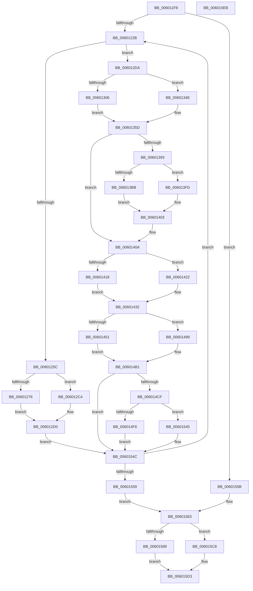

# compress_block

- RVA: `0x006011F8`–`0x006015EC` (길이 `1,012` bytes)
- VA: `0x00000001406011F8`
- 실행 섹션: `.text`
- PDB 이름 있음: `예`; PDB Function 태그: `예`
- unwind 정보 RVA: `0x000D0514`
- 디코드: `276`개 명령, `1,012/1,012` bytes 표시
- 미해석 바이트: `0` (있으면 어셈블리에 `.byte`로 보존)

> 이 문서는 커널 이미지의 기계어와 PDB 기호를 분석해 생성했습니다. 4번과 5번은 함수 원형과 자료형을 바이너리 사용 방식에서 추정한 C 해석이며 원본 소스 복구 결과는 아닙니다.

## 1. Dependencies

- 직접 호출 지점: **0**; 고유 호출 대상: **0**
- 직접 호출자로 확인된 함수: **1**
- RIP 상대 이미지 참조: **1**

### Outgoing calls
- 직접 디코드된 call 명령이 없습니다.

### Direct callers
- [tr_flush_block](tr_flush_block_function_00600AF8.md) at `0x00600D85`

### Static image references
- `0x00601232` → RVA `0x00000000` (`image boundary/outside`; read)

## 2. Other-region calls and transfers

- 다른 실행 섹션으로 향하는 call: **0**
- 별도 외부 분기/꼬리 이동을 확인하지 못했습니다.

## 3. Assembly (complete function range)

```asm
006011F8  4C 89 44 24 18                  mov qword ptr [rsp + 0x18], r8
006011FD  53                              push rbx
006011FE  55                              push rbp
006011FF  56                              push rsi
00601200  57                              push rdi
00601201  41 54                           push r12
00601203  41 55                           push r13
00601205  41 56                           push r14
00601207  41 57                           push r15
00601209  48 83 EC 18                     sub rsp, 0x18
0060120D  33 FF                           xor edi, edi
0060120F  4C 8D 91 60 17 00 00            lea r10, [rcx + 0x1760]
00601216  4C 8B FA                        mov r15, rdx
00601219  4C 8B C9                        mov r9, rcx
0060121C  8D 6F 10                        lea ebp, [rdi + 0x10]
0060121F  39 B9 44 17 00 00               cmp dword ptr [rcx + 0x1744], edi
00601225  0F 84 30 03 00 00               je 0x14060155b
0060122B  49 8B 91 38 17 00 00            mov rdx, qword ptr [r9 + 0x1738]
00601232  4C 8D 1D C7 ED 9F FF            lea r11, [rip - 0x601239]
00601239  49 8D 59 10                     lea rbx, [r9 + 0x10]
0060123D  44 0F B6 04 17                  movzx r8d, byte ptr [rdi + rdx]
00601242  FF C7                           inc edi
00601244  0F B6 0C 17                     movzx ecx, byte ptr [rdi + rdx]
00601248  FF C7                           inc edi
0060124A  C1 E1 08                        shl ecx, 8
0060124D  44 0F B6 34 17                  movzx r14d, byte ptr [rdi + rdx]
00601252  FF C7                           inc edi
00601254  44 03 C1                        add r8d, ecx
00601257  41 8B 0A                        mov ecx, dword ptr [r10]
0060125A  75 7E                           jne 0x1406012da
0060125C  49 63 C6                        movsxd rax, r14d
0060125F  4D 8D 59 28                     lea r11, [r9 + 0x28]
00601263  41 0F B7 74 87 02               movzx esi, word ptr [r15 + rax*4 + 2]
00601269  45 0F B7 04 87                  movzx r8d, word ptr [r15 + rax*4]
0060126E  8B C5                           mov eax, ebp
00601270  2B C6                           sub eax, esi
00601272  3B C8                           cmp ecx, eax
00601274  7E 4E                           jle 0x1406012c4
00601276  41 8B 13                        mov edx, dword ptr [r11]
00601279  41 0F B7 C0                     movzx eax, r8w
0060127D  66 D3 E0                        shl ax, cl
00601280  66 41 09 81 5C 17 00 00         or word ptr [r9 + 0x175c], ax
00601288  41 8A 81 5C 17 00 00            mov al, byte ptr [r9 + 0x175c]
0060128F  48 8B 0B                        mov rcx, qword ptr [rbx]
00601292  88 04 0A                        mov byte ptr [rdx + rcx], al
00601295  41 FF 03                        inc dword ptr [r11]
00601298  41 8B 13                        mov edx, dword ptr [r11]
0060129B  48 8B 0B                        mov rcx, qword ptr [rbx]
0060129E  41 8A 81 5D 17 00 00            mov al, byte ptr [r9 + 0x175d]
006012A5  88 04 0A                        mov byte ptr [rdx + rcx], al
006012A8  8B CD                           mov ecx, ebp
006012AA  41 2A 0A                        sub cl, byte ptr [r10]
006012AD  41 FF 03                        inc dword ptr [r11]
006012B0  66 41 D3 E8                     shr r8w, cl
006012B4  41 8B 0A                        mov ecx, dword ptr [r10]
006012B7  83 C1 F0                        add ecx, -0x10
006012BA  66 45 89 81 5C 17 00 00         mov word ptr [r9 + 0x175c], r8w
006012C2  EB 0C                           jmp 0x1406012d0
006012C4  66 41 D3 E0                     shl r8w, cl
006012C8  66 45 09 81 5C 17 00 00         or word ptr [r9 + 0x175c], r8w
006012D0  03 CE                           add ecx, esi
006012D2  41 89 0A                        mov dword ptr [r10], ecx
006012D5  E9 72 02 00 00                  jmp 0x14060154c
006012DA  47 0F B6 AC 1E 20 67 03 00      movzx r13d, byte ptr [r14 + r11 + 0x36720]
006012E3  45 0F B7 99 5C 17 00 00         movzx r11d, word ptr [r9 + 0x175c]
006012EB  41 8D 85 01 01 00 00            lea eax, [r13 + 0x101]
006012F2  45 0F B7 64 87 02               movzx r12d, word ptr [r15 + rax*4 + 2]
006012F8  41 0F B7 34 87                  movzx esi, word ptr [r15 + rax*4]
006012FD  8B C5                           mov eax, ebp
006012FF  41 2B C4                        sub eax, r12d
00601302  3B C8                           cmp ecx, eax
00601304  7E 48                           jle 0x14060134e
00601306  0F B7 C6                        movzx eax, si
00601309  66 D3 E0                        shl ax, cl
0060130C  48 8B 0B                        mov rcx, qword ptr [rbx]
0060130F  66 41 0B C3                     or ax, r11w
00601313  4D 8D 59 28                     lea r11, [r9 + 0x28]
00601317  66 41 89 81 5C 17 00 00         mov word ptr [r9 + 0x175c], ax
0060131F  41 8B 13                        mov edx, dword ptr [r11]
00601322  88 04 0A                        mov byte ptr [rdx + rcx], al
00601325  41 FF 03                        inc dword ptr [r11]
00601328  41 8B 13                        mov edx, dword ptr [r11]
0060132B  48 8B 0B                        mov rcx, qword ptr [rbx]
0060132E  41 8A 81 5D 17 00 00            mov al, byte ptr [r9 + 0x175d]
00601335  88 04 0A                        mov byte ptr [rdx + rcx], al
00601338  8B CD                           mov ecx, ebp
0060133A  41 8B 12                        mov edx, dword ptr [r10]
0060133D  41 FF 03                        inc dword ptr [r11]
00601340  83 C2 F0                        add edx, -0x10
00601343  41 2A 0A                        sub cl, byte ptr [r10]
00601346  41 03 D4                        add edx, r12d
00601349  66 D3 EE                        shr si, cl
0060134C  EB 0F                           jmp 0x14060135d
0060134E  66 D3 E6                        shl si, cl
00601351  42 8D 14 21                     lea edx, [rcx + r12]
00601355  66 41 0B F3                     or si, r11w
00601359  4D 8D 59 28                     lea r11, [r9 + 0x28]
0060135D  66 41 89 B1 5C 17 00 00         mov word ptr [r9 + 0x175c], si
00601365  48 8D 0D 94 EC 9F FF            lea rcx, [rip - 0x60136c]
0060136C  41 89 12                        mov dword ptr [r10], edx
0060136F  49 8B C5                        mov rax, r13
00601372  46 8B AC A9 90 6E 03 00         mov r13d, dword ptr [rcx + r13*4 + 0x36e90]
0060137A  4C 89 5C 24 08                  mov qword ptr [rsp + 8], r11
0060137F  4C 89 5C 24 78                  mov qword ptr [rsp + 0x78], r11
00601384  48 89 5C 24 68                  mov qword ptr [rsp + 0x68], rbx
00601389  4C 89 5C 24 60                  mov qword ptr [rsp + 0x60], r11
0060138E  45 85 ED                        test r13d, r13d
00601391  74 77                           je 0x14060140a
00601393  44 2B B4 81 20 68 03 00         sub r14d, dword ptr [rcx + rax*4 + 0x36820]
0060139B  8B CA                           mov ecx, edx
0060139D  41 0F B7 C6                     movzx eax, r14w
006013A1  66 D3 E0                        shl ax, cl
006013A4  66 0B C6                        or ax, si
006013A7  0F B7 F0                        movzx esi, ax
006013AA  66 41 89 81 5C 17 00 00         mov word ptr [r9 + 0x175c], ax
006013B2  8B C5                           mov eax, ebp
006013B4  41 2B C5                        sub eax, r13d
006013B7  3B D0                           cmp edx, eax
006013B9  7E 42                           jle 0x1406013fd
006013BB  41 8B 13                        mov edx, dword ptr [r11]
006013BE  40 8A C6                        mov al, sil
006013C1  48 8B 0B                        mov rcx, qword ptr [rbx]
006013C4  41 0F B7 F6                     movzx esi, r14w
006013C8  88 04 0A                        mov byte ptr [rdx + rcx], al
006013CB  41 FF 03                        inc dword ptr [r11]
006013CE  41 8B 13                        mov edx, dword ptr [r11]
006013D1  41 8A 81 5D 17 00 00            mov al, byte ptr [r9 + 0x175d]
006013D8  48 8B 0B                        mov rcx, qword ptr [rbx]
006013DB  88 04 0A                        mov byte ptr [rdx + rcx], al
006013DE  8B CD                           mov ecx, ebp
006013E0  41 2A 0A                        sub cl, byte ptr [r10]
006013E3  41 8D 45 F0                     lea eax, [r13 - 0x10]
006013E7  41 FF 03                        inc dword ptr [r11]
006013EA  66 D3 EE                        shr si, cl
006013ED  41 01 02                        add dword ptr [r10], eax
006013F0  41 8B 12                        mov edx, dword ptr [r10]
006013F3  66 41 89 B1 5C 17 00 00         mov word ptr [r9 + 0x175c], si
006013FB  EB 06                           jmp 0x140601403
006013FD  41 03 D5                        add edx, r13d
00601400  41 89 12                        mov dword ptr [r10], edx
00601403  48 8D 0D F6 EB 9F FF            lea rcx, [rip - 0x60140a]
0060140A  41 FF C8                        dec r8d
0060140D  41 BE 00 01 00 00               mov r14d, 0x100
00601413  45 3B C6                        cmp r8d, r14d
00601416  73 0A                           jae 0x140601422
00601418  41 8A 8C 08 20 65 03 00         mov cl, byte ptr [r8 + rcx + 0x36520]
00601420  EB 10                           jmp 0x140601432
00601422  41 8B C0                        mov eax, r8d
00601425  C1 E8 07                        shr eax, 7
00601428  41 03 C6                        add eax, r14d
0060142B  8A 8C 08 20 65 03 00            mov cl, byte ptr [rax + rcx + 0x36520]
00601432  48 8B 44 24 70                  mov rax, qword ptr [rsp + 0x70]
00601437  44 0F B6 E9                     movzx r13d, cl
0060143B  8B CA                           mov ecx, edx
0060143D  46 0F B7 64 A8 02               movzx r12d, word ptr [rax + r13*4 + 2]
00601443  46 0F B7 34 A8                  movzx r14d, word ptr [rax + r13*4]
00601448  8B C5                           mov eax, ebp
0060144A  41 2B C4                        sub eax, r12d
0060144D  3B D0                           cmp edx, eax
0060144F  7E 48                           jle 0x140601499
00601451  41 8B 13                        mov edx, dword ptr [r11]
00601454  41 0F B7 C6                     movzx eax, r14w
00601458  66 D3 E0                        shl ax, cl
0060145B  48 8B 0B                        mov rcx, qword ptr [rbx]
0060145E  66 0B C6                        or ax, si
00601461  66 41 89 81 5C 17 00 00         mov word ptr [r9 + 0x175c], ax
00601469  88 04 0A                        mov byte ptr [rdx + rcx], al
0060146C  41 FF 03                        inc dword ptr [r11]
0060146F  41 8B 13                        mov edx, dword ptr [r11]
00601472  48 8B 0B                        mov rcx, qword ptr [rbx]
00601475  41 8A 81 5D 17 00 00            mov al, byte ptr [r9 + 0x175d]
0060147C  88 04 0A                        mov byte ptr [rdx + rcx], al
0060147F  8B CD                           mov ecx, ebp
00601481  41 8B 02                        mov eax, dword ptr [r10]
00601484  49 8B D3                        mov rdx, r11
00601487  41 FF 03                        inc dword ptr [r11]
0060148A  83 C0 F0                        add eax, -0x10
0060148D  41 2A 0A                        sub cl, byte ptr [r10]
00601490  44 03 E0                        add r12d, eax
00601493  66 41 D3 EE                     shr r14w, cl
00601497  EB 18                           jmp 0x1406014b1
00601499  44 03 E2                        add r12d, edx
0060149C  66 41 D3 E6                     shl r14w, cl
006014A0  48 8B 54 24 60                  mov rdx, qword ptr [rsp + 0x60]
006014A5  4D 8D 59 28                     lea r11, [r9 + 0x28]
006014A9  66 44 0B F6                     or r14w, si
006014AD  49 8D 59 10                     lea rbx, [r9 + 0x10]
006014B1  66 45 89 B1 5C 17 00 00         mov word ptr [r9 + 0x175c], r14w
006014B9  48 8D 05 40 EB 9F FF            lea rax, [rip - 0x6014c0]
006014C0  45 89 22                        mov dword ptr [r10], r12d
006014C3  42 8B B4 A8 A0 68 03 00         mov esi, dword ptr [rax + r13*4 + 0x368a0]
006014CB  85 F6                           test esi, esi
006014CD  74 7D                           je 0x14060154c
006014CF  46 2B 84 A8 10 6F 03 00         sub r8d, dword ptr [rax + r13*4 + 0x36f10]
006014D7  41 8B CC                        mov ecx, r12d
006014DA  41 0F B7 C0                     movzx eax, r8w
006014DE  66 D3 E0                        shl ax, cl
006014E1  66 41 0B C6                     or ax, r14w
006014E5  66 41 89 81 5C 17 00 00         mov word ptr [r9 + 0x175c], ax
006014ED  8B C5                           mov eax, ebp
006014EF  2B C6                           sub eax, esi
006014F1  44 3B E0                        cmp r12d, eax
006014F4  7E 4F                           jle 0x140601545
006014F6  8B 12                           mov edx, dword ptr [rdx]
006014F8  41 8A 81 5C 17 00 00            mov al, byte ptr [r9 + 0x175c]
006014FF  48 8B 5C 24 68                  mov rbx, qword ptr [rsp + 0x68]
00601504  4C 8B 5C 24 60                  mov r11, qword ptr [rsp + 0x60]
00601509  48 8B 0B                        mov rcx, qword ptr [rbx]
0060150C  88 04 0A                        mov byte ptr [rdx + rcx], al
0060150F  48 8B 44 24 78                  mov rax, qword ptr [rsp + 0x78]
00601514  48 8B 0B                        mov rcx, qword ptr [rbx]
00601517  FF 00                           inc dword ptr [rax]
00601519  8B 10                           mov edx, dword ptr [rax]
0060151B  41 8A 81 5D 17 00 00            mov al, byte ptr [r9 + 0x175d]
00601522  88 04 0A                        mov byte ptr [rdx + rcx], al
00601525  8B CD                           mov ecx, ebp
00601527  48 8B 44 24 08                  mov rax, qword ptr [rsp + 8]
0060152C  41 2A 0A                        sub cl, byte ptr [r10]
0060152F  66 41 D3 E8                     shr r8w, cl
00601533  66 45 89 81 5C 17 00 00         mov word ptr [r9 + 0x175c], r8w
0060153B  FF 00                           inc dword ptr [rax]
0060153D  8D 46 F0                        lea eax, [rsi - 0x10]
00601540  41 01 02                        add dword ptr [r10], eax
00601543  EB 07                           jmp 0x14060154c
00601545  41 8D 04 34                     lea eax, [r12 + rsi]
00601549  41 89 02                        mov dword ptr [r10], eax
0060154C  41 3B B9 44 17 00 00            cmp edi, dword ptr [r9 + 0x1744]
00601553  0F 82 D2 FC FF FF               jb 0x14060122b
00601559  EB 08                           jmp 0x140601563
0060155B  4C 8D 59 28                     lea r11, [rcx + 0x28]
0060155F  48 8D 59 10                     lea rbx, [rcx + 0x10]
00601563  41 0F B7 B7 02 04 00 00         movzx esi, word ptr [r15 + 0x402]
0060156B  49 8D B9 5C 17 00 00            lea rdi, [r9 + 0x175c]
00601572  41 8B 0A                        mov ecx, dword ptr [r10]
00601575  8B C5                           mov eax, ebp
00601577  45 0F B7 8F 00 04 00 00         movzx r9d, word ptr [r15 + 0x400]
0060157F  2B C6                           sub eax, esi
00601581  44 0F B7 07                     movzx r8d, word ptr [rdi]
00601585  3B C8                           cmp ecx, eax
00601587  7E 3F                           jle 0x1406015c8
00601589  48 8B 13                        mov rdx, qword ptr [rbx]
0060158C  41 0F B7 C1                     movzx eax, r9w
00601590  66 D3 E0                        shl ax, cl
00601593  66 41 0B C0                     or ax, r8w
00601597  45 8B 03                        mov r8d, dword ptr [r11]
0060159A  66 89 07                        mov word ptr [rdi], ax
0060159D  41 88 04 10                     mov byte ptr [r8 + rdx], al
006015A1  41 FF 03                        inc dword ptr [r11]
006015A4  45 8B 03                        mov r8d, dword ptr [r11]
006015A7  48 8B 13                        mov rdx, qword ptr [rbx]
006015AA  8A 47 01                        mov al, byte ptr [rdi + 1]
006015AD  41 88 04 10                     mov byte ptr [r8 + rdx], al
006015B1  41 2A 2A                        sub bpl, byte ptr [r10]
006015B4  41 8B 12                        mov edx, dword ptr [r10]
006015B7  40 8A CD                        mov cl, bpl
006015BA  41 FF 03                        inc dword ptr [r11]
006015BD  83 C2 F0                        add edx, -0x10
006015C0  03 D6                           add edx, esi
006015C2  66 41 D3 E9                     shr r9w, cl
006015C6  EB 0B                           jmp 0x1406015d3
006015C8  66 41 D3 E1                     shl r9w, cl
006015CC  8D 14 31                        lea edx, [rcx + rsi]
006015CF  66 45 0B C8                     or r9w, r8w
006015D3  66 44 89 0F                     mov word ptr [rdi], r9w
006015D7  41 89 12                        mov dword ptr [r10], edx
006015DA  48 83 C4 18                     add rsp, 0x18
006015DE  41 5F                           pop r15
006015E0  41 5E                           pop r14
006015E2  41 5D                           pop r13
006015E4  41 5C                           pop r12
006015E6  5F                              pop rdi
006015E7  5E                              pop rsi
006015E8  5D                              pop rbp
006015E9  5B                              pop rbx
006015EA  C3                              ret
006015EB  CC                              int3
```

## 4. C-style interpretation (structured pseudocode)

```c
__int64 __fastcall compress_block(__int64 a1, __int64 a2, __int64 a3)
{
    __int64 result;
    __int64 v_r12;
    __int64 v_r14;
    __int64 v_rbp;
    __int64 v_rdi;
    __int64 v_rsi;
    __int64 v_rsp;
    unsigned __int64 v_stack_m50;
    unsigned __int64 v_stack_p10;
    unsigned __int64 v_stack_p18;
    unsigned __int64 v_stack_p20;
    unsigned __int64 v_stack_p8;

    v_stack_p18 = a3;
    v_rsp = (v_rsp) - (24);
    v_rdi = 0;
    if ((*(unsigned int *)(a1 + 5956)) == 0) goto loc_0060155B;
loc_0060122B:
    v_rdi = (unsigned int)((v_rdi) + 1);
    v_rdi = (unsigned int)((v_rdi) + 1);
    a1 = (unsigned int)((*(unsigned __int8 *)(v_rdi + *(unsigned __int64 *)(a1 + 5944) * 1)) << (8));
    v_rdi = (unsigned int)((v_rdi) + 1);
    a3 = (unsigned int)((*(unsigned __int8 *)(v_rdi + *(unsigned __int64 *)(a1 + 5944) * 1)) + ((unsigned int)(a1)));
    if (condition_is_not_equal) goto loc_006012DA;
    result = (unsigned int)(((unsigned int)((unsigned int)(v_rdi + 16))) - ((unsigned int)(*(unsigned __int16 *)(a2 + (int)((unsigned int)(*(unsigned __int8 *)(v_rdi + *(unsigned __int64 *)(a1 + 5944) * 1))) * 4 + 2))));
    if (((unsigned int)((unsigned int)(*(unsigned int *)(a1 + 5984)))) <= ((unsigned int)(result))) goto loc_006012C4;
    result = (unsigned __int16)(((unsigned __int16)(*(unsigned __int16 *)(a2 + (int)((unsigned int)(*(unsigned __int8 *)(v_rdi + *(unsigned __int64 *)(a1 + 5944) * 1))) * 4))) << ((unsigned __int8)((unsigned int)(*(unsigned int *)(a1 + 5984)))));
    *(unsigned __int8 *)((unsigned int)(*(unsigned int *)(a1 + 40)) + *(unsigned __int64 *)(a1 + 16) * 1) = (unsigned __int8)(*(unsigned __int8 *)(a1 + 5980));
    *(unsigned __int8 *)((unsigned int)(*(unsigned int *)(a1 + 40)) + *(unsigned __int64 *)(a1 + 16) * 1) = (unsigned __int8)(*(unsigned __int8 *)(a1 + 5981));
    a1 = (unsigned __int8)(((unsigned int)((unsigned int)(v_rdi + 16))) - (*(unsigned __int8 *)(a1 + 5984)));
    a3 = (unsigned __int16)((*(unsigned __int16 *)(a2 + (int)((unsigned int)(*(unsigned __int8 *)(v_rdi + *(unsigned __int64 *)(a1 + 5944) * 1))) * 4)) >> ((unsigned __int8)(a1)));
    a1 = (unsigned int)(((unsigned int)(*(unsigned int *)(a1 + 5984))) + (-16));
    *(unsigned __int16 *)(a1 + 5980) = (unsigned __int16)(a3);
    goto loc_006012D0;
loc_006012C4:
    a3 = (unsigned __int16)((a3) << ((unsigned __int8)(a1)));
loc_006012D0:
    a1 = (unsigned int)((a1) + ((unsigned int)(*(unsigned __int16 *)(a2 + (int)((unsigned int)(*(unsigned __int8 *)(v_rdi + *(unsigned __int64 *)(a1 + 5944) * 1))) * 4 + 2))));
    *(unsigned int *)(a1 + 5984) = (unsigned int)(a1);
    goto loc_0060154C;
loc_006012DA:
    result = (unsigned int)(((unsigned int)((unsigned int)(v_rdi + 16))) - ((unsigned int)(*(unsigned __int16 *)(a2 + *(unsigned __int8 *)(*(unsigned __int8 *)(v_rdi + *(unsigned __int64 *)(a1 + 5944) * 1) + a1 + 40 * 1 + 223008) + 257 * 4 + 2))));
    if (((unsigned int)(a1)) <= ((unsigned int)(result))) goto loc_0060134E;
    result = (unsigned __int16)(((unsigned __int16)(*(unsigned __int16 *)(a2 + *(unsigned __int8 *)(*(unsigned __int8 *)(v_rdi + *(unsigned __int64 *)(a1 + 5944) * 1) + a1 + 40 * 1 + 223008) + 257 * 4))) << ((unsigned __int8)(a1)));
    result = (unsigned __int16)((result) | ((unsigned __int16)(*(unsigned __int16 *)(a1 + 5980))));
    *(unsigned __int16 *)(a1 + 5980) = (unsigned __int16)(result);
    *(unsigned __int8 *)((unsigned int)(*(unsigned int *)(a1 + 40)) + *(unsigned __int64 *)(a1 + 16) * 1) = (unsigned __int8)(result);
    *(unsigned __int8 *)((unsigned int)(*(unsigned int *)(a1 + 40)) + *(unsigned __int64 *)(a1 + 16) * 1) = (unsigned __int8)(*(unsigned __int8 *)(a1 + 5981));
    a2 = (unsigned int)(((unsigned int)(*(unsigned int *)(a1 + 5984))) + (-16));
    a1 = (unsigned __int8)(((unsigned int)((unsigned int)(v_rdi + 16))) - (*(unsigned __int8 *)(a1 + 5984)));
    a2 = (unsigned int)((a2) + ((unsigned int)(*(unsigned __int16 *)(a2 + *(unsigned __int8 *)(*(unsigned __int8 *)(v_rdi + *(unsigned __int64 *)(a1 + 5944) * 1) + a1 + 40 * 1 + 223008) + 257 * 4 + 2))));
    v_rsi = (unsigned __int16)((*(unsigned __int16 *)(a2 + *(unsigned __int8 *)(*(unsigned __int8 *)(v_rdi + *(unsigned __int64 *)(a1 + 5944) * 1) + a1 + 40 * 1 + 223008) + 257 * 4)) >> ((unsigned __int8)(a1)));
    goto loc_0060135D;
loc_0060134E:
    v_rsi = (unsigned __int16)((v_rsi) << ((unsigned __int8)(a1)));
    v_rsi = (unsigned __int16)((v_rsi) | ((unsigned __int16)(a1 + 40)));
loc_0060135D:
    *(unsigned __int16 *)(a1 + 5980) = (unsigned __int16)(v_rsi);
    *(unsigned int *)(a1 + 5984) = (unsigned int)(a1 + *(unsigned __int16 *)(a2 + *(unsigned __int8 *)(*(unsigned __int8 *)(v_rdi + *(unsigned __int64 *)(a1 + 5944) * 1) + a1 + 40 * 1 + 223008) + 257 * 4 + 2) * 1);
    v_stack_m50 = a1 + 40;
    v_stack_p20 = a1 + 40;
    v_stack_p10 = a1 + 16;
    v_stack_p8 = a1 + 40;
    if ((unsigned int)((unsigned int)(*(unsigned int *)(v_rip - 6296428 + *(unsigned __int8 *)(*(unsigned __int8 *)(v_rdi + *(unsigned __int64 *)(a1 + 5944) * 1) + a1 + 40 * 1 + 223008) * 4 + 224912))) == 0) goto loc_0060140A;
    v_r14 = (unsigned int)((*(unsigned __int8 *)(v_rdi + *(unsigned __int64 *)(a1 + 5944) * 1)) - (*(unsigned int *)(v_rip - 6296428 + *(unsigned __int8 *)(*(unsigned __int8 *)(v_rdi + *(unsigned __int64 *)(a1 + 5944) * 1) + a1 + 40 * 1 + 223008) * 4 + 223264)));
    result = (unsigned __int16)(((unsigned __int16)(v_r14)) << ((unsigned __int8)((unsigned int)((unsigned int)(a1 + *(unsigned __int16 *)(a2 + *(unsigned __int8 *)(*(unsigned __int8 *)(v_rdi + *(unsigned __int64 *)(a1 + 5944) * 1) + a1 + 40 * 1 + 223008) + 257 * 4 + 2) * 1)))));
    result = (unsigned __int16)((result) | ((unsigned __int16)(v_rsi)));
    *(unsigned __int16 *)(a1 + 5980) = (unsigned __int16)(result);
    result = (unsigned int)(((unsigned int)((unsigned int)(v_rdi + 16))) - ((unsigned int)((unsigned int)(*(unsigned int *)(v_rip - 6296428 + *(unsigned __int8 *)(*(unsigned __int8 *)(v_rdi + *(unsigned __int64 *)(a1 + 5944) * 1) + a1 + 40 * 1 + 223008) * 4 + 224912)))));
    if (((unsigned int)(a1 + *(unsigned __int16 *)(a2 + *(unsigned __int8 *)(*(unsigned __int8 *)(v_rdi + *(unsigned __int64 *)(a1 + 5944) * 1) + a1 + 40 * 1 + 223008) + 257 * 4 + 2) * 1)) <= ((unsigned int)(result))) goto loc_006013FD;
    *(unsigned __int8 *)((unsigned int)(*(unsigned int *)(a1 + 40)) + *(unsigned __int64 *)(a1 + 16) * 1) = (unsigned __int8)((unsigned __int8)((unsigned __int16)(result)));
    *(unsigned __int8 *)((unsigned int)(*(unsigned int *)(a1 + 40)) + *(unsigned __int64 *)(a1 + 16) * 1) = (unsigned __int8)(*(unsigned __int8 *)(a1 + 5981));
    a1 = (unsigned __int8)(((unsigned int)((unsigned int)(v_rdi + 16))) - (*(unsigned __int8 *)(a1 + 5984)));
    v_rsi = (unsigned __int16)(((unsigned __int16)(v_r14)) >> ((unsigned __int8)(a1)));
    *(unsigned __int16 *)(a1 + 5980) = (unsigned __int16)(v_rsi);
    goto loc_00601403;
loc_006013FD:
    a2 = (unsigned int)(((unsigned int)(*(unsigned int *)(a1 + 5984))) + ((unsigned int)((unsigned int)(*(unsigned int *)(v_rip - 6296428 + *(unsigned __int8 *)(*(unsigned __int8 *)(v_rdi + *(unsigned __int64 *)(a1 + 5944) * 1) + a1 + 40 * 1 + 223008) * 4 + 224912)))));
    *(unsigned int *)(a1 + 5984) = (unsigned int)(a2);
loc_00601403:
loc_0060140A:
    a3 = (unsigned int)((a3) - 1);
    if (((unsigned int)(a3)) >= 256) goto loc_00601422;
    goto loc_00601432;
loc_00601422:
    result = (unsigned int)(((unsigned int)((unsigned int)(a3))) >> (7));
    result = (unsigned int)((result) + (256));
loc_00601432:
    result = (unsigned int)(((unsigned int)((unsigned int)(v_rdi + 16))) - ((unsigned int)(*(unsigned __int16 *)(v_stack_p18 + (unsigned __int8)(*(unsigned __int8 *)(result + *(unsigned __int8 *)(a3 + v_rip - 6296586 * 1 + 222496) * 1 + 222496)) * 4 + 2))));
    if (((unsigned int)(a2)) <= ((unsigned int)(result))) goto loc_00601499;
    result = (unsigned __int16)(((unsigned __int16)(*(unsigned __int16 *)(v_stack_p18 + (unsigned __int8)(*(unsigned __int8 *)(result + *(unsigned __int8 *)(a3 + v_rip - 6296586 * 1 + 222496) * 1 + 222496)) * 4))) << ((unsigned __int8)((unsigned int)((unsigned int)(a2)))));
    result = (unsigned __int16)((result) | ((unsigned __int16)(v_rsi)));
    *(unsigned __int16 *)(a1 + 5980) = (unsigned __int16)(result);
    *(unsigned __int8 *)((unsigned int)(*(unsigned int *)(a1 + 40)) + *(unsigned __int64 *)(a1 + 16) * 1) = (unsigned __int8)(result);
    *(unsigned __int8 *)((unsigned int)(*(unsigned int *)(a1 + 40)) + *(unsigned __int64 *)(a1 + 16) * 1) = (unsigned __int8)(*(unsigned __int8 *)(a1 + 5981));
    result = (unsigned int)(((unsigned int)(*(unsigned int *)(a1 + 5984))) + (-16));
    a1 = (unsigned __int8)(((unsigned int)((unsigned int)(v_rdi + 16))) - (*(unsigned __int8 *)(a1 + 5984)));
    v_r12 = (unsigned int)((*(unsigned __int16 *)(v_stack_p18 + (unsigned __int8)(*(unsigned __int8 *)(result + *(unsigned __int8 *)(a3 + v_rip - 6296586 * 1 + 222496) * 1 + 222496)) * 4 + 2)) + ((unsigned int)(result)));
    v_r14 = (unsigned __int16)((*(unsigned __int16 *)(v_stack_p18 + (unsigned __int8)(*(unsigned __int8 *)(result + *(unsigned __int8 *)(a3 + v_rip - 6296586 * 1 + 222496) * 1 + 222496)) * 4)) >> ((unsigned __int8)(a1)));
    goto loc_006014B1;
loc_00601499:
    v_r12 = (unsigned int)((v_r12) + ((unsigned int)(a1 + 40)));
    v_r14 = (unsigned __int16)((v_r14) << ((unsigned __int8)(a1)));
    v_r14 = (unsigned __int16)((v_r14) | ((unsigned __int16)(v_rsi)));
loc_006014B1:
    *(unsigned __int16 *)(a1 + 5980) = (unsigned __int16)(v_r14);
    *(unsigned int *)(a1 + 5984) = (unsigned int)(v_r12);
    if ((unsigned int)((unsigned int)(*(unsigned int *)(v_rip - 6296768 + (unsigned __int8)(*(unsigned __int8 *)(result + *(unsigned __int8 *)(a3 + v_rip - 6296586 * 1 + 222496) * 1 + 222496)) * 4 + 223392))) == 0) goto loc_0060154C;
    a3 = (unsigned int)((a3) - (*(unsigned int *)(v_rip - 6296768 + (unsigned __int8)(*(unsigned __int8 *)(result + *(unsigned __int8 *)(a3 + v_rip - 6296586 * 1 + 222496) * 1 + 222496)) * 4 + 225040)));
    result = (unsigned __int16)(((unsigned __int16)(a3)) << ((unsigned __int8)((unsigned int)((unsigned int)(v_r12)))));
    result = (unsigned __int16)((result) | ((unsigned __int16)(v_r14)));
    *(unsigned __int16 *)(a1 + 5980) = (unsigned __int16)(result);
    result = (unsigned int)(((unsigned int)((unsigned int)(v_rdi + 16))) - ((unsigned int)((unsigned int)(*(unsigned int *)(v_rip - 6296768 + (unsigned __int8)(*(unsigned __int8 *)(result + *(unsigned __int8 *)(a3 + v_rip - 6296586 * 1 + 222496) * 1 + 222496)) * 4 + 223392)))));
    if (((unsigned int)(v_r12)) <= ((unsigned int)(result))) goto loc_00601545;
    *(unsigned __int8 *)((unsigned int)(*(unsigned int *)(v_stack_p8)) + *(unsigned __int64 *)(v_stack_p10) * 1) = (unsigned __int8)(*(unsigned __int8 *)(a1 + 5980));
    *(unsigned __int8 *)((unsigned int)(*(unsigned int *)(v_stack_p20)) + *(unsigned __int64 *)(v_stack_p10) * 1) = (unsigned __int8)(*(unsigned __int8 *)(a1 + 5981));
    a1 = (unsigned __int8)(((unsigned int)((unsigned int)(v_rdi + 16))) - (*(unsigned __int8 *)(a1 + 5984)));
    a3 = (unsigned __int16)((a3) >> ((unsigned __int8)(a1)));
    *(unsigned __int16 *)(a1 + 5980) = (unsigned __int16)(a3);
    goto loc_0060154C;
loc_00601545:
    *(unsigned int *)(a1 + 5984) = (unsigned int)(v_r12 + (unsigned int)(*(unsigned int *)(v_rip - 6296768 + (unsigned __int8)(*(unsigned __int8 *)(result + *(unsigned __int8 *)(a3 + v_rip - 6296586 * 1 + 222496) * 1 + 222496)) * 4 + 223392)) * 1);
loc_0060154C:
    if (((unsigned int)(v_rdi)) < (*(unsigned int *)(a1 + 5956))) goto loc_0060122B;
    goto loc_00601563;
loc_0060155B:
loc_00601563:
    result = (unsigned int)(((unsigned int)((unsigned int)(v_rdi + 16))) - ((unsigned int)(*(unsigned __int16 *)(a2 + 1026))));
    if (((unsigned int)((unsigned int)(*(unsigned int *)(a1 + 5984)))) <= ((unsigned int)(result))) goto loc_006015C8;
    result = (unsigned __int16)(((unsigned __int16)(*(unsigned __int16 *)(a2 + 1024))) << ((unsigned __int8)((unsigned int)(*(unsigned int *)(a1 + 5984)))));
    result = (unsigned __int16)((result) | ((unsigned __int16)(*(unsigned __int16 *)(a1 + 5980))));
    *(unsigned __int16 *)(a1 + 5980) = (unsigned __int16)(result);
    *(unsigned __int8 *)((unsigned int)(*(unsigned int *)(a1 + 40)) + *(unsigned __int64 *)(a1 + 16) * 1) = (unsigned __int8)(result);
    *(unsigned __int8 *)((unsigned int)(*(unsigned int *)(a1 + 40)) + *(unsigned __int64 *)(a1 + 16) * 1) = (unsigned __int8)(*(unsigned __int8 *)(a1 + 5980 + 1));
    v_rbp = (unsigned __int8)((v_rdi + 16) - (*(unsigned __int8 *)(a1 + 5984)));
    a2 = (unsigned int)(((unsigned int)(*(unsigned int *)(a1 + 5984))) + (-16));
    a2 = (unsigned int)((a2) + ((unsigned int)(*(unsigned __int16 *)(a2 + 1026))));
    a4 = (unsigned __int16)((*(unsigned __int16 *)(a2 + 1024)) >> ((unsigned __int8)((unsigned __int8)(v_rbp))));
    goto loc_006015D3;
loc_006015C8:
    a4 = (unsigned __int16)((a4) << ((unsigned __int8)((unsigned __int8)(v_rbp))));
    a4 = (unsigned __int16)((a4) | ((unsigned __int16)((unsigned int)(*(unsigned int *)(a1 + 40)))));
loc_006015D3:
    *(unsigned __int16 *)(a1 + 5980) = (unsigned __int16)(a4);
    *(unsigned int *)(a1 + 5984) = (unsigned int)((unsigned __int8)(v_rbp) + *(unsigned __int16 *)(a2 + 1026) * 1);
    v_rsp = (v_rsp) + (24);
    return *(unsigned __int8 *)(a1 + 5980 + 1);
}
```

## 5. (Beta) C Style

```c
int64_t compress_block(void *Arg1, void *Arg2, int64_t Arg3)
{
    uint8_t *arg1 = (uint8_t *)Arg1;
    uint8_t *arg2 = (uint8_t *)Arg2;

    int64_t result;
    int64_t local_r12;
    int64_t local_r14;
    int64_t local_rbp;
    int64_t local_rdi;
    int64_t local_rsi;
    int64_t local_rsp;
    uint64_t v_stack_m50;
    uint64_t v_stack_p10;
    uint64_t v_stack_p18;
    uint64_t v_stack_p20;
    uint64_t v_stack_p8;

    v_stack_p18 = Arg3;
    local_rsp = (local_rsp) - (24);
    local_rdi = 0;
    if ((*(uint32_t *)(arg1 + 0x1744)) == 0) goto loc_0060155B;
loc_0060122B:
    local_rdi = (uint32_t)((local_rdi) + 1);
    local_rdi = (uint32_t)((local_rdi) + 1);
    Arg1 = (uint32_t)((*(uint8_t *)(local_rdi + *(uint64_t *)(arg1 + 0x1738) * 1)) << (8));
    local_rdi = (uint32_t)((local_rdi) + 1);
    Arg3 = (uint32_t)((*(uint8_t *)(local_rdi + *(uint64_t *)(arg1 + 0x1738) * 1)) + ((uint32_t)(Arg1)));
    if (condition_is_not_equal) goto loc_006012DA;
    result = (uint32_t)(((uint32_t)((uint32_t)(local_rdi + 16))) - ((uint32_t)(*(uint16_t *)(arg2 + (int32_t)((uint32_t)(*(uint8_t *)(local_rdi + *(uint64_t *)(arg1 + 0x1738) * 1))) * 4 + 0x2))));
    if (((uint32_t)((uint32_t)(*(uint32_t *)(arg1 + 0x1760)))) <= ((uint32_t)(result))) goto loc_006012C4;
    result = (uint16_t)(((uint16_t)(*(uint16_t *)(arg2 + (int32_t)((uint32_t)(*(uint8_t *)(local_rdi + *(uint64_t *)(arg1 + 0x1738) * 1))) * 4))) << ((uint8_t)((uint32_t)(*(uint32_t *)(arg1 + 0x1760)))));
    *(uint8_t *)((uint32_t)(*(uint32_t *)(arg1 + 0x28)) + *(uint64_t *)(arg1 + 0x10) * 1) = (uint8_t)(*(uint8_t *)(arg1 + 0x175C));
    *(uint8_t *)((uint32_t)(*(uint32_t *)(arg1 + 0x28)) + *(uint64_t *)(arg1 + 0x10) * 1) = (uint8_t)(*(uint8_t *)(arg1 + 0x175D));
    Arg1 = (uint8_t)(((uint32_t)((uint32_t)(local_rdi + 16))) - (*(uint8_t *)(arg1 + 0x1760)));
    Arg3 = (uint16_t)((*(uint16_t *)(arg2 + (int32_t)((uint32_t)(*(uint8_t *)(local_rdi + *(uint64_t *)(arg1 + 0x1738) * 1))) * 4)) >> ((uint8_t)(Arg1)));
    Arg1 = (uint32_t)(((uint32_t)(*(uint32_t *)(arg1 + 0x1760))) + (-16));
    *(uint16_t *)(arg1 + 0x175C) = (uint16_t)(Arg3);
    goto loc_006012D0;
loc_006012C4:
    Arg3 = (uint16_t)((Arg3) << ((uint8_t)(Arg1)));
loc_006012D0:
    Arg1 = (uint32_t)((Arg1) + ((uint32_t)(*(uint16_t *)(arg2 + (int32_t)((uint32_t)(*(uint8_t *)(local_rdi + *(uint64_t *)(arg1 + 0x1738) * 1))) * 4 + 0x2))));
    *(uint32_t *)(arg1 + 0x1760) = (uint32_t)(Arg1);
    goto loc_0060154C;
loc_006012DA:
    result = (uint32_t)(((uint32_t)((uint32_t)(local_rdi + 16))) - ((uint32_t)(*(uint16_t *)(arg2 + *(uint8_t *)(*(uint8_t *)(local_rdi + *(uint64_t *)(arg1 + 0x1738) * 1) + arg1 + 0x28 * 1 + 0x36720) + 0x101 * 4 + 0x2))));
    if (((uint32_t)(Arg1)) <= ((uint32_t)(result))) goto loc_0060134E;
    result = (uint16_t)(((uint16_t)(*(uint16_t *)(arg2 + *(uint8_t *)(*(uint8_t *)(local_rdi + *(uint64_t *)(arg1 + 0x1738) * 1) + arg1 + 0x28 * 1 + 0x36720) + 0x101 * 4))) << ((uint8_t)(Arg1)));
    result = (uint16_t)((result) | ((uint16_t)(*(uint16_t *)(arg1 + 0x175C))));
    *(uint16_t *)(arg1 + 0x175C) = (uint16_t)(result);
    *(uint8_t *)((uint32_t)(*(uint32_t *)(arg1 + 0x28)) + *(uint64_t *)(arg1 + 0x10) * 1) = (uint8_t)(result);
    *(uint8_t *)((uint32_t)(*(uint32_t *)(arg1 + 0x28)) + *(uint64_t *)(arg1 + 0x10) * 1) = (uint8_t)(*(uint8_t *)(arg1 + 0x175D));
    Arg2 = (uint32_t)(((uint32_t)(*(uint32_t *)(arg1 + 0x1760))) + (-16));
    Arg1 = (uint8_t)(((uint32_t)((uint32_t)(local_rdi + 16))) - (*(uint8_t *)(arg1 + 0x1760)));
    Arg2 = (uint32_t)((Arg2) + ((uint32_t)(*(uint16_t *)(arg2 + *(uint8_t *)(*(uint8_t *)(local_rdi + *(uint64_t *)(arg1 + 0x1738) * 1) + arg1 + 0x28 * 1 + 0x36720) + 0x101 * 4 + 0x2))));
    local_rsi = (uint16_t)((*(uint16_t *)(arg2 + *(uint8_t *)(*(uint8_t *)(local_rdi + *(uint64_t *)(arg1 + 0x1738) * 1) + arg1 + 0x28 * 1 + 0x36720) + 0x101 * 4)) >> ((uint8_t)(Arg1)));
    goto loc_0060135D;
loc_0060134E:
    local_rsi = (uint16_t)((local_rsi) << ((uint8_t)(Arg1)));
    local_rsi = (uint16_t)((local_rsi) | ((uint16_t)(Arg1 + 40)));
loc_0060135D:
    *(uint16_t *)(arg1 + 0x175C) = (uint16_t)(local_rsi);
    *(uint32_t *)(arg1 + 0x1760) = (uint32_t)(Arg1 + *(uint16_t *)(arg2 + *(uint8_t *)(*(uint8_t *)(local_rdi + *(uint64_t *)(arg1 + 0x1738) * 1) + arg1 + 0x28 * 1 + 0x36720) + 0x101 * 4 + 0x2) * 1);
    v_stack_m50 = Arg1 + 40;
    v_stack_p20 = Arg1 + 40;
    v_stack_p10 = Arg1 + 16;
    v_stack_p8 = Arg1 + 40;
    if ((uint32_t)((uint32_t)(*(uint32_t *)(v_rip - 0x60136C + *(uint8_t *)(*(uint8_t *)(local_rdi + *(uint64_t *)(arg1 + 0x1738) * 1) + arg1 + 0x28 * 1 + 0x36720) * 4 + 0x36E90))) == 0) goto loc_0060140A;
    local_r14 = (uint32_t)((*(uint8_t *)(local_rdi + *(uint64_t *)(arg1 + 0x1738) * 1)) - (*(uint32_t *)(v_rip - 0x60136C + *(uint8_t *)(*(uint8_t *)(local_rdi + *(uint64_t *)(arg1 + 0x1738) * 1) + arg1 + 0x28 * 1 + 0x36720) * 4 + 0x36820)));
    result = (uint16_t)(((uint16_t)(local_r14)) << ((uint8_t)((uint32_t)((uint32_t)(Arg1 + *(uint16_t *)(arg2 + *(uint8_t *)(*(uint8_t *)(local_rdi + *(uint64_t *)(arg1 + 0x1738) * 1) + arg1 + 0x28 * 1 + 0x36720) + 0x101 * 4 + 0x2) * 1)))));
    result = (uint16_t)((result) | ((uint16_t)(local_rsi)));
    *(uint16_t *)(arg1 + 0x175C) = (uint16_t)(result);
    result = (uint32_t)(((uint32_t)((uint32_t)(local_rdi + 16))) - ((uint32_t)((uint32_t)(*(uint32_t *)(v_rip - 0x60136C + *(uint8_t *)(*(uint8_t *)(local_rdi + *(uint64_t *)(arg1 + 0x1738) * 1) + arg1 + 0x28 * 1 + 0x36720) * 4 + 0x36E90)))));
    if (((uint32_t)(Arg1 + *(uint16_t *)(arg2 + *(uint8_t *)(*(uint8_t *)(local_rdi + *(uint64_t *)(arg1 + 0x1738) * 1) + arg1 + 0x28 * 1 + 0x36720) + 0x101 * 4 + 0x2) * 1)) <= ((uint32_t)(result))) goto loc_006013FD;
    *(uint8_t *)((uint32_t)(*(uint32_t *)(arg1 + 0x28)) + *(uint64_t *)(arg1 + 0x10) * 1) = (uint8_t)((uint8_t)((uint16_t)(result)));
    *(uint8_t *)((uint32_t)(*(uint32_t *)(arg1 + 0x28)) + *(uint64_t *)(arg1 + 0x10) * 1) = (uint8_t)(*(uint8_t *)(arg1 + 0x175D));
    Arg1 = (uint8_t)(((uint32_t)((uint32_t)(local_rdi + 16))) - (*(uint8_t *)(arg1 + 0x1760)));
    local_rsi = (uint16_t)(((uint16_t)(local_r14)) >> ((uint8_t)(Arg1)));
    *(uint16_t *)(arg1 + 0x175C) = (uint16_t)(local_rsi);
    goto loc_00601403;
loc_006013FD:
    Arg2 = (uint32_t)(((uint32_t)(*(uint32_t *)(arg1 + 0x1760))) + ((uint32_t)((uint32_t)(*(uint32_t *)(v_rip - 0x60136C + *(uint8_t *)(*(uint8_t *)(local_rdi + *(uint64_t *)(arg1 + 0x1738) * 1) + arg1 + 0x28 * 1 + 0x36720) * 4 + 0x36E90)))));
    *(uint32_t *)(arg1 + 0x1760) = (uint32_t)(Arg2);
loc_00601403:
loc_0060140A:
    Arg3 = (uint32_t)((Arg3) - 1);
    if (((uint32_t)(Arg3)) >= 256) goto loc_00601422;
    goto loc_00601432;
loc_00601422:
    result = (uint32_t)(((uint32_t)((uint32_t)(Arg3))) >> (7));
    result = (uint32_t)((result) + (256));
loc_00601432:
    result = (uint32_t)(((uint32_t)((uint32_t)(local_rdi + 16))) - ((uint32_t)(*(uint16_t *)(v_stack_p18 + (uint8_t)(*(uint8_t *)(result + *(uint8_t *)(Arg3 + v_rip - 0x60140A * 1 + 0x36520) * 1 + 0x36520)) * 4 + 0x2))));
    if (((uint32_t)(Arg2)) <= ((uint32_t)(result))) goto loc_00601499;
    result = (uint16_t)(((uint16_t)(*(uint16_t *)(v_stack_p18 + (uint8_t)(*(uint8_t *)(result + *(uint8_t *)(Arg3 + v_rip - 0x60140A * 1 + 0x36520) * 1 + 0x36520)) * 4))) << ((uint8_t)((uint32_t)((uint32_t)(Arg2)))));
    result = (uint16_t)((result) | ((uint16_t)(local_rsi)));
    *(uint16_t *)(arg1 + 0x175C) = (uint16_t)(result);
    *(uint8_t *)((uint32_t)(*(uint32_t *)(arg1 + 0x28)) + *(uint64_t *)(arg1 + 0x10) * 1) = (uint8_t)(result);
    *(uint8_t *)((uint32_t)(*(uint32_t *)(arg1 + 0x28)) + *(uint64_t *)(arg1 + 0x10) * 1) = (uint8_t)(*(uint8_t *)(arg1 + 0x175D));
    result = (uint32_t)(((uint32_t)(*(uint32_t *)(arg1 + 0x1760))) + (-16));
    Arg1 = (uint8_t)(((uint32_t)((uint32_t)(local_rdi + 16))) - (*(uint8_t *)(arg1 + 0x1760)));
    local_r12 = (uint32_t)((*(uint16_t *)(v_stack_p18 + (uint8_t)(*(uint8_t *)(result + *(uint8_t *)(Arg3 + v_rip - 0x60140A * 1 + 0x36520) * 1 + 0x36520)) * 4 + 0x2)) + ((uint32_t)(result)));
    local_r14 = (uint16_t)((*(uint16_t *)(v_stack_p18 + (uint8_t)(*(uint8_t *)(result + *(uint8_t *)(Arg3 + v_rip - 0x60140A * 1 + 0x36520) * 1 + 0x36520)) * 4)) >> ((uint8_t)(Arg1)));
    goto loc_006014B1;
loc_00601499:
    local_r12 = (uint32_t)((local_r12) + ((uint32_t)(Arg1 + 40)));
    local_r14 = (uint16_t)((local_r14) << ((uint8_t)(Arg1)));
    local_r14 = (uint16_t)((local_r14) | ((uint16_t)(local_rsi)));
loc_006014B1:
    *(uint16_t *)(arg1 + 0x175C) = (uint16_t)(local_r14);
    *(uint32_t *)(arg1 + 0x1760) = (uint32_t)(local_r12);
    if ((uint32_t)((uint32_t)(*(uint32_t *)(v_rip - 0x6014C0 + (uint8_t)(*(uint8_t *)(result + *(uint8_t *)(Arg3 + v_rip - 0x60140A * 1 + 0x36520) * 1 + 0x36520)) * 4 + 0x368A0))) == 0) goto loc_0060154C;
    Arg3 = (uint32_t)((Arg3) - (*(uint32_t *)(v_rip - 0x6014C0 + (uint8_t)(*(uint8_t *)(result + *(uint8_t *)(Arg3 + v_rip - 0x60140A * 1 + 0x36520) * 1 + 0x36520)) * 4 + 0x36F10)));
    result = (uint16_t)(((uint16_t)(Arg3)) << ((uint8_t)((uint32_t)((uint32_t)(local_r12)))));
    result = (uint16_t)((result) | ((uint16_t)(local_r14)));
    *(uint16_t *)(arg1 + 0x175C) = (uint16_t)(result);
    result = (uint32_t)(((uint32_t)((uint32_t)(local_rdi + 16))) - ((uint32_t)((uint32_t)(*(uint32_t *)(v_rip - 0x6014C0 + (uint8_t)(*(uint8_t *)(result + *(uint8_t *)(Arg3 + v_rip - 0x60140A * 1 + 0x36520) * 1 + 0x36520)) * 4 + 0x368A0)))));
    if (((uint32_t)(local_r12)) <= ((uint32_t)(result))) goto loc_00601545;
    *(uint8_t *)((uint32_t)(*(uint32_t *)(v_stack_p8)) + *(uint64_t *)(v_stack_p10) * 1) = (uint8_t)(*(uint8_t *)(arg1 + 0x175C));
    *(uint8_t *)((uint32_t)(*(uint32_t *)(v_stack_p20)) + *(uint64_t *)(v_stack_p10) * 1) = (uint8_t)(*(uint8_t *)(arg1 + 0x175D));
    Arg1 = (uint8_t)(((uint32_t)((uint32_t)(local_rdi + 16))) - (*(uint8_t *)(arg1 + 0x1760)));
    Arg3 = (uint16_t)((Arg3) >> ((uint8_t)(Arg1)));
    *(uint16_t *)(arg1 + 0x175C) = (uint16_t)(Arg3);
    goto loc_0060154C;
loc_00601545:
    *(uint32_t *)(arg1 + 0x1760) = (uint32_t)(local_r12 + (uint32_t)(*(uint32_t *)(v_rip - 0x6014C0 + (uint8_t)(*(uint8_t *)(result + *(uint8_t *)(Arg3 + v_rip - 0x60140A * 1 + 0x36520) * 1 + 0x36520)) * 4 + 0x368A0)) * 1);
loc_0060154C:
    if (((uint32_t)(local_rdi)) < (*(uint32_t *)(arg1 + 0x1744))) goto loc_0060122B;
    goto loc_00601563;
loc_0060155B:
loc_00601563:
    result = (uint32_t)(((uint32_t)((uint32_t)(local_rdi + 16))) - ((uint32_t)(*(uint16_t *)(arg2 + 0x402))));
    if (((uint32_t)((uint32_t)(*(uint32_t *)(arg1 + 0x1760)))) <= ((uint32_t)(result))) goto loc_006015C8;
    result = (uint16_t)(((uint16_t)(*(uint16_t *)(arg2 + 0x400))) << ((uint8_t)((uint32_t)(*(uint32_t *)(arg1 + 0x1760)))));
    result = (uint16_t)((result) | ((uint16_t)(*(uint16_t *)(arg1 + 0x175C))));
    *(uint16_t *)(arg1 + 0x175C) = (uint16_t)(result);
    *(uint8_t *)((uint32_t)(*(uint32_t *)(arg1 + 0x28)) + *(uint64_t *)(arg1 + 0x10) * 1) = (uint8_t)(result);
    *(uint8_t *)((uint32_t)(*(uint32_t *)(arg1 + 0x28)) + *(uint64_t *)(arg1 + 0x10) * 1) = (uint8_t)(*(uint8_t *)(arg1 + 0x175C + 0x1));
    local_rbp = (uint8_t)((local_rdi + 16) - (*(uint8_t *)(arg1 + 0x1760)));
    Arg2 = (uint32_t)(((uint32_t)(*(uint32_t *)(arg1 + 0x1760))) + (-16));
    Arg2 = (uint32_t)((Arg2) + ((uint32_t)(*(uint16_t *)(arg2 + 0x402))));
    a4 = (uint16_t)((*(uint16_t *)(arg2 + 0x400)) >> ((uint8_t)((uint8_t)(local_rbp))));
    goto loc_006015D3;
loc_006015C8:
    a4 = (uint16_t)((a4) << ((uint8_t)((uint8_t)(local_rbp))));
    a4 = (uint16_t)((a4) | ((uint16_t)((uint32_t)(*(uint32_t *)(arg1 + 0x28)))));
loc_006015D3:
    *(uint16_t *)(arg1 + 0x175C) = (uint16_t)(a4);
    *(uint32_t *)(arg1 + 0x1760) = (uint32_t)((uint8_t)(local_rbp) + *(uint16_t *)(arg2 + 0x402) * 1);
    local_rsp = (local_rsp) + (24);
    return *(uint8_t *)(arg1 + 0x175C + 0x1);
}
```

### 관측된 메모리 오프셋

구조체 형식이 확인되지 않은 접근은 인자 기준의 오프셋으로만 기록했습니다.

| 기준 인자 | 오프셋 표현 | 폭 (bit) | 접근 |
|---|---:|---:|---|
| `Arg1` | `+ 0x0` | `8` | `R` |
| `Arg1` | `+ 0x0` | `16` | `R` |
| `Arg1` | `+ 0x0` | `16` | `W` |
| `Arg1` | `+ 0x0` | `32` | `R` |
| `Arg1` | `+ 0x0` | `32` | `R/W` |
| `Arg1` | `+ 0x0` | `32` | `W` |
| `Arg1` | `+ 0x0` | `64` | `R` |
| `Arg1` | `+ 0x1` | `8` | `R` |
| `Arg1` | `+ 0x10` | `64` | `R` |
| `Arg1` | `+ 0x28` | `64` | `R` |
| `Arg1` | `+ 0x1738` | `64` | `R` |
| `Arg1` | `+ 0x1744` | `32` | `R` |
| `Arg1` | `+ 0x175C` | `8` | `R` |
| `Arg1` | `+ 0x175C` | `16` | `R` |
| `Arg1` | `+ 0x175C` | `16` | `R/W` |
| `Arg1` | `+ 0x175C` | `16` | `W` |
| `Arg1` | `+ 0x175C` | `64` | `R` |
| `Arg1` | `+ 0x175D` | `8` | `R` |
| `Arg1` | `+ 0x1760` | `64` | `R` |
| `Arg2` | `+ 0x0 + rax*4` | `16` | `R` |
| `Arg2` | `+ 0x2 + rax*4` | `16` | `R` |
| `Arg2` | `+ 0x400` | `16` | `R` |
| `Arg2` | `+ 0x402` | `16` | `R` |

## 6. Execution-region graph

[열기: 2D/3D 그래프와 함수 탐색 컨트롤 패널](../../../control-panel.html?section=text&rva=0x006011F8&view=graph)

- 2D 그래프는 위에서 아래로 흐르고, 3D 그래프는 빈 공간을 드래그해 회전합니다. Shift+드래그는 이동, 휠은 확대·축소, 함수 노드 선택은 대상 보고서 이동입니다.

### Static fallback


