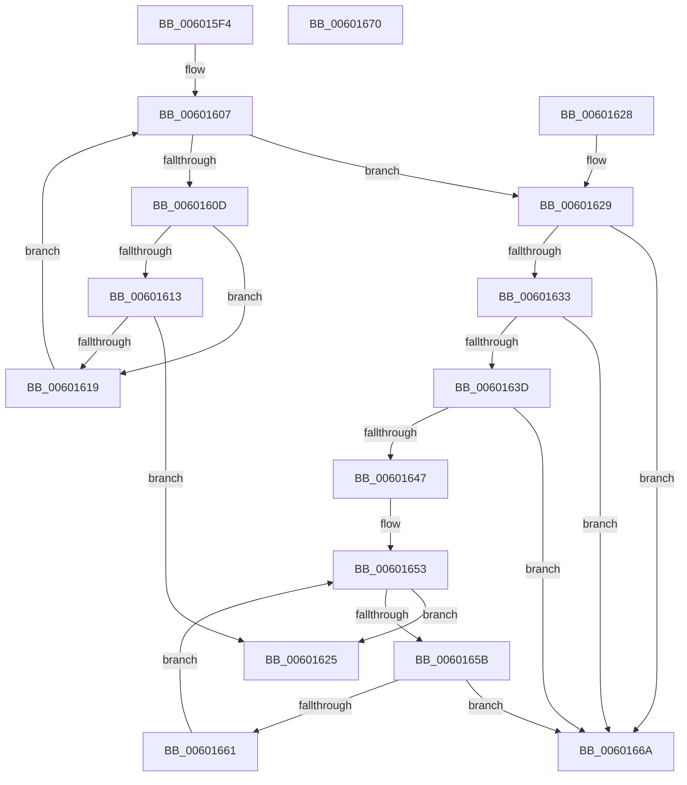

# detect_data_type

- RVA: `0x006015F4`–`0x00601671` (길이 `125` bytes)
- VA: `0x00000001406015F4`
- 실행 섹션: `.text`
- PDB 이름 있음: `예`; PDB Function 태그: `예`
- unwind 정보 RVA: `0x000DB714`
- 디코드: `35`개 명령, `125/125` bytes 표시
- 미해석 바이트: `0` (있으면 어셈블리에 `.byte`로 보존)

> 이 문서는 커널 이미지의 기계어와 PDB 기호를 분석해 생성했습니다. 4번과 5번은 함수 원형과 자료형을 바이너리 사용 방식에서 추정한 C 해석이며 원본 소스 복구 결과는 아닙니다.

## 1. Dependencies

- 직접 호출 지점: **0**; 고유 호출 대상: **0**
- 직접 호출자로 확인된 함수: **1**
- RIP 상대 이미지 참조: **0**

### Outgoing calls
- 직접 디코드된 call 명령이 없습니다.

### Direct callers
- [tr_flush_block](tr_flush_block_function_00600AF8.md) at `0x00600B46`

### Static image references
- 디코드된 RIP-relative 메모리 참조가 없습니다.

## 2. Other-region calls and transfers

- 다른 실행 섹션으로 향하는 call: **0**
- 별도 외부 분기/꼬리 이동을 확인하지 못했습니다.

## 3. Assembly (complete function range)

```asm
006015F4  45 33 C9                        xor r9d, r9d
006015F7  48 8D 91 0C 01 00 00            lea rdx, [rcx + 0x10c]
006015FE  41 8B C1                        mov eax, r9d
00601601  41 B8 7F C0 FF F3               mov r8d, 0xf3ffc07f
00601607  48 83 F8 1F                     cmp rax, 0x1f
0060160B  7F 1C                           jg 0x140601629
0060160D  41 F6 C0 01                     test r8b, 1
00601611  74 06                           je 0x140601619
00601613  66 44 39 0A                     cmp word ptr [rdx], r9w
00601617  75 0C                           jne 0x140601625
00601619  48 FF C0                        inc rax
0060161C  48 83 C2 04                     add rdx, 4
00601620  41 D1 E8                        shr r8d, 1
00601623  EB E2                           jmp 0x140601607
00601625  33 C0                           xor eax, eax
00601627  C3                              ret
00601628  CC                              int3
00601629  66 44 39 89 30 01 00 00         cmp word ptr [rcx + 0x130], r9w
00601631  75 37                           jne 0x14060166a
00601633  66 44 39 89 34 01 00 00         cmp word ptr [rcx + 0x134], r9w
0060163B  75 2D                           jne 0x14060166a
0060163D  66 44 39 89 40 01 00 00         cmp word ptr [rcx + 0x140], r9w
00601645  75 23                           jne 0x14060166a
00601647  B8 20 00 00 00                  mov eax, 0x20
0060164C  48 81 C1 8C 01 00 00            add rcx, 0x18c
00601653  48 3D 00 01 00 00               cmp rax, 0x100
00601659  7D CA                           jge 0x140601625
0060165B  66 44 39 09                     cmp word ptr [rcx], r9w
0060165F  75 09                           jne 0x14060166a
00601661  48 FF C0                        inc rax
00601664  48 83 C1 04                     add rcx, 4
00601668  EB E9                           jmp 0x140601653
0060166A  B8 01 00 00 00                  mov eax, 1
0060166F  C3                              ret
00601670  CC                              int3
```

## 4. C-style interpretation (structured pseudocode)

```c
__int64 __fastcall detect_data_type(__int64 a1, __int64 a2, __int64 a3, int a4)
{
    __int64 result;

    a4 = 0;
loc_00601607:
    if (0 > 31) goto loc_00601629;
    if ((((unsigned __int8)((unsigned int)(0xF3FFC07FULL))) & (1)) == 0) goto loc_00601619;
    if ((*(unsigned __int16 *)(a1 + 268)) != 0) goto loc_00601625;
loc_00601619:
    result = (0) + 1;
    a2 = (a1 + 268) + (4);
    a3 = (unsigned int)(((unsigned int)(0xF3FFC07FULL)) >> (1));
    goto loc_00601607;
loc_00601625:
    result = 0;
    return result;
loc_00601629:
    if ((*(unsigned __int16 *)(a1 + 304)) != 0) goto loc_0060166A;
    if ((*(unsigned __int16 *)(a1 + 308)) != 0) goto loc_0060166A;
    if ((*(unsigned __int16 *)(a1 + 320)) != 0) goto loc_0060166A;
    a1 = (a1) + (396);
loc_00601653:
    if (32 >= 256) goto loc_00601625;
    if ((*(unsigned __int16 *)(a1)) != 0) goto loc_0060166A;
    result = (32) + 1;
    a1 = (a1) + (4);
    goto loc_00601653;
loc_0060166A:
    return 1;
}
```

## 5. (Beta) C Style

```c
int64_t detect_data_type(void *Arg1, int64_t Arg2, int64_t Arg3, int32_t Arg4)
{
    uint8_t *arg1 = (uint8_t *)Arg1;

    int64_t result;

    Arg4 = 0;
loc_00601607:
    if (0 > 31) goto loc_00601629;
    if ((((uint8_t)((uint32_t)(0xF3FFC07FULL))) & (1)) == 0) goto loc_00601619;
    if ((*(uint16_t *)(arg1 + 0x10C)) != 0) goto loc_00601625;
loc_00601619:
    result = (0) + 1;
    Arg2 = (Arg1 + 268) + (4);
    Arg3 = (uint32_t)(((uint32_t)(0xF3FFC07FULL)) >> (1));
    goto loc_00601607;
loc_00601625:
    result = 0;
    return result;
loc_00601629:
    if ((*(uint16_t *)(arg1 + 0x130)) != 0) goto loc_0060166A;
    if ((*(uint16_t *)(arg1 + 0x134)) != 0) goto loc_0060166A;
    if ((*(uint16_t *)(arg1 + 0x140)) != 0) goto loc_0060166A;
    Arg1 = (Arg1) + (396);
loc_00601653:
    if (32 >= 256) goto loc_00601625;
    if ((*(uint16_t *)(arg1)) != 0) goto loc_0060166A;
    result = (32) + 1;
    Arg1 = (Arg1) + (4);
    goto loc_00601653;
loc_0060166A:
    return 1;
}
```

### 관측된 메모리 오프셋

구조체 형식이 확인되지 않은 접근은 인자 기준의 오프셋으로만 기록했습니다.

| 기준 인자 | 오프셋 표현 | 폭 (bit) | 접근 |
|---|---:|---:|---|
| `Arg1` | `+ 0x0` | `16` | `R` |
| `Arg1` | `+ 0x10C` | `64` | `R` |
| `Arg1` | `+ 0x130` | `16` | `R` |
| `Arg1` | `+ 0x134` | `16` | `R` |
| `Arg1` | `+ 0x140` | `16` | `R` |

## 6. Execution-region graph

[열기: 2D/3D 그래프와 함수 탐색 컨트롤 패널](../../../control-panel.html?section=text&rva=0x006015F4&view=graph)

- 2D 그래프는 위에서 아래로 흐르고, 3D 그래프는 빈 공간을 드래그해 회전합니다. Shift+드래그는 이동, 휠은 확대·축소, 함수 노드 선택은 대상 보고서 이동입니다.

### Static fallback


