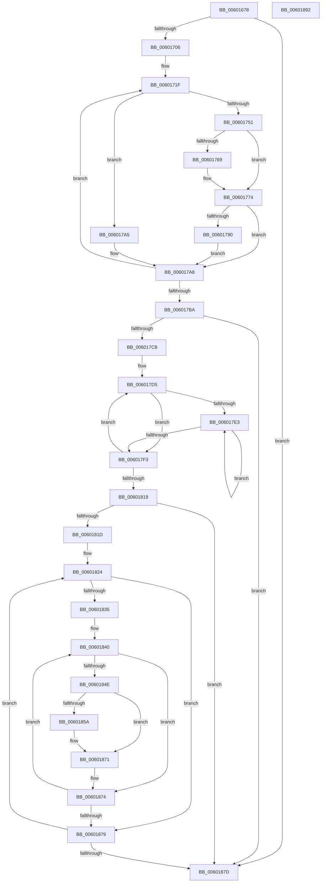

# gen_bitlen

- RVA: `0x00601678`–`0x00601893` (길이 `539` bytes)
- VA: `0x0000000140601678`
- 실행 섹션: `.text`
- PDB 이름 있음: `예`; PDB Function 태그: `예`
- unwind 정보 RVA: `0x000D0530`
- 디코드: `142`개 명령, `539/539` bytes 표시
- 미해석 바이트: `0` (있으면 어셈블리에 `.byte`로 보존)

> 이 문서는 커널 이미지의 기계어와 PDB 기호를 분석해 생성했습니다. 4번과 5번은 함수 원형과 자료형을 바이너리 사용 방식에서 추정한 C 해석이며 원본 소스 복구 결과는 아닙니다.

## 1. Dependencies

- 직접 호출 지점: **0**; 고유 호출 대상: **0**
- 직접 호출자로 확인된 함수: **1**
- RIP 상대 이미지 참조: **0**

### Outgoing calls
- 직접 디코드된 call 명령이 없습니다.

### Direct callers
- [build_tree](build_tree_function_00600FB0.md) at `0x006011BC`

### Static image references
- 디코드된 RIP-relative 메모리 참조가 없습니다.

## 2. Other-region calls and transfers

- 다른 실행 섹션으로 향하는 call: **0**
- 별도 외부 분기/꼬리 이동을 확인하지 못했습니다.

## 3. Assembly (complete function range)

```asm
00601678  48 89 5C 24 18                  mov qword ptr [rsp + 0x18], rbx
0060167D  48 89 6C 24 20                  mov qword ptr [rsp + 0x20], rbp
00601682  56                              push rsi
00601683  57                              push rdi
00601684  41 54                           push r12
00601686  41 55                           push r13
00601688  41 56                           push r14
0060168A  41 57                           push r15
0060168C  8B 42 08                        mov eax, dword ptr [rdx + 8]
0060168F  4C 8B C1                        mov r8, rcx
00601692  48 8B 3A                        mov rdi, qword ptr [rdx]
00601695  45 33 C9                        xor r9d, r9d
00601698  89 44 24 38                     mov dword ptr [rsp + 0x38], eax
0060169C  45 8B D9                        mov r11d, r9d
0060169F  48 8B 42 10                     mov rax, qword ptr [rdx + 0x10]
006016A3  41 0F B7 C9                     movzx ecx, r9w
006016A7  4C 8B 38                        mov r15, qword ptr [rax]
006016AA  4C 8B 68 08                     mov r13, qword ptr [rax + 8]
006016AE  44 8B 60 10                     mov r12d, dword ptr [rax + 0x10]
006016B2  48 63 50 18                     movsxd rdx, dword ptr [rax + 0x18]
006016B6  8B C1                           mov eax, ecx
006016B8  C1 E1 10                        shl ecx, 0x10
006016BB  0B C8                           or ecx, eax
006016BD  66 0F 6E C1                     movd xmm0, ecx
006016C1  66 0F 70 C0 00                  pshufd xmm0, xmm0, 0
006016C6  41 0F 11 80 D8 0B 00 00         movups xmmword ptr [r8 + 0xbd8], xmm0
006016CE  41 0F 11 80 E8 0B 00 00         movups xmmword ptr [r8 + 0xbe8], xmm0
006016D6  49 63 80 F0 14 00 00            movsxd rax, dword ptr [r8 + 0x14f0]
006016DD  49 63 8C 80 F8 0B 00 00         movsxd rcx, dword ptr [r8 + rax*4 + 0xbf8]
006016E5  66 44 89 4C 8F 02               mov word ptr [rdi + rcx*4 + 2], r9w
006016EB  41 B9 3D 02 00 00               mov r9d, 0x23d
006016F1  41 8B 98 F0 14 00 00            mov ebx, dword ptr [r8 + 0x14f0]
006016F8  FF C3                           inc ebx
006016FA  48 63 C3                        movsxd rax, ebx
006016FD  49 3B C1                        cmp rax, r9
00601700  0F 8D 77 01 00 00               jge 0x14060187d
00601706  4C 2B C8                        sub r9, rax
00601709  49 8D B0 F8 0B 00 00            lea rsi, [r8 + 0xbf8]
00601710  41 03 D9                        add ebx, r9d
00601713  48 8D 34 86                     lea rsi, [rsi + rax*4]
00601717  89 5C 24 40                     mov dword ptr [rsp + 0x40], ebx
0060171B  8B 5C 24 38                     mov ebx, dword ptr [rsp + 0x38]
0060171F  4C 63 16                        movsxd r10, dword ptr [rsi]
00601722  44 8B F2                        mov r14d, edx
00601725  49 8B EA                        mov rbp, r10
00601728  42 0F B7 44 97 02               movzx eax, word ptr [rdi + r10*4 + 2]
0060172E  0F B7 4C 87 02                  movzx ecx, word ptr [rdi + rax*4 + 2]
00601733  41 8D 43 01                     lea eax, [r11 + 1]
00601737  FF C1                           inc ecx
00601739  3B CA                           cmp ecx, edx
0060173B  41 0F 4E C3                     cmovle eax, r11d
0060173F  44 0F 4E F1                     cmovle r14d, ecx
00601743  66 46 89 74 97 02               mov word ptr [rdi + r10*4 + 2], r14w
00601749  44 8B D8                        mov r11d, eax
0060174C  44 3B D3                        cmp r10d, ebx
0060174F  7F 54                           jg 0x1406017a5
00601751  B9 01 00 00 00                  mov ecx, 1
00601756  49 63 C6                        movsxd rax, r14d
00601759  66 41 01 8C 40 D8 0B 00 00      add word ptr [r8 + rax*2 + 0xbd8], cx
00601762  33 C9                           xor ecx, ecx
00601764  45 3B D4                        cmp r10d, r12d
00601767  7C 0B                           jl 0x140601774
00601769  45 2B D4                        sub r10d, r12d
0060176C  49 63 C2                        movsxd rax, r10d
0060176F  41 8B 4C 85 00                  mov ecx, dword ptr [r13 + rax*4]
00601774  44 0F B7 14 AF                  movzx r10d, word ptr [rdi + rbp*4]
00601779  41 8D 04 0E                     lea eax, [r14 + rcx]
0060177D  41 0F AF C2                     imul eax, r10d
00601781  45 33 F6                        xor r14d, r14d
00601784  41 01 80 4C 17 00 00            add dword ptr [r8 + 0x174c], eax
0060178B  4D 85 FF                        test r15, r15
0060178E  74 18                           je 0x1406017a8
00601790  41 0F B7 44 AF 02               movzx eax, word ptr [r15 + rbp*4 + 2]
00601796  03 C1                           add eax, ecx
00601798  41 0F AF C2                     imul eax, r10d
0060179C  41 01 80 50 17 00 00            add dword ptr [r8 + 0x1750], eax
006017A3  EB 03                           jmp 0x1406017a8
006017A5  45 33 F6                        xor r14d, r14d
006017A8  48 83 C6 04                     add rsi, 4
006017AC  BD 01 00 00 00                  mov ebp, 1
006017B1  4C 2B CD                        sub r9, rbp
006017B4  0F 85 65 FF FF FF               jne 0x14060171f
006017BA  48 63 5C 24 40                  movsxd rbx, dword ptr [rsp + 0x40]
006017BF  45 85 DB                        test r11d, r11d
006017C2  0F 84 B5 00 00 00               je 0x14060187d
006017C8  44 8D 52 FF                     lea r10d, [rdx - 1]
006017CC  41 BF FF FF 00 00               mov r15d, 0xffff
006017D2  8D 75 01                        lea esi, [rbp + 1]
006017D5  49 63 CA                        movsxd rcx, r10d
006017D8  66 45 39 B4 48 D8 0B 00 00      cmp word ptr [r8 + rcx*2 + 0xbd8], r14w
006017E1  75 10                           jne 0x1406017f3
006017E3  2B CD                           sub ecx, ebp
006017E5  48 63 C1                        movsxd rax, ecx
006017E8  66 45 39 B4 40 D8 0B 00 00      cmp word ptr [r8 + rax*2 + 0xbd8], r14w
006017F1  74 F0                           je 0x1406017e3
006017F3  48 63 C1                        movsxd rax, ecx
006017F6  44 2B DE                        sub r11d, esi
006017F9  66 45 01 BC 40 D8 0B 00 00      add word ptr [r8 + rax*2 + 0xbd8], r15w
00601802  66 41 01 B4 40 DA 0B 00 00      add word ptr [r8 + rax*2 + 0xbda], si
0060180B  66 45 01 BC 50 D8 0B 00 00      add word ptr [r8 + rdx*2 + 0xbd8], r15w
00601814  45 85 DB                        test r11d, r11d
00601817  7F BC                           jg 0x1406017d5
00601819  85 D2                           test edx, edx
0060181B  74 60                           je 0x14060187d
0060181D  8B 74 24 38                     mov esi, dword ptr [rsp + 0x38]
00601821  4C 8B DB                        mov r11, rbx
00601824  48 63 C2                        movsxd rax, edx
00601827  45 0F B7 8C 40 D8 0B 00 00      movzx r9d, word ptr [r8 + rax*2 + 0xbd8]
00601830  45 85 C9                        test r9d, r9d
00601833  74 44                           je 0x140601879
00601835  4D 8D 90 F8 0B 00 00            lea r10, [r8 + 0xbf8]
0060183C  4F 8D 14 9A                     lea r10, [r10 + r11*4]
00601840  4D 8D 52 FC                     lea r10, [r10 - 4]
00601844  4C 2B DD                        sub r11, rbp
00601847  49 63 02                        movsxd rax, dword ptr [r10]
0060184A  3B C6                           cmp eax, esi
0060184C  7F 26                           jg 0x140601874
0060184E  48 8B D8                        mov rbx, rax
00601851  0F B7 44 87 02                  movzx eax, word ptr [rdi + rax*4 + 2]
00601856  3B C2                           cmp eax, edx
00601858  74 17                           je 0x140601871
0060185A  8B CA                           mov ecx, edx
0060185C  2B C8                           sub ecx, eax
0060185E  0F B7 04 9F                     movzx eax, word ptr [rdi + rbx*4]
00601862  0F AF C8                        imul ecx, eax
00601865  41 01 88 4C 17 00 00            add dword ptr [r8 + 0x174c], ecx
0060186C  66 89 54 9F 02                  mov word ptr [rdi + rbx*4 + 2], dx
00601871  44 2B CD                        sub r9d, ebp
00601874  45 85 C9                        test r9d, r9d
00601877  75 C7                           jne 0x140601840
00601879  2B D5                           sub edx, ebp
0060187B  75 A7                           jne 0x140601824
0060187D  48 8B 5C 24 48                  mov rbx, qword ptr [rsp + 0x48]
00601882  48 8B 6C 24 50                  mov rbp, qword ptr [rsp + 0x50]
00601887  41 5F                           pop r15
00601889  41 5E                           pop r14
0060188B  41 5D                           pop r13
0060188D  41 5C                           pop r12
0060188F  5F                              pop rdi
00601890  5E                              pop rsi
00601891  C3                              ret
00601892  CC                              int3
```

## 4. C-style interpretation (structured pseudocode)

```c
__int64 __fastcall gen_bitlen(__int64 a1, __int64 a2, __int64 a3, int a4)
{
    __int64 result;
    __int64 v_r10;
    __int64 v_r11;
    __int64 v_r14;
    __int64 v_rbx;
    __int64 v_rsi;
    unsigned int v_stack_p10;
    unsigned __int64 v_stack_p18;
    unsigned __int64 v_stack_p20;
    unsigned int v_stack_p8;

    v_stack_p18 = v_rbx;
    v_stack_p20 = v_rbp;
    a4 = 0;
    v_stack_p8 = (unsigned int)((unsigned int)(*(unsigned int *)(a2 + 8)));
    a1 = (unsigned int)((0) << (16));
    a1 = (unsigned int)((a1) | (0));
    *(unsigned __int64 *)(a1 + 3032) = v_xmm0;
    *(unsigned __int64 *)(a1 + 3048) = v_xmm0;
    *(unsigned __int16 *)(*(unsigned __int64 *)(a2) + (int)(*(unsigned int *)(a1 + (int)(*(unsigned int *)(a1 + 5360)) * 4 + 3064)) * 4 + 2) = 0;
    v_rbx = (unsigned int)(((unsigned int)(*(unsigned int *)(a1 + 5360))) + 1);
    if (((int)((unsigned int)(v_rbx))) >= 573) goto loc_0060187D;
    a4 = (573) - ((int)((unsigned int)(v_rbx)));
    v_rbx = (unsigned int)((v_rbx) + (a4));
    v_stack_p10 = (unsigned int)(v_rbx);
loc_0060171F:
    a1 = (unsigned int)((*(unsigned __int16 *)(*(unsigned __int64 *)(a2) + *(unsigned __int16 *)(*(unsigned __int64 *)(a2) + (int)(*(unsigned int *)(a1 + 3064 + (int)((unsigned int)(v_rbx)) * 4)) * 4 + 2) * 4 + 2)) + 1);
    result = 0 + 1;
    if (((unsigned int)(a1)) <= ((unsigned int)((int)(*(unsigned int *)(*(unsigned __int64 *)(a2 + 16) + 24))))) { result = 0; }
    v_r14 = (unsigned int)((unsigned int)((int)(*(unsigned int *)(*(unsigned __int64 *)(a2 + 16) + 24))));
    if (((unsigned int)(a1)) <= ((unsigned int)((int)(*(unsigned int *)(*(unsigned __int64 *)(a2 + 16) + 24))))) { v_r14 = (unsigned int)(a1); }
    *(unsigned __int16 *)(*(unsigned __int64 *)(a2) + (int)(*(unsigned int *)(a1 + 3064 + (int)((unsigned int)(v_rbx)) * 4)) * 4 + 2) = (unsigned __int16)(v_r14);
    if (((unsigned int)((int)(*(unsigned int *)(a1 + 3064 + (int)((unsigned int)(v_rbx)) * 4)))) > ((unsigned int)((unsigned int)(v_stack_p8)))) goto loc_006017A5;
    a1 = 0;
    result = (int)((unsigned int)(v_r14));
    v_r10 = (int)(*(unsigned int *)(a1 + 3064 + (int)((unsigned int)(v_rbx)) * 4));
    if (((unsigned int)((int)(*(unsigned int *)(a1 + 3064 + (int)((unsigned int)(v_rbx)) * 4)))) >= ((unsigned int)((unsigned int)(*(unsigned int *)(*(unsigned __int64 *)(a2 + 16) + 16))))) {
        v_r10 = (unsigned int)(((int)(*(unsigned int *)(a1 + 3064 + (int)((unsigned int)(v_rbx)) * 4))) - ((unsigned int)((unsigned int)(*(unsigned int *)(*(unsigned __int64 *)(a2 + 16) + 16)))));
        result = (int)((unsigned int)(v_r10));
        a1 = *(unsigned int *)(*(unsigned __int64 *)(*(unsigned __int64 *)(a2 + 16) + 8) + result * 4);
    }
    result = (unsigned int)((v_r14 + a1 * 1) * ((unsigned int)(*(unsigned __int16 *)(*(unsigned __int64 *)(a2) + (int)(*(unsigned int *)(a1 + 3064 + (int)((unsigned int)(v_rbx)) * 4)) * 4))));
    v_r14 = 0;
    if (*(unsigned __int64 *)(*(unsigned __int64 *)(a2 + 16)) == 0) goto loc_006017A8;
    result = (unsigned int)((*(unsigned __int16 *)(*(unsigned __int64 *)(*(unsigned __int64 *)(a2 + 16)) + (int)(*(unsigned int *)(a1 + 3064 + (int)((unsigned int)(v_rbx)) * 4)) * 4 + 2)) + ((unsigned int)(a1)));
    result = (unsigned int)((result) * ((unsigned int)(*(unsigned __int16 *)(*(unsigned __int64 *)(a2) + (int)(*(unsigned int *)(a1 + 3064 + (int)((unsigned int)(v_rbx)) * 4)) * 4))));
    goto loc_006017A8;
loc_006017A5:
    v_r14 = 0;
loc_006017A8:
    v_rsi = (a1 + 3064 + (int)((unsigned int)(v_rbx)) * 4) + (4);
    a4 = (a4) - (1);
    if (condition_is_not_equal) goto loc_0060171F;
    if ((unsigned int)((unsigned int)((unsigned int)(result))) == 0) goto loc_0060187D;
loc_006017D5:
    if ((*(unsigned __int16 *)(a1 + (int)((unsigned int)((int)(*(unsigned int *)(*(unsigned __int64 *)(a2 + 16) + 24)) - 1)) * 2 + 3032)) != 0) goto loc_006017F3;
loc_006017E3:
    a1 = (unsigned int)(((int)((unsigned int)((int)(*(unsigned int *)(*(unsigned __int64 *)(a2 + 16) + 24)) - 1))) - (1));
    if ((*(unsigned __int16 *)(a1 + (int)((unsigned int)(a1)) * 2 + 3032)) == 0) goto loc_006017E3;
loc_006017F3:
    v_r11 = (unsigned int)(((unsigned int)((unsigned int)(result))) - ((unsigned int)(1 + 1)));
    if (condition_is_greater) goto loc_006017D5;
    if ((unsigned int)((int)(*(unsigned int *)(*(unsigned __int64 *)(a2 + 16) + 24))) == 0) goto loc_0060187D;
loc_00601824:
    if ((unsigned int)(*(unsigned __int16 *)(a1 + (int)((unsigned int)((int)(*(unsigned int *)(*(unsigned __int64 *)(a2 + 16) + 24)))) * 2 + 3032)) == 0) goto loc_00601879;
loc_00601840:
    v_r11 = ((int)(v_stack_p10)) - (1);
    if (((unsigned int)((int)(*(unsigned int *)(a1 + 3064 + (int)(v_stack_p10) * 4 - 4)))) > ((unsigned int)((unsigned int)(v_stack_p8)))) goto loc_00601874;
    result = *(unsigned __int16 *)(*(unsigned __int64 *)(a2) + (int)(*(unsigned int *)(a1 + 3064 + (int)(v_stack_p10) * 4 - 4)) * 4 + 2);
    if (((unsigned int)(*(unsigned __int16 *)(*(unsigned __int64 *)(a2) + (int)(*(unsigned int *)(a1 + 3064 + (int)(v_stack_p10) * 4 - 4)) * 4 + 2))) != ((unsigned int)((int)(*(unsigned int *)(*(unsigned __int64 *)(a2 + 16) + 24))))) {
        a1 = (unsigned int)((int)(*(unsigned int *)(*(unsigned __int64 *)(a2 + 16) + 24)));
        a1 = (unsigned int)((a1) - ((unsigned int)(*(unsigned __int16 *)(*(unsigned __int64 *)(a2) + (int)(*(unsigned int *)(a1 + 3064 + (int)(v_stack_p10) * 4 - 4)) * 4 + 2))));
        result = *(unsigned __int16 *)(*(unsigned __int64 *)(a2) + (int)(*(unsigned int *)(a1 + 3064 + (int)(v_stack_p10) * 4 - 4)) * 4);
        a1 = (unsigned int)((a1) * ((unsigned int)(result)));
        *(unsigned __int16 *)(*(unsigned __int64 *)(a2) + (int)(*(unsigned int *)(a1 + 3064 + (int)(v_stack_p10) * 4 - 4)) * 4 + 2) = (unsigned __int16)((int)(*(unsigned int *)(*(unsigned __int64 *)(a2 + 16) + 24)));
    }
    a4 = (unsigned int)((*(unsigned __int16 *)(a1 + (int)((unsigned int)((int)(*(unsigned int *)(*(unsigned __int64 *)(a2 + 16) + 24)))) * 2 + 3032)) - (1));
loc_00601874:
    if (a4 != 0) goto loc_00601840;
loc_00601879:
    a2 = (unsigned int)(((int)(*(unsigned int *)(*(unsigned __int64 *)(a2 + 16) + 24))) - (1));
    if (condition_is_not_equal) goto loc_00601824;
loc_0060187D:
    return result;
}
```

## 5. (Beta) C Style

```c
int64_t gen_bitlen(void *Arg1, void *Arg2, int64_t Arg3, int32_t Arg4)
{
    uint8_t *arg1 = (uint8_t *)Arg1;
    uint8_t *arg2 = (uint8_t *)Arg2;

    int64_t result;
    int64_t local_r10;
    int64_t local_r11;
    int64_t local_r14;
    int64_t local_rbx;
    int64_t local_rsi;
    uint32_t v_stack_p10;
    uint64_t v_stack_p18;
    uint64_t v_stack_p20;
    uint32_t v_stack_p8;

    v_stack_p18 = local_rbx;
    v_stack_p20 = local_rbp;
    Arg4 = 0;
    v_stack_p8 = (uint32_t)((uint32_t)(*(uint32_t *)(arg2 + 0x8)));
    Arg1 = (uint32_t)((0) << (16));
    Arg1 = (uint32_t)((Arg1) | (0));
    *(uint64_t *)(arg1 + 0xBD8) = v_xmm0;
    *(uint64_t *)(arg1 + 0xBE8) = v_xmm0;
    *(uint16_t *)(*(uint64_t *)(arg2) + (int32_t)(*(uint32_t *)(arg1 + (int32_t)(*(uint32_t *)(arg1 + 0x14F0)) * 4 + 0xBF8)) * 4 + 0x2) = 0;
    local_rbx = (uint32_t)(((uint32_t)(*(uint32_t *)(arg1 + 0x14F0))) + 1);
    if (((int32_t)((uint32_t)(local_rbx))) >= 573) goto loc_0060187D;
    Arg4 = (573) - ((int32_t)((uint32_t)(local_rbx)));
    local_rbx = (uint32_t)((local_rbx) + (Arg4));
    v_stack_p10 = (uint32_t)(local_rbx);
loc_0060171F:
    Arg1 = (uint32_t)((*(uint16_t *)(*(uint64_t *)(arg2) + *(uint16_t *)(*(uint64_t *)(arg2) + (int32_t)(*(uint32_t *)(arg1 + 0xBF8 + (int32_t)((uint32_t)(local_rbx)) * 4)) * 4 + 0x2) * 4 + 0x2)) + 1);
    result = 0 + 1;
    if (((uint32_t)(Arg1)) <= ((uint32_t)((int32_t)(*(uint32_t *)(*(uint64_t *)(arg2 + 0x10) + 0x18))))) { result = 0; }
    local_r14 = (uint32_t)((uint32_t)((int32_t)(*(uint32_t *)(*(uint64_t *)(arg2 + 0x10) + 0x18))));
    if (((uint32_t)(Arg1)) <= ((uint32_t)((int32_t)(*(uint32_t *)(*(uint64_t *)(arg2 + 0x10) + 0x18))))) { local_r14 = (uint32_t)(Arg1); }
    *(uint16_t *)(*(uint64_t *)(arg2) + (int32_t)(*(uint32_t *)(arg1 + 0xBF8 + (int32_t)((uint32_t)(local_rbx)) * 4)) * 4 + 0x2) = (uint16_t)(local_r14);
    if (((uint32_t)((int32_t)(*(uint32_t *)(arg1 + 0xBF8 + (int32_t)((uint32_t)(local_rbx)) * 4)))) > ((uint32_t)((uint32_t)(v_stack_p8)))) goto loc_006017A5;
    Arg1 = 0;
    result = (int32_t)((uint32_t)(local_r14));
    local_r10 = (int32_t)(*(uint32_t *)(arg1 + 0xBF8 + (int32_t)((uint32_t)(local_rbx)) * 4));
    if (((uint32_t)((int32_t)(*(uint32_t *)(arg1 + 0xBF8 + (int32_t)((uint32_t)(local_rbx)) * 4)))) >= ((uint32_t)((uint32_t)(*(uint32_t *)(*(uint64_t *)(arg2 + 0x10) + 0x10))))) {
        local_r10 = (uint32_t)(((int32_t)(*(uint32_t *)(arg1 + 0xBF8 + (int32_t)((uint32_t)(local_rbx)) * 4))) - ((uint32_t)((uint32_t)(*(uint32_t *)(*(uint64_t *)(arg2 + 0x10) + 0x10)))));
        result = (int32_t)((uint32_t)(local_r10));
        Arg1 = *(uint32_t *)(*(uint64_t *)(*(uint64_t *)(arg2 + 0x10) + 0x8) + result * 4);
    }
    result = (uint32_t)((local_r14 + Arg1 * 1) * ((uint32_t)(*(uint16_t *)(*(uint64_t *)(arg2) + (int32_t)(*(uint32_t *)(arg1 + 0xBF8 + (int32_t)((uint32_t)(local_rbx)) * 4)) * 4))));
    local_r14 = 0;
    if (*(uint64_t *)(*(uint64_t *)(arg2 + 0x10)) == 0) goto loc_006017A8;
    result = (uint32_t)((*(uint16_t *)(*(uint64_t *)(*(uint64_t *)(arg2 + 0x10)) + (int32_t)(*(uint32_t *)(arg1 + 0xBF8 + (int32_t)((uint32_t)(local_rbx)) * 4)) * 4 + 0x2)) + ((uint32_t)(Arg1)));
    result = (uint32_t)((result) * ((uint32_t)(*(uint16_t *)(*(uint64_t *)(arg2) + (int32_t)(*(uint32_t *)(arg1 + 0xBF8 + (int32_t)((uint32_t)(local_rbx)) * 4)) * 4))));
    goto loc_006017A8;
loc_006017A5:
    local_r14 = 0;
loc_006017A8:
    local_rsi = (Arg1 + 3064 + (int32_t)((uint32_t)(local_rbx)) * 4) + (4);
    Arg4 = (Arg4) - (1);
    if (condition_is_not_equal) goto loc_0060171F;
    if ((uint32_t)((uint32_t)((uint32_t)(result))) == 0) goto loc_0060187D;
loc_006017D5:
    if ((*(uint16_t *)(arg1 + (int32_t)((uint32_t)((int32_t)(*(uint32_t *)(*(uint64_t *)(arg2 + 0x10) + 0x18)) - 0x1)) * 2 + 0xBD8)) != 0) goto loc_006017F3;
loc_006017E3:
    Arg1 = (uint32_t)(((int32_t)((uint32_t)((int32_t)(*(uint32_t *)(*(uint64_t *)(arg2 + 0x10) + 0x18)) - 1))) - (1));
    if ((*(uint16_t *)(arg1 + (int32_t)((uint32_t)(arg1)) * 2 + 0xBD8)) == 0) goto loc_006017E3;
loc_006017F3:
    local_r11 = (uint32_t)(((uint32_t)((uint32_t)(result))) - ((uint32_t)(1 + 1)));
    if (condition_is_greater) goto loc_006017D5;
    if ((uint32_t)((int32_t)(*(uint32_t *)(*(uint64_t *)(arg2 + 0x10) + 0x18))) == 0) goto loc_0060187D;
loc_00601824:
    if ((uint32_t)(*(uint16_t *)(arg1 + (int32_t)((uint32_t)((int32_t)(*(uint32_t *)(*(uint64_t *)(arg2 + 0x10) + 0x18)))) * 2 + 0xBD8)) == 0) goto loc_00601879;
loc_00601840:
    local_r11 = ((int32_t)(v_stack_p10)) - (1);
    if (((uint32_t)((int32_t)(*(uint32_t *)(arg1 + 0xBF8 + (int32_t)(v_stack_p10) * 4 - 0x4)))) > ((uint32_t)((uint32_t)(v_stack_p8)))) goto loc_00601874;
    result = *(uint16_t *)(*(uint64_t *)(arg2) + (int32_t)(*(uint32_t *)(arg1 + 0xBF8 + (int32_t)(v_stack_p10) * 4 - 0x4)) * 4 + 0x2);
    if (((uint32_t)(*(uint16_t *)(*(uint64_t *)(arg2) + (int32_t)(*(uint32_t *)(arg1 + 0xBF8 + (int32_t)(v_stack_p10) * 4 - 0x4)) * 4 + 0x2))) != ((uint32_t)((int32_t)(*(uint32_t *)(*(uint64_t *)(arg2 + 0x10) + 0x18))))) {
        Arg1 = (uint32_t)((int32_t)(*(uint32_t *)(*(uint64_t *)(arg2 + 0x10) + 0x18)));
        Arg1 = (uint32_t)((Arg1) - ((uint32_t)(*(uint16_t *)(*(uint64_t *)(arg2) + (int32_t)(*(uint32_t *)(arg1 + 0xBF8 + (int32_t)(v_stack_p10) * 4 - 0x4)) * 4 + 0x2))));
        result = *(uint16_t *)(*(uint64_t *)(arg2) + (int32_t)(*(uint32_t *)(arg1 + 0xBF8 + (int32_t)(v_stack_p10) * 4 - 0x4)) * 4);
        Arg1 = (uint32_t)((Arg1) * ((uint32_t)(result)));
        *(uint16_t *)(*(uint64_t *)(arg2) + (int32_t)(*(uint32_t *)(arg1 + 0xBF8 + (int32_t)(v_stack_p10) * 4 - 0x4)) * 4 + 0x2) = (uint16_t)((int32_t)(*(uint32_t *)(*(uint64_t *)(arg2 + 0x10) + 0x18)));
    }
    Arg4 = (uint32_t)((*(uint16_t *)(arg1 + (int32_t)((uint32_t)((int32_t)(*(uint32_t *)(*(uint64_t *)(arg2 + 0x10) + 0x18)))) * 2 + 0xBD8)) - (1));
loc_00601874:
    if (Arg4 != 0) goto loc_00601840;
loc_00601879:
    Arg2 = (uint32_t)(((int32_t)(*(uint32_t *)(*(uint64_t *)(arg2 + 0x10) + 0x18))) - (1));
    if (condition_is_not_equal) goto loc_00601824;
loc_0060187D:
    return result;
}
```

### 관측된 메모리 오프셋

구조체 형식이 확인되지 않은 접근은 인자 기준의 오프셋으로만 기록했습니다.

| 기준 인자 | 오프셋 표현 | 폭 (bit) | 접근 |
|---|---:|---:|---|
| `Arg1` | `- 0x4` | `64` | `R` |
| `Arg1` | `+ 0x0` | `32` | `R` |
| `Arg1` | `+ 0x0 + r11*4` | `64` | `R` |
| `Arg1` | `+ 0x0 + rax*4` | `64` | `R` |
| `Arg1` | `+ 0xBD8` | `128` | `R` |
| `Arg1` | `+ 0xBD8 + rax*2` | `16` | `R` |
| `Arg1` | `+ 0xBD8 + rax*2` | `16` | `R/W` |
| `Arg1` | `+ 0xBD8 + rcx*2` | `16` | `R` |
| `Arg1` | `+ 0xBD8 + rdx*2` | `16` | `R/W` |
| `Arg1` | `+ 0xBDA + rax*2` | `16` | `R/W` |
| `Arg1` | `+ 0xBE8` | `128` | `R` |
| `Arg1` | `+ 0xBF8` | `64` | `R` |
| `Arg1` | `+ 0xBF8 + rax*4` | `32` | `R` |
| `Arg1` | `+ 0x14F0` | `32` | `R` |
| `Arg1` | `+ 0x174C` | `32` | `R/W` |
| `Arg1` | `+ 0x1750` | `32` | `R/W` |
| `Arg2` | `+ 0x0` | `64` | `R` |
| `Arg2` | `+ 0x8` | `32` | `R` |
| `Arg2` | `+ 0x10` | `64` | `R` |

## 6. Execution-region graph

[열기: 2D/3D 그래프와 함수 탐색 컨트롤 패널](../../../control-panel.html?section=text&rva=0x00601678&view=graph)

- 2D 그래프는 위에서 아래로 흐르고, 3D 그래프는 빈 공간을 드래그해 회전합니다. Shift+드래그는 이동, 휠은 확대·축소, 함수 노드 선택은 대상 보고서 이동입니다.

### Static fallback


