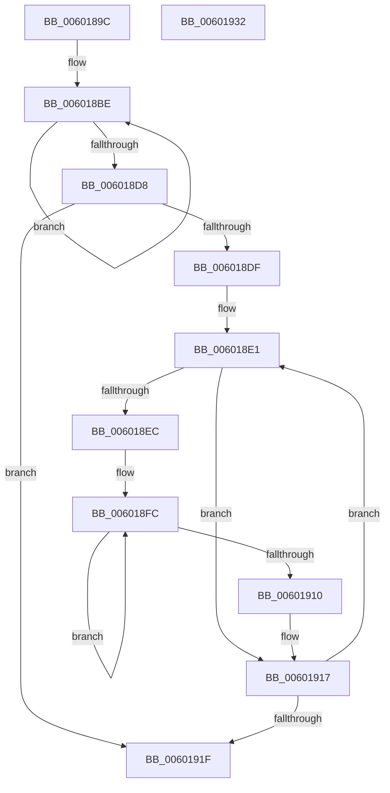

# gen_codes

- RVA: `0x0060189C`–`0x00601933` (길이 `151` bytes)
- VA: `0x000000014060189C`
- 실행 섹션: `.text`
- PDB 이름 있음: `예`; PDB Function 태그: `예`
- unwind 정보 RVA: `0x000B8838`
- 디코드: `47`개 명령, `151/151` bytes 표시
- 미해석 바이트: `0` (있으면 어셈블리에 `.byte`로 보존)

> 이 문서는 커널 이미지의 기계어와 PDB 기호를 분석해 생성했습니다. 4번과 5번은 함수 원형과 자료형을 바이너리 사용 방식에서 추정한 C 해석이며 원본 소스 복구 결과는 아닙니다.

## 1. Dependencies

- 직접 호출 지점: **1**; 고유 호출 대상: **1**
- 직접 호출자로 확인된 함수: **1**
- RIP 상대 이미지 참조: **1**

### Outgoing calls
- `0x00601927` → [_security_check_cookie](../6A/_security_check_cookie_function_006AC640.md) (function, `0x006AC640`)

### Direct callers
- [build_tree](build_tree_function_00600FB0.md) at `0x006011CD`

### Static image references
- `0x006018A2` → RVA `0x00E0A740` (`.data`; read)

## 2. Other-region calls and transfers

- 다른 실행 섹션으로 향하는 call: **0**
- 별도 외부 분기/꼬리 이동을 확인하지 못했습니다.

## 3. Assembly (complete function range)

```asm
0060189C  40 53                           push rbx
0060189E  48 83 EC 30                     sub rsp, 0x30
006018A2  48 8B 05 97 8E 80 00            mov rax, qword ptr [rip + 0x808e97]
006018A9  48 33 C4                        xor rax, rsp
006018AC  48 89 44 24 20                  mov qword ptr [rsp + 0x20], rax
006018B1  45 33 D2                        xor r10d, r10d
006018B4  4C 8B D9                        mov r11, rcx
006018B7  41 8D 5A 01                     lea ebx, [r10 + 1]
006018BB  44 8B CB                        mov r9d, ebx
006018BE  43 0F B7 44 48 FE               movzx eax, word ptr [r8 + r9*2 - 2]
006018C4  44 03 D0                        add r10d, eax
006018C7  45 03 D2                        add r10d, r10d
006018CA  66 46 89 14 4C                  mov word ptr [rsp + r9*2], r10w
006018CF  4C 03 CB                        add r9, rbx
006018D2  49 83 F9 0F                     cmp r9, 0xf
006018D6  7E E6                           jle 0x1406018be
006018D8  4C 63 D2                        movsxd r10, edx
006018DB  85 D2                           test edx, edx
006018DD  78 40                           js 0x14060191f
006018DF  33 D2                           xor edx, edx
006018E1  45 0F B7 44 93 02               movzx r8d, word ptr [r11 + rdx*4 + 2]
006018E7  45 85 C0                        test r8d, r8d
006018EA  74 2B                           je 0x140601917
006018EC  46 0F B7 0C 44                  movzx r9d, word ptr [rsp + r8*2]
006018F1  33 C9                           xor ecx, ecx
006018F3  42 8D 04 0B                     lea eax, [rbx + r9]
006018F7  66 42 89 04 44                  mov word ptr [rsp + r8*2], ax
006018FC  41 8B C1                        mov eax, r9d
006018FF  44 2B C3                        sub r8d, ebx
00601902  23 C3                           and eax, ebx
00601904  41 D1 E9                        shr r9d, 1
00601907  0B C8                           or ecx, eax
00601909  03 C9                           add ecx, ecx
0060190B  45 85 C0                        test r8d, r8d
0060190E  7F EC                           jg 0x1406018fc
00601910  D1 E9                           shr ecx, 1
00601912  66 41 89 0C 93                  mov word ptr [r11 + rdx*4], cx
00601917  48 03 D3                        add rdx, rbx
0060191A  49 3B D2                        cmp rdx, r10
0060191D  7E C2                           jle 0x1406018e1
0060191F  48 8B 4C 24 20                  mov rcx, qword ptr [rsp + 0x20]
00601924  48 33 CC                        xor rcx, rsp
00601927  E8 14 AD 0A 00                  call 0x1406ac640
0060192C  48 83 C4 30                     add rsp, 0x30
00601930  5B                              pop rbx
00601931  C3                              ret
00601932  CC                              int3
```

## 4. C-style interpretation (structured pseudocode)

```c
__int64 __fastcall gen_codes(__int64 a1, int a2, __int64 a3)
{
    __int64 result;
    __int64 v_r10;
    __int64 v_rsp;
    unsigned __int64 v_stack_m18;

    v_rsp = (v_rsp) - (48);
    result = (*(unsigned __int64 *)(v_rip + 8425111)) ^ (v_rsp);
    v_stack_m18 = result;
    v_r10 = 0;
loc_006018BE:
    v_r10 = (unsigned int)((v_r10) + ((unsigned int)(*(unsigned __int16 *)(a3 + (unsigned int)((unsigned int)(v_r10 + 1)) * 2 - 2))));
    v_r10 = (unsigned int)((v_r10) + ((unsigned int)(v_r10)));
    *(unsigned __int16 *)(v_rsp + (unsigned int)((unsigned int)(v_r10 + 1)) * 2) = (unsigned __int16)(v_r10);
    a4 = ((unsigned int)((unsigned int)(v_r10 + 1))) + (v_r10 + 1);
    if (a4 <= 15) goto loc_006018BE;
    if (sign_flag) goto loc_0060191F;
    a2 = 0;
loc_006018E1:
    if ((unsigned int)(*(unsigned __int16 *)(a1 + a2 * 4 + 2)) == 0) goto loc_00601917;
    a1 = 0;
    *(unsigned __int16 *)(v_rsp + *(unsigned __int16 *)(a1 + a2 * 4 + 2) * 2) = (unsigned __int16)(v_r10 + 1 + *(unsigned __int16 *)(v_rsp + *(unsigned __int16 *)(a1 + a2 * 4 + 2) * 2) * 1);
loc_006018FC:
    a3 = (unsigned int)((*(unsigned __int16 *)(a1 + a2 * 4 + 2)) - ((unsigned int)(v_r10 + 1)));
    result = (unsigned int)(((unsigned int)((unsigned int)(*(unsigned __int16 *)(v_rsp + *(unsigned __int16 *)(a1 + a2 * 4 + 2) * 2)))) & ((unsigned int)(v_r10 + 1)));
    a4 = (unsigned int)((*(unsigned __int16 *)(v_rsp + *(unsigned __int16 *)(a1 + a2 * 4 + 2) * 2)) >> (1));
    a1 = (unsigned int)((a1) | ((unsigned int)(result)));
    a1 = (unsigned int)((a1) + ((unsigned int)(a1)));
    if (condition_is_greater) goto loc_006018FC;
    a1 = (unsigned int)((a1) >> (1));
    *(unsigned __int16 *)(a1 + a2 * 4) = (unsigned __int16)(a1);
loc_00601917:
    a2 = (a2) + (v_r10 + 1);
    if (a2 <= ((int)(a2))) goto loc_006018E1;
loc_0060191F:
    a1 = (v_stack_m18) ^ (v_rsp);
    result = _security_check_cookie(a1, a2, a3, a4);
    v_rsp = (v_rsp) + (48);
    return result;
}
```

## 5. (Beta) C Style

```c
int64_t gen_codes(void *Arg1, int32_t Arg2, void *Arg3)
{
    uint8_t *arg1 = (uint8_t *)Arg1;
    uint8_t *arg3 = (uint8_t *)Arg3;

    int64_t result;
    int64_t local_r10;
    int64_t local_rsp;
    uint64_t v_stack_m18;

    local_rsp = (local_rsp) - (48);
    result = (*(uint64_t *)(v_rip + 0x808E97)) ^ (local_rsp);
    v_stack_m18 = result;
    local_r10 = 0;
loc_006018BE:
    local_r10 = (uint32_t)((local_r10) + ((uint32_t)(*(uint16_t *)(arg3 + (uint32_t)((uint32_t)(local_r10 + 0x1)) * 2 - 0x2))));
    local_r10 = (uint32_t)((local_r10) + ((uint32_t)(local_r10)));
    *(uint16_t *)(local_rsp + (uint32_t)((uint32_t)(local_r10 + 0x1)) * 2) = (uint16_t)(local_r10);
    a4 = ((uint32_t)((uint32_t)(local_r10 + 1))) + (local_r10 + 1);
    if (a4 <= 15) goto loc_006018BE;
    if (sign_flag) goto loc_0060191F;
    Arg2 = 0;
loc_006018E1:
    if ((uint32_t)(*(uint16_t *)(arg1 + Arg2 * 4 + 0x2)) == 0) goto loc_00601917;
    Arg1 = 0;
    *(uint16_t *)(local_rsp + *(uint16_t *)(arg1 + Arg2 * 4 + 0x2) * 2) = (uint16_t)(local_r10 + 1 + *(uint16_t *)(local_rsp + *(uint16_t *)(arg1 + Arg2 * 4 + 0x2) * 2) * 1);
loc_006018FC:
    Arg3 = (uint32_t)((*(uint16_t *)(arg1 + Arg2 * 4 + 0x2)) - ((uint32_t)(local_r10 + 1)));
    result = (uint32_t)(((uint32_t)((uint32_t)(*(uint16_t *)(local_rsp + *(uint16_t *)(arg1 + Arg2 * 4 + 0x2) * 2)))) & ((uint32_t)(local_r10 + 1)));
    a4 = (uint32_t)((*(uint16_t *)(local_rsp + *(uint16_t *)(arg1 + Arg2 * 4 + 0x2) * 2)) >> (1));
    Arg1 = (uint32_t)((Arg1) | ((uint32_t)(result)));
    Arg1 = (uint32_t)((Arg1) + ((uint32_t)(Arg1)));
    if (condition_is_greater) goto loc_006018FC;
    Arg1 = (uint32_t)((Arg1) >> (1));
    *(uint16_t *)(arg1 + Arg2 * 4) = (uint16_t)(Arg1);
loc_00601917:
    Arg2 = (Arg2) + (local_r10 + 1);
    if (Arg2 <= ((int32_t)(Arg2))) goto loc_006018E1;
loc_0060191F:
    Arg1 = (v_stack_m18) ^ (local_rsp);
    result = _security_check_cookie(Arg1, Arg2, Arg3, a4);
    local_rsp = (local_rsp) + (48);
    return result;
}
```

### 관측된 메모리 오프셋

구조체 형식이 확인되지 않은 접근은 인자 기준의 오프셋으로만 기록했습니다.

| 기준 인자 | 오프셋 표현 | 폭 (bit) | 접근 |
|---|---:|---:|---|
| `Arg1` | `+ 0x0 + rdx*4` | `16` | `W` |
| `Arg1` | `+ 0x2 + rdx*4` | `16` | `R` |
| `Arg3` | `- 0x2 + r9*2` | `16` | `R` |

## 6. Execution-region graph

[열기: 2D/3D 그래프와 함수 탐색 컨트롤 패널](../../../control-panel.html?section=text&rva=0x0060189C&view=graph)

- 2D 그래프는 위에서 아래로 흐르고, 3D 그래프는 빈 공간을 드래그해 회전합니다. Shift+드래그는 이동, 휠은 확대·축소, 함수 노드 선택은 대상 보고서 이동입니다.

### Static fallback


