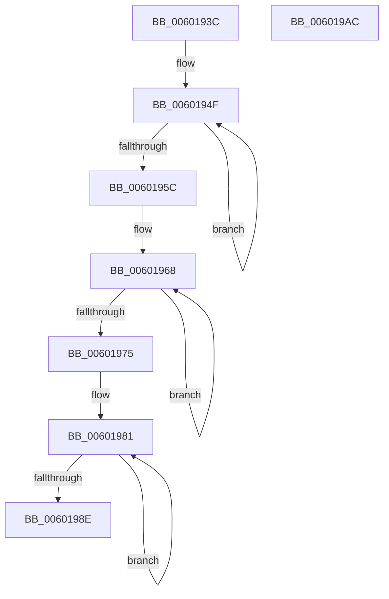

# init_block

- RVA: `0x0060193C`–`0x006019AD` (길이 `113` bytes)
- VA: `0x000000014060193C`
- 실행 섹션: `.text`
- PDB 이름 있음: `예`; PDB Function 태그: `예`
- unwind 정보 RVA: `0x000DB714`
- 디코드: `26`개 명령, `113/113` bytes 표시
- 미해석 바이트: `0` (있으면 어셈블리에 `.byte`로 보존)

> 이 문서는 커널 이미지의 기계어와 PDB 기호를 분석해 생성했습니다. 4번과 5번은 함수 원형과 자료형을 바이너리 사용 방식에서 추정한 C 해석이며 원본 소스 복구 결과는 아닙니다.

## 1. Dependencies

- 직접 호출 지점: **0**; 고유 호출 대상: **0**
- 직접 호출자로 확인된 함수: **2**
- RIP 상대 이미지 참조: **0**

### Outgoing calls
- 직접 디코드된 call 명령이 없습니다.

### Direct callers
- [deflateResetKeep](../5F/deflateResetKeep_function_005F3934.md) at `0x005F3A06`
- [tr_flush_block](tr_flush_block_function_00600AF8.md) at `0x00600D8D`

### Static image references
- 디코드된 RIP-relative 메모리 참조가 없습니다.

## 2. Other-region calls and transfers

- 다른 실행 섹션으로 향하는 call: **0**
- 별도 외부 분기/꼬리 이동을 확인하지 못했습니다.

## 3. Assembly (complete function range)

```asm
0060193C  45 33 C0                        xor r8d, r8d
0060193F  48 8D 81 0C 01 00 00            lea rax, [rcx + 0x10c]
00601946  BA 1E 01 00 00                  mov edx, 0x11e
0060194B  45 8D 48 01                     lea r9d, [r8 + 1]
0060194F  66 44 89 00                     mov word ptr [rax], r8w
00601953  48 8D 40 04                     lea rax, [rax + 4]
00601957  49 2B D1                        sub rdx, r9
0060195A  75 F3                           jne 0x14060194f
0060195C  48 8D 81 00 0A 00 00            lea rax, [rcx + 0xa00]
00601963  BA 1E 00 00 00                  mov edx, 0x1e
00601968  66 44 89 00                     mov word ptr [rax], r8w
0060196C  48 8D 40 04                     lea rax, [rax + 4]
00601970  49 2B D1                        sub rdx, r9
00601973  75 F3                           jne 0x140601968
00601975  48 8D 81 F4 0A 00 00            lea rax, [rcx + 0xaf4]
0060197C  BA 13 00 00 00                  mov edx, 0x13
00601981  66 44 89 00                     mov word ptr [rax], r8w
00601985  48 8D 40 04                     lea rax, [rax + 4]
00601989  49 2B D1                        sub rdx, r9
0060198C  75 F3                           jne 0x140601981
0060198E  66 44 89 89 0C 05 00 00         mov word ptr [rcx + 0x50c], r9w
00601996  4C 89 81 4C 17 00 00            mov qword ptr [rcx + 0x174c], r8
0060199D  44 89 81 54 17 00 00            mov dword ptr [rcx + 0x1754], r8d
006019A4  44 89 81 44 17 00 00            mov dword ptr [rcx + 0x1744], r8d
006019AB  C3                              ret
006019AC  CC                              int3
```

## 4. C-style interpretation (structured pseudocode)

```c
__int64 __fastcall init_block(__int64 a1, __int64 a2, int a3)
{
    a3 = 0;
loc_0060194F:
    *(unsigned __int16 *)(a1 + 268) = 0;
    a2 = (286) - (a3 + 1);
    if (condition_is_not_equal) goto loc_0060194F;
loc_00601968:
    *(unsigned __int16 *)(a1 + 2560) = 0;
    a2 = (30) - (a3 + 1);
    if (condition_is_not_equal) goto loc_00601968;
loc_00601981:
    *(unsigned __int16 *)(a1 + 2804) = 0;
    a2 = (19) - (a3 + 1);
    if (condition_is_not_equal) goto loc_00601981;
    *(unsigned __int16 *)(a1 + 1292) = (unsigned __int16)(a3 + 1);
    *(unsigned __int64 *)(a1 + 5964) = 0;
    *(unsigned int *)(a1 + 5972) = 0;
    *(unsigned int *)(a1 + 5956) = 0;
    return a1 + 2804 + 4;
}
```

## 5. (Beta) C Style

```c
int64_t init_block(void *Arg1, int64_t Arg2, int32_t Arg3)
{
    uint8_t *arg1 = (uint8_t *)Arg1;

    Arg3 = 0;
loc_0060194F:
    *(uint16_t *)(arg1 + 0x10C) = 0;
    Arg2 = (286) - (Arg3 + 1);
    if (condition_is_not_equal) goto loc_0060194F;
loc_00601968:
    *(uint16_t *)(arg1 + 0xA00) = 0;
    Arg2 = (30) - (Arg3 + 1);
    if (condition_is_not_equal) goto loc_00601968;
loc_00601981:
    *(uint16_t *)(arg1 + 0xAF4) = 0;
    Arg2 = (19) - (Arg3 + 1);
    if (condition_is_not_equal) goto loc_00601981;
    *(uint16_t *)(arg1 + 0x50C) = (uint16_t)(Arg3 + 1);
    *(uint64_t *)(arg1 + 0x174C) = 0;
    *(uint32_t *)(arg1 + 0x1754) = 0;
    *(uint32_t *)(arg1 + 0x1744) = 0;
    return Arg1 + 2804 + 4;
}
```

### 관측된 메모리 오프셋

구조체 형식이 확인되지 않은 접근은 인자 기준의 오프셋으로만 기록했습니다.

| 기준 인자 | 오프셋 표현 | 폭 (bit) | 접근 |
|---|---:|---:|---|
| `Arg1` | `+ 0x0` | `16` | `W` |
| `Arg1` | `+ 0x4` | `64` | `R` |
| `Arg1` | `+ 0x10C` | `64` | `R` |
| `Arg1` | `+ 0x50C` | `16` | `W` |
| `Arg1` | `+ 0xA00` | `64` | `R` |
| `Arg1` | `+ 0xAF4` | `64` | `R` |
| `Arg1` | `+ 0x1744` | `32` | `W` |
| `Arg1` | `+ 0x174C` | `64` | `W` |
| `Arg1` | `+ 0x1754` | `32` | `W` |

## 6. Execution-region graph

[열기: 2D/3D 그래프와 함수 탐색 컨트롤 패널](../../../control-panel.html?section=text&rva=0x0060193C&view=graph)

- 2D 그래프는 위에서 아래로 흐르고, 3D 그래프는 빈 공간을 드래그해 회전합니다. Shift+드래그는 이동, 휠은 확대·축소, 함수 노드 선택은 대상 보고서 이동입니다.

### Static fallback


