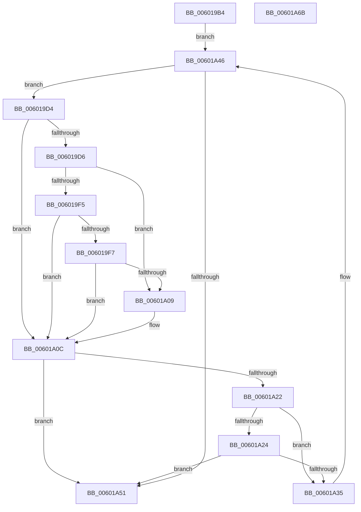

# pqdownheap

- RVA: `0x006019B4`–`0x00601A6C` (길이 `184` bytes)
- VA: `0x00000001406019B4`
- 실행 섹션: `.text`
- PDB 이름 있음: `예`; PDB Function 태그: `예`
- unwind 정보 RVA: `0x00069588`
- 디코드: `42`개 명령, `184/184` bytes 표시
- 미해석 바이트: `0` (있으면 어셈블리에 `.byte`로 보존)

> 이 문서는 커널 이미지의 기계어와 PDB 기호를 분석해 생성했습니다. 4번과 5번은 함수 원형과 자료형을 바이너리 사용 방식에서 추정한 C 해석이며 원본 소스 복구 결과는 아닙니다.

## 1. Dependencies

- 직접 호출 지점: **0**; 고유 호출 대상: **0**
- 직접 호출자로 확인된 함수: **1**
- RIP 상대 이미지 참조: **0**

### Outgoing calls
- 직접 디코드된 call 명령이 없습니다.

### Direct callers
- [build_tree](build_tree_function_00600FB0.md) at `0x006010C1`
- [build_tree](build_tree_function_00600FB0.md) at `0x006010FB`
- [build_tree](build_tree_function_00600FB0.md) at `0x00601188`

### Static image references
- 디코드된 RIP-relative 메모리 참조가 없습니다.

## 2. Other-region calls and transfers

- 다른 실행 섹션으로 향하는 call: **0**
- 별도 외부 분기/꼬리 이동을 확인하지 못했습니다.

## 3. Assembly (complete function range)

```asm
006019B4  48 89 5C 24 08                  mov qword ptr [rsp + 8], rbx
006019B9  48 89 74 24 10                  mov qword ptr [rsp + 0x10], rsi
006019BE  48 89 7C 24 18                  mov qword ptr [rsp + 0x18], rdi
006019C3  49 63 C0                        movsxd rax, r8d
006019C6  47 8D 0C 00                     lea r9d, [r8 + r8]
006019CA  48 63 9C 81 F8 0B 00 00         movsxd rbx, dword ptr [rcx + rax*4 + 0xbf8]
006019D2  EB 72                           jmp 0x140601a46
006019D4  7D 36                           jge 0x140601a0c
006019D6  49 63 C1                        movsxd rax, r9d
006019D9  4C 63 9C 81 F8 0B 00 00         movsxd r11, dword ptr [rcx + rax*4 + 0xbf8]
006019E1  4C 63 94 81 FC 0B 00 00         movsxd r10, dword ptr [rcx + rax*4 + 0xbfc]
006019E9  42 0F B7 04 92                  movzx eax, word ptr [rdx + r10*4]
006019EE  66 42 3B 04 9A                  cmp ax, word ptr [rdx + r11*4]
006019F3  72 14                           jb 0x140601a09
006019F5  75 15                           jne 0x140601a0c
006019F7  41 8A 84 0B F4 14 00 00         mov al, byte ptr [r11 + rcx + 0x14f4]
006019FF  41 38 84 0A F4 14 00 00         cmp byte ptr [r10 + rcx + 0x14f4], al
00601A07  77 03                           ja 0x140601a0c
00601A09  41 FF C1                        inc r9d
00601A0C  49 63 C1                        movsxd rax, r9d
00601A0F  4C 63 9C 81 F8 0B 00 00         movsxd r11, dword ptr [rcx + rax*4 + 0xbf8]
00601A17  0F B7 04 9A                     movzx eax, word ptr [rdx + rbx*4]
00601A1B  66 42 3B 04 9A                  cmp ax, word ptr [rdx + r11*4]
00601A20  72 2F                           jb 0x140601a51
00601A22  75 11                           jne 0x140601a35
00601A24  41 8A 84 0B F4 14 00 00         mov al, byte ptr [r11 + rcx + 0x14f4]
00601A2C  38 84 0B F4 14 00 00            cmp byte ptr [rbx + rcx + 0x14f4], al
00601A33  76 1C                           jbe 0x140601a51
00601A35  49 63 C0                        movsxd rax, r8d
00601A38  45 8B C1                        mov r8d, r9d
00601A3B  45 03 C9                        add r9d, r9d
00601A3E  44 89 9C 81 F8 0B 00 00         mov dword ptr [rcx + rax*4 + 0xbf8], r11d
00601A46  8B 81 EC 14 00 00               mov eax, dword ptr [rcx + 0x14ec]
00601A4C  44 3B C8                        cmp r9d, eax
00601A4F  7E 83                           jle 0x1406019d4
00601A51  48 8B 74 24 10                  mov rsi, qword ptr [rsp + 0x10]
00601A56  48 8B 7C 24 18                  mov rdi, qword ptr [rsp + 0x18]
00601A5B  49 63 C0                        movsxd rax, r8d
00601A5E  89 9C 81 F8 0B 00 00            mov dword ptr [rcx + rax*4 + 0xbf8], ebx
00601A65  48 8B 5C 24 08                  mov rbx, qword ptr [rsp + 8]
00601A6A  C3                              ret
00601A6B  CC                              int3
```

## 4. C-style interpretation (structured pseudocode)

```c
__int64 __fastcall pqdownheap(__int64 a1, __int64 a2, __int64 a3)
{
    unsigned __int64 v_stack_p10;
    unsigned __int64 v_stack_p18;
    unsigned __int64 v_stack_p8;

    v_stack_p8 = v_rbx;
    v_stack_p10 = v_rsi;
    v_stack_p18 = v_rdi;
    goto loc_00601A46;
loc_006019D4:
    if (condition_is_greater_or_equal) goto loc_00601A0C;
    if (((unsigned __int16)(*(unsigned __int16 *)(a2 + (int)(*(unsigned int *)(a1 + (int)((unsigned int)(a3 + a3 * 1)) * 4 + 3068)) * 4))) < (*(unsigned __int16 *)(a2 + (int)(*(unsigned int *)(a1 + (int)((unsigned int)(a3 + a3 * 1)) * 4 + 3064)) * 4))) goto loc_00601A09;
    if (((unsigned __int16)(*(unsigned __int16 *)(a2 + (int)(*(unsigned int *)(a1 + (int)((unsigned int)(a3 + a3 * 1)) * 4 + 3068)) * 4))) != (*(unsigned __int16 *)(a2 + (int)(*(unsigned int *)(a1 + (int)((unsigned int)(a3 + a3 * 1)) * 4 + 3064)) * 4))) goto loc_00601A0C;
    if ((*(unsigned __int8 *)((int)(*(unsigned int *)(a1 + (int)((unsigned int)(a3 + a3 * 1)) * 4 + 3068)) + a1 * 1 + 5364)) <= ((unsigned __int8)(*(unsigned __int8 *)((int)(*(unsigned int *)(a1 + (int)((unsigned int)(a3 + a3 * 1)) * 4 + 3064)) + a1 * 1 + 5364)))) {
        a4 = (unsigned int)((a3 + a3 * 1) + 1);
    }
    if (((unsigned __int16)(*(unsigned __int16 *)(a2 + (int)(*(unsigned int *)(a1 + (int)((unsigned int)(a3)) * 4 + 3064)) * 4))) < (*(unsigned __int16 *)(a2 + (int)(*(unsigned int *)(a1 + (int)((unsigned int)(a4)) * 4 + 3064)) * 4))) goto loc_00601A51;
    if (((unsigned __int16)(*(unsigned __int16 *)(a2 + (int)(*(unsigned int *)(a1 + (int)((unsigned int)(a3)) * 4 + 3064)) * 4))) != (*(unsigned __int16 *)(a2 + (int)(*(unsigned int *)(a1 + (int)((unsigned int)(a4)) * 4 + 3064)) * 4))) goto loc_00601A35;
    if ((*(unsigned __int8 *)((int)(*(unsigned int *)(a1 + (int)((unsigned int)(a3)) * 4 + 3064)) + a1 * 1 + 5364)) <= ((unsigned __int8)(*(unsigned __int8 *)((int)(*(unsigned int *)(a1 + (int)((unsigned int)(a4)) * 4 + 3064)) + a1 * 1 + 5364)))) goto loc_00601A51;
loc_00601A35:
    a4 = (unsigned int)((a4) + ((unsigned int)(a4)));
    *(unsigned int *)(a1 + (int)((unsigned int)(a3)) * 4 + 3064) = (unsigned int)((int)(*(unsigned int *)(a1 + (int)((unsigned int)(a4)) * 4 + 3064)));
loc_00601A46:
    if (((unsigned int)(a4)) <= ((unsigned int)((unsigned int)(*(unsigned int *)(a1 + 5356))))) goto loc_006019D4;
loc_00601A51:
    *(unsigned int *)(a1 + (int)((unsigned int)((unsigned int)((unsigned int)(a4)))) * 4 + 3064) = (unsigned int)((int)(*(unsigned int *)(a1 + (int)((unsigned int)(a3)) * 4 + 3064)));
    return (int)((unsigned int)((unsigned int)((unsigned int)(a4))));
}
```

## 5. (Beta) C Style

```c
int64_t pqdownheap(void *Arg1, void *Arg2, void *Arg3)
{
    uint8_t *arg1 = (uint8_t *)Arg1;
    uint8_t *arg2 = (uint8_t *)Arg2;
    uint8_t *arg3 = (uint8_t *)Arg3;

    uint64_t v_stack_p10;
    uint64_t v_stack_p18;
    uint64_t v_stack_p8;

    v_stack_p8 = local_rbx;
    v_stack_p10 = local_rsi;
    v_stack_p18 = local_rdi;
    goto loc_00601A46;
loc_006019D4:
    if (condition_is_greater_or_equal) goto loc_00601A0C;
    if (((uint16_t)(*(uint16_t *)(arg2 + (int32_t)(*(uint32_t *)(arg1 + (int32_t)((uint32_t)(arg3 + arg3 * 1)) * 4 + 0xBFC)) * 4))) < (*(uint16_t *)(arg2 + (int32_t)(*(uint32_t *)(arg1 + (int32_t)((uint32_t)(arg3 + arg3 * 1)) * 4 + 0xBF8)) * 4))) goto loc_00601A09;
    if (((uint16_t)(*(uint16_t *)(arg2 + (int32_t)(*(uint32_t *)(arg1 + (int32_t)((uint32_t)(arg3 + arg3 * 1)) * 4 + 0xBFC)) * 4))) != (*(uint16_t *)(arg2 + (int32_t)(*(uint32_t *)(arg1 + (int32_t)((uint32_t)(arg3 + arg3 * 1)) * 4 + 0xBF8)) * 4))) goto loc_00601A0C;
    if ((*(uint8_t *)((int32_t)(*(uint32_t *)(arg1 + (int32_t)((uint32_t)(arg3 + arg3 * 1)) * 4 + 0xBFC)) + arg1 * 1 + 0x14F4)) <= ((uint8_t)(*(uint8_t *)((int32_t)(*(uint32_t *)(arg1 + (int32_t)((uint32_t)(arg3 + arg3 * 1)) * 4 + 0xBF8)) + arg1 * 1 + 0x14F4)))) {
        a4 = (uint32_t)((Arg3 + Arg3 * 1) + 1);
    }
    if (((uint16_t)(*(uint16_t *)(arg2 + (int32_t)(*(uint32_t *)(arg1 + (int32_t)((uint32_t)(arg3)) * 4 + 0xBF8)) * 4))) < (*(uint16_t *)(arg2 + (int32_t)(*(uint32_t *)(arg1 + (int32_t)((uint32_t)(a4)) * 4 + 0xBF8)) * 4))) goto loc_00601A51;
    if (((uint16_t)(*(uint16_t *)(arg2 + (int32_t)(*(uint32_t *)(arg1 + (int32_t)((uint32_t)(arg3)) * 4 + 0xBF8)) * 4))) != (*(uint16_t *)(arg2 + (int32_t)(*(uint32_t *)(arg1 + (int32_t)((uint32_t)(a4)) * 4 + 0xBF8)) * 4))) goto loc_00601A35;
    if ((*(uint8_t *)((int32_t)(*(uint32_t *)(arg1 + (int32_t)((uint32_t)(arg3)) * 4 + 0xBF8)) + arg1 * 1 + 0x14F4)) <= ((uint8_t)(*(uint8_t *)((int32_t)(*(uint32_t *)(arg1 + (int32_t)((uint32_t)(a4)) * 4 + 0xBF8)) + arg1 * 1 + 0x14F4)))) goto loc_00601A51;
loc_00601A35:
    a4 = (uint32_t)((a4) + ((uint32_t)(a4)));
    *(uint32_t *)(arg1 + (int32_t)((uint32_t)(arg3)) * 4 + 0xBF8) = (uint32_t)((int32_t)(*(uint32_t *)(arg1 + (int32_t)((uint32_t)(a4)) * 4 + 0xBF8)));
loc_00601A46:
    if (((uint32_t)(a4)) <= ((uint32_t)((uint32_t)(*(uint32_t *)(arg1 + 0x14EC))))) goto loc_006019D4;
loc_00601A51:
    *(uint32_t *)(arg1 + (int32_t)((uint32_t)((uint32_t)((uint32_t)(a4)))) * 4 + 0xBF8) = (uint32_t)((int32_t)(*(uint32_t *)(arg1 + (int32_t)((uint32_t)(arg3)) * 4 + 0xBF8)));
    return (int32_t)((uint32_t)((uint32_t)((uint32_t)(a4))));
}
```

### 관측된 메모리 오프셋

구조체 형식이 확인되지 않은 접근은 인자 기준의 오프셋으로만 기록했습니다.

| 기준 인자 | 오프셋 표현 | 폭 (bit) | 접근 |
|---|---:|---:|---|
| `Arg1` | `+ 0xBF8 + rax*4` | `32` | `R` |
| `Arg1` | `+ 0xBF8 + rax*4` | `32` | `W` |
| `Arg1` | `+ 0xBFC + rax*4` | `32` | `R` |
| `Arg1` | `+ 0x14EC` | `32` | `R` |
| `Arg2` | `+ 0x0 + r10*4` | `16` | `R` |
| `Arg2` | `+ 0x0 + r11*4` | `16` | `R` |
| `Arg2` | `+ 0x0 + rbx*4` | `16` | `R` |
| `Arg3` | `+ 0x0 + r8*1` | `32` | `R` |

## 6. Execution-region graph

[열기: 2D/3D 그래프와 함수 탐색 컨트롤 패널](../../../control-panel.html?section=text&rva=0x006019B4&view=graph)

- 2D 그래프는 위에서 아래로 흐르고, 3D 그래프는 빈 공간을 드래그해 회전합니다. Shift+드래그는 이동, 휠은 확대·축소, 함수 노드 선택은 대상 보고서 이동입니다.

### Static fallback


