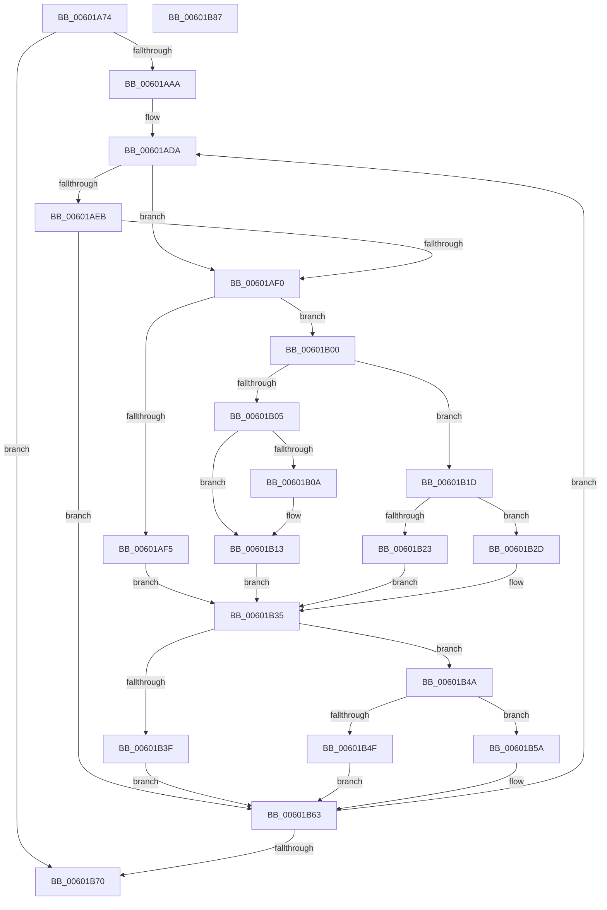

# scan_tree

- RVA: `0x00601A74`–`0x00601B88` (길이 `276` bytes)
- VA: `0x0000000140601A74`
- 실행 섹션: `.text`
- PDB 이름 있음: `예`; PDB Function 태그: `예`
- unwind 정보 RVA: `0x000A6CEC`
- 디코드: `75`개 명령, `276/276` bytes 표시
- 미해석 바이트: `0` (있으면 어셈블리에 `.byte`로 보존)

> 이 문서는 커널 이미지의 기계어와 PDB 기호를 분석해 생성했습니다. 4번과 5번은 함수 원형과 자료형을 바이너리 사용 방식에서 추정한 C 해석이며 원본 소스 복구 결과는 아닙니다.

## 1. Dependencies

- 직접 호출 지점: **0**; 고유 호출 대상: **0**
- 직접 호출자로 확인된 함수: **1**
- RIP 상대 이미지 참조: **0**

### Outgoing calls
- 직접 디코드된 call 명령이 없습니다.

### Direct callers
- [tr_flush_block](tr_flush_block_function_00600AF8.md) at `0x00600B81`
- [tr_flush_block](tr_flush_block_function_00600AF8.md) at `0x00600B97`

### Static image references
- 디코드된 RIP-relative 메모리 참조가 없습니다.

## 2. Other-region calls and transfers

- 다른 실행 섹션으로 향하는 call: **0**
- 별도 외부 분기/꼬리 이동을 확인하지 못했습니다.

## 3. Assembly (complete function range)

```asm
00601A74  48 8B C4                        mov rax, rsp
00601A77  48 89 58 08                     mov qword ptr [rax + 8], rbx
00601A7B  48 89 68 10                     mov qword ptr [rax + 0x10], rbp
00601A7F  48 89 70 18                     mov qword ptr [rax + 0x18], rsi
00601A83  48 89 78 20                     mov qword ptr [rax + 0x20], rdi
00601A87  41 56                           push r14
00601A89  0F B7 5A 02                     movzx ebx, word ptr [rdx + 2]
00601A8D  83 CF FF                        or edi, 0xffffffff
00601A90  4D 63 D8                        movsxd r11, r8d
00601A93  45 33 C9                        xor r9d, r9d
00601A96  4C 8B D2                        mov r10, rdx
00601A99  66 42 81 4C 9A 06 FF FF         or word ptr [rdx + r11*4 + 6], 0xffff
00601AA1  45 85 C0                        test r8d, r8d
00601AA4  0F 88 C6 00 00 00               js 0x140601b70
00601AAA  0F B7 C3                        movzx eax, bx
00601AAD  49 8D 72 06                     lea rsi, [r10 + 6]
00601AB1  66 F7 D8                        neg ax
00601AB4  49 8D 6B 01                     lea rbp, [r11 + 1]
00601AB8  0F B7 C3                        movzx eax, bx
00601ABB  44 8D 77 02                     lea r14d, [rdi + 2]
00601ABF  45 1B C0                        sbb r8d, r8d
00601AC2  41 81 E0 7D FF FF FF            and r8d, 0xffffff7d
00601AC9  41 81 C0 8A 00 00 00            add r8d, 0x8a
00601AD0  66 F7 D8                        neg ax
00601AD3  1B D2                           sbb edx, edx
00601AD5  F7 DA                           neg edx
00601AD7  83 C2 03                        add edx, 3
00601ADA  45 03 CE                        add r9d, r14d
00601ADD  44 8B D3                        mov r10d, ebx
00601AE0  44 8B DB                        mov r11d, ebx
00601AE3  0F B7 1E                        movzx ebx, word ptr [rsi]
00601AE6  45 3B C8                        cmp r9d, r8d
00601AE9  7D 05                           jge 0x140601af0
00601AEB  44 3B D3                        cmp r10d, ebx
00601AEE  74 73                           je 0x140601b63
00601AF0  44 3B CA                        cmp r9d, edx
00601AF3  7D 0B                           jge 0x140601b00
00601AF5  66 46 01 8C 91 F4 0A 00 00      add word ptr [rcx + r10*4 + 0xaf4], r9w
00601AFE  EB 35                           jmp 0x140601b35
00601B00  45 85 D2                        test r10d, r10d
00601B03  74 18                           je 0x140601b1d
00601B05  44 3B DF                        cmp r11d, edi
00601B08  74 09                           je 0x140601b13
00601B0A  66 46 01 B4 91 F4 0A 00 00      add word ptr [rcx + r10*4 + 0xaf4], r14w
00601B13  66 44 01 B1 34 0B 00 00         add word ptr [rcx + 0xb34], r14w
00601B1B  EB 18                           jmp 0x140601b35
00601B1D  41 83 F9 0A                     cmp r9d, 0xa
00601B21  7F 0A                           jg 0x140601b2d
00601B23  66 44 01 B1 38 0B 00 00         add word ptr [rcx + 0xb38], r14w
00601B2B  EB 08                           jmp 0x140601b35
00601B2D  66 44 01 B1 3C 0B 00 00         add word ptr [rcx + 0xb3c], r14w
00601B35  45 33 C9                        xor r9d, r9d
00601B38  41 8B FB                        mov edi, r11d
00601B3B  85 DB                           test ebx, ebx
00601B3D  75 0B                           jne 0x140601b4a
00601B3F  8D 53 03                        lea edx, [rbx + 3]
00601B42  41 B8 8A 00 00 00               mov r8d, 0x8a
00601B48  EB 19                           jmp 0x140601b63
00601B4A  44 3B D3                        cmp r10d, ebx
00601B4D  75 0B                           jne 0x140601b5a
00601B4F  BA 03 00 00 00                  mov edx, 3
00601B54  44 8D 42 03                     lea r8d, [rdx + 3]
00601B58  EB 09                           jmp 0x140601b63
00601B5A  BA 04 00 00 00                  mov edx, 4
00601B5F  44 8D 42 03                     lea r8d, [rdx + 3]
00601B63  48 83 C6 04                     add rsi, 4
00601B67  49 2B EE                        sub rbp, r14
00601B6A  0F 85 6A FF FF FF               jne 0x140601ada
00601B70  48 8B 5C 24 10                  mov rbx, qword ptr [rsp + 0x10]
00601B75  48 8B 6C 24 18                  mov rbp, qword ptr [rsp + 0x18]
00601B7A  48 8B 74 24 20                  mov rsi, qword ptr [rsp + 0x20]
00601B7F  48 8B 7C 24 28                  mov rdi, qword ptr [rsp + 0x28]
00601B84  41 5E                           pop r14
00601B86  C3                              ret
00601B87  CC                              int3
```

## 4. C-style interpretation (structured pseudocode)

```c
__int64 __fastcall scan_tree(__int64 a1, __int64 a2, int a3, int a4)
{
    __int64 result;
    __int64 v_rbp;
    __int64 v_rdi;
    __int64 v_rsi;
    unsigned __int64 v_stack_p10;
    unsigned __int64 v_stack_p18;
    unsigned __int64 v_stack_p20;
    unsigned __int64 v_stack_p8;

    *(unsigned __int64 *)(v_rsp + 8) = v_rbx;
    *(unsigned __int64 *)(v_rsp + 16) = v_rbp;
    *(unsigned __int64 *)(v_rsp + 24) = v_rsi;
    *(unsigned __int64 *)(v_rsp + 32) = v_rdi;
    v_rdi = (unsigned int)((v_rdi) | (0xFFFFFFFFULL));
    a4 = 0;
    if (sign_flag) goto loc_00601B70;
    result = (unsigned __int16)(-((unsigned __int16)(*(unsigned __int16 *)(a2 + 2))));
    a3 = (unsigned int)((a3) & (0xFFFFFF7DULL));
    a3 = (unsigned int)((a3) + (138));
    result = (unsigned __int16)(-((unsigned __int16)(*(unsigned __int16 *)(a2 + 2))));
    a2 = (unsigned int)(-(a2));
    a2 = (unsigned int)((a2) + (3));
loc_00601ADA:
    a4 = (unsigned int)((a4) + ((unsigned int)(v_rdi + 2)));
    if (a4 >= a3) goto loc_00601AF0;
    if (((unsigned int)((unsigned int)((unsigned int)(*(unsigned __int16 *)(a2 + 2))))) == ((unsigned int)(*(unsigned __int16 *)(a2 + 6)))) goto loc_00601B63;
loc_00601AF0:
    if (a4 >= ((unsigned int)(a2))) goto loc_00601B00;
    goto loc_00601B35;
loc_00601B00:
    if ((unsigned int)((unsigned int)((unsigned int)(*(unsigned __int16 *)(a2 + 2)))) == 0) goto loc_00601B1D;
    if (((unsigned int)((unsigned int)((unsigned int)(*(unsigned __int16 *)(a2 + 2))))) != ((unsigned int)(v_rdi))) {
    }
    goto loc_00601B35;
loc_00601B1D:
    if (a4 > 10) goto loc_00601B2D;
    goto loc_00601B35;
loc_00601B2D:
loc_00601B35:
    a4 = 0;
    if ((unsigned int)(*(unsigned __int16 *)(a2 + 6)) != 0) goto loc_00601B4A;
    goto loc_00601B63;
loc_00601B4A:
    if (((unsigned int)((unsigned int)((unsigned int)(*(unsigned __int16 *)(a2 + 2))))) != ((unsigned int)(*(unsigned __int16 *)(a2 + 6)))) goto loc_00601B5A;
    goto loc_00601B63;
loc_00601B5A:
loc_00601B63:
    v_rsi = (a2 + 6) + (4);
    v_rbp = ((int)(a3) + 1) - (v_rdi + 2);
    if (condition_is_not_equal) goto loc_00601ADA;
loc_00601B70:
    return result;
}
```

## 5. (Beta) C Style

```c
int64_t scan_tree(void *Arg1, void *Arg2, void *Arg3, int32_t Arg4)
{
    uint8_t *arg1 = (uint8_t *)Arg1;
    uint8_t *arg2 = (uint8_t *)Arg2;
    uint8_t *arg3 = (uint8_t *)Arg3;

    int64_t result;
    int64_t local_rbp;
    int64_t local_rdi;
    int64_t local_rsi;
    uint64_t v_stack_p10;
    uint64_t v_stack_p18;
    uint64_t v_stack_p20;
    uint64_t v_stack_p8;

    *(uint64_t *)(local_rsp + 0x8) = local_rbx;
    *(uint64_t *)(local_rsp + 0x10) = local_rbp;
    *(uint64_t *)(local_rsp + 0x18) = local_rsi;
    *(uint64_t *)(local_rsp + 0x20) = local_rdi;
    local_rdi = (uint32_t)((local_rdi) | (0xFFFFFFFFULL));
    Arg4 = 0;
    if (sign_flag) goto loc_00601B70;
    result = (uint16_t)(-((uint16_t)(*(uint16_t *)(arg2 + 0x2))));
    Arg3 = (uint32_t)((Arg3) & (0xFFFFFF7DULL));
    Arg3 = (uint32_t)((Arg3) + (138));
    result = (uint16_t)(-((uint16_t)(*(uint16_t *)(arg2 + 0x2))));
    Arg2 = (uint32_t)(-(Arg2));
    Arg2 = (uint32_t)((Arg2) + (3));
loc_00601ADA:
    Arg4 = (uint32_t)((Arg4) + ((uint32_t)(local_rdi + 2)));
    if (Arg4 >= Arg3) goto loc_00601AF0;
    if (((uint32_t)((uint32_t)((uint32_t)(*(uint16_t *)(arg2 + 0x2))))) == ((uint32_t)(*(uint16_t *)(arg2 + 0x6)))) goto loc_00601B63;
loc_00601AF0:
    if (Arg4 >= ((uint32_t)(Arg2))) goto loc_00601B00;
    goto loc_00601B35;
loc_00601B00:
    if ((uint32_t)((uint32_t)((uint32_t)(*(uint16_t *)(arg2 + 0x2)))) == 0) goto loc_00601B1D;
    if (((uint32_t)((uint32_t)((uint32_t)(*(uint16_t *)(arg2 + 0x2))))) != ((uint32_t)(local_rdi))) {
    }
    goto loc_00601B35;
loc_00601B1D:
    if (Arg4 > 10) goto loc_00601B2D;
    goto loc_00601B35;
loc_00601B2D:
loc_00601B35:
    Arg4 = 0;
    if ((uint32_t)(*(uint16_t *)(arg2 + 0x6)) != 0) goto loc_00601B4A;
    goto loc_00601B63;
loc_00601B4A:
    if (((uint32_t)((uint32_t)((uint32_t)(*(uint16_t *)(arg2 + 0x2))))) != ((uint32_t)(*(uint16_t *)(arg2 + 0x6)))) goto loc_00601B5A;
    goto loc_00601B63;
loc_00601B5A:
loc_00601B63:
    local_rsi = (Arg2 + 6) + (4);
    local_rbp = ((int32_t)(Arg3) + 1) - (local_rdi + 2);
    if (condition_is_not_equal) goto loc_00601ADA;
loc_00601B70:
    return result;
}
```

### 관측된 메모리 오프셋

구조체 형식이 확인되지 않은 접근은 인자 기준의 오프셋으로만 기록했습니다.

| 기준 인자 | 오프셋 표현 | 폭 (bit) | 접근 |
|---|---:|---:|---|
| `Arg1` | `+ 0xAF4 + r10*4` | `16` | `R/W` |
| `Arg1` | `+ 0xB34` | `16` | `R/W` |
| `Arg1` | `+ 0xB38` | `16` | `R/W` |
| `Arg1` | `+ 0xB3C` | `16` | `R/W` |
| `Arg2` | `+ 0x0` | `16` | `R` |
| `Arg2` | `+ 0x2` | `16` | `R` |
| `Arg2` | `+ 0x6` | `64` | `R` |
| `Arg2` | `+ 0x6 + r11*4` | `16` | `R/W` |
| `Arg3` | `+ 0x1` | `64` | `R` |

## 6. Execution-region graph

[열기: 2D/3D 그래프와 함수 탐색 컨트롤 패널](../../../control-panel.html?section=text&rva=0x00601A74&view=graph)

- 2D 그래프는 위에서 아래로 흐르고, 3D 그래프는 빈 공간을 드래그해 회전합니다. Shift+드래그는 이동, 휠은 확대·축소, 함수 노드 선택은 대상 보고서 이동입니다.

### Static fallback


