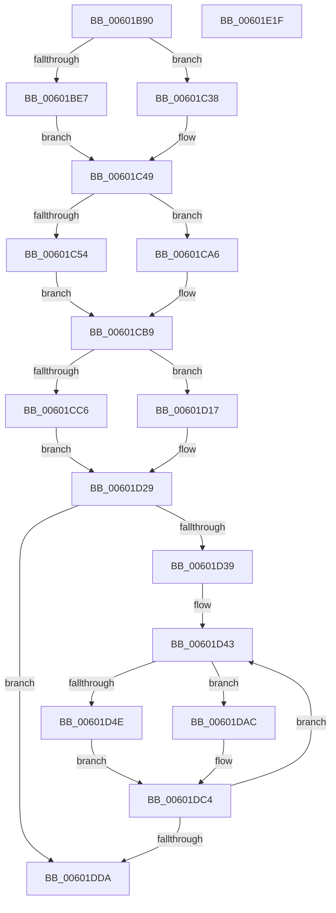

# send_all_trees

- RVA: `0x00601B90`–`0x00601E20` (길이 `656` bytes)
- VA: `0x0000000140601B90`
- 실행 섹션: `.text`
- PDB 이름 있음: `예`; PDB Function 태그: `예`
- unwind 정보 RVA: `0x0005FEF8`
- 디코드: `162`개 명령, `656/656` bytes 표시
- 미해석 바이트: `0` (있으면 어셈블리에 `.byte`로 보존)

> 이 문서는 커널 이미지의 기계어와 PDB 기호를 분석해 생성했습니다. 4번과 5번은 함수 원형과 자료형을 바이너리 사용 방식에서 추정한 C 해석이며 원본 소스 복구 결과는 아닙니다.

## 1. Dependencies

- 직접 호출 지점: **2**; 고유 호출 대상: **1**
- 직접 호출자로 확인된 함수: **1**
- RIP 상대 이미지 참조: **1**

### Outgoing calls
- `0x00601DE8` → [send_tree](send_tree_function_00601E28.md) (function, `0x00601E28`)
- `0x00601DFB` → [send_tree](send_tree_function_00601E28.md) (function, `0x00601E28`)

### Direct callers
- [tr_flush_block](tr_flush_block_function_00600AF8.md) at `0x00600D77`

### Static image references
- `0x00601D39` → RVA `0x00036DA0` (`.rdata`; read)

## 2. Other-region calls and transfers

- 다른 실행 섹션으로 향하는 call: **0**
- 별도 외부 분기/꼬리 이동을 확인하지 못했습니다.

## 3. Assembly (complete function range)

```asm
00601B90  48 8B C4                        mov rax, rsp
00601B93  48 89 58 08                     mov qword ptr [rax + 8], rbx
00601B97  48 89 68 10                     mov qword ptr [rax + 0x10], rbp
00601B9B  48 89 70 18                     mov qword ptr [rax + 0x18], rsi
00601B9F  48 89 78 20                     mov qword ptr [rax + 0x20], rdi
00601BA3  41 54                           push r12
00601BA5  41 56                           push r14
00601BA7  41 57                           push r15
00601BA9  48 83 EC 20                     sub rsp, 0x20
00601BAD  48 8B D9                        mov rbx, rcx
00601BB0  41 8B F1                        mov esi, r9d
00601BB3  8B 89 60 17 00 00               mov ecx, dword ptr [rcx + 0x1760]
00601BB9  44 8B F2                        mov r14d, edx
00601BBC  45 0F B7 CE                     movzx r9d, r14w
00601BC0  B8 01 01 00 00                  mov eax, 0x101
00601BC5  66 44 2B C8                     sub r9w, ax
00601BC9  45 8B F8                        mov r15d, r8d
00601BCC  44 0F B7 9B 5C 17 00 00         movzx r11d, word ptr [rbx + 0x175c]
00601BD4  4C 8D 53 28                     lea r10, [rbx + 0x28]
00601BD8  48 8D 7B 10                     lea rdi, [rbx + 0x10]
00601BDC  41 BC 01 00 00 00               mov r12d, 1
00601BE2  83 F9 0B                        cmp ecx, 0xb
00601BE5  7E 51                           jle 0x140601c38
00601BE7  41 8B 12                        mov edx, dword ptr [r10]
00601BEA  41 0F B7 C1                     movzx eax, r9w
00601BEE  66 D3 E0                        shl ax, cl
00601BF1  48 8B 0F                        mov rcx, qword ptr [rdi]
00601BF4  66 41 0B C3                     or ax, r11w
00601BF8  66 89 83 5C 17 00 00            mov word ptr [rbx + 0x175c], ax
00601BFF  88 04 0A                        mov byte ptr [rdx + rcx], al
00601C02  45 01 22                        add dword ptr [r10], r12d
00601C05  41 8B 12                        mov edx, dword ptr [r10]
00601C08  48 8B 0F                        mov rcx, qword ptr [rdi]
00601C0B  8A 83 5D 17 00 00               mov al, byte ptr [rbx + 0x175d]
00601C11  88 04 0A                        mov byte ptr [rdx + rcx], al
00601C14  41 8D 4C 24 0F                  lea ecx, [r12 + 0xf]
00601C19  0F B7 83 60 17 00 00            movzx eax, word ptr [rbx + 0x1760]
00601C20  83 83 60 17 00 00 F5            add dword ptr [rbx + 0x1760], -0xb
00601C27  2A C8                           sub cl, al
00601C29  45 01 22                        add dword ptr [r10], r12d
00601C2C  8B 93 60 17 00 00               mov edx, dword ptr [rbx + 0x1760]
00601C32  66 41 D3 E9                     shr r9w, cl
00601C36  EB 11                           jmp 0x140601c49
00601C38  8D 51 05                        lea edx, [rcx + 5]
00601C3B  66 41 D3 E1                     shl r9w, cl
00601C3F  89 93 60 17 00 00               mov dword ptr [rbx + 0x1760], edx
00601C45  66 45 0B CB                     or r9w, r11w
00601C49  66 45 2B C4                     sub r8w, r12w
00601C4D  8B CA                           mov ecx, edx
00601C4F  83 FA 0B                        cmp edx, 0xb
00601C52  7E 52                           jle 0x140601ca6
00601C54  41 8B 12                        mov edx, dword ptr [r10]
00601C57  41 0F B7 C0                     movzx eax, r8w
00601C5B  66 D3 E0                        shl ax, cl
00601C5E  48 8B 0F                        mov rcx, qword ptr [rdi]
00601C61  66 41 0B C1                     or ax, r9w
00601C65  66 89 83 5C 17 00 00            mov word ptr [rbx + 0x175c], ax
00601C6C  88 04 0A                        mov byte ptr [rdx + rcx], al
00601C6F  45 01 22                        add dword ptr [r10], r12d
00601C72  41 8B 12                        mov edx, dword ptr [r10]
00601C75  48 8B 0F                        mov rcx, qword ptr [rdi]
00601C78  8A 83 5D 17 00 00               mov al, byte ptr [rbx + 0x175d]
00601C7E  88 04 0A                        mov byte ptr [rdx + rcx], al
00601C81  B9 10 00 00 00                  mov ecx, 0x10
00601C86  0F B7 83 60 17 00 00            movzx eax, word ptr [rbx + 0x1760]
00601C8D  83 83 60 17 00 00 F5            add dword ptr [rbx + 0x1760], -0xb
00601C94  2A C8                           sub cl, al
00601C96  45 01 22                        add dword ptr [r10], r12d
00601C99  44 8B 9B 60 17 00 00            mov r11d, dword ptr [rbx + 0x1760]
00601CA0  66 41 D3 E8                     shr r8w, cl
00601CA4  EB 13                           jmp 0x140601cb9
00601CA6  44 8D 5A 05                     lea r11d, [rdx + 5]
00601CAA  66 41 D3 E0                     shl r8w, cl
00601CAE  44 89 9B 60 17 00 00            mov dword ptr [rbx + 0x1760], r11d
00601CB5  66 45 0B C1                     or r8w, r9w
00601CB9  44 8D 4E FC                     lea r9d, [rsi - 4]
00601CBD  41 8B CB                        mov ecx, r11d
00601CC0  41 83 FB 0C                     cmp r11d, 0xc
00601CC4  7E 51                           jle 0x140601d17
00601CC6  41 8B 12                        mov edx, dword ptr [r10]
00601CC9  41 0F B7 C1                     movzx eax, r9w
00601CCD  66 D3 E0                        shl ax, cl
00601CD0  48 8B 0F                        mov rcx, qword ptr [rdi]
00601CD3  66 41 0B C0                     or ax, r8w
00601CD7  66 89 83 5C 17 00 00            mov word ptr [rbx + 0x175c], ax
00601CDE  88 04 0A                        mov byte ptr [rdx + rcx], al
00601CE1  45 01 22                        add dword ptr [r10], r12d
00601CE4  41 8B 12                        mov edx, dword ptr [r10]
00601CE7  48 8B 0F                        mov rcx, qword ptr [rdi]
00601CEA  8A 83 5D 17 00 00               mov al, byte ptr [rbx + 0x175d]
00601CF0  88 04 0A                        mov byte ptr [rdx + rcx], al
00601CF3  B9 10 00 00 00                  mov ecx, 0x10
00601CF8  0F B7 83 60 17 00 00            movzx eax, word ptr [rbx + 0x1760]
00601CFF  83 83 60 17 00 00 F4            add dword ptr [rbx + 0x1760], -0xc
00601D06  2A C8                           sub cl, al
00601D08  45 01 22                        add dword ptr [r10], r12d
00601D0B  8B 93 60 17 00 00               mov edx, dword ptr [rbx + 0x1760]
00601D11  66 41 D3 E9                     shr r9w, cl
00601D15  EB 12                           jmp 0x140601d29
00601D17  41 8D 53 04                     lea edx, [r11 + 4]
00601D1B  66 41 D3 E1                     shl r9w, cl
00601D1F  89 93 60 17 00 00               mov dword ptr [rbx + 0x1760], edx
00601D25  66 45 0B C8                     or r9w, r8w
00601D29  66 44 89 8B 5C 17 00 00         mov word ptr [rbx + 0x175c], r9w
00601D31  85 F6                           test esi, esi
00601D33  0F 8E A1 00 00 00               jle 0x140601dda
00601D39  4C 8D 1D 60 50 A3 FF            lea r11, [rip - 0x5cafa0]
00601D40  48 8B EE                        mov rbp, rsi
00601D43  41 0F B6 03                     movzx eax, byte ptr [r11]
00601D47  8B CA                           mov ecx, edx
00601D49  83 FA 0D                        cmp edx, 0xd
00601D4C  7E 5E                           jle 0x140601dac
00601D4E  44 0F B7 84 83 F6 0A 00 00      movzx r8d, word ptr [rbx + rax*4 + 0xaf6]
00601D57  41 8B 12                        mov edx, dword ptr [r10]
00601D5A  41 0F B7 C0                     movzx eax, r8w
00601D5E  66 D3 E0                        shl ax, cl
00601D61  48 8B 0F                        mov rcx, qword ptr [rdi]
00601D64  66 41 0B C1                     or ax, r9w
00601D68  66 89 83 5C 17 00 00            mov word ptr [rbx + 0x175c], ax
00601D6F  45 0F B7 C8                     movzx r9d, r8w
00601D73  88 04 0A                        mov byte ptr [rdx + rcx], al
00601D76  45 01 22                        add dword ptr [r10], r12d
00601D79  41 8B 12                        mov edx, dword ptr [r10]
00601D7C  48 8B 0F                        mov rcx, qword ptr [rdi]
00601D7F  8A 83 5D 17 00 00               mov al, byte ptr [rbx + 0x175d]
00601D85  88 04 0A                        mov byte ptr [rdx + rcx], al
00601D88  B9 10 00 00 00                  mov ecx, 0x10
00601D8D  0F B7 83 60 17 00 00            movzx eax, word ptr [rbx + 0x1760]
00601D94  83 83 60 17 00 00 F3            add dword ptr [rbx + 0x1760], -0xd
00601D9B  2A C8                           sub cl, al
00601D9D  45 01 22                        add dword ptr [r10], r12d
00601DA0  8B B3 60 17 00 00               mov esi, dword ptr [rbx + 0x1760]
00601DA6  66 41 D3 E9                     shr r9w, cl
00601DAA  EB 18                           jmp 0x140601dc4
00601DAC  0F B7 84 83 F6 0A 00 00         movzx eax, word ptr [rbx + rax*4 + 0xaf6]
00601DB4  8D 72 03                        lea esi, [rdx + 3]
00601DB7  66 D3 E0                        shl ax, cl
00601DBA  66 44 0B C8                     or r9w, ax
00601DBE  89 B3 60 17 00 00               mov dword ptr [rbx + 0x1760], esi
00601DC4  4D 03 DC                        add r11, r12
00601DC7  66 44 89 8B 5C 17 00 00         mov word ptr [rbx + 0x175c], r9w
00601DCF  8B D6                           mov edx, esi
00601DD1  49 2B EC                        sub rbp, r12
00601DD4  0F 85 69 FF FF FF               jne 0x140601d43
00601DDA  45 8D 46 FF                     lea r8d, [r14 - 1]
00601DDE  48 8B CB                        mov rcx, rbx
00601DE1  48 8D 93 0C 01 00 00            lea rdx, [rbx + 0x10c]
00601DE8  E8 3B 00 00 00                  call 0x140601e28
00601DED  45 8D 47 FF                     lea r8d, [r15 - 1]
00601DF1  48 8B CB                        mov rcx, rbx
00601DF4  48 8D 93 00 0A 00 00            lea rdx, [rbx + 0xa00]
00601DFB  E8 28 00 00 00                  call 0x140601e28
00601E00  48 8B 5C 24 40                  mov rbx, qword ptr [rsp + 0x40]
00601E05  48 8B 6C 24 48                  mov rbp, qword ptr [rsp + 0x48]
00601E0A  48 8B 74 24 50                  mov rsi, qword ptr [rsp + 0x50]
00601E0F  48 8B 7C 24 58                  mov rdi, qword ptr [rsp + 0x58]
00601E14  48 83 C4 20                     add rsp, 0x20
00601E18  41 5F                           pop r15
00601E1A  41 5E                           pop r14
00601E1C  41 5C                           pop r12
00601E1E  C3                              ret
00601E1F  CC                              int3
```

## 4. C-style interpretation (structured pseudocode)

```c
__int64 __fastcall send_all_trees(__int64 a1, int a2, int a3, int a4)
{
    __int64 result;
    __int64 v_r11;
    __int64 v_rbp;
    __int64 v_rsp;
    unsigned __int64 v_stack_p10;
    unsigned __int64 v_stack_p18;
    unsigned __int64 v_stack_p20;
    unsigned __int64 v_stack_p8;

    *(unsigned __int64 *)(v_rsp + 8) = v_rbx;
    *(unsigned __int64 *)(v_rsp + 16) = v_rbp;
    *(unsigned __int64 *)(v_rsp + 24) = v_rsi;
    *(unsigned __int64 *)(v_rsp + 32) = v_rdi;
    v_rsp = (v_rsp) - (32);
    a4 = (unsigned __int16)(((unsigned __int16)((unsigned int)(a2))) - (257));
    if (((unsigned int)((unsigned int)(*(unsigned int *)(a1 + 5984)))) <= 11) goto loc_00601C38;
    result = (unsigned __int16)(((unsigned __int16)(a4)) << ((unsigned __int8)((unsigned int)(*(unsigned int *)(a1 + 5984)))));
    result = (unsigned __int16)((result) | ((unsigned __int16)(*(unsigned __int16 *)(a1 + 5980))));
    *(unsigned __int16 *)(a1 + 5980) = (unsigned __int16)(result);
    *(unsigned __int8 *)((unsigned int)(*(unsigned int *)(a1 + 40)) + *(unsigned __int64 *)(a1 + 16) * 1) = (unsigned __int8)(result);
    *(unsigned __int8 *)((unsigned int)(*(unsigned int *)(a1 + 40)) + *(unsigned __int64 *)(a1 + 16) * 1) = (unsigned __int8)(*(unsigned __int8 *)(a1 + 5981));
    a1 = (unsigned __int8)((1 + 15) - ((unsigned __int8)(*(unsigned __int16 *)(a1 + 5984))));
    a4 = (unsigned __int16)((a4) >> ((unsigned __int8)(a1)));
    goto loc_00601C49;
loc_00601C38:
    a4 = (unsigned __int16)((a4) << ((unsigned __int8)(a1)));
    *(unsigned int *)(a1 + 5984) = (unsigned int)(a1 + 5);
    a4 = (unsigned __int16)((a4) | ((unsigned __int16)(*(unsigned __int16 *)(a1 + 5980))));
loc_00601C49:
    a3 = (unsigned __int16)((a3) - (1));
    if (((unsigned int)(a1 + 5)) <= 11) goto loc_00601CA6;
    result = (unsigned __int16)(((unsigned __int16)(a3)) << ((unsigned __int8)((unsigned int)((unsigned int)(a1 + 5)))));
    result = (unsigned __int16)((result) | ((unsigned __int16)(a4)));
    *(unsigned __int16 *)(a1 + 5980) = (unsigned __int16)(result);
    *(unsigned __int8 *)((unsigned int)(*(unsigned int *)(a1 + 40)) + *(unsigned __int64 *)(a1 + 16) * 1) = (unsigned __int8)(result);
    *(unsigned __int8 *)((unsigned int)(*(unsigned int *)(a1 + 40)) + *(unsigned __int64 *)(a1 + 16) * 1) = (unsigned __int8)(*(unsigned __int8 *)(a1 + 5981));
    a1 = (unsigned __int8)((16) - ((unsigned __int8)(*(unsigned __int16 *)(a1 + 5984))));
    a3 = (unsigned __int16)((a3) >> ((unsigned __int8)(a1)));
    goto loc_00601CB9;
loc_00601CA6:
    a3 = (unsigned __int16)((a3) << ((unsigned __int8)(a1)));
    *(unsigned int *)(a1 + 5984) = (unsigned int)((unsigned int)(*(unsigned int *)(a1 + 40)) + 5);
    a3 = (unsigned __int16)((a3) | ((unsigned __int16)(a4)));
loc_00601CB9:
    if (((unsigned int)((unsigned int)(*(unsigned int *)(a1 + 40)) + 5)) <= 12) goto loc_00601D17;
    result = (unsigned __int16)(((unsigned __int16)((unsigned int)(a4) - 4)) << ((unsigned __int8)((unsigned int)((unsigned int)((unsigned int)(*(unsigned int *)(a1 + 40)) + 5)))));
    result = (unsigned __int16)((result) | ((unsigned __int16)(a3)));
    *(unsigned __int16 *)(a1 + 5980) = (unsigned __int16)(result);
    *(unsigned __int8 *)((unsigned int)(*(unsigned int *)(a1 + 40)) + *(unsigned __int64 *)(a1 + 16) * 1) = (unsigned __int8)(result);
    *(unsigned __int8 *)((unsigned int)(*(unsigned int *)(a1 + 40)) + *(unsigned __int64 *)(a1 + 16) * 1) = (unsigned __int8)(*(unsigned __int8 *)(a1 + 5981));
    a1 = (unsigned __int8)((16) - ((unsigned __int8)(*(unsigned __int16 *)(a1 + 5984))));
    a4 = (unsigned __int16)(((unsigned int)(a4) - 4) >> ((unsigned __int8)(a1)));
    goto loc_00601D29;
loc_00601D17:
    a4 = (unsigned __int16)((a4) << ((unsigned __int8)(a1)));
    *(unsigned int *)(a1 + 5984) = (unsigned int)((unsigned int)(*(unsigned int *)(a1 + 40)) + 5 + 4);
    a4 = (unsigned __int16)((a4) | ((unsigned __int16)(a3)));
loc_00601D29:
    *(unsigned __int16 *)(a1 + 5980) = (unsigned __int16)(a4);
    if (condition_is_less_or_equal) goto loc_00601DDA;
loc_00601D43:
    if (((unsigned int)((unsigned int)(*(unsigned int *)(a1 + 40)) + 5 + 4)) <= 13) goto loc_00601DAC;
    result = (unsigned __int16)(((unsigned __int16)(*(unsigned __int16 *)(a1 + *(unsigned __int8 *)(v_rip - 6074272) * 4 + 2806))) << ((unsigned __int8)((unsigned int)((unsigned int)((unsigned int)(*(unsigned int *)(a1 + 40)) + 5 + 4)))));
    result = (unsigned __int16)((result) | ((unsigned __int16)(a4)));
    *(unsigned __int16 *)(a1 + 5980) = (unsigned __int16)(result);
    *(unsigned __int8 *)((unsigned int)(*(unsigned int *)(a1 + 40)) + *(unsigned __int64 *)(a1 + 16) * 1) = (unsigned __int8)(result);
    *(unsigned __int8 *)((unsigned int)(*(unsigned int *)(a1 + 40)) + *(unsigned __int64 *)(a1 + 16) * 1) = (unsigned __int8)(*(unsigned __int8 *)(a1 + 5981));
    a1 = (unsigned __int8)((16) - ((unsigned __int8)(*(unsigned __int16 *)(a1 + 5984))));
    a4 = (unsigned __int16)(((unsigned __int16)(*(unsigned __int16 *)(a1 + *(unsigned __int8 *)(v_rip - 6074272) * 4 + 2806))) >> ((unsigned __int8)(a1)));
    goto loc_00601DC4;
loc_00601DAC:
    result = (unsigned __int16)((*(unsigned __int16 *)(a1 + *(unsigned __int16 *)(a1 + 5984) * 4 + 2806)) << ((unsigned __int8)(a1)));
    a4 = (unsigned __int16)((a4) | ((unsigned __int16)(result)));
    *(unsigned int *)(a1 + 5984) = (unsigned int)((unsigned int)(*(unsigned int *)(a1 + 40)) + 3);
loc_00601DC4:
    v_r11 = (v_rip - 6074272) + (1);
    *(unsigned __int16 *)(a1 + 5980) = (unsigned __int16)(a4);
    v_rbp = ((unsigned int)(a4)) - (1);
    if (condition_is_not_equal) goto loc_00601D43;
loc_00601DDA:
    result = send_tree(a1, a1 + 268, (unsigned int)(a2) - 1, a4);
    result = send_tree(a1, a1 + 2560, (unsigned int)(a3) - 1, a4);
    v_rsp = (v_rsp) + (32);
    return result;
}
```

## 5. (Beta) C Style

```c
int64_t send_all_trees(void *Arg1, void *Arg2, void *Arg3, void *Arg4)
{
    uint8_t *arg1 = (uint8_t *)Arg1;
    uint8_t *arg2 = (uint8_t *)Arg2;
    uint8_t *arg3 = (uint8_t *)Arg3;
    uint8_t *arg4 = (uint8_t *)Arg4;

    int64_t result;
    int64_t local_r11;
    int64_t local_rbp;
    int64_t local_rsp;
    uint64_t v_stack_p10;
    uint64_t v_stack_p18;
    uint64_t v_stack_p20;
    uint64_t v_stack_p8;

    *(uint64_t *)(local_rsp + 0x8) = local_rbx;
    *(uint64_t *)(local_rsp + 0x10) = local_rbp;
    *(uint64_t *)(local_rsp + 0x18) = local_rsi;
    *(uint64_t *)(local_rsp + 0x20) = local_rdi;
    local_rsp = (local_rsp) - (32);
    Arg4 = (uint16_t)(((uint16_t)((uint32_t)(Arg2))) - (257));
    if (((uint32_t)((uint32_t)(*(uint32_t *)(arg1 + 0x1760)))) <= 11) goto loc_00601C38;
    result = (uint16_t)(((uint16_t)(Arg4)) << ((uint8_t)((uint32_t)(*(uint32_t *)(arg1 + 0x1760)))));
    result = (uint16_t)((result) | ((uint16_t)(*(uint16_t *)(arg1 + 0x175C))));
    *(uint16_t *)(arg1 + 0x175C) = (uint16_t)(result);
    *(uint8_t *)((uint32_t)(*(uint32_t *)(arg1 + 0x28)) + *(uint64_t *)(arg1 + 0x10) * 1) = (uint8_t)(result);
    *(uint8_t *)((uint32_t)(*(uint32_t *)(arg1 + 0x28)) + *(uint64_t *)(arg1 + 0x10) * 1) = (uint8_t)(*(uint8_t *)(arg1 + 0x175D));
    Arg1 = (uint8_t)((1 + 15) - ((uint8_t)(*(uint16_t *)(arg1 + 0x1760))));
    Arg4 = (uint16_t)((Arg4) >> ((uint8_t)(Arg1)));
    goto loc_00601C49;
loc_00601C38:
    Arg4 = (uint16_t)((Arg4) << ((uint8_t)(Arg1)));
    *(uint32_t *)(arg1 + 0x1760) = (uint32_t)(Arg1 + 5);
    Arg4 = (uint16_t)((Arg4) | ((uint16_t)(*(uint16_t *)(arg1 + 0x175C))));
loc_00601C49:
    Arg3 = (uint16_t)((Arg3) - (1));
    if (((uint32_t)(Arg1 + 5)) <= 11) goto loc_00601CA6;
    result = (uint16_t)(((uint16_t)(Arg3)) << ((uint8_t)((uint32_t)((uint32_t)(Arg1 + 5)))));
    result = (uint16_t)((result) | ((uint16_t)(Arg4)));
    *(uint16_t *)(arg1 + 0x175C) = (uint16_t)(result);
    *(uint8_t *)((uint32_t)(*(uint32_t *)(arg1 + 0x28)) + *(uint64_t *)(arg1 + 0x10) * 1) = (uint8_t)(result);
    *(uint8_t *)((uint32_t)(*(uint32_t *)(arg1 + 0x28)) + *(uint64_t *)(arg1 + 0x10) * 1) = (uint8_t)(*(uint8_t *)(arg1 + 0x175D));
    Arg1 = (uint8_t)((16) - ((uint8_t)(*(uint16_t *)(arg1 + 0x1760))));
    Arg3 = (uint16_t)((Arg3) >> ((uint8_t)(Arg1)));
    goto loc_00601CB9;
loc_00601CA6:
    Arg3 = (uint16_t)((Arg3) << ((uint8_t)(Arg1)));
    *(uint32_t *)(arg1 + 0x1760) = (uint32_t)((uint32_t)(*(uint32_t *)(arg1 + 0x28)) + 5);
    Arg3 = (uint16_t)((Arg3) | ((uint16_t)(Arg4)));
loc_00601CB9:
    if (((uint32_t)((uint32_t)(*(uint32_t *)(arg1 + 0x28)) + 5)) <= 12) goto loc_00601D17;
    result = (uint16_t)(((uint16_t)((uint32_t)(Arg4) - 4)) << ((uint8_t)((uint32_t)((uint32_t)((uint32_t)(*(uint32_t *)(arg1 + 0x28)) + 5)))));
    result = (uint16_t)((result) | ((uint16_t)(Arg3)));
    *(uint16_t *)(arg1 + 0x175C) = (uint16_t)(result);
    *(uint8_t *)((uint32_t)(*(uint32_t *)(arg1 + 0x28)) + *(uint64_t *)(arg1 + 0x10) * 1) = (uint8_t)(result);
    *(uint8_t *)((uint32_t)(*(uint32_t *)(arg1 + 0x28)) + *(uint64_t *)(arg1 + 0x10) * 1) = (uint8_t)(*(uint8_t *)(arg1 + 0x175D));
    Arg1 = (uint8_t)((16) - ((uint8_t)(*(uint16_t *)(arg1 + 0x1760))));
    Arg4 = (uint16_t)(((uint32_t)(Arg4) - 4) >> ((uint8_t)(Arg1)));
    goto loc_00601D29;
loc_00601D17:
    Arg4 = (uint16_t)((Arg4) << ((uint8_t)(Arg1)));
    *(uint32_t *)(arg1 + 0x1760) = (uint32_t)((uint32_t)(*(uint32_t *)(arg1 + 0x28)) + 5 + 4);
    Arg4 = (uint16_t)((Arg4) | ((uint16_t)(Arg3)));
loc_00601D29:
    *(uint16_t *)(arg1 + 0x175C) = (uint16_t)(Arg4);
    if (condition_is_less_or_equal) goto loc_00601DDA;
loc_00601D43:
    if (((uint32_t)((uint32_t)(*(uint32_t *)(arg1 + 0x28)) + 5 + 4)) <= 13) goto loc_00601DAC;
    result = (uint16_t)(((uint16_t)(*(uint16_t *)(arg1 + *(uint8_t *)(v_rip - 0x5CAFA0) * 4 + 0xAF6))) << ((uint8_t)((uint32_t)((uint32_t)((uint32_t)(*(uint32_t *)(arg1 + 0x28)) + 5 + 4)))));
    result = (uint16_t)((result) | ((uint16_t)(Arg4)));
    *(uint16_t *)(arg1 + 0x175C) = (uint16_t)(result);
    *(uint8_t *)((uint32_t)(*(uint32_t *)(arg1 + 0x28)) + *(uint64_t *)(arg1 + 0x10) * 1) = (uint8_t)(result);
    *(uint8_t *)((uint32_t)(*(uint32_t *)(arg1 + 0x28)) + *(uint64_t *)(arg1 + 0x10) * 1) = (uint8_t)(*(uint8_t *)(arg1 + 0x175D));
    Arg1 = (uint8_t)((16) - ((uint8_t)(*(uint16_t *)(arg1 + 0x1760))));
    Arg4 = (uint16_t)(((uint16_t)(*(uint16_t *)(arg1 + *(uint8_t *)(v_rip - 0x5CAFA0) * 4 + 0xAF6))) >> ((uint8_t)(Arg1)));
    goto loc_00601DC4;
loc_00601DAC:
    result = (uint16_t)((*(uint16_t *)(arg1 + *(uint16_t *)(arg1 + 0x1760) * 4 + 0xAF6)) << ((uint8_t)(Arg1)));
    Arg4 = (uint16_t)((Arg4) | ((uint16_t)(result)));
    *(uint32_t *)(arg1 + 0x1760) = (uint32_t)((uint32_t)(*(uint32_t *)(arg1 + 0x28)) + 3);
loc_00601DC4:
    local_r11 = (v_rip - 6074272) + (1);
    *(uint16_t *)(arg1 + 0x175C) = (uint16_t)(Arg4);
    local_rbp = ((uint32_t)(Arg4)) - (1);
    if (condition_is_not_equal) goto loc_00601D43;
loc_00601DDA:
    result = send_tree(Arg1, Arg1 + 268, (uint32_t)(Arg2) - 1, Arg4);
    result = send_tree(Arg1, Arg1 + 2560, (uint32_t)(Arg3) - 1, Arg4);
    local_rsp = (local_rsp) + (32);
    return result;
}
```

### 관측된 메모리 오프셋

구조체 형식이 확인되지 않은 접근은 인자 기준의 오프셋으로만 기록했습니다.

| 기준 인자 | 오프셋 표현 | 폭 (bit) | 접근 |
|---|---:|---:|---|
| `Arg1` | `+ 0x0` | `32` | `R` |
| `Arg1` | `+ 0x0` | `32` | `R/W` |
| `Arg1` | `+ 0x0` | `64` | `R` |
| `Arg1` | `+ 0x10` | `64` | `R` |
| `Arg1` | `+ 0x28` | `64` | `R` |
| `Arg1` | `+ 0x10C` | `64` | `R` |
| `Arg1` | `+ 0xA00` | `64` | `R` |
| `Arg1` | `+ 0xAF6 + rax*4` | `16` | `R` |
| `Arg1` | `+ 0x175C` | `16` | `R` |
| `Arg1` | `+ 0x175C` | `16` | `W` |
| `Arg1` | `+ 0x175D` | `8` | `R` |
| `Arg1` | `+ 0x1760` | `16` | `R` |
| `Arg1` | `+ 0x1760` | `32` | `R` |
| `Arg1` | `+ 0x1760` | `32` | `R/W` |
| `Arg1` | `+ 0x1760` | `32` | `W` |
| `Arg2` | `- 0x1` | `32` | `R` |
| `Arg3` | `- 0x1` | `32` | `R` |
| `Arg4` | `- 0x4` | `32` | `R` |

## 6. Execution-region graph

[열기: 2D/3D 그래프와 함수 탐색 컨트롤 패널](../../../control-panel.html?section=text&rva=0x00601B90&view=graph)

- 2D 그래프는 위에서 아래로 흐르고, 3D 그래프는 빈 공간을 드래그해 회전합니다. Shift+드래그는 이동, 휠은 확대·축소, 함수 노드 선택은 대상 보고서 이동입니다.

### Static fallback


