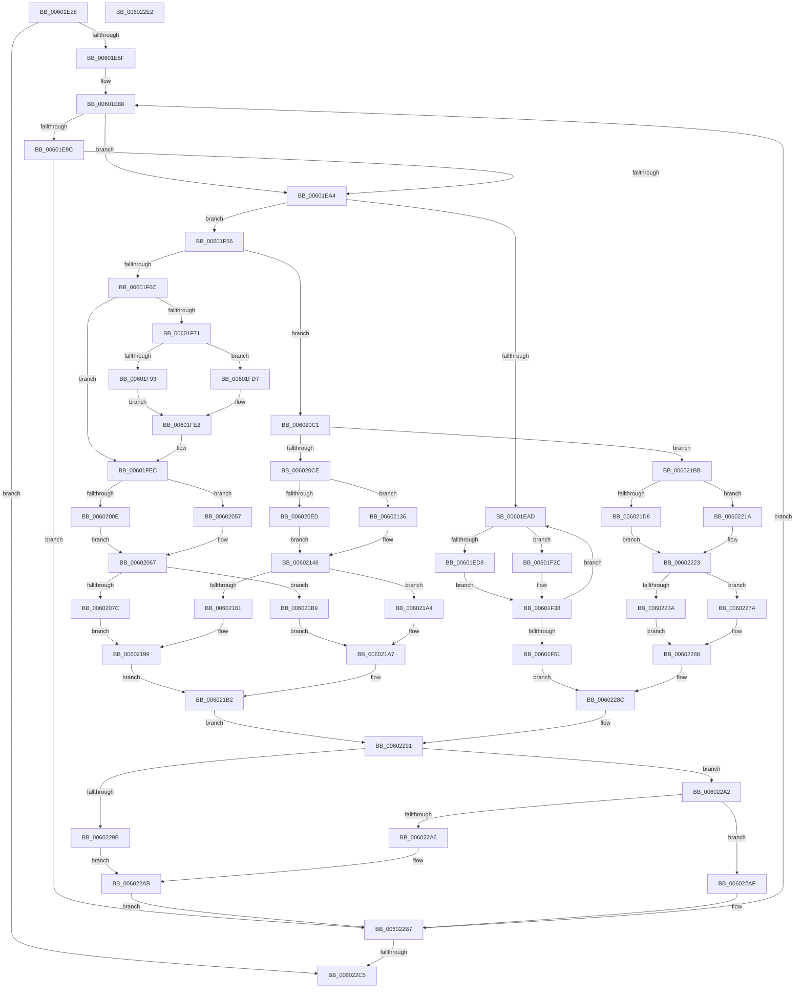

# send_tree

- RVA: `0x00601E28`–`0x006022E3` (길이 `1,211` bytes)
- VA: `0x0000000140601E28`
- 실행 섹션: `.text`
- PDB 이름 있음: `예`; PDB Function 태그: `예`
- unwind 정보 RVA: `0x000C3E7C`
- 디코드: `332`개 명령, `1,211/1,211` bytes 표시
- 미해석 바이트: `0` (있으면 어셈블리에 `.byte`로 보존)

> 이 문서는 커널 이미지의 기계어와 PDB 기호를 분석해 생성했습니다. 4번과 5번은 함수 원형과 자료형을 바이너리 사용 방식에서 추정한 C 해석이며 원본 소스 복구 결과는 아닙니다.

## 1. Dependencies

- 직접 호출 지점: **0**; 고유 호출 대상: **0**
- 직접 호출자로 확인된 함수: **1**
- RIP 상대 이미지 참조: **0**

### Outgoing calls
- 직접 디코드된 call 명령이 없습니다.

### Direct callers
- [send_all_trees](send_all_trees_function_00601B90.md) at `0x00601DE8`
- [send_all_trees](send_all_trees_function_00601B90.md) at `0x00601DFB`

### Static image references
- 디코드된 RIP-relative 메모리 참조가 없습니다.

## 2. Other-region calls and transfers

- 다른 실행 섹션으로 향하는 call: **0**
- 별도 외부 분기/꼬리 이동을 확인하지 못했습니다.

## 3. Assembly (complete function range)

```asm
00601E28  48 8B C4                        mov rax, rsp
00601E2B  48 89 58 08                     mov qword ptr [rax + 8], rbx
00601E2F  48 89 68 10                     mov qword ptr [rax + 0x10], rbp
00601E33  48 89 70 18                     mov qword ptr [rax + 0x18], rsi
00601E37  48 89 78 20                     mov qword ptr [rax + 0x20], rdi
00601E3B  41 54                           push r12
00601E3D  41 55                           push r13
00601E3F  41 56                           push r14
00601E41  41 57                           push r15
00601E43  0F B7 7A 02                     movzx edi, word ptr [rdx + 2]
00601E47  83 CB FF                        or ebx, 0xffffffff
00601E4A  45 33 D2                        xor r10d, r10d
00601E4D  4D 63 C0                        movsxd r8, r8d
00601E50  4C 8B DA                        mov r11, rdx
00601E53  4C 8B C9                        mov r9, rcx
00601E56  4D 85 C0                        test r8, r8
00601E59  0F 88 66 04 00 00               js 0x1406022c5
00601E5F  8B C7                           mov eax, edi
00601E61  4D 8D 7B 06                     lea r15, [r11 + 6]
00601E65  F7 D8                           neg eax
00601E67  4D 8D 68 01                     lea r13, [r8 + 1]
00601E6B  8B C7                           mov eax, edi
00601E6D  44 8D 73 11                     lea r14d, [rbx + 0x11]
00601E71  1B D2                           sbb edx, edx
00601E73  81 E2 7D FF FF FF               and edx, 0xffffff7d
00601E79  81 C2 8A 00 00 00               add edx, 0x8a
00601E7F  F7 D8                           neg eax
00601E81  1B C9                           sbb ecx, ecx
00601E83  F7 D9                           neg ecx
00601E85  83 C1 03                        add ecx, 3
00601E88  41 8B F2                        mov esi, r10d
00601E8B  8B EF                           mov ebp, edi
00601E8D  41 FF C2                        inc r10d
00601E90  44 8B E7                        mov r12d, edi
00601E93  41 0F B7 3F                     movzx edi, word ptr [r15]
00601E97  44 3B D2                        cmp r10d, edx
00601E9A  7D 08                           jge 0x140601ea4
00601E9C  3B EF                           cmp ebp, edi
00601E9E  0F 84 13 04 00 00               je 0x1406022b7
00601EA4  44 3B D1                        cmp r10d, ecx
00601EA7  0F 8D A9 00 00 00               jge 0x140601f56
00601EAD  45 0F B7 9C A9 F6 0A 00 00      movzx r11d, word ptr [r9 + rbp*4 + 0xaf6]
00601EB6  41 8B C6                        mov eax, r14d
00601EB9  41 8B 89 60 17 00 00            mov ecx, dword ptr [r9 + 0x1760]
00601EC0  41 2B C3                        sub eax, r11d
00601EC3  45 0F B7 84 A9 F4 0A 00 00      movzx r8d, word ptr [r9 + rbp*4 + 0xaf4]
00601ECC  41 0F B7 B1 5C 17 00 00         movzx esi, word ptr [r9 + 0x175c]
00601ED4  3B C8                           cmp ecx, eax
00601ED6  7E 54                           jle 0x140601f2c
00601ED8  41 8B 51 28                     mov edx, dword ptr [r9 + 0x28]
00601EDC  41 0F B7 C0                     movzx eax, r8w
00601EE0  66 D3 E0                        shl ax, cl
00601EE3  49 8B 49 10                     mov rcx, qword ptr [r9 + 0x10]
00601EE7  66 0B C6                        or ax, si
00601EEA  66 41 89 81 5C 17 00 00         mov word ptr [r9 + 0x175c], ax
00601EF2  88 04 0A                        mov byte ptr [rdx + rcx], al
00601EF5  41 FF 41 28                     inc dword ptr [r9 + 0x28]
00601EF9  41 8B 51 28                     mov edx, dword ptr [r9 + 0x28]
00601EFD  49 8B 49 10                     mov rcx, qword ptr [r9 + 0x10]
00601F01  41 8A 81 5D 17 00 00            mov al, byte ptr [r9 + 0x175d]
00601F08  88 04 0A                        mov byte ptr [rdx + rcx], al
00601F0B  41 8B CE                        mov ecx, r14d
00601F0E  41 8B 91 60 17 00 00            mov edx, dword ptr [r9 + 0x1760]
00601F15  41 FF 41 28                     inc dword ptr [r9 + 0x28]
00601F19  83 C2 F0                        add edx, -0x10
00601F1C  41 2A 89 60 17 00 00            sub cl, byte ptr [r9 + 0x1760]
00601F23  41 03 D3                        add edx, r11d
00601F26  66 41 D3 E8                     shr r8w, cl
00601F2A  EB 0C                           jmp 0x140601f38
00601F2C  66 41 D3 E0                     shl r8w, cl
00601F30  42 8D 14 19                     lea edx, [rcx + r11]
00601F34  66 44 0B C6                     or r8w, si
00601F38  66 45 89 81 5C 17 00 00         mov word ptr [r9 + 0x175c], r8w
00601F40  41 89 91 60 17 00 00            mov dword ptr [r9 + 0x1760], edx
00601F47  41 83 EA 01                     sub r10d, 1
00601F4B  0F 85 5C FF FF FF               jne 0x140601ead
00601F51  E9 36 03 00 00                  jmp 0x14060228c
00601F56  4D 8D 99 60 17 00 00            lea r11, [r9 + 0x1760]
00601F5D  4D 8D 81 5C 17 00 00            lea r8, [r9 + 0x175c]
00601F64  85 ED                           test ebp, ebp
00601F66  0F 84 55 01 00 00               je 0x1406020c1
00601F6C  44 3B E3                        cmp r12d, ebx
00601F6F  74 7B                           je 0x140601fec
00601F71  41 0F B7 9C A9 F6 0A 00 00      movzx ebx, word ptr [r9 + rbp*4 + 0xaf6]
00601F7A  41 8B C6                        mov eax, r14d
00601F7D  41 8B 0B                        mov ecx, dword ptr [r11]
00601F80  2B C3                           sub eax, ebx
00601F82  45 0F B7 94 A9 F4 0A 00 00      movzx r10d, word ptr [r9 + rbp*4 + 0xaf4]
00601F8B  41 0F B7 10                     movzx edx, word ptr [r8]
00601F8F  3B C8                           cmp ecx, eax
00601F91  7E 44                           jle 0x140601fd7
00601F93  41 0F B7 C2                     movzx eax, r10w
00601F97  66 D3 E0                        shl ax, cl
00601F9A  49 8B 49 10                     mov rcx, qword ptr [r9 + 0x10]
00601F9E  66 0B C2                        or ax, dx
00601FA1  41 8B 51 28                     mov edx, dword ptr [r9 + 0x28]
00601FA5  66 41 89 00                     mov word ptr [r8], ax
00601FA9  88 04 0A                        mov byte ptr [rdx + rcx], al
00601FAC  41 FF 41 28                     inc dword ptr [r9 + 0x28]
00601FB0  41 8B 51 28                     mov edx, dword ptr [r9 + 0x28]
00601FB4  49 8B 49 10                     mov rcx, qword ptr [r9 + 0x10]
00601FB8  41 8A 40 01                     mov al, byte ptr [r8 + 1]
00601FBC  88 04 0A                        mov byte ptr [rdx + rcx], al
00601FBF  41 8B CE                        mov ecx, r14d
00601FC2  41 8B 03                        mov eax, dword ptr [r11]
00601FC5  41 FF 41 28                     inc dword ptr [r9 + 0x28]
00601FC9  83 C0 F0                        add eax, -0x10
00601FCC  41 2A 0B                        sub cl, byte ptr [r11]
00601FCF  03 C3                           add eax, ebx
00601FD1  66 41 D3 EA                     shr r10w, cl
00601FD5  EB 0B                           jmp 0x140601fe2
00601FD7  66 41 D3 E2                     shl r10w, cl
00601FDB  8D 04 19                        lea eax, [rcx + rbx]
00601FDE  66 44 0B D2                     or r10w, dx
00601FE2  66 45 89 10                     mov word ptr [r8], r10w
00601FE6  44 8B D6                        mov r10d, esi
00601FE9  41 89 03                        mov dword ptr [r11], eax
00601FEC  41 0F B7 B1 36 0B 00 00         movzx esi, word ptr [r9 + 0xb36]
00601FF4  B8 10 00 00 00                  mov eax, 0x10
00601FF9  41 8B 0B                        mov ecx, dword ptr [r11]
00601FFC  2B C6                           sub eax, esi
00601FFE  41 0F B7 99 34 0B 00 00         movzx ebx, word ptr [r9 + 0xb34]
00602006  45 0F B7 30                     movzx r14d, word ptr [r8]
0060200A  3B C8                           cmp ecx, eax
0060200C  7E 49                           jle 0x140602057
0060200E  41 8B 51 28                     mov edx, dword ptr [r9 + 0x28]
00602012  0F B7 C3                        movzx eax, bx
00602015  66 D3 E0                        shl ax, cl
00602018  49 8B 49 10                     mov rcx, qword ptr [r9 + 0x10]
0060201C  66 41 0B C6                     or ax, r14w
00602020  66 41 89 00                     mov word ptr [r8], ax
00602024  41 BE 10 00 00 00               mov r14d, 0x10
0060202A  88 04 0A                        mov byte ptr [rdx + rcx], al
0060202D  41 FF 41 28                     inc dword ptr [r9 + 0x28]
00602031  41 8B 51 28                     mov edx, dword ptr [r9 + 0x28]
00602035  49 8B 49 10                     mov rcx, qword ptr [r9 + 0x10]
00602039  41 8A 40 01                     mov al, byte ptr [r8 + 1]
0060203D  88 04 0A                        mov byte ptr [rdx + rcx], al
00602040  41 8B CE                        mov ecx, r14d
00602043  41 8B 13                        mov edx, dword ptr [r11]
00602046  41 FF 41 28                     inc dword ptr [r9 + 0x28]
0060204A  83 C2 F0                        add edx, -0x10
0060204D  41 2A 0B                        sub cl, byte ptr [r11]
00602050  03 D6                           add edx, esi
00602052  66 D3 EB                        shr bx, cl
00602055  EB 10                           jmp 0x140602067
00602057  66 D3 E3                        shl bx, cl
0060205A  8D 14 31                        lea edx, [rcx + rsi]
0060205D  66 41 0B DE                     or bx, r14w
00602061  41 BE 10 00 00 00               mov r14d, 0x10
00602067  49 8B C3                        mov rax, r11
0060206A  BE 03 00 00 00                  mov esi, 3
0060206F  66 44 2B D6                     sub r10w, si
00602073  8B CA                           mov ecx, edx
00602075  89 10                           mov dword ptr [rax], edx
00602077  83 FA 0E                        cmp edx, 0xe
0060207A  7E 3D                           jle 0x1406020b9
0060207C  41 8B 51 28                     mov edx, dword ptr [r9 + 0x28]
00602080  41 0F B7 C2                     movzx eax, r10w
00602084  66 D3 E0                        shl ax, cl
00602087  49 8B 49 10                     mov rcx, qword ptr [r9 + 0x10]
0060208B  66 0B C3                        or ax, bx
0060208E  66 41 89 00                     mov word ptr [r8], ax
00602092  88 04 0A                        mov byte ptr [rdx + rcx], al
00602095  41 FF 41 28                     inc dword ptr [r9 + 0x28]
00602099  41 8B 51 28                     mov edx, dword ptr [r9 + 0x28]
0060209D  41 8A 40 01                     mov al, byte ptr [r8 + 1]
006020A1  49 8B 49 10                     mov rcx, qword ptr [r9 + 0x10]
006020A5  88 04 0A                        mov byte ptr [rdx + rcx], al
006020A8  41 FF 41 28                     inc dword ptr [r9 + 0x28]
006020AC  41 0F B7 03                     movzx eax, word ptr [r11]
006020B0  41 83 03 F2                     add dword ptr [r11], -0xe
006020B4  E9 E0 00 00 00                  jmp 0x140602199
006020B9  8D 42 02                        lea eax, [rdx + 2]
006020BC  E9 E6 00 00 00                  jmp 0x1406021a7
006020C1  41 8B 0B                        mov ecx, dword ptr [r11]
006020C4  41 83 FA 0A                     cmp r10d, 0xa
006020C8  0F 8F ED 00 00 00               jg 0x1406021bb
006020CE  41 0F B7 B1 3A 0B 00 00         movzx esi, word ptr [r9 + 0xb3a]
006020D6  B8 10 00 00 00                  mov eax, 0x10
006020DB  41 0F B7 99 38 0B 00 00         movzx ebx, word ptr [r9 + 0xb38]
006020E3  2B C6                           sub eax, esi
006020E5  45 0F B7 30                     movzx r14d, word ptr [r8]
006020E9  3B C8                           cmp ecx, eax
006020EB  7E 49                           jle 0x140602136
006020ED  41 8B 51 28                     mov edx, dword ptr [r9 + 0x28]
006020F1  0F B7 C3                        movzx eax, bx
006020F4  66 D3 E0                        shl ax, cl
006020F7  49 8B 49 10                     mov rcx, qword ptr [r9 + 0x10]
006020FB  66 41 0B C6                     or ax, r14w
006020FF  66 41 89 00                     mov word ptr [r8], ax
00602103  41 BE 10 00 00 00               mov r14d, 0x10
00602109  88 04 0A                        mov byte ptr [rdx + rcx], al
0060210C  41 FF 41 28                     inc dword ptr [r9 + 0x28]
00602110  41 8B 51 28                     mov edx, dword ptr [r9 + 0x28]
00602114  49 8B 49 10                     mov rcx, qword ptr [r9 + 0x10]
00602118  41 8A 40 01                     mov al, byte ptr [r8 + 1]
0060211C  88 04 0A                        mov byte ptr [rdx + rcx], al
0060211F  41 8B CE                        mov ecx, r14d
00602122  41 8B 13                        mov edx, dword ptr [r11]
00602125  41 FF 41 28                     inc dword ptr [r9 + 0x28]
00602129  83 C2 F0                        add edx, -0x10
0060212C  41 2A 0B                        sub cl, byte ptr [r11]
0060212F  03 D6                           add edx, esi
00602131  66 D3 EB                        shr bx, cl
00602134  EB 10                           jmp 0x140602146
00602136  66 D3 E3                        shl bx, cl
00602139  8D 14 31                        lea edx, [rcx + rsi]
0060213C  66 41 0B DE                     or bx, r14w
00602140  41 BE 10 00 00 00               mov r14d, 0x10
00602146  49 8B C8                        mov rcx, r8
00602149  49 8B C3                        mov rax, r11
0060214C  BE 03 00 00 00                  mov esi, 3
00602151  66 44 2B D6                     sub r10w, si
00602155  66 89 19                        mov word ptr [rcx], bx
00602158  8B CA                           mov ecx, edx
0060215A  89 10                           mov dword ptr [rax], edx
0060215C  83 FA 0D                        cmp edx, 0xd
0060215F  7E 43                           jle 0x1406021a4
00602161  41 8B 51 28                     mov edx, dword ptr [r9 + 0x28]
00602165  41 0F B7 C2                     movzx eax, r10w
00602169  66 D3 E0                        shl ax, cl
0060216C  49 8B 49 10                     mov rcx, qword ptr [r9 + 0x10]
00602170  66 0B C3                        or ax, bx
00602173  66 41 89 00                     mov word ptr [r8], ax
00602177  88 04 0A                        mov byte ptr [rdx + rcx], al
0060217A  41 FF 41 28                     inc dword ptr [r9 + 0x28]
0060217E  41 8B 51 28                     mov edx, dword ptr [r9 + 0x28]
00602182  41 8A 40 01                     mov al, byte ptr [r8 + 1]
00602186  49 8B 49 10                     mov rcx, qword ptr [r9 + 0x10]
0060218A  88 04 0A                        mov byte ptr [rdx + rcx], al
0060218D  41 FF 41 28                     inc dword ptr [r9 + 0x28]
00602191  41 0F B7 03                     movzx eax, word ptr [r11]
00602195  41 83 03 F3                     add dword ptr [r11], -0xd
00602199  41 8B CE                        mov ecx, r14d
0060219C  2A C8                           sub cl, al
0060219E  66 41 D3 EA                     shr r10w, cl
006021A2  EB 0E                           jmp 0x1406021b2
006021A4  8D 42 03                        lea eax, [rdx + 3]
006021A7  66 41 D3 E2                     shl r10w, cl
006021AB  66 44 0B D3                     or r10w, bx
006021AF  41 89 03                        mov dword ptr [r11], eax
006021B2  66 45 89 10                     mov word ptr [r8], r10w
006021B6  E9 D6 00 00 00                  jmp 0x140602291
006021BB  41 0F B7 B1 3E 0B 00 00         movzx esi, word ptr [r9 + 0xb3e]
006021C3  41 8B C6                        mov eax, r14d
006021C6  41 0F B7 99 3C 0B 00 00         movzx ebx, word ptr [r9 + 0xb3c]
006021CE  2B C6                           sub eax, esi
006021D0  41 0F B7 10                     movzx edx, word ptr [r8]
006021D4  3B C8                           cmp ecx, eax
006021D6  7E 42                           jle 0x14060221a
006021D8  0F B7 C3                        movzx eax, bx
006021DB  66 D3 E0                        shl ax, cl
006021DE  49 8B 49 10                     mov rcx, qword ptr [r9 + 0x10]
006021E2  66 0B C2                        or ax, dx
006021E5  41 8B 51 28                     mov edx, dword ptr [r9 + 0x28]
006021E9  66 41 89 00                     mov word ptr [r8], ax
006021ED  88 04 0A                        mov byte ptr [rdx + rcx], al
006021F0  41 FF 41 28                     inc dword ptr [r9 + 0x28]
006021F4  41 8B 51 28                     mov edx, dword ptr [r9 + 0x28]
006021F8  49 8B 49 10                     mov rcx, qword ptr [r9 + 0x10]
006021FC  41 8A 40 01                     mov al, byte ptr [r8 + 1]
00602200  88 04 0A                        mov byte ptr [rdx + rcx], al
00602203  41 8B CE                        mov ecx, r14d
00602206  41 8B 03                        mov eax, dword ptr [r11]
00602209  41 FF 41 28                     inc dword ptr [r9 + 0x28]
0060220D  83 C0 F0                        add eax, -0x10
00602210  41 2A 0B                        sub cl, byte ptr [r11]
00602213  03 C6                           add eax, esi
00602215  66 D3 EB                        shr bx, cl
00602218  EB 09                           jmp 0x140602223
0060221A  66 D3 E3                        shl bx, cl
0060221D  8D 04 31                        lea eax, [rcx + rsi]
00602220  66 0B DA                        or bx, dx
00602223  49 8B CB                        mov rcx, r11
00602226  49 8B D0                        mov rdx, r8
00602229  66 41 83 EA 0B                  sub r10w, 0xb
0060222E  66 89 1A                        mov word ptr [rdx], bx
00602231  89 01                           mov dword ptr [rcx], eax
00602233  8B C8                           mov ecx, eax
00602235  83 F8 09                        cmp eax, 9
00602238  7E 40                           jle 0x14060227a
0060223A  41 8B 51 28                     mov edx, dword ptr [r9 + 0x28]
0060223E  41 0F B7 C2                     movzx eax, r10w
00602242  66 D3 E0                        shl ax, cl
00602245  49 8B 49 10                     mov rcx, qword ptr [r9 + 0x10]
00602249  66 0B C3                        or ax, bx
0060224C  66 41 89 00                     mov word ptr [r8], ax
00602250  88 04 0A                        mov byte ptr [rdx + rcx], al
00602253  41 FF 41 28                     inc dword ptr [r9 + 0x28]
00602257  41 8B 51 28                     mov edx, dword ptr [r9 + 0x28]
0060225B  49 8B 49 10                     mov rcx, qword ptr [r9 + 0x10]
0060225F  41 8A 40 01                     mov al, byte ptr [r8 + 1]
00602263  88 04 0A                        mov byte ptr [rdx + rcx], al
00602266  41 8B CE                        mov ecx, r14d
00602269  41 2A 0B                        sub cl, byte ptr [r11]
0060226C  41 FF 41 28                     inc dword ptr [r9 + 0x28]
00602270  66 41 D3 EA                     shr r10w, cl
00602274  41 83 03 F7                     add dword ptr [r11], -9
00602278  EB 0E                           jmp 0x140602288
0060227A  66 41 D3 E2                     shl r10w, cl
0060227E  66 44 0B D3                     or r10w, bx
00602282  83 C0 07                        add eax, 7
00602285  41 89 03                        mov dword ptr [r11], eax
00602288  66 45 89 10                     mov word ptr [r8], r10w
0060228C  BE 03 00 00 00                  mov esi, 3
00602291  45 33 D2                        xor r10d, r10d
00602294  41 8B DC                        mov ebx, r12d
00602297  85 FF                           test edi, edi
00602299  75 07                           jne 0x1406022a2
0060229B  BA 8A 00 00 00                  mov edx, 0x8a
006022A0  EB 09                           jmp 0x1406022ab
006022A2  3B EF                           cmp ebp, edi
006022A4  75 09                           jne 0x1406022af
006022A6  BA 06 00 00 00                  mov edx, 6
006022AB  8B CE                           mov ecx, esi
006022AD  EB 08                           jmp 0x1406022b7
006022AF  BA 07 00 00 00                  mov edx, 7
006022B4  8D 4A FD                        lea ecx, [rdx - 3]
006022B7  49 83 C7 04                     add r15, 4
006022BB  49 83 ED 01                     sub r13, 1
006022BF  0F 85 C3 FB FF FF               jne 0x140601e88
006022C5  48 8B 5C 24 28                  mov rbx, qword ptr [rsp + 0x28]
006022CA  48 8B 6C 24 30                  mov rbp, qword ptr [rsp + 0x30]
006022CF  48 8B 74 24 38                  mov rsi, qword ptr [rsp + 0x38]
006022D4  48 8B 7C 24 40                  mov rdi, qword ptr [rsp + 0x40]
006022D9  41 5F                           pop r15
006022DB  41 5E                           pop r14
006022DD  41 5D                           pop r13
006022DF  41 5C                           pop r12
006022E1  C3                              ret
006022E2  CC                              int3
```

## 4. C-style interpretation (structured pseudocode)

```c
__int64 __fastcall send_tree(__int64 a1, __int64 a2, int a3)
{
    __int64 result;
    __int64 v_r10;
    __int64 v_r13;
    __int64 v_r15;
    __int64 v_rbx;
    unsigned __int64 v_stack_p10;
    unsigned __int64 v_stack_p18;
    unsigned __int64 v_stack_p20;
    unsigned __int64 v_stack_p8;

    *(unsigned __int64 *)(v_rsp + 8) = v_rbx;
    *(unsigned __int64 *)(v_rsp + 16) = v_rbp;
    *(unsigned __int64 *)(v_rsp + 24) = v_rsi;
    *(unsigned __int64 *)(v_rsp + 32) = v_rdi;
    v_rbx = (unsigned int)((v_rbx) | (0xFFFFFFFFULL));
    v_r10 = 0;
    if (sign_flag) goto loc_006022C5;
    result = (unsigned int)(-((unsigned int)((unsigned int)(*(unsigned __int16 *)(a2 + 2)))));
    a2 = (unsigned int)((a2) & (0xFFFFFF7DULL));
    a2 = (unsigned int)((a2) + (138));
    result = (unsigned int)(-((unsigned int)((unsigned int)(*(unsigned __int16 *)(a2 + 2)))));
    a1 = (unsigned int)(-(a1));
    a1 = (unsigned int)((a1) + (3));
loc_00601E88:
    v_r10 = (unsigned int)((v_r10) + 1);
    if (((unsigned int)(v_r10)) >= ((unsigned int)(a2))) goto loc_00601EA4;
    if (((unsigned int)((unsigned int)((unsigned int)(*(unsigned __int16 *)(a2 + 2))))) == ((unsigned int)(*(unsigned __int16 *)(a2 + 6)))) goto loc_006022B7;
loc_00601EA4:
    if (((unsigned int)(v_r10)) >= ((unsigned int)(a1))) goto loc_00601F56;
loc_00601EAD:
    result = (unsigned int)(((unsigned int)((unsigned int)(v_rbx + 17))) - ((unsigned int)(*(unsigned __int16 *)(a1 + (unsigned int)((unsigned int)(*(unsigned __int16 *)(a2 + 2))) * 4 + 2806))));
    if (((unsigned int)((unsigned int)(*(unsigned int *)(a1 + 5984)))) <= ((unsigned int)(result))) goto loc_00601F2C;
    result = (unsigned __int16)(((unsigned __int16)(*(unsigned __int16 *)(a1 + (unsigned int)((unsigned int)(*(unsigned __int16 *)(a2 + 2))) * 4 + 2804))) << ((unsigned __int8)((unsigned int)(*(unsigned int *)(a1 + 5984)))));
    result = (unsigned __int16)((result) | ((unsigned __int16)(*(unsigned __int16 *)(a1 + 5980))));
    *(unsigned __int16 *)(a1 + 5980) = (unsigned __int16)(result);
    *(unsigned __int8 *)((unsigned int)(*(unsigned int *)(a1 + 40)) + *(unsigned __int64 *)(a1 + 16) * 1) = (unsigned __int8)(result);
    *(unsigned __int8 *)((unsigned int)(*(unsigned int *)(a1 + 40)) + *(unsigned __int64 *)(a1 + 16) * 1) = (unsigned __int8)(*(unsigned __int8 *)(a1 + 5981));
    a2 = (unsigned int)(((unsigned int)(*(unsigned int *)(a1 + 5984))) + (-16));
    a1 = (unsigned __int8)(((unsigned int)((unsigned int)(v_rbx + 17))) - (*(unsigned __int8 *)(a1 + 5984)));
    a2 = (unsigned int)((a2) + ((unsigned int)(*(unsigned __int16 *)(a1 + (unsigned int)((unsigned int)(*(unsigned __int16 *)(a2 + 2))) * 4 + 2806))));
    a3 = (unsigned __int16)((*(unsigned __int16 *)(a1 + (unsigned int)((unsigned int)(*(unsigned __int16 *)(a2 + 2))) * 4 + 2804)) >> ((unsigned __int8)(a1)));
    goto loc_00601F38;
loc_00601F2C:
    a3 = (unsigned __int16)((a3) << ((unsigned __int8)(a1)));
    a3 = (unsigned __int16)((a3) | ((unsigned __int16)(*(unsigned __int16 *)(a1 + 5980))));
loc_00601F38:
    *(unsigned __int16 *)(a1 + 5980) = (unsigned __int16)(a3);
    *(unsigned int *)(a1 + 5984) = (unsigned int)(a1 + *(unsigned __int16 *)(a1 + (unsigned int)((unsigned int)(*(unsigned __int16 *)(a2 + 2))) * 4 + 2806) * 1);
    v_r10 = (unsigned int)((v_r10) - (1));
    if (condition_is_not_equal) goto loc_00601EAD;
    goto loc_0060228C;
loc_00601F56:
    if ((unsigned int)((unsigned int)((unsigned int)(*(unsigned __int16 *)(a2 + 2)))) == 0) goto loc_006020C1;
    if (((unsigned int)((unsigned int)((unsigned int)(*(unsigned __int16 *)(a2 + 2))))) == ((unsigned int)(v_rbx))) goto loc_00601FEC;
    result = (unsigned int)(((unsigned int)((unsigned int)(v_rbx + 17))) - ((unsigned int)(*(unsigned __int16 *)(a1 + (unsigned int)((unsigned int)(*(unsigned __int16 *)(a2 + 2))) * 4 + 2806))));
    if (((unsigned int)((unsigned int)(*(unsigned int *)(a1 + 5984)))) <= ((unsigned int)(result))) goto loc_00601FD7;
    result = (unsigned __int16)(((unsigned __int16)(*(unsigned __int16 *)(a1 + (unsigned int)((unsigned int)(*(unsigned __int16 *)(a2 + 2))) * 4 + 2804))) << ((unsigned __int8)((unsigned int)(*(unsigned int *)(a1 + 5984)))));
    result = (unsigned __int16)((result) | ((unsigned __int16)(*(unsigned __int16 *)(a1 + 5980))));
    *(unsigned __int16 *)(a1 + 5980) = (unsigned __int16)(result);
    *(unsigned __int8 *)((unsigned int)(*(unsigned int *)(a1 + 40)) + *(unsigned __int64 *)(a1 + 16) * 1) = (unsigned __int8)(result);
    *(unsigned __int8 *)((unsigned int)(*(unsigned int *)(a1 + 40)) + *(unsigned __int64 *)(a1 + 16) * 1) = (unsigned __int8)(*(unsigned __int8 *)(a1 + 5980 + 1));
    result = (unsigned int)(((unsigned int)(*(unsigned int *)(a1 + 5984))) + (-16));
    a1 = (unsigned __int8)(((unsigned int)((unsigned int)(v_rbx + 17))) - (*(unsigned __int8 *)(a1 + 5984)));
    result = (unsigned int)((result) + ((unsigned int)(*(unsigned __int16 *)(a1 + (unsigned int)((unsigned int)(*(unsigned __int16 *)(a2 + 2))) * 4 + 2806))));
    v_r10 = (unsigned __int16)((*(unsigned __int16 *)(a1 + (unsigned int)((unsigned int)(*(unsigned __int16 *)(a2 + 2))) * 4 + 2804)) >> ((unsigned __int8)(a1)));
    goto loc_00601FE2;
loc_00601FD7:
    v_r10 = (unsigned __int16)((v_r10) << ((unsigned __int8)(a1)));
    v_r10 = (unsigned __int16)((v_r10) | ((unsigned __int16)((unsigned int)(*(unsigned int *)(a1 + 40)))));
loc_00601FE2:
    *(unsigned __int16 *)(a1 + 5980) = (unsigned __int16)(v_r10);
    *(unsigned int *)(a1 + 5984) = (unsigned int)(a1 + *(unsigned __int16 *)(a1 + (unsigned int)((unsigned int)(*(unsigned __int16 *)(a2 + 2))) * 4 + 2806) * 1);
loc_00601FEC:
    result = (unsigned int)((16) - ((unsigned int)(*(unsigned __int16 *)(a1 + 2870))));
    if (((unsigned int)((unsigned int)(*(unsigned int *)(a1 + 5984)))) <= ((unsigned int)(result))) goto loc_00602057;
    result = (unsigned __int16)(((unsigned __int16)(*(unsigned __int16 *)(a1 + 2868))) << ((unsigned __int8)((unsigned int)(*(unsigned int *)(a1 + 5984)))));
    result = (unsigned __int16)((result) | ((unsigned __int16)(*(unsigned __int16 *)(a1 + 5980))));
    *(unsigned __int16 *)(a1 + 5980) = (unsigned __int16)(result);
    *(unsigned __int8 *)((unsigned int)(*(unsigned int *)(a1 + 40)) + *(unsigned __int64 *)(a1 + 16) * 1) = (unsigned __int8)(result);
    *(unsigned __int8 *)((unsigned int)(*(unsigned int *)(a1 + 40)) + *(unsigned __int64 *)(a1 + 16) * 1) = (unsigned __int8)(*(unsigned __int8 *)(a1 + 5980 + 1));
    a2 = (unsigned int)(((unsigned int)(*(unsigned int *)(a1 + 5984))) + (-16));
    a1 = (unsigned __int8)((16) - (*(unsigned __int8 *)(a1 + 5984)));
    a2 = (unsigned int)((a2) + ((unsigned int)(*(unsigned __int16 *)(a1 + 2870))));
    v_rbx = (unsigned __int16)((*(unsigned __int16 *)(a1 + 2868)) >> ((unsigned __int8)(a1)));
    goto loc_00602067;
loc_00602057:
    v_rbx = (unsigned __int16)((v_rbx) << ((unsigned __int8)(a1)));
    v_rbx = (unsigned __int16)((v_rbx) | (16));
loc_00602067:
    v_r10 = (unsigned __int16)(((unsigned int)((unsigned int)(*(unsigned __int16 *)(a1 + 5980)))) - (3));
    *(unsigned int *)(a1 + 5984) = (unsigned int)(a1 + *(unsigned __int16 *)(a1 + 2870) * 1);
    if (((unsigned int)(a1 + *(unsigned __int16 *)(a1 + 2870) * 1)) <= 14) goto loc_006020B9;
    result = (unsigned __int16)(((unsigned __int16)(v_r10)) << ((unsigned __int8)((unsigned int)((unsigned int)(a1 + *(unsigned __int16 *)(a1 + 2870) * 1)))));
    result = (unsigned __int16)((result) | ((unsigned __int16)(v_rbx)));
    *(unsigned __int16 *)(a1 + 5980) = (unsigned __int16)(result);
    *(unsigned __int8 *)((unsigned int)(*(unsigned int *)(a1 + 40)) + *(unsigned __int64 *)(a1 + 16) * 1) = (unsigned __int8)(result);
    *(unsigned __int8 *)((unsigned int)(*(unsigned int *)(a1 + 40)) + *(unsigned __int64 *)(a1 + 16) * 1) = (unsigned __int8)(*(unsigned __int8 *)(a1 + 5980 + 1));
    goto loc_00602199;
loc_006020B9:
    goto loc_006021A7;
loc_006020C1:
    if (((unsigned int)(v_r10)) > 10) goto loc_006021BB;
    result = (unsigned int)((16) - ((unsigned int)(*(unsigned __int16 *)(a1 + 2874))));
    if (((unsigned int)((unsigned int)(*(unsigned int *)(a1 + 5984)))) <= ((unsigned int)(result))) goto loc_00602136;
    result = (unsigned __int16)(((unsigned __int16)(*(unsigned __int16 *)(a1 + 2872))) << ((unsigned __int8)((unsigned int)(*(unsigned int *)(a1 + 5984)))));
    result = (unsigned __int16)((result) | ((unsigned __int16)(*(unsigned __int16 *)(a1 + 5980))));
    *(unsigned __int16 *)(a1 + 5980) = (unsigned __int16)(result);
    *(unsigned __int8 *)((unsigned int)(*(unsigned int *)(a1 + 40)) + *(unsigned __int64 *)(a1 + 16) * 1) = (unsigned __int8)(result);
    *(unsigned __int8 *)((unsigned int)(*(unsigned int *)(a1 + 40)) + *(unsigned __int64 *)(a1 + 16) * 1) = (unsigned __int8)(*(unsigned __int8 *)(a1 + 5980 + 1));
    a2 = (unsigned int)(((unsigned int)(*(unsigned int *)(a1 + 5984))) + (-16));
    a1 = (unsigned __int8)((16) - (*(unsigned __int8 *)(a1 + 5984)));
    a2 = (unsigned int)((a2) + ((unsigned int)(*(unsigned __int16 *)(a1 + 2874))));
    v_rbx = (unsigned __int16)((*(unsigned __int16 *)(a1 + 2872)) >> ((unsigned __int8)(a1)));
    goto loc_00602146;
loc_00602136:
    v_rbx = (unsigned __int16)((v_rbx) << ((unsigned __int8)(a1)));
    v_rbx = (unsigned __int16)((v_rbx) | (16));
loc_00602146:
    v_r10 = (unsigned __int16)((v_r10) - (3));
    *(unsigned __int16 *)(a1 + 5980) = (unsigned __int16)(v_rbx);
    *(unsigned int *)(a1 + 5984) = (unsigned int)(a1 + *(unsigned __int16 *)(a1 + 2874) * 1);
    if (((unsigned int)(a1 + *(unsigned __int16 *)(a1 + 2874) * 1)) <= 13) goto loc_006021A4;
    result = (unsigned __int16)(((unsigned __int16)(v_r10)) << ((unsigned __int8)((unsigned int)((unsigned int)(a1 + *(unsigned __int16 *)(a1 + 2874) * 1)))));
    result = (unsigned __int16)((result) | ((unsigned __int16)(v_rbx)));
    *(unsigned __int16 *)(a1 + 5980) = (unsigned __int16)(result);
    *(unsigned __int8 *)((unsigned int)(*(unsigned int *)(a1 + 40)) + *(unsigned __int64 *)(a1 + 16) * 1) = (unsigned __int8)(result);
    *(unsigned __int8 *)((unsigned int)(*(unsigned int *)(a1 + 40)) + *(unsigned __int64 *)(a1 + 16) * 1) = (unsigned __int8)(*(unsigned __int8 *)(a1 + 5980 + 1));
loc_00602199:
    a1 = (unsigned __int8)((16) - ((unsigned __int8)(*(unsigned __int16 *)(a1 + 5984))));
    v_r10 = (unsigned __int16)((v_r10) >> ((unsigned __int8)(a1)));
    goto loc_006021B2;
loc_006021A4:
loc_006021A7:
    v_r10 = (unsigned __int16)((v_r10) << ((unsigned __int8)(a1)));
    v_r10 = (unsigned __int16)((v_r10) | ((unsigned __int16)(v_rbx)));
    *(unsigned int *)(a1 + 5984) = (unsigned int)((unsigned int)(*(unsigned int *)(a1 + 40)) + 3);
loc_006021B2:
    *(unsigned __int16 *)(a1 + 5980) = (unsigned __int16)(v_r10);
    goto loc_00602291;
loc_006021BB:
    result = (unsigned int)((16) - ((unsigned int)(*(unsigned __int16 *)(a1 + 2878))));
    if (((unsigned int)(a1)) <= ((unsigned int)(result))) goto loc_0060221A;
    result = (unsigned __int16)(((unsigned __int16)(*(unsigned __int16 *)(a1 + 2876))) << ((unsigned __int8)(a1)));
    result = (unsigned __int16)((result) | ((unsigned __int16)(*(unsigned __int16 *)(a1 + 5980))));
    *(unsigned __int16 *)(a1 + 5980) = (unsigned __int16)(result);
    *(unsigned __int8 *)((unsigned int)(*(unsigned int *)(a1 + 40)) + *(unsigned __int64 *)(a1 + 16) * 1) = (unsigned __int8)(result);
    *(unsigned __int8 *)((unsigned int)(*(unsigned int *)(a1 + 40)) + *(unsigned __int64 *)(a1 + 16) * 1) = (unsigned __int8)(*(unsigned __int8 *)(a1 + 5980 + 1));
    result = (unsigned int)(((unsigned int)(*(unsigned int *)(a1 + 5984))) + (-16));
    a1 = (unsigned __int8)((16) - (*(unsigned __int8 *)(a1 + 5984)));
    result = (unsigned int)((result) + ((unsigned int)(*(unsigned __int16 *)(a1 + 2878))));
    v_rbx = (unsigned __int16)((*(unsigned __int16 *)(a1 + 2876)) >> ((unsigned __int8)(a1)));
    goto loc_00602223;
loc_0060221A:
    v_rbx = (unsigned __int16)((v_rbx) << ((unsigned __int8)(a1)));
    v_rbx = (unsigned __int16)((v_rbx) | ((unsigned __int16)((unsigned int)(*(unsigned int *)(a1 + 40)))));
loc_00602223:
    v_r10 = (unsigned __int16)((v_r10) - (11));
    *(unsigned __int16 *)(a1 + 5980) = (unsigned __int16)(v_rbx);
    *(unsigned int *)(a1 + 5984) = (unsigned int)(a1 + *(unsigned __int16 *)(a1 + 2878) * 1);
    if (((unsigned int)(a1 + *(unsigned __int16 *)(a1 + 2878) * 1)) <= 9) goto loc_0060227A;
    result = (unsigned __int16)(((unsigned __int16)(v_r10)) << ((unsigned __int8)((unsigned int)((unsigned int)(a1 + *(unsigned __int16 *)(a1 + 2878) * 1)))));
    result = (unsigned __int16)((result) | ((unsigned __int16)(v_rbx)));
    *(unsigned __int16 *)(a1 + 5980) = (unsigned __int16)(result);
    *(unsigned __int8 *)((unsigned int)(*(unsigned int *)(a1 + 40)) + *(unsigned __int64 *)(a1 + 16) * 1) = (unsigned __int8)(result);
    *(unsigned __int8 *)((unsigned int)(*(unsigned int *)(a1 + 40)) + *(unsigned __int64 *)(a1 + 16) * 1) = (unsigned __int8)(*(unsigned __int8 *)(a1 + 5980 + 1));
    a1 = (unsigned __int8)((16) - (*(unsigned __int8 *)(a1 + 5984)));
    v_r10 = (unsigned __int16)((v_r10) >> ((unsigned __int8)(a1)));
    goto loc_00602288;
loc_0060227A:
    v_r10 = (unsigned __int16)((v_r10) << ((unsigned __int8)(a1)));
    v_r10 = (unsigned __int16)((v_r10) | ((unsigned __int16)(v_rbx)));
    result = (unsigned int)((*(unsigned __int8 *)(a1 + 5980 + 1)) + (7));
    *(unsigned int *)(a1 + 5984) = (unsigned int)(result);
loc_00602288:
    *(unsigned __int16 *)(a1 + 5980) = (unsigned __int16)(v_r10);
loc_0060228C:
loc_00602291:
    v_r10 = 0;
    if ((unsigned int)(*(unsigned __int16 *)(a2 + 6)) != 0) goto loc_006022A2;
    goto loc_006022AB;
loc_006022A2:
    if (((unsigned int)((unsigned int)((unsigned int)(*(unsigned __int16 *)(a2 + 2))))) != ((unsigned int)(*(unsigned __int16 *)(a2 + 6)))) goto loc_006022AF;
loc_006022AB:
    goto loc_006022B7;
loc_006022AF:
loc_006022B7:
    v_r15 = (a2 + 6) + (4);
    v_r13 = ((int)(a3) + 1) - (1);
    if (condition_is_not_equal) goto loc_00601E88;
loc_006022C5:
    return result;
}
```

## 5. (Beta) C Style

```c
int64_t send_tree(void *Arg1, void *Arg2, int32_t Arg3)
{
    uint8_t *arg1 = (uint8_t *)Arg1;
    uint8_t *arg2 = (uint8_t *)Arg2;

    int64_t result;
    int64_t local_r10;
    int64_t local_r13;
    int64_t local_r15;
    int64_t local_rbx;
    uint64_t v_stack_p10;
    uint64_t v_stack_p18;
    uint64_t v_stack_p20;
    uint64_t v_stack_p8;

    *(uint64_t *)(local_rsp + 0x8) = local_rbx;
    *(uint64_t *)(local_rsp + 0x10) = local_rbp;
    *(uint64_t *)(local_rsp + 0x18) = local_rsi;
    *(uint64_t *)(local_rsp + 0x20) = local_rdi;
    local_rbx = (uint32_t)((local_rbx) | (0xFFFFFFFFULL));
    local_r10 = 0;
    if (sign_flag) goto loc_006022C5;
    result = (uint32_t)(-((uint32_t)((uint32_t)(*(uint16_t *)(arg2 + 0x2)))));
    Arg2 = (uint32_t)((Arg2) & (0xFFFFFF7DULL));
    Arg2 = (uint32_t)((Arg2) + (138));
    result = (uint32_t)(-((uint32_t)((uint32_t)(*(uint16_t *)(arg2 + 0x2)))));
    Arg1 = (uint32_t)(-(Arg1));
    Arg1 = (uint32_t)((Arg1) + (3));
loc_00601E88:
    local_r10 = (uint32_t)((local_r10) + 1);
    if (((uint32_t)(local_r10)) >= ((uint32_t)(Arg2))) goto loc_00601EA4;
    if (((uint32_t)((uint32_t)((uint32_t)(*(uint16_t *)(arg2 + 0x2))))) == ((uint32_t)(*(uint16_t *)(arg2 + 0x6)))) goto loc_006022B7;
loc_00601EA4:
    if (((uint32_t)(local_r10)) >= ((uint32_t)(Arg1))) goto loc_00601F56;
loc_00601EAD:
    result = (uint32_t)(((uint32_t)((uint32_t)(local_rbx + 17))) - ((uint32_t)(*(uint16_t *)(arg1 + (uint32_t)((uint32_t)(*(uint16_t *)(arg2 + 0x2))) * 4 + 0xAF6))));
    if (((uint32_t)((uint32_t)(*(uint32_t *)(arg1 + 0x1760)))) <= ((uint32_t)(result))) goto loc_00601F2C;
    result = (uint16_t)(((uint16_t)(*(uint16_t *)(arg1 + (uint32_t)((uint32_t)(*(uint16_t *)(arg2 + 0x2))) * 4 + 0xAF4))) << ((uint8_t)((uint32_t)(*(uint32_t *)(arg1 + 0x1760)))));
    result = (uint16_t)((result) | ((uint16_t)(*(uint16_t *)(arg1 + 0x175C))));
    *(uint16_t *)(arg1 + 0x175C) = (uint16_t)(result);
    *(uint8_t *)((uint32_t)(*(uint32_t *)(arg1 + 0x28)) + *(uint64_t *)(arg1 + 0x10) * 1) = (uint8_t)(result);
    *(uint8_t *)((uint32_t)(*(uint32_t *)(arg1 + 0x28)) + *(uint64_t *)(arg1 + 0x10) * 1) = (uint8_t)(*(uint8_t *)(arg1 + 0x175D));
    Arg2 = (uint32_t)(((uint32_t)(*(uint32_t *)(arg1 + 0x1760))) + (-16));
    Arg1 = (uint8_t)(((uint32_t)((uint32_t)(local_rbx + 17))) - (*(uint8_t *)(arg1 + 0x1760)));
    Arg2 = (uint32_t)((Arg2) + ((uint32_t)(*(uint16_t *)(arg1 + (uint32_t)((uint32_t)(*(uint16_t *)(arg2 + 0x2))) * 4 + 0xAF6))));
    Arg3 = (uint16_t)((*(uint16_t *)(arg1 + (uint32_t)((uint32_t)(*(uint16_t *)(arg2 + 0x2))) * 4 + 0xAF4)) >> ((uint8_t)(Arg1)));
    goto loc_00601F38;
loc_00601F2C:
    Arg3 = (uint16_t)((Arg3) << ((uint8_t)(Arg1)));
    Arg3 = (uint16_t)((Arg3) | ((uint16_t)(*(uint16_t *)(arg1 + 0x175C))));
loc_00601F38:
    *(uint16_t *)(arg1 + 0x175C) = (uint16_t)(Arg3);
    *(uint32_t *)(arg1 + 0x1760) = (uint32_t)(Arg1 + *(uint16_t *)(arg1 + (uint32_t)((uint32_t)(*(uint16_t *)(arg2 + 0x2))) * 4 + 0xAF6) * 1);
    local_r10 = (uint32_t)((local_r10) - (1));
    if (condition_is_not_equal) goto loc_00601EAD;
    goto loc_0060228C;
loc_00601F56:
    if ((uint32_t)((uint32_t)((uint32_t)(*(uint16_t *)(arg2 + 0x2)))) == 0) goto loc_006020C1;
    if (((uint32_t)((uint32_t)((uint32_t)(*(uint16_t *)(arg2 + 0x2))))) == ((uint32_t)(local_rbx))) goto loc_00601FEC;
    result = (uint32_t)(((uint32_t)((uint32_t)(local_rbx + 17))) - ((uint32_t)(*(uint16_t *)(arg1 + (uint32_t)((uint32_t)(*(uint16_t *)(arg2 + 0x2))) * 4 + 0xAF6))));
    if (((uint32_t)((uint32_t)(*(uint32_t *)(arg1 + 0x1760)))) <= ((uint32_t)(result))) goto loc_00601FD7;
    result = (uint16_t)(((uint16_t)(*(uint16_t *)(arg1 + (uint32_t)((uint32_t)(*(uint16_t *)(arg2 + 0x2))) * 4 + 0xAF4))) << ((uint8_t)((uint32_t)(*(uint32_t *)(arg1 + 0x1760)))));
    result = (uint16_t)((result) | ((uint16_t)(*(uint16_t *)(arg1 + 0x175C))));
    *(uint16_t *)(arg1 + 0x175C) = (uint16_t)(result);
    *(uint8_t *)((uint32_t)(*(uint32_t *)(arg1 + 0x28)) + *(uint64_t *)(arg1 + 0x10) * 1) = (uint8_t)(result);
    *(uint8_t *)((uint32_t)(*(uint32_t *)(arg1 + 0x28)) + *(uint64_t *)(arg1 + 0x10) * 1) = (uint8_t)(*(uint8_t *)(arg1 + 0x175C + 0x1));
    result = (uint32_t)(((uint32_t)(*(uint32_t *)(arg1 + 0x1760))) + (-16));
    Arg1 = (uint8_t)(((uint32_t)((uint32_t)(local_rbx + 17))) - (*(uint8_t *)(arg1 + 0x1760)));
    result = (uint32_t)((result) + ((uint32_t)(*(uint16_t *)(arg1 + (uint32_t)((uint32_t)(*(uint16_t *)(arg2 + 0x2))) * 4 + 0xAF6))));
    local_r10 = (uint16_t)((*(uint16_t *)(arg1 + (uint32_t)((uint32_t)(*(uint16_t *)(arg2 + 0x2))) * 4 + 0xAF4)) >> ((uint8_t)(Arg1)));
    goto loc_00601FE2;
loc_00601FD7:
    local_r10 = (uint16_t)((local_r10) << ((uint8_t)(Arg1)));
    local_r10 = (uint16_t)((local_r10) | ((uint16_t)((uint32_t)(*(uint32_t *)(arg1 + 0x28)))));
loc_00601FE2:
    *(uint16_t *)(arg1 + 0x175C) = (uint16_t)(local_r10);
    *(uint32_t *)(arg1 + 0x1760) = (uint32_t)(Arg1 + *(uint16_t *)(arg1 + (uint32_t)((uint32_t)(*(uint16_t *)(arg2 + 0x2))) * 4 + 0xAF6) * 1);
loc_00601FEC:
    result = (uint32_t)((16) - ((uint32_t)(*(uint16_t *)(arg1 + 0xB36))));
    if (((uint32_t)((uint32_t)(*(uint32_t *)(arg1 + 0x1760)))) <= ((uint32_t)(result))) goto loc_00602057;
    result = (uint16_t)(((uint16_t)(*(uint16_t *)(arg1 + 0xB34))) << ((uint8_t)((uint32_t)(*(uint32_t *)(arg1 + 0x1760)))));
    result = (uint16_t)((result) | ((uint16_t)(*(uint16_t *)(arg1 + 0x175C))));
    *(uint16_t *)(arg1 + 0x175C) = (uint16_t)(result);
    *(uint8_t *)((uint32_t)(*(uint32_t *)(arg1 + 0x28)) + *(uint64_t *)(arg1 + 0x10) * 1) = (uint8_t)(result);
    *(uint8_t *)((uint32_t)(*(uint32_t *)(arg1 + 0x28)) + *(uint64_t *)(arg1 + 0x10) * 1) = (uint8_t)(*(uint8_t *)(arg1 + 0x175C + 0x1));
    Arg2 = (uint32_t)(((uint32_t)(*(uint32_t *)(arg1 + 0x1760))) + (-16));
    Arg1 = (uint8_t)((16) - (*(uint8_t *)(arg1 + 0x1760)));
    Arg2 = (uint32_t)((Arg2) + ((uint32_t)(*(uint16_t *)(arg1 + 0xB36))));
    local_rbx = (uint16_t)((*(uint16_t *)(arg1 + 0xB34)) >> ((uint8_t)(Arg1)));
    goto loc_00602067;
loc_00602057:
    local_rbx = (uint16_t)((local_rbx) << ((uint8_t)(Arg1)));
    local_rbx = (uint16_t)((local_rbx) | (16));
loc_00602067:
    local_r10 = (uint16_t)(((uint32_t)((uint32_t)(*(uint16_t *)(arg1 + 0x175C)))) - (3));
    *(uint32_t *)(arg1 + 0x1760) = (uint32_t)(Arg1 + *(uint16_t *)(arg1 + 0xB36) * 1);
    if (((uint32_t)(Arg1 + *(uint16_t *)(arg1 + 0xB36) * 1)) <= 14) goto loc_006020B9;
    result = (uint16_t)(((uint16_t)(local_r10)) << ((uint8_t)((uint32_t)((uint32_t)(Arg1 + *(uint16_t *)(arg1 + 0xB36) * 1)))));
    result = (uint16_t)((result) | ((uint16_t)(local_rbx)));
    *(uint16_t *)(arg1 + 0x175C) = (uint16_t)(result);
    *(uint8_t *)((uint32_t)(*(uint32_t *)(arg1 + 0x28)) + *(uint64_t *)(arg1 + 0x10) * 1) = (uint8_t)(result);
    *(uint8_t *)((uint32_t)(*(uint32_t *)(arg1 + 0x28)) + *(uint64_t *)(arg1 + 0x10) * 1) = (uint8_t)(*(uint8_t *)(arg1 + 0x175C + 0x1));
    goto loc_00602199;
loc_006020B9:
    goto loc_006021A7;
loc_006020C1:
    if (((uint32_t)(local_r10)) > 10) goto loc_006021BB;
    result = (uint32_t)((16) - ((uint32_t)(*(uint16_t *)(arg1 + 0xB3A))));
    if (((uint32_t)((uint32_t)(*(uint32_t *)(arg1 + 0x1760)))) <= ((uint32_t)(result))) goto loc_00602136;
    result = (uint16_t)(((uint16_t)(*(uint16_t *)(arg1 + 0xB38))) << ((uint8_t)((uint32_t)(*(uint32_t *)(arg1 + 0x1760)))));
    result = (uint16_t)((result) | ((uint16_t)(*(uint16_t *)(arg1 + 0x175C))));
    *(uint16_t *)(arg1 + 0x175C) = (uint16_t)(result);
    *(uint8_t *)((uint32_t)(*(uint32_t *)(arg1 + 0x28)) + *(uint64_t *)(arg1 + 0x10) * 1) = (uint8_t)(result);
    *(uint8_t *)((uint32_t)(*(uint32_t *)(arg1 + 0x28)) + *(uint64_t *)(arg1 + 0x10) * 1) = (uint8_t)(*(uint8_t *)(arg1 + 0x175C + 0x1));
    Arg2 = (uint32_t)(((uint32_t)(*(uint32_t *)(arg1 + 0x1760))) + (-16));
    Arg1 = (uint8_t)((16) - (*(uint8_t *)(arg1 + 0x1760)));
    Arg2 = (uint32_t)((Arg2) + ((uint32_t)(*(uint16_t *)(arg1 + 0xB3A))));
    local_rbx = (uint16_t)((*(uint16_t *)(arg1 + 0xB38)) >> ((uint8_t)(Arg1)));
    goto loc_00602146;
loc_00602136:
    local_rbx = (uint16_t)((local_rbx) << ((uint8_t)(Arg1)));
    local_rbx = (uint16_t)((local_rbx) | (16));
loc_00602146:
    local_r10 = (uint16_t)((local_r10) - (3));
    *(uint16_t *)(arg1 + 0x175C) = (uint16_t)(local_rbx);
    *(uint32_t *)(arg1 + 0x1760) = (uint32_t)(Arg1 + *(uint16_t *)(arg1 + 0xB3A) * 1);
    if (((uint32_t)(Arg1 + *(uint16_t *)(arg1 + 0xB3A) * 1)) <= 13) goto loc_006021A4;
    result = (uint16_t)(((uint16_t)(local_r10)) << ((uint8_t)((uint32_t)((uint32_t)(Arg1 + *(uint16_t *)(arg1 + 0xB3A) * 1)))));
    result = (uint16_t)((result) | ((uint16_t)(local_rbx)));
    *(uint16_t *)(arg1 + 0x175C) = (uint16_t)(result);
    *(uint8_t *)((uint32_t)(*(uint32_t *)(arg1 + 0x28)) + *(uint64_t *)(arg1 + 0x10) * 1) = (uint8_t)(result);
    *(uint8_t *)((uint32_t)(*(uint32_t *)(arg1 + 0x28)) + *(uint64_t *)(arg1 + 0x10) * 1) = (uint8_t)(*(uint8_t *)(arg1 + 0x175C + 0x1));
loc_00602199:
    Arg1 = (uint8_t)((16) - ((uint8_t)(*(uint16_t *)(arg1 + 0x1760))));
    local_r10 = (uint16_t)((local_r10) >> ((uint8_t)(Arg1)));
    goto loc_006021B2;
loc_006021A4:
loc_006021A7:
    local_r10 = (uint16_t)((local_r10) << ((uint8_t)(Arg1)));
    local_r10 = (uint16_t)((local_r10) | ((uint16_t)(local_rbx)));
    *(uint32_t *)(arg1 + 0x1760) = (uint32_t)((uint32_t)(*(uint32_t *)(arg1 + 0x28)) + 3);
loc_006021B2:
    *(uint16_t *)(arg1 + 0x175C) = (uint16_t)(local_r10);
    goto loc_00602291;
loc_006021BB:
    result = (uint32_t)((16) - ((uint32_t)(*(uint16_t *)(arg1 + 0xB3E))));
    if (((uint32_t)(Arg1)) <= ((uint32_t)(result))) goto loc_0060221A;
    result = (uint16_t)(((uint16_t)(*(uint16_t *)(arg1 + 0xB3C))) << ((uint8_t)(Arg1)));
    result = (uint16_t)((result) | ((uint16_t)(*(uint16_t *)(arg1 + 0x175C))));
    *(uint16_t *)(arg1 + 0x175C) = (uint16_t)(result);
    *(uint8_t *)((uint32_t)(*(uint32_t *)(arg1 + 0x28)) + *(uint64_t *)(arg1 + 0x10) * 1) = (uint8_t)(result);
    *(uint8_t *)((uint32_t)(*(uint32_t *)(arg1 + 0x28)) + *(uint64_t *)(arg1 + 0x10) * 1) = (uint8_t)(*(uint8_t *)(arg1 + 0x175C + 0x1));
    result = (uint32_t)(((uint32_t)(*(uint32_t *)(arg1 + 0x1760))) + (-16));
    Arg1 = (uint8_t)((16) - (*(uint8_t *)(arg1 + 0x1760)));
    result = (uint32_t)((result) + ((uint32_t)(*(uint16_t *)(arg1 + 0xB3E))));
    local_rbx = (uint16_t)((*(uint16_t *)(arg1 + 0xB3C)) >> ((uint8_t)(Arg1)));
    goto loc_00602223;
loc_0060221A:
    local_rbx = (uint16_t)((local_rbx) << ((uint8_t)(Arg1)));
    local_rbx = (uint16_t)((local_rbx) | ((uint16_t)((uint32_t)(*(uint32_t *)(arg1 + 0x28)))));
loc_00602223:
    local_r10 = (uint16_t)((local_r10) - (11));
    *(uint16_t *)(arg1 + 0x175C) = (uint16_t)(local_rbx);
    *(uint32_t *)(arg1 + 0x1760) = (uint32_t)(Arg1 + *(uint16_t *)(arg1 + 0xB3E) * 1);
    if (((uint32_t)(Arg1 + *(uint16_t *)(arg1 + 0xB3E) * 1)) <= 9) goto loc_0060227A;
    result = (uint16_t)(((uint16_t)(local_r10)) << ((uint8_t)((uint32_t)((uint32_t)(Arg1 + *(uint16_t *)(arg1 + 0xB3E) * 1)))));
    result = (uint16_t)((result) | ((uint16_t)(local_rbx)));
    *(uint16_t *)(arg1 + 0x175C) = (uint16_t)(result);
    *(uint8_t *)((uint32_t)(*(uint32_t *)(arg1 + 0x28)) + *(uint64_t *)(arg1 + 0x10) * 1) = (uint8_t)(result);
    *(uint8_t *)((uint32_t)(*(uint32_t *)(arg1 + 0x28)) + *(uint64_t *)(arg1 + 0x10) * 1) = (uint8_t)(*(uint8_t *)(arg1 + 0x175C + 0x1));
    Arg1 = (uint8_t)((16) - (*(uint8_t *)(arg1 + 0x1760)));
    local_r10 = (uint16_t)((local_r10) >> ((uint8_t)(Arg1)));
    goto loc_00602288;
loc_0060227A:
    local_r10 = (uint16_t)((local_r10) << ((uint8_t)(Arg1)));
    local_r10 = (uint16_t)((local_r10) | ((uint16_t)(local_rbx)));
    result = (uint32_t)((*(uint8_t *)(arg1 + 0x175C + 0x1)) + (7));
    *(uint32_t *)(arg1 + 0x1760) = (uint32_t)(result);
loc_00602288:
    *(uint16_t *)(arg1 + 0x175C) = (uint16_t)(local_r10);
loc_0060228C:
loc_00602291:
    local_r10 = 0;
    if ((uint32_t)(*(uint16_t *)(arg2 + 0x6)) != 0) goto loc_006022A2;
    goto loc_006022AB;
loc_006022A2:
    if (((uint32_t)((uint32_t)((uint32_t)(*(uint16_t *)(arg2 + 0x2))))) != ((uint32_t)(*(uint16_t *)(arg2 + 0x6)))) goto loc_006022AF;
loc_006022AB:
    goto loc_006022B7;
loc_006022AF:
loc_006022B7:
    local_r15 = (Arg2 + 6) + (4);
    local_r13 = ((int32_t)(Arg3) + 1) - (1);
    if (condition_is_not_equal) goto loc_00601E88;
loc_006022C5:
    return result;
}
```

### 관측된 메모리 오프셋

구조체 형식이 확인되지 않은 접근은 인자 기준의 오프셋으로만 기록했습니다.

| 기준 인자 | 오프셋 표현 | 폭 (bit) | 접근 |
|---|---:|---:|---|
| `Arg1` | `+ 0x0` | `8` | `R` |
| `Arg1` | `+ 0x0` | `16` | `R` |
| `Arg1` | `+ 0x0` | `16` | `W` |
| `Arg1` | `+ 0x0` | `32` | `R` |
| `Arg1` | `+ 0x0` | `32` | `R/W` |
| `Arg1` | `+ 0x0` | `32` | `W` |
| `Arg1` | `+ 0x1` | `8` | `R` |
| `Arg1` | `+ 0x10` | `64` | `R` |
| `Arg1` | `+ 0x28` | `32` | `R` |
| `Arg1` | `+ 0x28` | `32` | `R/W` |
| `Arg1` | `+ 0xAF4 + rbp*4` | `16` | `R` |
| `Arg1` | `+ 0xAF6 + rbp*4` | `16` | `R` |
| `Arg1` | `+ 0xB34` | `16` | `R` |
| `Arg1` | `+ 0xB36` | `16` | `R` |
| `Arg1` | `+ 0xB38` | `16` | `R` |
| `Arg1` | `+ 0xB3A` | `16` | `R` |
| `Arg1` | `+ 0xB3C` | `16` | `R` |
| `Arg1` | `+ 0xB3E` | `16` | `R` |
| `Arg1` | `+ 0x175C` | `16` | `R` |
| `Arg1` | `+ 0x175C` | `16` | `W` |
| `Arg1` | `+ 0x175C` | `64` | `R` |
| `Arg1` | `+ 0x175D` | `8` | `R` |
| `Arg1` | `+ 0x1760` | `8` | `R` |
| `Arg1` | `+ 0x1760` | `32` | `R` |
| `Arg1` | `+ 0x1760` | `32` | `W` |
| `Arg1` | `+ 0x1760` | `64` | `R` |
| `Arg2` | `+ 0x0` | `16` | `R` |
| `Arg2` | `+ 0x2` | `16` | `R` |
| `Arg2` | `+ 0x6` | `64` | `R` |

## 6. Execution-region graph

[열기: 2D/3D 그래프와 함수 탐색 컨트롤 패널](../../../control-panel.html?section=text&rva=0x00601E28&view=graph)

- 2D 그래프는 위에서 아래로 흐르고, 3D 그래프는 빈 공간을 드래그해 회전합니다. Shift+드래그는 이동, 휠은 확대·축소, 함수 노드 선택은 대상 보고서 이동입니다.

### Static fallback


