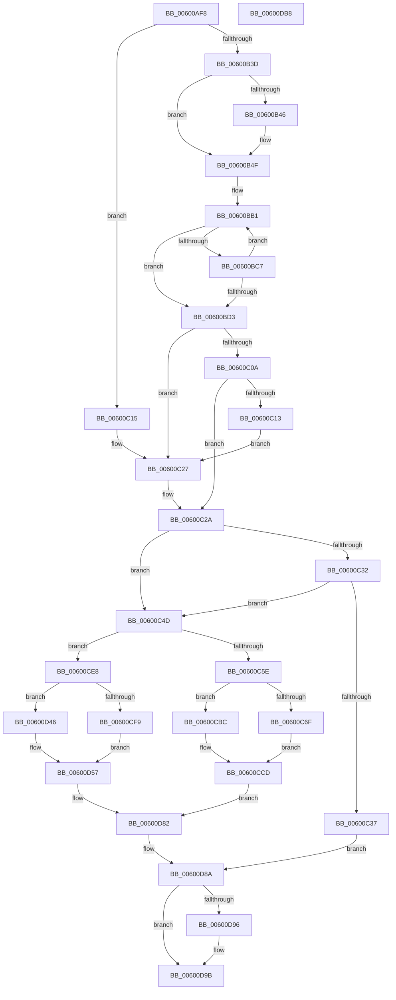

# tr_flush_block

- RVA: `0x00600AF8`–`0x00600DB9` (길이 `705` bytes)
- VA: `0x0000000140600AF8`
- 실행 섹션: `.text`
- PDB 이름 있음: `예`; PDB Function 태그: `아니요`
- unwind 정보 RVA: `0x00075C18`
- 디코드: `171`개 명령, `705/705` bytes 표시
- 미해석 바이트: `0` (있으면 어셈블리에 `.byte`로 보존)

> 이 문서는 커널 이미지의 기계어와 PDB 기호를 분석해 생성했습니다. 4번과 5번은 함수 원형과 자료형을 바이너리 사용 방식에서 추정한 C 해석이며 원본 소스 복구 결과는 아닙니다.

## 1. Dependencies

- 직접 호출 지점: **11**; 고유 호출 대상: **8**
- 직접 호출자로 확인된 함수: **4**
- RIP 상대 이미지 참조: **3**

### Outgoing calls
- `0x00600B46` → [detect_data_type](detect_data_type_function_006015F4.md) (function, `0x006015F4`)
- `0x00600B59` → [build_tree](build_tree_function_00600FB0.md) (function, `0x00600FB0`)
- `0x00600B68` → [build_tree](build_tree_function_00600FB0.md) (function, `0x00600FB0`)
- `0x00600B81` → [scan_tree](scan_tree_function_00601A74.md) (function, `0x00601A74`)
- `0x00600B97` → [scan_tree](scan_tree_function_00601A74.md) (function, `0x00601A74`)
- `0x00600BA3` → [build_tree](build_tree_function_00600FB0.md) (function, `0x00600FB0`)
- `0x00600C43` → [tr_stored_block](tr_stored_block_function_00600DC0.md) (function, `0x00600DC0`)
- `0x00600D77` → [send_all_trees](send_all_trees_function_00601B90.md) (function, `0x00601B90`)
- `0x00600D85` → [compress_block](compress_block_function_006011F8.md) (function, `0x006011F8`)
- `0x00600D8D` → [init_block](init_block_function_0060193C.md) (function, `0x0060193C`)
- `0x00600D96` → [bi_windup](bi_windup_function_00600F50.md) (function, `0x00600F50`)

### Direct callers
- [deflate_fast](../5F/deflate_fast_function_005F3A80.md) at `0x005F3ED2`
- [deflate_fast](../5F/deflate_fast_function_005F3A80.md) at `0x005F3F50`
- [deflate_fast](../5F/deflate_fast_function_005F3A80.md) at `0x005F3FA6`
- [deflate_huff](../5F/deflate_huff_function_005F3FDC.md) at `0x005F40B6`
- [deflate_huff](../5F/deflate_huff_function_005F3FDC.md) at `0x005F411A`
- [deflate_rle](../5F/deflate_rle_function_005F414C.md) at `0x005F439D`
- [deflate_rle](../5F/deflate_rle_function_005F414C.md) at `0x005F43FE`
- [deflate_slow](../5F/deflate_slow_function_005F4430.md) at `0x005F482C`
- [deflate_slow](../5F/deflate_slow_function_005F4430.md) at `0x005F48E8`
- [deflate_slow](../5F/deflate_slow_function_005F4430.md) at `0x005F49F1`
- [deflate_slow](../5F/deflate_slow_function_005F4430.md) at `0x005F4A43`

### Static image references
- `0x00600BB1` → RVA `0x00036DA0` (`.rdata`; read)
- `0x00600CD5` → RVA `0x00036920` (`.rdata`; read)
- `0x00600CDC` → RVA `0x00036DC0` (`.rdata`; read)

## 2. Other-region calls and transfers

- 다른 실행 섹션으로 향하는 call: **0**
- 별도 외부 분기/꼬리 이동을 확인하지 못했습니다.

## 3. Assembly (complete function range)

```asm
00600AF8  48 89 5C 24 08                  mov qword ptr [rsp + 8], rbx
00600AFD  48 89 6C 24 10                  mov qword ptr [rsp + 0x10], rbp
00600B02  48 89 74 24 18                  mov qword ptr [rsp + 0x18], rsi
00600B07  57                              push rdi
00600B08  41 54                           push r12
00600B0A  41 55                           push r13
00600B0C  41 56                           push r14
00600B0E  41 57                           push r15
00600B10  48 83 EC 20                     sub rsp, 0x20
00600B14  45 33 E4                        xor r12d, r12d
00600B17  41 8B F9                        mov edi, r9d
00600B1A  41 8B F0                        mov esi, r8d
00600B1D  48 8B EA                        mov rbp, rdx
00600B20  48 8B D9                        mov rbx, rcx
00600B23  45 8B CC                        mov r9d, r12d
00600B26  45 8D 6C 24 02                  lea r13d, [r12 + 2]
00600B2B  45 8D 5C 24 04                  lea r11d, [r12 + 4]
00600B30  44 39 A1 FC 00 00 00            cmp dword ptr [rcx + 0xfc], r12d
00600B37  0F 8E D8 00 00 00               jle 0x140600c15
00600B3D  4C 8B 11                        mov r10, qword ptr [rcx]
00600B40  45 39 6A 48                     cmp dword ptr [r10 + 0x48], r13d
00600B44  75 09                           jne 0x140600b4f
00600B46  E8 A9 0A 00 00                  call 0x1406015f4
00600B4B  41 89 42 48                     mov dword ptr [r10 + 0x48], eax
00600B4F  48 8D 93 90 0B 00 00            lea rdx, [rbx + 0xb90]
00600B56  48 8B CB                        mov rcx, rbx
00600B59  E8 52 04 00 00                  call 0x140600fb0
00600B5E  48 8D 93 A8 0B 00 00            lea rdx, [rbx + 0xba8]
00600B65  48 8B CB                        mov rcx, rbx
00600B68  E8 43 04 00 00                  call 0x140600fb0
00600B6D  44 8B 83 98 0B 00 00            mov r8d, dword ptr [rbx + 0xb98]
00600B74  4C 8D B3 0C 01 00 00            lea r14, [rbx + 0x10c]
00600B7B  49 8B D6                        mov rdx, r14
00600B7E  48 8B CB                        mov rcx, rbx
00600B81  E8 EE 0E 00 00                  call 0x140601a74
00600B86  44 8B 83 B0 0B 00 00            mov r8d, dword ptr [rbx + 0xbb0]
00600B8D  4C 8D BB 00 0A 00 00            lea r15, [rbx + 0xa00]
00600B94  49 8B D7                        mov rdx, r15
00600B97  E8 D8 0E 00 00                  call 0x140601a74
00600B9C  48 8D 93 C0 0B 00 00            lea rdx, [rbx + 0xbc0]
00600BA3  E8 08 04 00 00                  call 0x140600fb0
00600BA8  41 B9 12 00 00 00               mov r9d, 0x12
00600BAE  41 8B C9                        mov ecx, r9d
00600BB1  48 8D 05 E8 61 A3 FF            lea rax, [rip - 0x5c9e18]
00600BB8  0F B6 04 01                     movzx eax, byte ptr [rcx + rax]
00600BBC  66 44 39 A4 83 F6 0A 00 00      cmp word ptr [rbx + rax*4 + 0xaf6], r12w
00600BC5  75 0C                           jne 0x140600bd3
00600BC7  41 FF C9                        dec r9d
00600BCA  48 FF C9                        dec rcx
00600BCD  48 83 F9 03                     cmp rcx, 3
00600BD1  7D DE                           jge 0x140600bb1
00600BD3  8B 8B 50 17 00 00               mov ecx, dword ptr [rbx + 0x1750]
00600BD9  42 8D 04 4D 11 00 00 00         lea eax, [r9*2 + 0x11]
00600BE1  41 03 C1                        add eax, r9d
00600BE4  83 C1 0A                        add ecx, 0xa
00600BE7  01 83 4C 17 00 00               add dword ptr [rbx + 0x174c], eax
00600BED  41 BB 04 00 00 00               mov r11d, 4
00600BF3  44 8B 83 4C 17 00 00            mov r8d, dword ptr [rbx + 0x174c]
00600BFA  41 83 C0 0A                     add r8d, 0xa
00600BFE  C1 E9 03                        shr ecx, 3
00600C01  41 C1 E8 03                     shr r8d, 3
00600C05  41 3B C8                        cmp ecx, r8d
00600C08  76 1D                           jbe 0x140600c27
00600C0A  44 39 9B 00 01 00 00            cmp dword ptr [rbx + 0x100], r11d
00600C11  75 17                           jne 0x140600c2a
00600C13  EB 12                           jmp 0x140600c27
00600C15  41 8D 48 05                     lea ecx, [r8 + 5]
00600C19  4C 8D BB 00 0A 00 00            lea r15, [rbx + 0xa00]
00600C20  4C 8D B3 0C 01 00 00            lea r14, [rbx + 0x10c]
00600C27  44 8B C1                        mov r8d, ecx
00600C2A  8D 46 04                        lea eax, [rsi + 4]
00600C2D  41 3B C0                        cmp eax, r8d
00600C30  77 1B                           ja 0x140600c4d
00600C32  48 85 ED                        test rbp, rbp
00600C35  74 16                           je 0x140600c4d
00600C37  44 8B CF                        mov r9d, edi
00600C3A  44 8B C6                        mov r8d, esi
00600C3D  48 8B D5                        mov rdx, rbp
00600C40  48 8B CB                        mov rcx, rbx
00600C43  E8 78 01 00 00                  call 0x140600dc0
00600C48  E9 3D 01 00 00                  jmp 0x140600d8a
00600C4D  8B 93 60 17 00 00               mov edx, dword ptr [rbx + 0x1760]
00600C53  41 3B C8                        cmp ecx, r8d
00600C56  8B CA                           mov ecx, edx
00600C58  0F 85 8A 00 00 00               jne 0x140600ce8
00600C5E  44 0F B7 8B 5C 17 00 00         movzx r9d, word ptr [rbx + 0x175c]
00600C66  46 8D 04 2F                     lea r8d, [rdi + r13]
00600C6A  83 FA 0D                        cmp edx, 0xd
00600C6D  7E 4D                           jle 0x140600cbc
00600C6F  8B 53 28                        mov edx, dword ptr [rbx + 0x28]
00600C72  41 0F B7 C0                     movzx eax, r8w
00600C76  66 D3 E0                        shl ax, cl
00600C79  48 8B 4B 10                     mov rcx, qword ptr [rbx + 0x10]
00600C7D  66 41 0B C1                     or ax, r9w
00600C81  66 89 83 5C 17 00 00            mov word ptr [rbx + 0x175c], ax
00600C88  88 04 0A                        mov byte ptr [rdx + rcx], al
00600C8B  FF 43 28                        inc dword ptr [rbx + 0x28]
00600C8E  8B 53 28                        mov edx, dword ptr [rbx + 0x28]
00600C91  48 8B 4B 10                     mov rcx, qword ptr [rbx + 0x10]
00600C95  8A 83 5D 17 00 00               mov al, byte ptr [rbx + 0x175d]
00600C9B  88 04 0A                        mov byte ptr [rdx + rcx], al
00600C9E  B9 10 00 00 00                  mov ecx, 0x10
00600CA3  0F B7 83 60 17 00 00            movzx eax, word ptr [rbx + 0x1760]
00600CAA  FF 43 28                        inc dword ptr [rbx + 0x28]
00600CAD  2A C8                           sub cl, al
00600CAF  83 83 60 17 00 00 F3            add dword ptr [rbx + 0x1760], -0xd
00600CB6  66 41 D3 E8                     shr r8w, cl
00600CBA  EB 11                           jmp 0x140600ccd
00600CBC  8D 42 03                        lea eax, [rdx + 3]
00600CBF  66 41 D3 E0                     shl r8w, cl
00600CC3  89 83 60 17 00 00               mov dword ptr [rbx + 0x1760], eax
00600CC9  66 45 0B C1                     or r8w, r9w
00600CCD  66 44 89 83 5C 17 00 00         mov word ptr [rbx + 0x175c], r8w
00600CD5  48 8D 15 44 5C A3 FF            lea rdx, [rip - 0x5ca3bc]
00600CDC  4C 8D 05 DD 60 A3 FF            lea r8, [rip - 0x5c9f23]
00600CE3  E9 9A 00 00 00                  jmp 0x140600d82
00600CE8  44 0F B7 93 5C 17 00 00         movzx r10d, word ptr [rbx + 0x175c]
00600CF0  45 8D 04 3B                     lea r8d, [r11 + rdi]
00600CF4  83 FA 0D                        cmp edx, 0xd
00600CF7  7E 4D                           jle 0x140600d46
00600CF9  8B 53 28                        mov edx, dword ptr [rbx + 0x28]
00600CFC  41 0F B7 C0                     movzx eax, r8w
00600D00  66 D3 E0                        shl ax, cl
00600D03  48 8B 4B 10                     mov rcx, qword ptr [rbx + 0x10]
00600D07  66 41 0B C2                     or ax, r10w
00600D0B  66 89 83 5C 17 00 00            mov word ptr [rbx + 0x175c], ax
00600D12  88 04 0A                        mov byte ptr [rdx + rcx], al
00600D15  FF 43 28                        inc dword ptr [rbx + 0x28]
00600D18  8B 53 28                        mov edx, dword ptr [rbx + 0x28]
00600D1B  48 8B 4B 10                     mov rcx, qword ptr [rbx + 0x10]
00600D1F  8A 83 5D 17 00 00               mov al, byte ptr [rbx + 0x175d]
00600D25  88 04 0A                        mov byte ptr [rdx + rcx], al
00600D28  B9 10 00 00 00                  mov ecx, 0x10
00600D2D  0F B7 83 60 17 00 00            movzx eax, word ptr [rbx + 0x1760]
00600D34  FF 43 28                        inc dword ptr [rbx + 0x28]
00600D37  2A C8                           sub cl, al
00600D39  83 83 60 17 00 00 F3            add dword ptr [rbx + 0x1760], -0xd
00600D40  66 41 D3 E8                     shr r8w, cl
00600D44  EB 11                           jmp 0x140600d57
00600D46  8D 42 03                        lea eax, [rdx + 3]
00600D49  66 41 D3 E0                     shl r8w, cl
00600D4D  89 83 60 17 00 00               mov dword ptr [rbx + 0x1760], eax
00600D53  66 45 0B C2                     or r8w, r10w
00600D57  66 44 89 83 5C 17 00 00         mov word ptr [rbx + 0x175c], r8w
00600D5F  41 FF C1                        inc r9d
00600D62  44 8B 83 B0 0B 00 00            mov r8d, dword ptr [rbx + 0xbb0]
00600D69  48 8B CB                        mov rcx, rbx
00600D6C  8B 93 98 0B 00 00               mov edx, dword ptr [rbx + 0xb98]
00600D72  41 FF C0                        inc r8d
00600D75  FF C2                           inc edx
00600D77  E8 14 0E 00 00                  call 0x140601b90
00600D7C  4D 8B C7                        mov r8, r15
00600D7F  49 8B D6                        mov rdx, r14
00600D82  48 8B CB                        mov rcx, rbx
00600D85  E8 6E 04 00 00                  call 0x1406011f8
00600D8A  48 8B CB                        mov rcx, rbx
00600D8D  E8 AA 0B 00 00                  call 0x14060193c
00600D92  85 FF                           test edi, edi
00600D94  74 05                           je 0x140600d9b
00600D96  E8 B5 01 00 00                  call 0x140600f50
00600D9B  48 8B 5C 24 50                  mov rbx, qword ptr [rsp + 0x50]
00600DA0  48 8B 6C 24 58                  mov rbp, qword ptr [rsp + 0x58]
00600DA5  48 8B 74 24 60                  mov rsi, qword ptr [rsp + 0x60]
00600DAA  48 83 C4 20                     add rsp, 0x20
00600DAE  41 5F                           pop r15
00600DB0  41 5E                           pop r14
00600DB2  41 5D                           pop r13
00600DB4  41 5C                           pop r12
00600DB6  5F                              pop rdi
00600DB7  C3                              ret
00600DB8  CC                              int3
```

## 4. C-style interpretation (structured pseudocode)

```c
__int64 __fastcall tr_flush_block(__int64 a1, __int64 a2, int a3, int a4)
{
    __int64 result;
    __int64 v_r12;
    __int64 v_rsp;
    unsigned __int64 v_stack_p10;
    unsigned __int64 v_stack_p18;
    unsigned __int64 v_stack_p8;

    v_stack_p8 = v_rbx;
    v_stack_p10 = v_rbp;
    v_stack_p18 = v_rsi;
    v_rsp = (v_rsp) - (32);
    v_r12 = 0;
    if ((*(unsigned int *)(a1 + 252)) <= 0) goto loc_00600C15;
    if ((*(unsigned int *)(*(unsigned __int64 *)(a1) + 72)) == ((unsigned int)(v_r12 + 2))) {
        result = detect_data_type(a1, a2, a3, 0);
        *(unsigned int *)(*(unsigned __int64 *)(a1) + 72) = (unsigned int)(result);
    }
    result = build_tree(a1, a1 + 2960, a3, 0);
    result = build_tree(a1, a1 + 2984, a3, 0);
    result = scan_tree(a1, a1 + 268, (unsigned int)(*(unsigned int *)(a1 + 2968)), 0);
    result = scan_tree(a1, a1 + 2560, (unsigned int)(*(unsigned int *)(a1 + 2992)), 0);
    result = build_tree(a1, a1 + 3008, (unsigned int)(*(unsigned int *)(a1 + 2992)), 0);
loc_00600BB1:
    if ((*(unsigned __int16 *)(a1 + *(unsigned __int8 *)(18 + v_rip - 6069784 * 1) * 4 + 2806)) != 0) goto loc_00600BD3;
    a4 = (unsigned int)((18) - 1);
    a1 = (18) - 1;
    if (a1 >= 3) goto loc_00600BB1;
loc_00600BD3:
    result = (unsigned int)((a4 * 2 + 17) + (a4));
    a1 = (unsigned int)(((unsigned int)(*(unsigned int *)(a1 + 5968))) + (10));
    a3 = (unsigned int)(((unsigned int)(*(unsigned int *)(a1 + 5964))) + (10));
    a1 = (unsigned int)((a1) >> (3));
    a3 = (unsigned int)((a3) >> (3));
    if (((unsigned int)(a1)) <= a3) goto loc_00600C27;
    if ((*(unsigned int *)(a1 + 256)) != 4) goto loc_00600C2A;
    goto loc_00600C27;
loc_00600C15:
loc_00600C27:
loc_00600C2A:
    if (((unsigned int)((unsigned int)(a3) + 4)) > ((unsigned int)((unsigned int)((unsigned int)(a3 + 5))))) goto loc_00600C4D;
    if (a2 == 0) goto loc_00600C4D;
    result = tr_stored_block(a1, a2, (unsigned int)((unsigned int)((unsigned int)(a3))), (unsigned int)((unsigned int)((unsigned int)(a4))));
    goto loc_00600D8A;
loc_00600C4D:
    if (((unsigned int)(a1)) != ((unsigned int)((unsigned int)((unsigned int)((unsigned int)(a3)))))) goto loc_00600CE8;
    if (((unsigned int)((unsigned int)(*(unsigned int *)(a1 + 5984)))) <= 13) goto loc_00600CBC;
    result = (unsigned __int16)(((unsigned __int16)((unsigned int)(a4) + v_r12 + 2 * 1)) << ((unsigned __int8)((unsigned int)((unsigned int)((unsigned int)(*(unsigned int *)(a1 + 5984)))))));
    result = (unsigned __int16)((result) | ((unsigned __int16)(*(unsigned __int16 *)(a1 + 5980))));
    *(unsigned __int16 *)(a1 + 5980) = (unsigned __int16)(result);
    *(unsigned __int8 *)((unsigned int)(*(unsigned int *)(a1 + 40)) + *(unsigned __int64 *)(a1 + 16) * 1) = (unsigned __int8)(result);
    *(unsigned __int8 *)((unsigned int)(*(unsigned int *)(a1 + 40)) + *(unsigned __int64 *)(a1 + 16) * 1) = (unsigned __int8)(*(unsigned __int8 *)(a1 + 5981));
    a1 = (unsigned __int8)((16) - ((unsigned __int8)(*(unsigned __int16 *)(a1 + 5984))));
    a3 = (unsigned __int16)(((unsigned int)(a4) + v_r12 + 2 * 1) >> ((unsigned __int8)(a1)));
    goto loc_00600CCD;
loc_00600CBC:
    a3 = (unsigned __int16)((a3) << ((unsigned __int8)(a1)));
    *(unsigned int *)(a1 + 5984) = (unsigned int)((unsigned int)(*(unsigned int *)(a1 + 40)) + 3);
    a3 = (unsigned __int16)((a3) | ((unsigned __int16)(*(unsigned __int16 *)(a1 + 5980))));
loc_00600CCD:
    *(unsigned __int16 *)(a1 + 5980) = (unsigned __int16)(a3);
    goto loc_00600D82;
loc_00600CE8:
    if (((unsigned int)(v_rip - 6071228)) <= 13) goto loc_00600D46;
    result = (unsigned __int16)(((unsigned __int16)(4 + (unsigned int)(a4) * 1)) << ((unsigned __int8)(a1)));
    result = (unsigned __int16)((result) | ((unsigned __int16)(*(unsigned __int16 *)(a1 + 5980))));
    *(unsigned __int16 *)(a1 + 5980) = (unsigned __int16)(result);
    *(unsigned __int8 *)((unsigned int)(*(unsigned int *)(a1 + 40)) + *(unsigned __int64 *)(a1 + 16) * 1) = (unsigned __int8)(result);
    *(unsigned __int8 *)((unsigned int)(*(unsigned int *)(a1 + 40)) + *(unsigned __int64 *)(a1 + 16) * 1) = (unsigned __int8)(*(unsigned __int8 *)(a1 + 5981));
    a1 = (unsigned __int8)((16) - ((unsigned __int8)(*(unsigned __int16 *)(a1 + 5984))));
    a3 = (unsigned __int16)((4 + (unsigned int)(a4) * 1) >> ((unsigned __int8)(a1)));
    goto loc_00600D57;
loc_00600D46:
    a3 = (unsigned __int16)((a3) << ((unsigned __int8)(a1)));
    *(unsigned int *)(a1 + 5984) = (unsigned int)((unsigned int)(*(unsigned int *)(a1 + 40)) + 3);
    a3 = (unsigned __int16)((a3) | ((unsigned __int16)(*(unsigned __int16 *)(a1 + 5980))));
loc_00600D57:
    *(unsigned __int16 *)(a1 + 5980) = (unsigned __int16)(a3);
    a4 = (unsigned int)((*(unsigned __int16 *)(a1 + 5980)) + 1);
    a3 = (unsigned int)(((unsigned int)(*(unsigned int *)(a1 + 2992))) + 1);
    a2 = (unsigned int)(((unsigned int)(*(unsigned int *)(a1 + 2968))) + 1);
    result = send_all_trees(a1, a2, a3, a4);
loc_00600D82:
    result = compress_block(a1, a1 + 268, a1 + 2560, a4);
loc_00600D8A:
    result = init_block(a1, a1 + 268, a1 + 2560, a4);
    if ((unsigned int)((unsigned int)(a4)) != 0) {
        result = bi_windup(a1, a1 + 268, a1 + 2560, a4);
    }
    v_rsp = (v_rsp) + (32);
    return result;
}
```

## 5. (Beta) C Style

```c
int64_t tr_flush_block(void *Arg1, int64_t Arg2, void *Arg3, void *Arg4)
{
    uint8_t *arg1 = (uint8_t *)Arg1;
    uint8_t *arg3 = (uint8_t *)Arg3;
    uint8_t *arg4 = (uint8_t *)Arg4;

    int64_t result;
    int64_t local_r12;
    int64_t local_rsp;
    uint64_t v_stack_p10;
    uint64_t v_stack_p18;
    uint64_t v_stack_p8;

    v_stack_p8 = local_rbx;
    v_stack_p10 = local_rbp;
    v_stack_p18 = local_rsi;
    local_rsp = (local_rsp) - (32);
    local_r12 = 0;
    if ((*(uint32_t *)(arg1 + 0xFC)) <= 0) goto loc_00600C15;
    if ((*(uint32_t *)(*(uint64_t *)(arg1) + 0x48)) == ((uint32_t)(local_r12 + 2))) {
        result = detect_data_type(Arg1, Arg2, Arg3, 0);
        *(uint32_t *)(*(uint64_t *)(arg1) + 0x48) = (uint32_t)(result);
    }
    result = build_tree(Arg1, Arg1 + 2960, Arg3, 0);
    result = build_tree(Arg1, Arg1 + 2984, Arg3, 0);
    result = scan_tree(Arg1, Arg1 + 268, (uint32_t)(*(uint32_t *)(arg1 + 0xB98)), 0);
    result = scan_tree(Arg1, Arg1 + 2560, (uint32_t)(*(uint32_t *)(arg1 + 0xBB0)), 0);
    result = build_tree(Arg1, Arg1 + 3008, (uint32_t)(*(uint32_t *)(arg1 + 0xBB0)), 0);
loc_00600BB1:
    if ((*(uint16_t *)(arg1 + *(uint8_t *)(18 + v_rip - 0x5C9E18 * 1) * 4 + 0xAF6)) != 0) goto loc_00600BD3;
    Arg4 = (uint32_t)((18) - 1);
    Arg1 = (18) - 1;
    if (Arg1 >= 3) goto loc_00600BB1;
loc_00600BD3:
    result = (uint32_t)((Arg4 * 2 + 17) + (Arg4));
    Arg1 = (uint32_t)(((uint32_t)(*(uint32_t *)(arg1 + 0x1750))) + (10));
    Arg3 = (uint32_t)(((uint32_t)(*(uint32_t *)(arg1 + 0x174C))) + (10));
    Arg1 = (uint32_t)((Arg1) >> (3));
    Arg3 = (uint32_t)((Arg3) >> (3));
    if (((uint32_t)(Arg1)) <= Arg3) goto loc_00600C27;
    if ((*(uint32_t *)(arg1 + 0x100)) != 4) goto loc_00600C2A;
    goto loc_00600C27;
loc_00600C15:
loc_00600C27:
loc_00600C2A:
    if (((uint32_t)((uint32_t)(Arg3) + 4)) > ((uint32_t)((uint32_t)((uint32_t)(Arg3 + 5))))) goto loc_00600C4D;
    if (Arg2 == 0) goto loc_00600C4D;
    result = tr_stored_block(Arg1, Arg2, (uint32_t)((uint32_t)((uint32_t)(Arg3))), (uint32_t)((uint32_t)((uint32_t)(Arg4))));
    goto loc_00600D8A;
loc_00600C4D:
    if (((uint32_t)(Arg1)) != ((uint32_t)((uint32_t)((uint32_t)((uint32_t)(Arg3)))))) goto loc_00600CE8;
    if (((uint32_t)((uint32_t)(*(uint32_t *)(arg1 + 0x1760)))) <= 13) goto loc_00600CBC;
    result = (uint16_t)(((uint16_t)((uint32_t)(Arg4) + local_r12 + 2 * 1)) << ((uint8_t)((uint32_t)((uint32_t)((uint32_t)(*(uint32_t *)(arg1 + 0x1760)))))));
    result = (uint16_t)((result) | ((uint16_t)(*(uint16_t *)(arg1 + 0x175C))));
    *(uint16_t *)(arg1 + 0x175C) = (uint16_t)(result);
    *(uint8_t *)((uint32_t)(*(uint32_t *)(arg1 + 0x28)) + *(uint64_t *)(arg1 + 0x10) * 1) = (uint8_t)(result);
    *(uint8_t *)((uint32_t)(*(uint32_t *)(arg1 + 0x28)) + *(uint64_t *)(arg1 + 0x10) * 1) = (uint8_t)(*(uint8_t *)(arg1 + 0x175D));
    Arg1 = (uint8_t)((16) - ((uint8_t)(*(uint16_t *)(arg1 + 0x1760))));
    Arg3 = (uint16_t)(((uint32_t)(Arg4) + local_r12 + 2 * 1) >> ((uint8_t)(Arg1)));
    goto loc_00600CCD;
loc_00600CBC:
    Arg3 = (uint16_t)((Arg3) << ((uint8_t)(Arg1)));
    *(uint32_t *)(arg1 + 0x1760) = (uint32_t)((uint32_t)(*(uint32_t *)(arg1 + 0x28)) + 3);
    Arg3 = (uint16_t)((Arg3) | ((uint16_t)(*(uint16_t *)(arg1 + 0x175C))));
loc_00600CCD:
    *(uint16_t *)(arg1 + 0x175C) = (uint16_t)(Arg3);
    goto loc_00600D82;
loc_00600CE8:
    if (((uint32_t)(v_rip - 6071228)) <= 13) goto loc_00600D46;
    result = (uint16_t)(((uint16_t)(4 + (uint32_t)(Arg4) * 1)) << ((uint8_t)(Arg1)));
    result = (uint16_t)((result) | ((uint16_t)(*(uint16_t *)(arg1 + 0x175C))));
    *(uint16_t *)(arg1 + 0x175C) = (uint16_t)(result);
    *(uint8_t *)((uint32_t)(*(uint32_t *)(arg1 + 0x28)) + *(uint64_t *)(arg1 + 0x10) * 1) = (uint8_t)(result);
    *(uint8_t *)((uint32_t)(*(uint32_t *)(arg1 + 0x28)) + *(uint64_t *)(arg1 + 0x10) * 1) = (uint8_t)(*(uint8_t *)(arg1 + 0x175D));
    Arg1 = (uint8_t)((16) - ((uint8_t)(*(uint16_t *)(arg1 + 0x1760))));
    Arg3 = (uint16_t)((4 + (uint32_t)(Arg4) * 1) >> ((uint8_t)(Arg1)));
    goto loc_00600D57;
loc_00600D46:
    Arg3 = (uint16_t)((Arg3) << ((uint8_t)(Arg1)));
    *(uint32_t *)(arg1 + 0x1760) = (uint32_t)((uint32_t)(*(uint32_t *)(arg1 + 0x28)) + 3);
    Arg3 = (uint16_t)((Arg3) | ((uint16_t)(*(uint16_t *)(arg1 + 0x175C))));
loc_00600D57:
    *(uint16_t *)(arg1 + 0x175C) = (uint16_t)(Arg3);
    Arg4 = (uint32_t)((*(uint16_t *)(arg1 + 0x175C)) + 1);
    Arg3 = (uint32_t)(((uint32_t)(*(uint32_t *)(arg1 + 0xBB0))) + 1);
    Arg2 = (uint32_t)(((uint32_t)(*(uint32_t *)(arg1 + 0xB98))) + 1);
    result = send_all_trees(Arg1, Arg2, Arg3, Arg4);
loc_00600D82:
    result = compress_block(Arg1, Arg1 + 268, Arg1 + 2560, Arg4);
loc_00600D8A:
    result = init_block(Arg1, Arg1 + 268, Arg1 + 2560, Arg4);
    if ((uint32_t)((uint32_t)(Arg4)) != 0) {
        result = bi_windup(Arg1, Arg1 + 268, Arg1 + 2560, Arg4);
    }
    local_rsp = (local_rsp) + (32);
    return result;
}
```

### 관측된 메모리 오프셋

구조체 형식이 확인되지 않은 접근은 인자 기준의 오프셋으로만 기록했습니다.

| 기준 인자 | 오프셋 표현 | 폭 (bit) | 접근 |
|---|---:|---:|---|
| `Arg1` | `+ 0x0` | `64` | `R` |
| `Arg1` | `+ 0x10` | `64` | `R` |
| `Arg1` | `+ 0x28` | `32` | `R` |
| `Arg1` | `+ 0x28` | `32` | `R/W` |
| `Arg1` | `+ 0xFC` | `32` | `R` |
| `Arg1` | `+ 0x100` | `32` | `R` |
| `Arg1` | `+ 0x10C` | `64` | `R` |
| `Arg1` | `+ 0xA00` | `64` | `R` |
| `Arg1` | `+ 0xAF6 + rax*4` | `16` | `R` |
| `Arg1` | `+ 0xB90` | `64` | `R` |
| `Arg1` | `+ 0xB98` | `32` | `R` |
| `Arg1` | `+ 0xBA8` | `64` | `R` |
| `Arg1` | `+ 0xBB0` | `32` | `R` |
| `Arg1` | `+ 0xBC0` | `64` | `R` |
| `Arg1` | `+ 0x174C` | `32` | `R` |
| `Arg1` | `+ 0x174C` | `32` | `R/W` |
| `Arg1` | `+ 0x1750` | `32` | `R` |
| `Arg1` | `+ 0x175C` | `16` | `R` |
| `Arg1` | `+ 0x175C` | `16` | `W` |
| `Arg1` | `+ 0x175D` | `8` | `R` |
| `Arg1` | `+ 0x1760` | `16` | `R` |
| `Arg1` | `+ 0x1760` | `32` | `R` |
| `Arg1` | `+ 0x1760` | `32` | `R/W` |
| `Arg1` | `+ 0x1760` | `32` | `W` |
| `Arg3` | `+ 0x4` | `32` | `R` |
| `Arg3` | `+ 0x5` | `32` | `R` |
| `Arg4` | `+ 0x0 + r13*1` | `32` | `R` |

## 6. Execution-region graph

[열기: 2D/3D 그래프와 함수 탐색 컨트롤 패널](../../../control-panel.html?section=text&rva=0x00600AF8&view=graph)

- 2D 그래프는 위에서 아래로 흐르고, 3D 그래프는 빈 공간을 드래그해 회전합니다. Shift+드래그는 이동, 휠은 확대·축소, 함수 노드 선택은 대상 보고서 이동입니다.

### Static fallback


