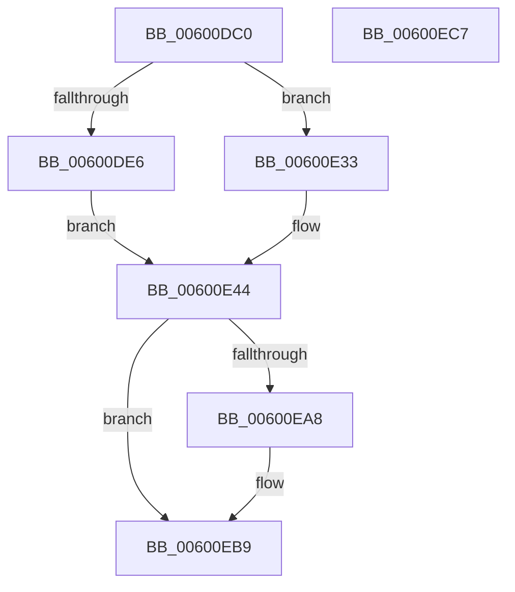

# tr_stored_block

- RVA: `0x00600DC0`–`0x00600EC8` (길이 `264` bytes)
- VA: `0x0000000140600DC0`
- 실행 섹션: `.text`
- PDB 이름 있음: `예`; PDB Function 태그: `아니요`
- unwind 정보 RVA: `0x0005CAAC`
- 디코드: `74`개 명령, `264/264` bytes 표시
- 미해석 바이트: `0` (있으면 어셈블리에 `.byte`로 보존)

> 이 문서는 커널 이미지의 기계어와 PDB 기호를 분석해 생성했습니다. 4번과 5번은 함수 원형과 자료형을 바이너리 사용 방식에서 추정한 C 해석이며 원본 소스 복구 결과는 아닙니다.

## 1. Dependencies

- 직접 호출 지점: **2**; 고유 호출 대상: **2**
- 직접 호출자로 확인된 함수: **3**
- RIP 상대 이미지 참조: **0**

### Outgoing calls
- `0x00600E4F` → [bi_windup](bi_windup_function_00600F50.md) (function, `0x00600F50`)
- `0x00600EB4` → [memcpy](../6C/memcpy_function_006C6840.md) (function, `0x006C6840`)

### Direct callers
- [deflate](../5F/deflate_function_005F35C8.md) at `0x005F382A`
- [deflate_stored](../5F/deflate_stored_function_005F4A80.md) at `0x005F4B55`
- [deflate_stored](../5F/deflate_stored_function_005F4A80.md) at `0x005F4EB4`
- [tr_flush_block](tr_flush_block_function_00600AF8.md) at `0x00600C43`

### Static image references
- 디코드된 RIP-relative 메모리 참조가 없습니다.

## 2. Other-region calls and transfers

- 다른 실행 섹션으로 향하는 call: **0**
- 별도 외부 분기/꼬리 이동을 확인하지 못했습니다.

## 3. Assembly (complete function range)

```asm
00600DC0  48 89 5C 24 08                  mov qword ptr [rsp + 8], rbx
00600DC5  57                              push rdi
00600DC6  48 83 EC 20                     sub rsp, 0x20
00600DCA  48 8B D9                        mov rbx, rcx
00600DCD  41 8B F8                        mov edi, r8d
00600DD0  8B 89 60 17 00 00               mov ecx, dword ptr [rcx + 0x1760]
00600DD6  4C 8B DA                        mov r11, rdx
00600DD9  44 0F B7 83 5C 17 00 00         movzx r8d, word ptr [rbx + 0x175c]
00600DE1  83 F9 0D                        cmp ecx, 0xd
00600DE4  7E 4D                           jle 0x140600e33
00600DE6  8B 53 28                        mov edx, dword ptr [rbx + 0x28]
00600DE9  41 0F B7 C1                     movzx eax, r9w
00600DED  66 D3 E0                        shl ax, cl
00600DF0  48 8B 4B 10                     mov rcx, qword ptr [rbx + 0x10]
00600DF4  66 41 0B C0                     or ax, r8w
00600DF8  66 89 83 5C 17 00 00            mov word ptr [rbx + 0x175c], ax
00600DFF  88 04 0A                        mov byte ptr [rdx + rcx], al
00600E02  FF 43 28                        inc dword ptr [rbx + 0x28]
00600E05  8B 53 28                        mov edx, dword ptr [rbx + 0x28]
00600E08  48 8B 4B 10                     mov rcx, qword ptr [rbx + 0x10]
00600E0C  8A 83 5D 17 00 00               mov al, byte ptr [rbx + 0x175d]
00600E12  88 04 0A                        mov byte ptr [rdx + rcx], al
00600E15  B9 10 00 00 00                  mov ecx, 0x10
00600E1A  0F B7 83 60 17 00 00            movzx eax, word ptr [rbx + 0x1760]
00600E21  FF 43 28                        inc dword ptr [rbx + 0x28]
00600E24  2A C8                           sub cl, al
00600E26  83 83 60 17 00 00 F3            add dword ptr [rbx + 0x1760], -0xd
00600E2D  66 41 D3 E9                     shr r9w, cl
00600E31  EB 11                           jmp 0x140600e44
00600E33  8D 41 03                        lea eax, [rcx + 3]
00600E36  66 41 D3 E1                     shl r9w, cl
00600E3A  89 83 60 17 00 00               mov dword ptr [rbx + 0x1760], eax
00600E40  66 45 0B C8                     or r9w, r8w
00600E44  48 8B CB                        mov rcx, rbx
00600E47  66 44 89 8B 5C 17 00 00         mov word ptr [rbx + 0x175c], r9w
00600E4F  E8 FC 00 00 00                  call 0x140600f50
00600E54  8B 4B 28                        mov ecx, dword ptr [rbx + 0x28]
00600E57  48 8B 43 10                     mov rax, qword ptr [rbx + 0x10]
00600E5B  40 88 3C 01                     mov byte ptr [rcx + rax], dil
00600E5F  0F B7 CF                        movzx ecx, di
00600E62  FF 43 28                        inc dword ptr [rbx + 0x28]
00600E65  8B 53 28                        mov edx, dword ptr [rbx + 0x28]
00600E68  48 8B 43 10                     mov rax, qword ptr [rbx + 0x10]
00600E6C  66 C1 E9 08                     shr cx, 8
00600E70  88 0C 02                        mov byte ptr [rdx + rax], cl
00600E73  40 8A CF                        mov cl, dil
00600E76  FF 43 28                        inc dword ptr [rbx + 0x28]
00600E79  F6 D1                           not cl
00600E7B  8B 53 28                        mov edx, dword ptr [rbx + 0x28]
00600E7E  48 8B 43 10                     mov rax, qword ptr [rbx + 0x10]
00600E82  88 0C 02                        mov byte ptr [rdx + rax], cl
00600E85  0F B7 CF                        movzx ecx, di
00600E88  FF 43 28                        inc dword ptr [rbx + 0x28]
00600E8B  66 F7 D1                        not cx
00600E8E  8B 53 28                        mov edx, dword ptr [rbx + 0x28]
00600E91  48 8B 43 10                     mov rax, qword ptr [rbx + 0x10]
00600E95  66 C1 E9 08                     shr cx, 8
00600E99  88 0C 02                        mov byte ptr [rdx + rax], cl
00600E9C  8B 43 28                        mov eax, dword ptr [rbx + 0x28]
00600E9F  FF C0                           inc eax
00600EA1  89 43 28                        mov dword ptr [rbx + 0x28], eax
00600EA4  85 FF                           test edi, edi
00600EA6  74 11                           je 0x140600eb9
00600EA8  8B C8                           mov ecx, eax
00600EAA  4C 8B C7                        mov r8, rdi
00600EAD  48 03 4B 10                     add rcx, qword ptr [rbx + 0x10]
00600EB1  49 8B D3                        mov rdx, r11
00600EB4  E8 87 59 0C 00                  call 0x1406c6840
00600EB9  01 7B 28                        add dword ptr [rbx + 0x28], edi
00600EBC  48 8B 5C 24 30                  mov rbx, qword ptr [rsp + 0x30]
00600EC1  48 83 C4 20                     add rsp, 0x20
00600EC5  5F                              pop rdi
00600EC6  C3                              ret
00600EC7  CC                              int3
```

## 4. C-style interpretation (structured pseudocode)

```c
__int64 __fastcall tr_stored_block(__int64 a1, __int64 a2, int a3, unsigned __int16 a4)
{
    __int64 result;
    __int64 v_rsp;
    unsigned __int64 v_stack_p8;

    v_stack_p8 = v_rbx;
    v_rsp = (v_rsp) - (32);
    if (((unsigned int)((unsigned int)(*(unsigned int *)(a1 + 5984)))) <= 13) goto loc_00600E33;
    result = (unsigned __int16)((a4) << ((unsigned __int8)((unsigned int)(*(unsigned int *)(a1 + 5984)))));
    result = (unsigned __int16)((result) | ((unsigned __int16)(*(unsigned __int16 *)(a1 + 5980))));
    *(unsigned __int16 *)(a1 + 5980) = (unsigned __int16)(result);
    *(unsigned __int8 *)((unsigned int)(*(unsigned int *)(a1 + 40)) + *(unsigned __int64 *)(a1 + 16) * 1) = (unsigned __int8)(result);
    *(unsigned __int8 *)((unsigned int)(*(unsigned int *)(a1 + 40)) + *(unsigned __int64 *)(a1 + 16) * 1) = (unsigned __int8)(*(unsigned __int8 *)(a1 + 5981));
    a1 = (unsigned __int8)((16) - ((unsigned __int8)(*(unsigned __int16 *)(a1 + 5984))));
    a4 = (unsigned __int16)((a4) >> ((unsigned __int8)(a1)));
    goto loc_00600E44;
loc_00600E33:
    a4 = (unsigned __int16)((a4) << ((unsigned __int8)(a1)));
    *(unsigned int *)(a1 + 5984) = (unsigned int)(a1 + 3);
    a4 = (unsigned __int16)((a4) | ((unsigned __int16)(*(unsigned __int16 *)(a1 + 5980))));
loc_00600E44:
    *(unsigned __int16 *)(a1 + 5980) = a4;
    result = bi_windup(a1, (unsigned int)(*(unsigned int *)(a1 + 40)), *(unsigned __int16 *)(a1 + 5980), a4);
    *(unsigned __int8 *)((unsigned int)(*(unsigned int *)(a1 + 40)) + *(unsigned __int64 *)(a1 + 16) * 1) = (unsigned __int8)((unsigned int)(a3));
    a1 = (unsigned __int16)(((unsigned __int16)((unsigned int)(a3))) >> (8));
    *(unsigned __int8 *)((unsigned int)(*(unsigned int *)(a1 + 40)) + *(unsigned __int64 *)(a1 + 16) * 1) = (unsigned __int8)(a1);
    a1 = (unsigned __int8)(~((unsigned __int8)((unsigned int)(a3))));
    *(unsigned __int8 *)((unsigned int)(*(unsigned int *)(a1 + 40)) + *(unsigned __int64 *)(a1 + 16) * 1) = (unsigned __int8)(a1);
    a1 = (unsigned __int16)(~((unsigned __int16)((unsigned int)(a3))));
    a1 = (unsigned __int16)((a1) >> (8));
    *(unsigned __int8 *)((unsigned int)(*(unsigned int *)(a1 + 40)) + *(unsigned __int64 *)(a1 + 16) * 1) = (unsigned __int8)(a1);
    result = (unsigned int)(((unsigned int)(*(unsigned int *)(a1 + 40))) + 1);
    *(unsigned int *)(a1 + 40) = (unsigned int)(result);
    if ((unsigned int)((unsigned int)(a3)) != 0) {
        a1 = (unsigned int)(result);
        a3 = (unsigned int)(a3);
        a1 = (a1) + (*(unsigned __int64 *)(a1 + 16));
        a2 = a2;
        result = memcpy(a1, a2, a3, a4);
    }
    v_rsp = (v_rsp) + (32);
    return result;
}
```

## 5. (Beta) C Style

```c
int64_t tr_stored_block(void *Arg1, int64_t Arg2, int32_t Arg3, uint16_t Arg4)
{
    uint8_t *arg1 = (uint8_t *)Arg1;

    int64_t result;
    int64_t local_rsp;
    uint64_t v_stack_p8;

    v_stack_p8 = local_rbx;
    local_rsp = (local_rsp) - (32);
    if (((uint32_t)((uint32_t)(*(uint32_t *)(arg1 + 0x1760)))) <= 13) goto loc_00600E33;
    result = (uint16_t)((Arg4) << ((uint8_t)((uint32_t)(*(uint32_t *)(arg1 + 0x1760)))));
    result = (uint16_t)((result) | ((uint16_t)(*(uint16_t *)(arg1 + 0x175C))));
    *(uint16_t *)(arg1 + 0x175C) = (uint16_t)(result);
    *(uint8_t *)((uint32_t)(*(uint32_t *)(arg1 + 0x28)) + *(uint64_t *)(arg1 + 0x10) * 1) = (uint8_t)(result);
    *(uint8_t *)((uint32_t)(*(uint32_t *)(arg1 + 0x28)) + *(uint64_t *)(arg1 + 0x10) * 1) = (uint8_t)(*(uint8_t *)(arg1 + 0x175D));
    Arg1 = (uint8_t)((16) - ((uint8_t)(*(uint16_t *)(arg1 + 0x1760))));
    Arg4 = (uint16_t)((Arg4) >> ((uint8_t)(Arg1)));
    goto loc_00600E44;
loc_00600E33:
    Arg4 = (uint16_t)((Arg4) << ((uint8_t)(Arg1)));
    *(uint32_t *)(arg1 + 0x1760) = (uint32_t)(Arg1 + 3);
    Arg4 = (uint16_t)((Arg4) | ((uint16_t)(*(uint16_t *)(arg1 + 0x175C))));
loc_00600E44:
    *(uint16_t *)(arg1 + 0x175C) = Arg4;
    result = bi_windup(Arg1, (uint32_t)(*(uint32_t *)(arg1 + 0x28)), *(uint16_t *)(arg1 + 0x175C), Arg4);
    *(uint8_t *)((uint32_t)(*(uint32_t *)(arg1 + 0x28)) + *(uint64_t *)(arg1 + 0x10) * 1) = (uint8_t)((uint32_t)(Arg3));
    Arg1 = (uint16_t)(((uint16_t)((uint32_t)(Arg3))) >> (8));
    *(uint8_t *)((uint32_t)(*(uint32_t *)(arg1 + 0x28)) + *(uint64_t *)(arg1 + 0x10) * 1) = (uint8_t)(Arg1);
    Arg1 = (uint8_t)(~((uint8_t)((uint32_t)(Arg3))));
    *(uint8_t *)((uint32_t)(*(uint32_t *)(arg1 + 0x28)) + *(uint64_t *)(arg1 + 0x10) * 1) = (uint8_t)(Arg1);
    Arg1 = (uint16_t)(~((uint16_t)((uint32_t)(Arg3))));
    Arg1 = (uint16_t)((Arg1) >> (8));
    *(uint8_t *)((uint32_t)(*(uint32_t *)(arg1 + 0x28)) + *(uint64_t *)(arg1 + 0x10) * 1) = (uint8_t)(Arg1);
    result = (uint32_t)(((uint32_t)(*(uint32_t *)(arg1 + 0x28))) + 1);
    *(uint32_t *)(arg1 + 0x28) = (uint32_t)(result);
    if ((uint32_t)((uint32_t)(Arg3)) != 0) {
        Arg1 = (uint32_t)(result);
        Arg3 = (uint32_t)(Arg3);
        Arg1 = (Arg1) + (*(uint64_t *)(arg1 + 0x10));
        Arg2 = Arg2;
        result = memcpy(Arg1, Arg2, Arg3, Arg4);
    }
    local_rsp = (local_rsp) + (32);
    return result;
}
```

### 관측된 메모리 오프셋

구조체 형식이 확인되지 않은 접근은 인자 기준의 오프셋으로만 기록했습니다.

| 기준 인자 | 오프셋 표현 | 폭 (bit) | 접근 |
|---|---:|---:|---|
| `Arg1` | `+ 0x10` | `64` | `R` |
| `Arg1` | `+ 0x28` | `32` | `R` |
| `Arg1` | `+ 0x28` | `32` | `R/W` |
| `Arg1` | `+ 0x28` | `32` | `W` |
| `Arg1` | `+ 0x175C` | `16` | `R` |
| `Arg1` | `+ 0x175C` | `16` | `W` |
| `Arg1` | `+ 0x175D` | `8` | `R` |
| `Arg1` | `+ 0x1760` | `16` | `R` |
| `Arg1` | `+ 0x1760` | `32` | `R` |
| `Arg1` | `+ 0x1760` | `32` | `R/W` |
| `Arg1` | `+ 0x1760` | `32` | `W` |

## 6. Execution-region graph

[열기: 2D/3D 그래프와 함수 탐색 컨트롤 패널](../../../control-panel.html?section=text&rva=0x00600DC0&view=graph)

- 2D 그래프는 위에서 아래로 흐르고, 3D 그래프는 빈 공간을 드래그해 회전합니다. Shift+드래그는 이동, 휠은 확대·축소, 함수 노드 선택은 대상 보고서 이동입니다.

### Static fallback


