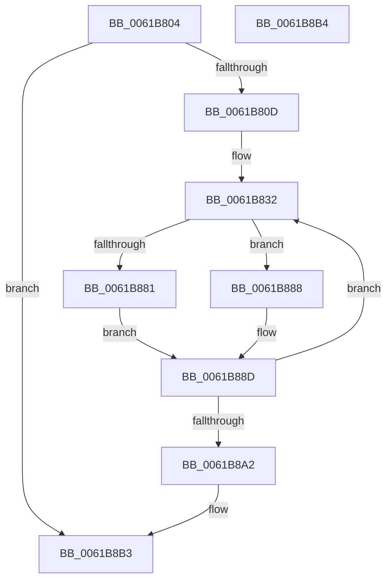

# AppendUlongAsHexadecimalW

- RVA: `0x0061B804`–`0x0061B8B5` (길이 `177` bytes)
- VA: `0x000000014061B804`
- 실행 섹션: `.text`
- PDB 이름 있음: `예`; PDB Function 태그: `아니요`
- unwind 정보 RVA: `0x000D2B40`
- 디코드: `44`개 명령, `177/177` bytes 표시
- 미해석 바이트: `0` (있으면 어셈블리에 `.byte`로 보존)

> 이 문서는 커널 이미지의 기계어와 PDB 기호를 분석해 생성했습니다. 4번과 5번은 함수 원형과 자료형을 바이너리 사용 방식에서 추정한 C 해석이며 원본 소스 복구 결과는 아닙니다.

## 1. Dependencies

- 직접 호출 지점: **1**; 고유 호출 대상: **1**
- 직접 호출자로 확인된 함수: **1**
- RIP 상대 이미지 참조: **1**

### Outgoing calls
- `0x0061B8A9` → [_security_check_cookie](../6A/_security_check_cookie_function_006AC640.md) (function, `0x006AC640`)

### Direct callers
- [CarInitializeTelemetryData](CarInitializeTelemetryData_function_00618BB0.md) at `0x00618D5E`
- [CarInitializeTelemetryData](CarInitializeTelemetryData_function_00618BB0.md) at `0x00618D72`

### Static image references
- `0x0061B815` → RVA `0x00E0A740` (`.data`; read)

## 2. Other-region calls and transfers

- 다른 실행 섹션으로 향하는 call: **0**
- 별도 외부 분기/꼬리 이동을 확인하지 못했습니다.

## 3. Assembly (complete function range)

```asm
0061B804  48 85 C9                        test rcx, rcx
0061B807  0F 84 A6 00 00 00               je 0x14061b8b3
0061B80D  55                              push rbp
0061B80E  48 8B EC                        mov rbp, rsp
0061B811  48 83 EC 30                     sub rsp, 0x30
0061B815  48 8B 05 24 EF 7E 00            mov rax, qword ptr [rip + 0x7eef24]
0061B81C  48 33 C4                        xor rax, rsp
0061B81F  48 89 45 F0                     mov qword ptr [rbp - 0x10], rax
0061B823  45 33 C0                        xor r8d, r8d
0061B826  4C 8B D9                        mov r11, rcx
0061B829  45 8B C8                        mov r9d, r8d
0061B82C  41 BA 00 00 00 F0               mov r10d, 0xf0000000
0061B832  B9 07 00 00 00                  mov ecx, 7
0061B837  C7 45 D0 30 00 31 00            mov dword ptr [rbp - 0x30], 0x310030
0061B83E  41 2B C8                        sub ecx, r8d
0061B841  C7 45 D4 32 00 33 00            mov dword ptr [rbp - 0x2c], 0x330032
0061B848  C1 E1 02                        shl ecx, 2
0061B84B  41 8B C2                        mov eax, r10d
0061B84E  23 C2                           and eax, edx
0061B850  C7 45 D8 34 00 35 00            mov dword ptr [rbp - 0x28], 0x350034
0061B857  D3 E8                           shr eax, cl
0061B859  C7 45 DC 36 00 37 00            mov dword ptr [rbp - 0x24], 0x370036
0061B860  C7 45 E0 38 00 39 00            mov dword ptr [rbp - 0x20], 0x390038
0061B867  C7 45 E4 41 00 42 00            mov dword ptr [rbp - 0x1c], 0x420041
0061B86E  C7 45 E8 43 00 44 00            mov dword ptr [rbp - 0x18], 0x440043
0061B875  C7 45 EC 45 00 46 00            mov dword ptr [rbp - 0x14], 0x460045
0061B87C  83 F8 0F                        cmp eax, 0xf
0061B87F  77 07                           ja 0x14061b888
0061B881  0F B7 4C 45 D0                  movzx ecx, word ptr [rbp + rax*2 - 0x30]
0061B886  EB 05                           jmp 0x14061b88d
0061B888  B9 3F 00 00 00                  mov ecx, 0x3f
0061B88D  66 43 89 0C 4B                  mov word ptr [r11 + r9*2], cx
0061B892  41 FF C0                        inc r8d
0061B895  49 FF C1                        inc r9
0061B898  41 C1 EA 04                     shr r10d, 4
0061B89C  49 83 F9 08                     cmp r9, 8
0061B8A0  7C 90                           jl 0x14061b832
0061B8A2  48 8B 4D F0                     mov rcx, qword ptr [rbp - 0x10]
0061B8A6  48 33 CC                        xor rcx, rsp
0061B8A9  E8 92 0D 09 00                  call 0x1406ac640
0061B8AE  48 83 C4 30                     add rsp, 0x30
0061B8B2  5D                              pop rbp
0061B8B3  C3                              ret
0061B8B4  CC                              int3
```

## 4. C-style interpretation (structured pseudocode)

```c
__int64 __fastcall AppendUlongAsHexadecimalW(__int64 a1, int a2, int a3)
{
    __int64 result;
    __int64 v_r10;
    __int64 v_rsp;
    unsigned __int64 v_stack_m18;
    unsigned int v_stack_m1C;
    unsigned int v_stack_m20;
    unsigned int v_stack_m24;
    unsigned int v_stack_m28;
    unsigned int v_stack_m2C;
    unsigned int v_stack_m30;
    unsigned int v_stack_m34;
    unsigned int v_stack_m38;

    if (a1 == 0) goto loc_0061B8B3;
    v_rsp = (v_rsp) - (48);
    result = (*(unsigned __int64 *)(v_rip + 8318756)) ^ (v_rsp);
    v_stack_m18 = result;
    a3 = 0;
loc_0061B832:
    v_stack_m38 = 0x310030ULL;
    a1 = (unsigned int)((7) - (0));
    v_stack_m34 = 0x330032ULL;
    a1 = (unsigned int)((a1) << (2));
    result = (unsigned int)(((unsigned int)((unsigned int)((unsigned int)(0xF0000000ULL)))) & (a2));
    v_stack_m30 = 0x350034ULL;
    result = (unsigned int)((result) >> ((unsigned __int8)(a1)));
    v_stack_m2C = 0x370036ULL;
    v_stack_m28 = 0x390038ULL;
    v_stack_m24 = 0x420041ULL;
    v_stack_m20 = 0x440043ULL;
    v_stack_m1C = 0x460045ULL;
    if (((unsigned int)(result)) > 15) goto loc_0061B888;
    goto loc_0061B88D;
loc_0061B888:
loc_0061B88D:
    *(unsigned __int16 *)(a1 + 0 * 2) = 63;
    a3 = (unsigned int)((a3) + 1);
    a4 = (0) + 1;
    v_r10 = (unsigned int)(((unsigned int)(0xF0000000ULL)) >> (4));
    if (a4 < 8) goto loc_0061B832;
    a1 = (v_stack_m18) ^ (v_rsp);
    result = _security_check_cookie(a1, a2, a3, a4);
    v_rsp = (v_rsp) + (48);
loc_0061B8B3:
    return result;
}
```

## 5. (Beta) C Style

```c
int64_t AppendUlongAsHexadecimalW(int64_t Arg1, int32_t Arg2, int32_t Arg3)
{
    int64_t result;
    int64_t local_r10;
    int64_t local_rsp;
    uint64_t v_stack_m18;
    uint32_t v_stack_m1C;
    uint32_t v_stack_m20;
    uint32_t v_stack_m24;
    uint32_t v_stack_m28;
    uint32_t v_stack_m2C;
    uint32_t v_stack_m30;
    uint32_t v_stack_m34;
    uint32_t v_stack_m38;

    if (Arg1 == 0) goto loc_0061B8B3;
    local_rsp = (local_rsp) - (48);
    result = (*(uint64_t *)(v_rip + 0x7EEF24)) ^ (local_rsp);
    v_stack_m18 = result;
    Arg3 = 0;
loc_0061B832:
    v_stack_m38 = 0x310030ULL;
    Arg1 = (uint32_t)((7) - (0));
    v_stack_m34 = 0x330032ULL;
    Arg1 = (uint32_t)((Arg1) << (2));
    result = (uint32_t)(((uint32_t)((uint32_t)((uint32_t)(0xF0000000ULL)))) & (Arg2));
    v_stack_m30 = 0x350034ULL;
    result = (uint32_t)((result) >> ((uint8_t)(Arg1)));
    v_stack_m2C = 0x370036ULL;
    v_stack_m28 = 0x390038ULL;
    v_stack_m24 = 0x420041ULL;
    v_stack_m20 = 0x440043ULL;
    v_stack_m1C = 0x460045ULL;
    if (((uint32_t)(result)) > 15) goto loc_0061B888;
    goto loc_0061B88D;
loc_0061B888:
loc_0061B88D:
    *(uint16_t *)(Arg1 + 0x0 * 2) = 63;
    Arg3 = (uint32_t)((Arg3) + 1);
    a4 = (0) + 1;
    local_r10 = (uint32_t)(((uint32_t)(0xF0000000ULL)) >> (4));
    if (a4 < 8) goto loc_0061B832;
    Arg1 = (v_stack_m18) ^ (local_rsp);
    result = _security_check_cookie(Arg1, Arg2, Arg3, a4);
    local_rsp = (local_rsp) + (48);
loc_0061B8B3:
    return result;
}
```

## 6. Execution-region graph

[열기: 2D/3D 그래프와 함수 탐색 컨트롤 패널](../../../control-panel.html?section=text&rva=0x0061B804&view=graph)

- 2D 그래프는 위에서 아래로 흐르고, 3D 그래프는 빈 공간을 드래그해 회전합니다. Shift+드래그는 이동, 휠은 확대·축소, 함수 노드 선택은 대상 보고서 이동입니다.

### Static fallback


