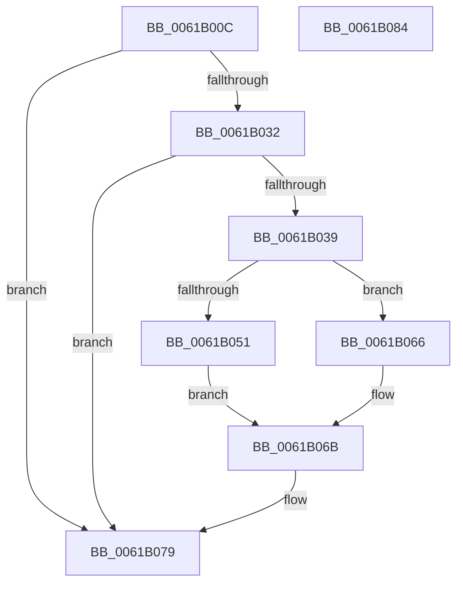

# CarAcquireDbLockAtDpcLevelSafe

- RVA: `0x0061B00C`–`0x0061B085` (길이 `121` bytes)
- VA: `0x000000014061B00C`
- 실행 섹션: `.text`
- PDB 이름 있음: `예`; PDB Function 태그: `아니요`
- unwind 정보 RVA: `0x0005CAAC`
- 디코드: `29`개 명령, `121/121` bytes 표시
- 미해석 바이트: `0` (있으면 어셈블리에 `.byte`로 보존)

> 이 문서는 커널 이미지의 기계어와 PDB 기호를 분석해 생성했습니다. 4번과 5번은 함수 원형과 자료형을 바이너리 사용 방식에서 추정한 C 해석이며 원본 소스 복구 결과는 아닙니다.

## 1. Dependencies

- 직접 호출 지점: **2**; 고유 호출 대상: **2**
- 직접 호출자로 확인된 함수: **5**
- RIP 상대 이미지 참조: **1**

### Outgoing calls
- `0x0061B051` → [ExAcquireSpinLockExclusiveAtDpcLevel](../24/ExAcquireSpinLockExclusiveAtDpcLevel_function_00248E80.md) (function, `0x00248E80`)
- `0x0061B066` → [ExAcquireSpinLockSharedAtDpcLevel](../24/ExAcquireSpinLockSharedAtDpcLevel_function_00248E30.md) (function, `0x00248E30`)

### Direct callers
- [CarAddUniqueViolation](CarAddUniqueViolation_function_0061B08C.md) at `0x0061B13C`
- [CarDeleteDriverRuleViolations](CarDeleteDriverRuleViolations_function_0061B38C.md) at `0x0061B3C5`
- [CarDeletePluginRuleViolations](CarDeletePluginRuleViolations_function_0061B440.md) at `0x0061B471`
- [CarDeleteRuleViolationDB](CarDeleteRuleViolationDB_function_0061B4D0.md) at `0x0061B500`
- [CarWriteEarlyRuleViolationEvents](CarWriteEarlyRuleViolationEvents_function_0061B628.md) at `0x0061B668`

### Static image references
- `0x0061B022` → RVA `0x00F03EA8` (`.data`; read)

## 2. Other-region calls and transfers

- 다른 실행 섹션으로 향하는 call: **0**
- 별도 외부 분기/꼬리 이동을 확인하지 못했습니다.

## 3. Assembly (complete function range)

```asm
0061B00C  48 89 5C 24 08                  mov qword ptr [rsp + 8], rbx
0061B011  57                              push rdi
0061B012  48 83 EC 20                     sub rsp, 0x20
0061B016  65 48 8B 14 25 88 01 00 00      mov rdx, qword ptr gs:[0x188]
0061B01F  48 8B D9                        mov rbx, rcx
0061B022  48 8B 05 7F 8E 8E 00            mov rax, qword ptr [rip + 0x8e8e7f]
0061B029  48 39 90 88 00 00 00            cmp qword ptr [rax + 0x88], rdx
0061B030  74 47                           je 0x14061b079
0061B032  8A 41 09                        mov al, byte ptr [rcx + 9]
0061B035  A8 02                           test al, 2
0061B037  75 40                           jne 0x14061b079
0061B039  65 48 8B 3C 25 88 01 00 00      mov rdi, qword ptr gs:[0x188]
0061B042  48 8B 0D 5F 8E 8E 00            mov rcx, qword ptr [rip + 0x8e8e5f]
0061B049  48 83 E9 80                     sub rcx, -0x80
0061B04D  A8 04                           test al, 4
0061B04F  74 15                           je 0x14061b066
0061B051  E8 2A DE C2 FF                  call 0x140248e80
0061B056  48 8B 05 4B 8E 8E 00            mov rax, qword ptr [rip + 0x8e8e4b]
0061B05D  48 89 B8 88 00 00 00            mov qword ptr [rax + 0x88], rdi
0061B064  EB 05                           jmp 0x14061b06b
0061B066  E8 C5 DD C2 FF                  call 0x140248e30
0061B06B  48 8B 05 36 8E 8E 00            mov rax, qword ptr [rip + 0x8e8e36]
0061B072  80 4B 09 02                     or byte ptr [rbx + 9], 2
0061B076  48 89 03                        mov qword ptr [rbx], rax
0061B079  48 8B 5C 24 30                  mov rbx, qword ptr [rsp + 0x30]
0061B07E  48 83 C4 20                     add rsp, 0x20
0061B082  5F                              pop rdi
0061B083  C3                              ret
0061B084  CC                              int3
```

## 4. C-style interpretation (structured pseudocode)

```c
__int64 __fastcall CarAcquireDbLockAtDpcLevelSafe(__int64 a1)
{
    __int64 result;
    __int64 v_rsp;
    unsigned __int64 v_stack_p8;

    v_stack_p8 = v_rbx;
    v_rsp = (v_rsp) - (32);
    if ((*(unsigned __int64 *)(*(unsigned __int64 *)(v_rip + 9342591) + 136)) == (*(unsigned __int64 *)(gs_base + (0 + 392)))) goto loc_0061B079;
    if ((((unsigned __int8)(*(unsigned __int8 *)(a1 + 9))) & (2)) != 0) goto loc_0061B079;
    a1 = (*(unsigned __int64 *)(v_rip + 9342559)) - (-128);
    if ((((unsigned __int8)(*(unsigned __int8 *)(a1 + 9))) & (4)) == 0) goto loc_0061B066;
    result = ExAcquireSpinLockExclusiveAtDpcLevel(a1, *(unsigned __int64 *)(gs_base + (0 + 392)), a3, a4);
    *(unsigned __int64 *)(*(unsigned __int64 *)(v_rip + 9342539) + 136) = *(unsigned __int64 *)(gs_base + (0 + 392));
    goto loc_0061B06B;
loc_0061B066:
    result = ExAcquireSpinLockSharedAtDpcLevel(a1, *(unsigned __int64 *)(gs_base + (0 + 392)), a3, a4);
loc_0061B06B:
    *(unsigned __int64 *)(a1) = *(unsigned __int64 *)(v_rip + 9342518);
loc_0061B079:
    v_rsp = (v_rsp) + (32);
    return *(unsigned __int64 *)(v_rip + 9342518);
}
```

## 5. (Beta) C Style

```c
int64_t CarAcquireDbLockAtDpcLevelSafe(void *Arg1)
{
    uint8_t *arg1 = (uint8_t *)Arg1;

    int64_t result;
    int64_t local_rsp;
    uint64_t v_stack_p8;

    v_stack_p8 = local_rbx;
    local_rsp = (local_rsp) - (32);
    if ((*(uint64_t *)(*(uint64_t *)(v_rip + 0x8E8E7F) + 0x88)) == (*(uint64_t *)(gs_base + (0 + 0x188)))) goto loc_0061B079;
    if ((((uint8_t)(*(uint8_t *)(arg1 + 0x9))) & (2)) != 0) goto loc_0061B079;
    Arg1 = (*(uint64_t *)(v_rip + 0x8E8E5F)) - (-128);
    if ((((uint8_t)(*(uint8_t *)(arg1 + 0x9))) & (4)) == 0) goto loc_0061B066;
    result = ExAcquireSpinLockExclusiveAtDpcLevel(Arg1, *(uint64_t *)(gs_base + (0 + 0x188)), a3, a4);
    *(uint64_t *)(*(uint64_t *)(v_rip + 0x8E8E4B) + 0x88) = *(uint64_t *)(gs_base + (0 + 0x188));
    goto loc_0061B06B;
loc_0061B066:
    result = ExAcquireSpinLockSharedAtDpcLevel(Arg1, *(uint64_t *)(gs_base + (0 + 0x188)), a3, a4);
loc_0061B06B:
    *(uint64_t *)(arg1) = *(uint64_t *)(v_rip + 0x8E8E36);
loc_0061B079:
    local_rsp = (local_rsp) + (32);
    return *(uint64_t *)(v_rip + 0x8E8E36);
}
```

### 관측된 메모리 오프셋

구조체 형식이 확인되지 않은 접근은 인자 기준의 오프셋으로만 기록했습니다.

| 기준 인자 | 오프셋 표현 | 폭 (bit) | 접근 |
|---|---:|---:|---|
| `Arg1` | `+ 0x0` | `64` | `W` |
| `Arg1` | `+ 0x9` | `8` | `R` |
| `Arg1` | `+ 0x9` | `8` | `R/W` |

## 6. Execution-region graph

[열기: 2D/3D 그래프와 함수 탐색 컨트롤 패널](../../../control-panel.html?section=text&rva=0x0061B00C&view=graph)

- 2D 그래프는 위에서 아래로 흐르고, 3D 그래프는 빈 공간을 드래그해 회전합니다. Shift+드래그는 이동, 휠은 확대·축소, 함수 노드 선택은 대상 보고서 이동입니다.

### Static fallback


