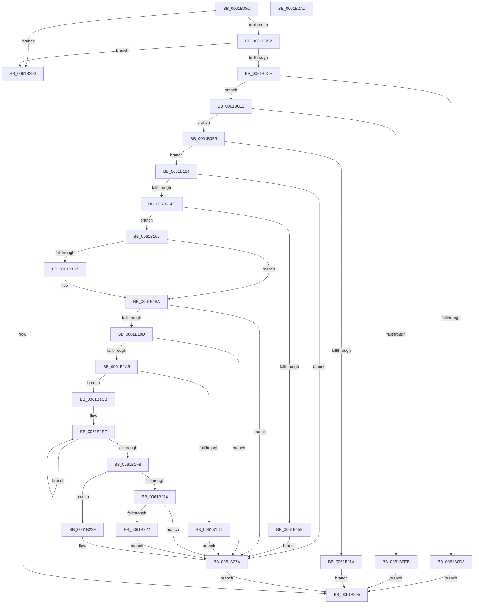

# CarAddUniqueViolation

- RVA: `0x0061B08C`–`0x0061B2AE` (길이 `546` bytes)
- VA: `0x000000014061B08C`
- 실행 섹션: `.text`
- PDB 이름 있음: `예`; PDB Function 태그: `아니요`
- unwind 정보 RVA: `0x000D2B24`
- 디코드: `146`개 명령, `546/546` bytes 표시
- 미해석 바이트: `0` (있으면 어셈블리에 `.byte`로 보존)

> 이 문서는 커널 이미지의 기계어와 PDB 기호를 분석해 생성했습니다. 4번과 5번은 함수 원형과 자료형을 바이너리 사용 방식에서 추정한 C 해석이며 원본 소스 복구 결과는 아닙니다.

## 1. Dependencies

- 직접 호출 지점: **9**; 고유 호출 대상: **8**
- 직접 호출자로 확인된 함수: **1**
- RIP 상대 이미지 참조: **3**

### Outgoing calls
- `0x0061B133` → [CarDbRaiseIrqlSafe](CarDbRaiseIrqlSafe_function_0061396C.md) (function, `0x0061396C`)
- `0x0061B13C` → [CarAcquireDbLockAtDpcLevelSafe](CarAcquireDbLockAtDpcLevelSafe_function_0061B00C.md) (function, `0x0061B00C`)
- `0x0061B177` → [RtlInsertElementGenericTableAvl](../3E/RtlInsertElementGenericTableAvl_function_003EE510.md) (function, `0x003EE510`)
- `0x0061B1B3` → [ExAllocatePool2](../../poolcode/B8/ExAllocatePool2_function_00B820F0.md) (function, `0x00B820F0`)
- `0x0061B207` → [ExAllocatePool2](../../poolcode/B8/ExAllocatePool2_function_00B820F0.md) (function, `0x00B820F0`)
- `0x0061B224` → [ExFreePoolWithTag](../../poolcode/B8/ExFreePoolWithTag_function_00B82870.md) (function, `0x00B82870`)
- `0x0061B238` → [memcpy](../6C/memcpy_function_006C6840.md) (function, `0x006C6840`)
- `0x0061B27E` → [CarReleaseDbLockFromDpcLevel](CarReleaseDbLockFromDpcLevel_function_0061B5DC.md) (function, `0x0061B5DC`)
- `0x0061B287` → [CarCleanDbLockContext](CarCleanDbLockContext_function_0061B2E4.md) (function, `0x0061B2E4`)

### Direct callers
- [CarHandleEtwEvent](CarHandleEtwEvent_function_00617FBC.md) at `0x0061802E`

### Static image references
- `0x0061B0F5` → RVA `0x00F03EA8` (`.data`; read)
- `0x0061B141` → RVA `0x00F03EB0` (`.data`; read)
- `0x0061B18A` → RVA `0x00F03EE0` (`.data`; read)

## 2. Other-region calls and transfers

- 다른 실행 섹션으로 향하는 call: **3**
  - `0x0061B1B3` → [ExAllocatePool2](../../poolcode/B8/ExAllocatePool2_function_00B820F0.md) (`.text` → `POOLCODE`)
  - `0x0061B207` → [ExAllocatePool2](../../poolcode/B8/ExAllocatePool2_function_00B820F0.md) (`.text` → `POOLCODE`)
  - `0x0061B224` → [ExFreePoolWithTag](../../poolcode/B8/ExFreePoolWithTag_function_00B82870.md) (`.text` → `POOLCODE`)
- 별도 외부 분기/꼬리 이동을 확인하지 못했습니다.

## 3. Assembly (complete function range)

```asm
0061B08C  48 89 5C 24 08                  mov qword ptr [rsp + 8], rbx
0061B091  44 88 44 24 18                  mov byte ptr [rsp + 0x18], r8b
0061B096  89 54 24 10                     mov dword ptr [rsp + 0x10], edx
0061B09A  55                              push rbp
0061B09B  56                              push rsi
0061B09C  57                              push rdi
0061B09D  41 54                           push r12
0061B09F  41 55                           push r13
0061B0A1  41 56                           push r14
0061B0A3  41 57                           push r15
0061B0A5  48 8B EC                        mov rbp, rsp
0061B0A8  48 83 EC 50                     sub rsp, 0x50
0061B0AC  45 33 E4                        xor r12d, r12d
0061B0AF  49 8B F1                        mov rsi, r9
0061B0B2  44 88 65 58                     mov byte ptr [rbp + 0x58], r12b
0061B0B6  41 8B FC                        mov edi, r12d
0061B0B9  4D 85 C9                        test r9, r9
0061B0BC  0F 84 CE 01 00 00               je 0x14061b290
0061B0C2  49 8D 41 04                     lea rax, [r9 + 4]
0061B0C6  48 85 C0                        test rax, rax
0061B0C9  0F 84 C1 01 00 00               je 0x14061b290
0061B0CF  4C 8B 7D 60                     mov r15, qword ptr [rbp + 0x60]
0061B0D3  4D 85 FF                        test r15, r15
0061B0D6  75 0A                           jne 0x14061b0e2
0061B0D8  B8 EF 00 00 C0                  mov eax, 0xc00000ef
0061B0DD  E9 B3 01 00 00                  jmp 0x14061b295
0061B0E2  4C 8B 75 78                     mov r14, qword ptr [rbp + 0x78]
0061B0E6  4D 85 F6                        test r14, r14
0061B0E9  75 0A                           jne 0x14061b0f5
0061B0EB  B8 F0 00 00 C0                  mov eax, 0xc00000f0
0061B0F0  E9 A0 01 00 00                  jmp 0x14061b295
0061B0F5  4C 39 25 AC 8D 8E 00            cmp qword ptr [rip + 0x8e8dac], r12
0061B0FC  4C 8B 6D 68                     mov r13, qword ptr [rbp + 0x68]
0061B100  8B 45 70                        mov eax, dword ptr [rbp + 0x70]
0061B103  4C 89 6D E8                     mov qword ptr [rbp - 0x18], r13
0061B107  4C 89 65 F4                     mov qword ptr [rbp - 0xc], r12
0061B10B  44 89 65 FC                     mov dword ptr [rbp - 4], r12d
0061B10F  89 4D E0                        mov dword ptr [rbp - 0x20], ecx
0061B112  89 55 E4                        mov dword ptr [rbp - 0x1c], edx
0061B115  89 45 F0                        mov dword ptr [rbp - 0x10], eax
0061B118  75 0A                           jne 0x14061b124
0061B11A  B8 BB 00 00 C0                  mov eax, 0xc00000bb
0061B11F  E9 71 01 00 00                  jmp 0x14061b295
0061B124  0F 57 C0                        xorps xmm0, xmm0
0061B127  48 8D 4D D0                     lea rcx, [rbp - 0x30]
0061B12B  0F 11 45 D0                     movups xmmword ptr [rbp - 0x30], xmm0
0061B12F  C6 45 D9 04                     mov byte ptr [rbp - 0x27], 4
0061B133  E8 34 88 FF FF                  call 0x14061396c
0061B138  48 8D 4D D0                     lea rcx, [rbp - 0x30]
0061B13C  E8 CB FE FF FF                  call 0x14061b00c
0061B141  8B 05 69 8D 8E 00               mov eax, dword ptr [rip + 0x8e8d69]
0061B147  85 C0                           test eax, eax
0061B149  0F 84 2B 01 00 00               je 0x14061b27a
0061B14F  48 8B 0D 52 8D 8E 00            mov rcx, qword ptr [rip + 0x8e8d52]
0061B156  81 79 2C 40 42 0F 00            cmp dword ptr [rcx + 0x2c], 0xf4240
0061B15D  72 0A                           jb 0x14061b169
0061B15F  BF 0E 02 00 C0                  mov edi, 0xc000020e
0061B164  E9 11 01 00 00                  jmp 0x14061b27a
0061B169  4C 8D 4D 58                     lea r9, [rbp + 0x58]
0061B16D  41 B8 20 00 00 00               mov r8d, 0x20
0061B173  48 8D 55 E0                     lea rdx, [rbp - 0x20]
0061B177  E8 94 33 DD FF                  call 0x1403ee510
0061B17C  8A 4D 58                        mov cl, byte ptr [rbp + 0x58]
0061B17F  48 8B D8                        mov rbx, rax
0061B182  48 85 C0                        test rax, rax
0061B185  74 03                           je 0x14061b18a
0061B187  FF 40 14                        inc dword ptr [rax + 0x14]
0061B18A  44 38 25 4F 8D 8E 00            cmp byte ptr [rip + 0x8e8d4f], r12b
0061B191  8B 40 14                        mov eax, dword ptr [rax + 0x14]
0061B194  41 89 06                        mov dword ptr [r14], eax
0061B197  0F 85 DD 00 00 00               jne 0x14061b27a
0061B19D  84 C9                           test cl, cl
0061B19F  0F 84 D5 00 00 00               je 0x14061b27a
0061B1A5  BA 68 00 00 00                  mov edx, 0x68
0061B1AA  41 B8 43 61 72 4E               mov r8d, 0x4e726143
0061B1B0  8D 4A D8                        lea ecx, [rdx - 0x28]
0061B1B3  E8 38 6F 56 00                  call 0x140b820f0
0061B1B8  48 89 43 18                     mov qword ptr [rbx + 0x18], rax
0061B1BC  48 85 C0                        test rax, rax
0061B1BF  75 0A                           jne 0x14061b1cb
0061B1C1  BF 17 00 00 C0                  mov edi, 0xc0000017
0061B1C6  E9 AF 00 00 00                  jmp 0x14061b27a
0061B1CB  0F 10 46 04                     movups xmm0, xmmword ptr [rsi + 4]
0061B1CF  49 83 CE FF                     or r14, 0xffffffffffffffff
0061B1D3  0F 11 40 02                     movups xmmword ptr [rax + 2], xmm0
0061B1D7  0F 10 4E 14                     movups xmm1, xmmword ptr [rsi + 0x14]
0061B1DB  0F 11 48 12                     movups xmmword ptr [rax + 0x12], xmm1
0061B1DF  0F 10 46 24                     movups xmm0, xmmword ptr [rsi + 0x24]
0061B1E3  0F 11 40 22                     movups xmmword ptr [rax + 0x22], xmm0
0061B1E7  0F 10 4E 34                     movups xmm1, xmmword ptr [rsi + 0x34]
0061B1EB  0F 11 48 32                     movups xmmword ptr [rax + 0x32], xmm1
0061B1EF  49 FF C6                        inc r14
0061B1F2  47 38 24 37                     cmp byte ptr [r15 + r14], r12b
0061B1F6  75 F7                           jne 0x14061b1ef
0061B1F8  41 8D 56 01                     lea edx, [r14 + 1]
0061B1FC  B9 40 00 00 00                  mov ecx, 0x40
0061B201  41 B8 43 61 72 4E               mov r8d, 0x4e726143
0061B207  E8 E4 6E 56 00                  call 0x140b820f0
0061B20C  4C 8B E0                        mov r12, rax
0061B20F  48 85 C0                        test rax, rax
0061B212  75 1B                           jne 0x14061b22f
0061B214  48 8B 4B 18                     mov rcx, qword ptr [rbx + 0x18]
0061B218  BF 17 00 00 C0                  mov edi, 0xc0000017
0061B21D  48 85 C9                        test rcx, rcx
0061B220  74 58                           je 0x14061b27a
0061B222  33 D2                           xor edx, edx
0061B224  E8 47 76 56 00                  call 0x140b82870
0061B229  4C 21 63 18                     and qword ptr [rbx + 0x18], r12
0061B22D  EB 4B                           jmp 0x14061b27a
0061B22F  45 8B C6                        mov r8d, r14d
0061B232  49 8B D7                        mov rdx, r15
0061B235  49 8B CC                        mov rcx, r12
0061B238  E8 03 B6 0A 00                  call 0x1406c6840
0061B23D  48 8B 43 18                     mov rax, qword ptr [rbx + 0x18]
0061B241  8A 4D 50                        mov cl, byte ptr [rbp + 0x50]
0061B244  4C 89 60 48                     mov qword ptr [rax + 0x48], r12
0061B248  48 8B 43 18                     mov rax, qword ptr [rbx + 0x18]
0061B24C  88 08                           mov byte ptr [rax], cl
0061B24E  48 8B 43 18                     mov rax, qword ptr [rbx + 0x18]
0061B252  8B 4D 48                        mov ecx, dword ptr [rbp + 0x48]
0061B255  89 48 50                        mov dword ptr [rax + 0x50], ecx
0061B258  48 8B 4B 18                     mov rcx, qword ptr [rbx + 0x18]
0061B25C  4C 89 69 58                     mov qword ptr [rcx + 0x58], r13
0061B260  8B 8E 64 04 00 00               mov ecx, dword ptr [rsi + 0x464]
0061B266  48 8B 53 18                     mov rdx, qword ptr [rbx + 0x18]
0061B26A  89 4A 60                        mov dword ptr [rdx + 0x60], ecx
0061B26D  48 8B 0D 34 8C 8E 00            mov rcx, qword ptr [rip + 0x8e8c34]
0061B274  FF 81 90 00 00 00               inc dword ptr [rcx + 0x90]
0061B27A  48 8D 4D D0                     lea rcx, [rbp - 0x30]
0061B27E  E8 59 03 00 00                  call 0x14061b5dc
0061B283  48 8D 4D D0                     lea rcx, [rbp - 0x30]
0061B287  E8 58 00 00 00                  call 0x14061b2e4
0061B28C  8B C7                           mov eax, edi
0061B28E  EB 05                           jmp 0x14061b295
0061B290  B8 0D 00 00 C0                  mov eax, 0xc000000d
0061B295  48 8B 9C 24 90 00 00 00         mov rbx, qword ptr [rsp + 0x90]
0061B29D  48 83 C4 50                     add rsp, 0x50
0061B2A1  41 5F                           pop r15
0061B2A3  41 5E                           pop r14
0061B2A5  41 5D                           pop r13
0061B2A7  41 5C                           pop r12
0061B2A9  5F                              pop rdi
0061B2AA  5E                              pop rsi
0061B2AB  5D                              pop rbp
0061B2AC  C3                              ret
0061B2AD  CC                              int3
```

## 4. C-style interpretation (structured pseudocode)

```c
__int64 __fastcall CarAddUniqueViolation(int a1, int a2, unsigned __int8 a3, __int64 a4, __int64 a5, __int64 a6, unsigned int a7, __int64 a8)
{
    __int64 result;
    __int64 v_r12;
    __int64 v_r14;
    __int64 v_rsp;
    unsigned int v_stack_m3C;
    unsigned __int64 v_stack_m44;
    unsigned int v_stack_m48;
    unsigned __int64 v_stack_m50;
    unsigned int v_stack_m54;
    unsigned int v_stack_m58;
    unsigned __int8 v_stack_m5F;
    unsigned __int64 v_stack_m68;
    unsigned int v_stack_p10;
    unsigned __int8 v_stack_p18;
    unsigned __int8 v_stack_p20;
    unsigned __int64 v_stack_p8;

    v_stack_p8 = v_rbx;
    v_stack_p18 = a3;
    v_stack_p10 = a2;
    v_rsp = (v_rsp) - (80);
    v_r12 = 0;
    v_stack_p20 = 0;
    if (a4 == 0) goto loc_0061B290;
    if (a4 + 4 == 0) goto loc_0061B290;
    if (a5 != 0) goto loc_0061B0E2;
    goto loc_0061B295;
loc_0061B0E2:
    if (a8 != 0) goto loc_0061B0F5;
    goto loc_0061B295;
loc_0061B0F5:
    v_stack_m50 = a6;
    v_stack_m44 = 0;
    v_stack_m3C = 0;
    v_stack_m58 = a1;
    v_stack_m54 = a2;
    v_stack_m48 = (unsigned int)((unsigned int)(a7));
    if ((*(unsigned __int64 *)(v_rip + 9342380)) != 0) goto loc_0061B124;
    goto loc_0061B295;
loc_0061B124:
    v_stack_m68 = v_xmm0;
    v_stack_m5F = 4;
    result = CarDbRaiseIrqlSafe(v_stack_m68, a2, a3, a4);
    result = CarAcquireDbLockAtDpcLevelSafe(v_stack_m68, a2, a3, a4);
    if ((unsigned int)((unsigned int)(*(unsigned int *)(v_rip + 9342313))) == 0) goto loc_0061B27A;
    if ((*(unsigned int *)(*(unsigned __int64 *)(v_rip + 9342290) + 44)) < 0xF4240ULL) goto loc_0061B169;
    goto loc_0061B27A;
loc_0061B169:
    result = RtlInsertElementGenericTableAvl(*(unsigned __int64 *)(v_rip + 9342290), v_stack_m58, 32, v_stack_p20);
    if (result != 0) {
    }
    *(unsigned int *)(a8) = (unsigned int)((unsigned int)(*(unsigned int *)(result + 20)));
    if ((*(unsigned __int8 *)(v_rip + 9342287)) != 0) goto loc_0061B27A;
    if ((unsigned __int8)(v_stack_p20) == 0) goto loc_0061B27A;
    result = ExAllocatePool2(104 - 40, 104, (unsigned int)(0x4E726143ULL), v_stack_p20);
    *(unsigned __int64 *)(result + 24) = result;
    if (result != 0) goto loc_0061B1CB;
    goto loc_0061B27A;
loc_0061B1CB:
    v_r14 = (a8) | (-1);
    *(unsigned __int64 *)(result + 2) = v_xmm0;
    *(unsigned __int64 *)(result + 18) = v_xmm1;
    *(unsigned __int64 *)(result + 34) = v_xmm0;
    *(unsigned __int64 *)(result + 50) = v_xmm1;
loc_0061B1EF:
    v_r14 = (v_r14) + 1;
    if ((*(unsigned __int8 *)(a5 + v_r14 * 1)) != 0) goto loc_0061B1EF;
    result = ExAllocatePool2(64, v_r14 + 1, (unsigned int)(0x4E726143ULL), v_stack_p20);
    if (result != 0) goto loc_0061B22F;
    if (*(unsigned __int64 *)(result + 24) == 0) goto loc_0061B27A;
    a2 = 0;
    result = ExFreePoolWithTag(*(unsigned __int64 *)(result + 24), a2, (unsigned int)(0x4E726143ULL), v_stack_p20);
    goto loc_0061B27A;
loc_0061B22F:
    result = memcpy(result, a5, (unsigned int)((unsigned int)(v_r14)), v_stack_p20);
    *(unsigned __int64 *)(*(unsigned __int64 *)(result + 24) + 72) = result;
    *(unsigned __int8 *)(*(unsigned __int64 *)(result + 24)) = (unsigned __int8)(v_stack_p18);
    *(unsigned int *)(*(unsigned __int64 *)(result + 24) + 80) = (unsigned int)((unsigned int)(v_stack_p10));
    *(unsigned __int64 *)(*(unsigned __int64 *)(result + 24) + 88) = a6;
    *(unsigned int *)(*(unsigned __int64 *)(result + 24) + 96) = (unsigned int)((unsigned int)(*(unsigned int *)(a4 + 1124)));
loc_0061B27A:
    result = CarReleaseDbLockFromDpcLevel(v_stack_m68, *(unsigned __int64 *)(result + 24), (unsigned int)((unsigned int)(v_r14)), v_stack_p20);
    result = CarCleanDbLockContext(v_stack_m68, *(unsigned __int64 *)(result + 24), (unsigned int)((unsigned int)(v_r14)), v_stack_p20);
    goto loc_0061B295;
loc_0061B290:
loc_0061B295:
    v_rsp = (v_rsp) + (80);
    return (unsigned int)(0xC000000DULL);
}
```

## 5. (Beta) C Style

```c
int64_t CarAddUniqueViolation(int32_t Arg1, int32_t Arg2, uint8_t Arg3, void *Arg4, int64_t Arg5, int64_t Arg6, uint32_t Arg7, int64_t Arg8)
{
    uint8_t *arg4 = (uint8_t *)Arg4;

    int64_t result;
    int64_t local_r12;
    int64_t local_r14;
    int64_t local_rsp;
    uint32_t v_stack_m3C;
    uint64_t v_stack_m44;
    uint32_t v_stack_m48;
    uint64_t v_stack_m50;
    uint32_t v_stack_m54;
    uint32_t v_stack_m58;
    uint8_t v_stack_m5F;
    uint64_t v_stack_m68;
    uint32_t v_stack_p10;
    uint8_t v_stack_p18;
    uint8_t v_stack_p20;
    uint64_t v_stack_p8;

    v_stack_p8 = local_rbx;
    v_stack_p18 = Arg3;
    v_stack_p10 = Arg2;
    local_rsp = (local_rsp) - (80);
    local_r12 = 0;
    v_stack_p20 = 0;
    if (Arg4 == NULL) goto loc_0061B290;
    if (Arg4 + 4 == 0) goto loc_0061B290;
    if (Arg5 != 0) goto loc_0061B0E2;
    goto loc_0061B295;
loc_0061B0E2:
    if (Arg8 != 0) goto loc_0061B0F5;
    goto loc_0061B295;
loc_0061B0F5:
    v_stack_m50 = Arg6;
    v_stack_m44 = 0;
    v_stack_m3C = 0;
    v_stack_m58 = Arg1;
    v_stack_m54 = Arg2;
    v_stack_m48 = (uint32_t)((uint32_t)(Arg7));
    if ((*(uint64_t *)(v_rip + 0x8E8DAC)) != 0) goto loc_0061B124;
    goto loc_0061B295;
loc_0061B124:
    v_stack_m68 = v_xmm0;
    v_stack_m5F = 4;
    result = CarDbRaiseIrqlSafe(v_stack_m68, Arg2, Arg3, Arg4);
    result = CarAcquireDbLockAtDpcLevelSafe(v_stack_m68, Arg2, Arg3, Arg4);
    if ((uint32_t)((uint32_t)(*(uint32_t *)(v_rip + 0x8E8D69))) == 0) goto loc_0061B27A;
    if ((*(uint32_t *)(*(uint64_t *)(v_rip + 0x8E8D52) + 0x2C)) < 0xF4240ULL) goto loc_0061B169;
    goto loc_0061B27A;
loc_0061B169:
    result = RtlInsertElementGenericTableAvl(*(uint64_t *)(v_rip + 0x8E8D52), v_stack_m58, 32, v_stack_p20);
    if (result != 0) {
    }
    *(uint32_t *)(Arg8) = (uint32_t)((uint32_t)(*(uint32_t *)(result + 0x14)));
    if ((*(uint8_t *)(v_rip + 0x8E8D4F)) != 0) goto loc_0061B27A;
    if ((uint8_t)(v_stack_p20) == 0) goto loc_0061B27A;
    result = ExAllocatePool2(104 - 40, 104, (uint32_t)(0x4E726143ULL), v_stack_p20);
    *(uint64_t *)(result + 0x18) = result;
    if (result != 0) goto loc_0061B1CB;
    goto loc_0061B27A;
loc_0061B1CB:
    local_r14 = (Arg8) | (-1);
    *(uint64_t *)(result + 0x2) = v_xmm0;
    *(uint64_t *)(result + 0x12) = v_xmm1;
    *(uint64_t *)(result + 0x22) = v_xmm0;
    *(uint64_t *)(result + 0x32) = v_xmm1;
loc_0061B1EF:
    local_r14 = (local_r14) + 1;
    if ((*(uint8_t *)(Arg5 + local_r14 * 1)) != 0) goto loc_0061B1EF;
    result = ExAllocatePool2(64, local_r14 + 1, (uint32_t)(0x4E726143ULL), v_stack_p20);
    if (result != 0) goto loc_0061B22F;
    if (*(uint64_t *)(result + 0x18) == 0) goto loc_0061B27A;
    Arg2 = 0;
    result = ExFreePoolWithTag(*(uint64_t *)(result + 0x18), Arg2, (uint32_t)(0x4E726143ULL), v_stack_p20);
    goto loc_0061B27A;
loc_0061B22F:
    result = memcpy(result, Arg5, (uint32_t)((uint32_t)(local_r14)), v_stack_p20);
    *(uint64_t *)(*(uint64_t *)(result + 0x18) + 0x48) = result;
    *(uint8_t *)(*(uint64_t *)(result + 0x18)) = (uint8_t)(v_stack_p18);
    *(uint32_t *)(*(uint64_t *)(result + 0x18) + 0x50) = (uint32_t)((uint32_t)(v_stack_p10));
    *(uint64_t *)(*(uint64_t *)(result + 0x18) + 0x58) = Arg6;
    *(uint32_t *)(*(uint64_t *)(result + 0x18) + 0x60) = (uint32_t)((uint32_t)(*(uint32_t *)(arg4 + 0x464)));
loc_0061B27A:
    result = CarReleaseDbLockFromDpcLevel(v_stack_m68, *(uint64_t *)(result + 0x18), (uint32_t)((uint32_t)(local_r14)), v_stack_p20);
    result = CarCleanDbLockContext(v_stack_m68, *(uint64_t *)(result + 0x18), (uint32_t)((uint32_t)(local_r14)), v_stack_p20);
    goto loc_0061B295;
loc_0061B290:
loc_0061B295:
    local_rsp = (local_rsp) + (80);
    return (uint32_t)(0xC000000DULL);
}
```

### 관측된 메모리 오프셋

구조체 형식이 확인되지 않은 접근은 인자 기준의 오프셋으로만 기록했습니다.

| 기준 인자 | 오프셋 표현 | 폭 (bit) | 접근 |
|---|---:|---:|---|
| `Arg4` | `+ 0x4` | `128` | `R` |
| `Arg4` | `+ 0x14` | `128` | `R` |
| `Arg4` | `+ 0x24` | `128` | `R` |
| `Arg4` | `+ 0x34` | `128` | `R` |
| `Arg4` | `+ 0x464` | `32` | `R` |

## 6. Execution-region graph

[열기: 2D/3D 그래프와 함수 탐색 컨트롤 패널](../../../control-panel.html?section=text&rva=0x0061B08C&view=graph)

- 2D 그래프는 위에서 아래로 흐르고, 3D 그래프는 빈 공간을 드래그해 회전합니다. Shift+드래그는 이동, 휠은 확대·축소, 함수 노드 선택은 대상 보고서 이동입니다.

### Static fallback


