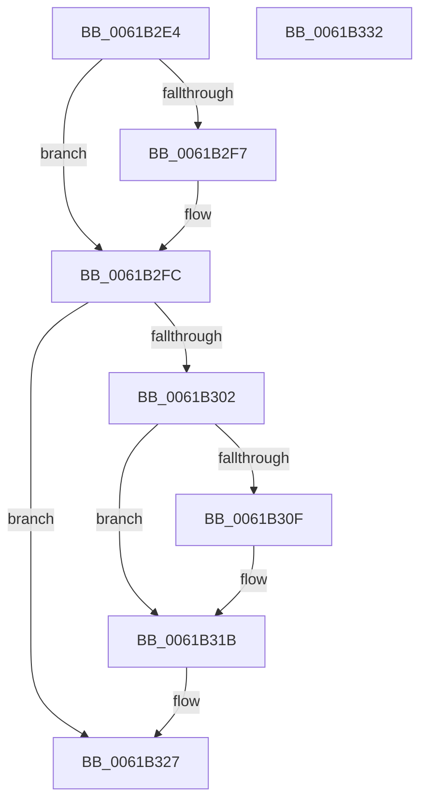

# CarCleanDbLockContext

- RVA: `0x0061B2E4`–`0x0061B333` (길이 `79` bytes)
- VA: `0x000000014061B2E4`
- 실행 섹션: `.text`
- PDB 이름 있음: `예`; PDB Function 태그: `아니요`
- unwind 정보 RVA: `0x0005CAAC`
- 디코드: `23`개 명령, `79/79` bytes 표시
- 미해석 바이트: `0` (있으면 어셈블리에 `.byte`로 보존)

> 이 문서는 커널 이미지의 기계어와 PDB 기호를 분석해 생성했습니다. 4번과 5번은 함수 원형과 자료형을 바이너리 사용 방식에서 추정한 C 해석이며 원본 소스 복구 결과는 아닙니다.

## 1. Dependencies

- 직접 호출 지점: **2**; 고유 호출 대상: **2**
- 직접 호출자로 확인된 함수: **5**
- RIP 상대 이미지 참조: **1**

### Outgoing calls
- `0x0061B2F7` → [CarReleaseDbLockFromDpcLevel](CarReleaseDbLockFromDpcLevel_function_0061B5DC.md) (function, `0x0061B5DC`)
- `0x0061B316` → [KiLowerIrqlProcessIrqlFlags](../4F/KiLowerIrqlProcessIrqlFlags_function_004F5698.md) (function, `0x004F5698`)

### Direct callers
- [CarAddUniqueViolation](CarAddUniqueViolation_function_0061B08C.md) at `0x0061B287`
- [CarDeleteDriverRuleViolations](CarDeleteDriverRuleViolations_function_0061B38C.md) at `0x0061B41A`
- [CarDeletePluginRuleViolations](CarDeletePluginRuleViolations_function_0061B440.md) at `0x0061B4B8`
- [CarDeleteRuleViolationDB](CarDeleteRuleViolationDB_function_0061B4D0.md) at `0x0061B549`
- [CarWriteEarlyRuleViolationEvents](CarWriteEarlyRuleViolationEvents_function_0061B628.md) at `0x0061B6EA`

### Static image references
- `0x0061B302` → RVA `0x00FC6D20` (`ALMOSTRO`; read)

## 2. Other-region calls and transfers

- 다른 실행 섹션으로 향하는 call: **0**
- 별도 외부 분기/꼬리 이동을 확인하지 못했습니다.

## 3. Assembly (complete function range)

```asm
0061B2E4  48 89 5C 24 08                  mov qword ptr [rsp + 8], rbx
0061B2E9  57                              push rdi
0061B2EA  48 83 EC 20                     sub rsp, 0x20
0061B2EE  F6 41 09 02                     test byte ptr [rcx + 9], 2
0061B2F2  48 8B D9                        mov rbx, rcx
0061B2F5  74 05                           je 0x14061b2fc
0061B2F7  E8 E0 02 00 00                  call 0x14061b5dc
0061B2FC  F6 43 09 01                     test byte ptr [rbx + 9], 1
0061B300  74 25                           je 0x14061b327
0061B302  83 3D 17 BA 9A 00 00            cmp dword ptr [rip + 0x9aba17], 0
0061B309  0F B6 7B 08                     movzx edi, byte ptr [rbx + 8]
0061B30D  74 0C                           je 0x14061b31b
0061B30F  44 0F 20 C1                     mov rcx, cr8
0061B313  40 8A D7                        mov dl, dil
0061B316  E8 7D A3 ED FF                  call 0x1404f5698
0061B31B  44 0F 22 C7                     mov cr8, rdi
0061B31F  80 63 09 FE                     and byte ptr [rbx + 9], 0xfe
0061B323  C6 43 08 00                     mov byte ptr [rbx + 8], 0
0061B327  48 8B 5C 24 30                  mov rbx, qword ptr [rsp + 0x30]
0061B32C  48 83 C4 20                     add rsp, 0x20
0061B330  5F                              pop rdi
0061B331  C3                              ret
0061B332  CC                              int3
```

## 4. C-style interpretation (structured pseudocode)

```c
__int64 __fastcall CarCleanDbLockContext(__int64 a1)
{
    __int64 result;
    __int64 v_rsp;
    unsigned __int64 v_stack_p8;

    v_stack_p8 = v_rbx;
    v_rsp = (v_rsp) - (32);
    if (((*(unsigned __int8 *)(a1 + 9)) & (2)) != 0) {
        result = CarReleaseDbLockFromDpcLevel(a1, a2, a3, a4);
    }
    if (((*(unsigned __int8 *)(a1 + 9)) & (1)) == 0) goto loc_0061B327;
    if ((*(unsigned int *)(v_rip + 10140183)) != 0) {
        a1 = v_cr8;
        a2 = (unsigned __int8)(*(unsigned __int8 *)(a1 + 8));
        result = KiLowerIrqlProcessIrqlFlags(a1, a2, a3, a4);
    }
    *(unsigned __int8 *)(a1 + 8) = 0;
loc_0061B327:
    v_rsp = (v_rsp) + (32);
    return result;
}
```

## 5. (Beta) C Style

```c
int64_t CarCleanDbLockContext(void *Arg1)
{
    uint8_t *arg1 = (uint8_t *)Arg1;

    int64_t result;
    int64_t local_rsp;
    uint64_t v_stack_p8;

    v_stack_p8 = local_rbx;
    local_rsp = (local_rsp) - (32);
    if (((*(uint8_t *)(arg1 + 0x9)) & (2)) != 0) {
        result = CarReleaseDbLockFromDpcLevel(Arg1, a2, a3, a4);
    }
    if (((*(uint8_t *)(arg1 + 0x9)) & (1)) == 0) goto loc_0061B327;
    if ((*(uint32_t *)(v_rip + 0x9ABA17)) != 0) {
        Arg1 = v_cr8;
        a2 = (uint8_t)(*(uint8_t *)(arg1 + 0x8));
        result = KiLowerIrqlProcessIrqlFlags(Arg1, a2, a3, a4);
    }
    *(uint8_t *)(arg1 + 0x8) = 0;
loc_0061B327:
    local_rsp = (local_rsp) + (32);
    return result;
}
```

### 관측된 메모리 오프셋

구조체 형식이 확인되지 않은 접근은 인자 기준의 오프셋으로만 기록했습니다.

| 기준 인자 | 오프셋 표현 | 폭 (bit) | 접근 |
|---|---:|---:|---|
| `Arg1` | `+ 0x8` | `8` | `R` |
| `Arg1` | `+ 0x8` | `8` | `W` |
| `Arg1` | `+ 0x9` | `8` | `R` |
| `Arg1` | `+ 0x9` | `8` | `R/W` |

## 6. Execution-region graph

[열기: 2D/3D 그래프와 함수 탐색 컨트롤 패널](../../../control-panel.html?section=text&rva=0x0061B2E4&view=graph)

- 2D 그래프는 위에서 아래로 흐르고, 3D 그래프는 빈 공간을 드래그해 회전합니다. Shift+드래그는 이동, 휠은 확대·축소, 함수 노드 선택은 대상 보고서 이동입니다.

### Static fallback


