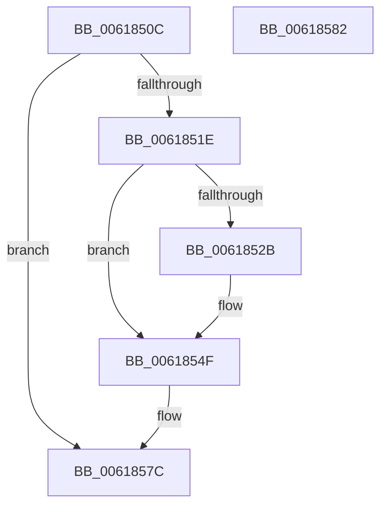

# CarCleanup

- RVA: `0x0061850C`–`0x00618583` (길이 `119` bytes)
- VA: `0x000000014061850C`
- 실행 섹션: `.text`
- PDB 이름 있음: `예`; PDB Function 태그: `아니요`
- unwind 정보 RVA: `0x0005CF00`
- 디코드: `27`개 명령, `119/119` bytes 표시
- 미해석 바이트: `0` (있으면 어셈블리에 `.byte`로 보존)

> 이 문서는 커널 이미지의 기계어와 PDB 기호를 분석해 생성했습니다. 4번과 5번은 함수 원형과 자료형을 바이너리 사용 방식에서 추정한 C 해석이며 원본 소스 복구 결과는 아닙니다.

## 1. Dependencies

- 직접 호출 지점: **5**; 고유 호출 대상: **5**
- 직접 호출자로 확인된 함수: **3**
- RIP 상대 이미지 참조: **10**

### Outgoing calls
- `0x0061851E` → [CarDeleteRuleViolationDB](CarDeleteRuleViolationDB_function_0061B4D0.md) (function, `0x0061B4D0`)
- `0x0061853F` → [EtwUnregister](../../page/A7/EtwUnregister_function_00A723D0.md) (function, `0x00A723D0`)
- `0x0061854A` → [McGenEventUnregister_EtwUnregister](../60/McGenEventUnregister_EtwUnregister_function_006058E4.md) (function, `0x006058E4`)
- `0x00618556` → [KeDeregisterBugCheckReasonCallback](../4A/KeDeregisterBugCheckReasonCallback_function_004AB240.md) (function, `0x004AB240`)
- `0x00618571` → [memset](../6C/memset_function_006C6C40.md) (function, `0x006C6C40`)

### Direct callers
- [VfVolatileClearDifRuleClass](VfVolatileClearDifRuleClass_function_006168E0.md) at `0x0061697F`
- [VfVolatileSetDifRuleClass](VfVolatileSetDifRuleClass_function_00616AA4.md) at `0x00616D34`
- [CarReportUnusualShutdown](CarReportUnusualShutdown_function_0061951C.md) at `0x0061956B`

### Static image references
- `0x00618512` → RVA `0x00F03EC0` (`.data`; read)
- `0x00618523` → RVA `0x00F03EE0` (`.data`; read)
- `0x0061852B` → RVA `0x00E090E8` (`.data`; read)
- `0x00618532` → RVA `0x00E090E8` (`.data`; write)
- `0x00618539` → RVA `0x00E090C8` (`.data`; write)
- `0x00618544` → RVA `0x00F03EE0` (`.data`; write)
- `0x0061854F` → RVA `0x00F024C0` (`.data`; read)
- `0x0061855D` → RVA `0x00F024D0` (`.data`; write)
- `0x0061856A` → RVA `0x00F02500` (`.data`; read)
- `0x00618576` → RVA `0x00F03EC0` (`.data`; read/write)

## 2. Other-region calls and transfers

- 다른 실행 섹션으로 향하는 call: **1**
  - `0x0061853F` → [EtwUnregister](../../page/A7/EtwUnregister_function_00A723D0.md) (`.text` → `PAGE`)
- 별도 외부 분기/꼬리 이동을 확인하지 못했습니다.

## 3. Assembly (complete function range)

```asm
0061850C  40 53                           push rbx
0061850E  48 83 EC 20                     sub rsp, 0x20
00618512  8B 05 A8 B9 8E 00               mov eax, dword ptr [rip + 0x8eb9a8]
00618518  33 DB                           xor ebx, ebx
0061851A  85 C0                           test eax, eax
0061851C  74 5E                           je 0x14061857c
0061851E  E8 AD 2F 00 00                  call 0x14061b4d0
00618523  38 1D B7 B9 8E 00               cmp byte ptr [rip + 0x8eb9b7], bl
00618529  74 24                           je 0x14061854f
0061852B  48 8B 0D B6 0B 7F 00            mov rcx, qword ptr [rip + 0x7f0bb6]
00618532  48 89 1D AF 0B 7F 00            mov qword ptr [rip + 0x7f0baf], rbx
00618539  89 1D 89 0B 7F 00               mov dword ptr [rip + 0x7f0b89], ebx
0061853F  E8 8C 9E 45 00                  call 0x140a723d0
00618544  88 1D 96 B9 8E 00               mov byte ptr [rip + 0x8eb996], bl
0061854A  E8 95 D3 FE FF                  call 0x1406058e4
0061854F  48 8D 0D 6A 9F 8E 00            lea rcx, [rip + 0x8e9f6a]
00618556  E8 E5 2C E9 FF                  call 0x1404ab240
0061855B  33 D2                           xor edx, edx
0061855D  48 89 1D 6C 9F 8E 00            mov qword ptr [rip + 0x8e9f6c], rbx
00618564  41 B8 80 00 00 00               mov r8d, 0x80
0061856A  48 8D 0D 8F 9F 8E 00            lea rcx, [rip + 0x8e9f8f]
00618571  E8 CA E6 0A 00                  call 0x1406c6c40
00618576  87 1D 44 B9 8E 00               xchg dword ptr [rip + 0x8eb944], ebx
0061857C  48 83 C4 20                     add rsp, 0x20
00618580  5B                              pop rbx
00618581  C3                              ret
00618582  CC                              int3
```

## 4. C-style interpretation (structured pseudocode)

```c
__int64 __fastcall CarCleanup(__int64 a1, int a2)
{
    __int64 result;
    __int64 v_rbx;
    __int64 v_rsp;

    v_rsp = (v_rsp) - (32);
    v_rbx = 0;
    if ((unsigned int)((unsigned int)(*(unsigned int *)(v_rip + 9353640))) == 0) goto loc_0061857C;
    result = CarDeleteRuleViolationDB(a1, a2, a3, a4);
    if ((*(unsigned __int8 *)(v_rip + 9353655)) != 0) {
        a1 = *(unsigned __int64 *)(v_rip + 8326070);
        *(unsigned __int64 *)(v_rip + 8326063) = 0;
        *(unsigned int *)(v_rip + 8326025) = 0;
        result = EtwUnregister(a1, a2, a3, a4);
        *(unsigned __int8 *)(v_rip + 9353622) = 0;
        result = McGenEventUnregister_EtwUnregister(a1, a2, a3, a4);
    }
    result = KeDeregisterBugCheckReasonCallback(v_rip + 9346922, a2, a3, a4);
    a2 = 0;
    *(unsigned __int64 *)(v_rip + 9346924) = 0;
    result = memset(v_rip + 9346959, a2, 128, a4);
loc_0061857C:
    v_rsp = (v_rsp) + (32);
    return result;
}
```

## 5. (Beta) C Style

```c
int64_t CarCleanup(int64_t Arg1, int32_t Arg2)
{
    int64_t result;
    int64_t local_rbx;
    int64_t local_rsp;

    local_rsp = (local_rsp) - (32);
    local_rbx = 0;
    if ((uint32_t)((uint32_t)(*(uint32_t *)(v_rip + 0x8EB9A8))) == 0) goto loc_0061857C;
    result = CarDeleteRuleViolationDB(Arg1, Arg2, a3, a4);
    if ((*(uint8_t *)(v_rip + 0x8EB9B7)) != 0) {
        Arg1 = *(uint64_t *)(v_rip + 0x7F0BB6);
        *(uint64_t *)(v_rip + 0x7F0BAF) = 0;
        *(uint32_t *)(v_rip + 0x7F0B89) = 0;
        result = EtwUnregister(Arg1, Arg2, a3, a4);
        *(uint8_t *)(v_rip + 0x8EB996) = 0;
        result = McGenEventUnregister_EtwUnregister(Arg1, Arg2, a3, a4);
    }
    result = KeDeregisterBugCheckReasonCallback(v_rip + 9346922, Arg2, a3, a4);
    Arg2 = 0;
    *(uint64_t *)(v_rip + 0x8E9F6C) = 0;
    result = memset(v_rip + 9346959, Arg2, 128, a4);
loc_0061857C:
    local_rsp = (local_rsp) + (32);
    return result;
}
```

## 6. Execution-region graph

[열기: 2D/3D 그래프와 함수 탐색 컨트롤 패널](../../../control-panel.html?section=text&rva=0x0061850C&view=graph)

- 2D 그래프는 위에서 아래로 흐르고, 3D 그래프는 빈 공간을 드래그해 회전합니다. Shift+드래그는 이동, 휠은 확대·축소, 함수 노드 선택은 대상 보고서 이동입니다.

### Static fallback


