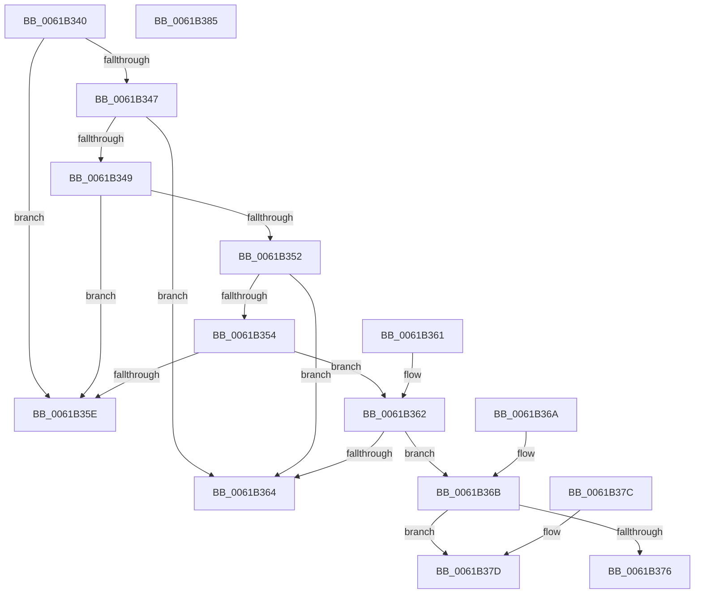

# CarComparRuleViolation

- RVA: `0x0061B340`–`0x0061B386` (길이 `70` bytes)
- VA: `0x000000014061B340`
- 실행 섹션: `.text`
- PDB 이름 있음: `예`; PDB Function 태그: `아니요`
- unwind 정보 RVA: `0x000DB714`
- 디코드: `30`개 명령, `70/70` bytes 표시
- 미해석 바이트: `0` (있으면 어셈블리에 `.byte`로 보존)

> 이 문서는 커널 이미지의 기계어와 PDB 기호를 분석해 생성했습니다. 4번과 5번은 함수 원형과 자료형을 바이너리 사용 방식에서 추정한 C 해석이며 원본 소스 복구 결과는 아닙니다.

## 1. Dependencies

- 직접 호출 지점: **0**; 고유 호출 대상: **0**
- 직접 호출자로 확인된 함수: **0**
- RIP 상대 이미지 참조: **0**

### Outgoing calls
- 직접 디코드된 call 명령이 없습니다.

### Direct callers
- 이 함수 시작 RVA로 연결되는 직접 call은 확인되지 않았습니다. 간접 호출은 완전히 역산할 수 없습니다.

### Static image references
- 디코드된 RIP-relative 메모리 참조가 없습니다.

## 2. Other-region calls and transfers

- 다른 실행 섹션으로 향하는 call: **0**
- 별도 외부 분기/꼬리 이동을 확인하지 못했습니다.

## 3. Assembly (complete function range)

```asm
0061B340  8B 02                           mov eax, dword ptr [rdx]
0061B342  41 3B 00                        cmp eax, dword ptr [r8]
0061B345  72 17                           jb 0x14061b35e
0061B347  77 1B                           ja 0x14061b364
0061B349  8B 42 04                        mov eax, dword ptr [rdx + 4]
0061B34C  41 3B 40 04                     cmp eax, dword ptr [r8 + 4]
0061B350  72 0C                           jb 0x14061b35e
0061B352  77 10                           ja 0x14061b364
0061B354  48 8B 42 08                     mov rax, qword ptr [rdx + 8]
0061B358  49 3B 40 08                     cmp rax, qword ptr [r8 + 8]
0061B35C  73 04                           jae 0x14061b362
0061B35E  33 C0                           xor eax, eax
0061B360  C3                              ret
0061B361  CC                              int3
0061B362  76 07                           jbe 0x14061b36b
0061B364  B8 01 00 00 00                  mov eax, 1
0061B369  C3                              ret
0061B36A  CC                              int3
0061B36B  8B 4A 10                        mov ecx, dword ptr [rdx + 0x10]
0061B36E  41 8B 50 10                     mov edx, dword ptr [r8 + 0x10]
0061B372  3B CA                           cmp ecx, edx
0061B374  75 07                           jne 0x14061b37d
0061B376  B8 02 00 00 00                  mov eax, 2
0061B37B  C3                              ret
0061B37C  CC                              int3
0061B37D  33 C0                           xor eax, eax
0061B37F  3B CA                           cmp ecx, edx
0061B381  0F 97 C0                        seta al
0061B384  C3                              ret
0061B385  CC                              int3
```

## 4. C-style interpretation (structured pseudocode)

```c
__int64 __fastcall CarComparRuleViolation(__int64 a1, __int64 a2, __int64 a3)
{
    __int64 result;

    if (((unsigned int)((unsigned int)(*(unsigned int *)(a2)))) < (*(unsigned int *)(a3))) goto loc_0061B35E;
    if (((unsigned int)((unsigned int)(*(unsigned int *)(a2)))) > (*(unsigned int *)(a3))) goto loc_0061B364;
    if (((unsigned int)((unsigned int)(*(unsigned int *)(a2 + 4)))) < (*(unsigned int *)(a3 + 4))) goto loc_0061B35E;
    if (((unsigned int)((unsigned int)(*(unsigned int *)(a2 + 4)))) > (*(unsigned int *)(a3 + 4))) goto loc_0061B364;
    if ((*(unsigned __int64 *)(a2 + 8)) >= (*(unsigned __int64 *)(a3 + 8))) goto loc_0061B362;
loc_0061B35E:
    result = 0;
    return result;
loc_0061B362:
    if (condition_is_below_or_equal) goto loc_0061B36B;
loc_0061B364:
    return 1;
loc_0061B36B:
    if (((unsigned int)((unsigned int)(*(unsigned int *)(a2 + 16)))) != ((unsigned int)((unsigned int)(*(unsigned int *)(a3 + 16))))) goto loc_0061B37D;
    return 2;
loc_0061B37D:
    result = 0;
    result = (((unsigned int)((unsigned int)(*(unsigned int *)(a2 + 16)))) > ((unsigned int)((unsigned int)(*(unsigned int *)(a3 + 16))))) ? 1 : 0;
    return result;
}
```

## 5. (Beta) C Style

```c
int64_t CarComparRuleViolation(int64_t Arg1, void *Arg2, void *Arg3)
{
    uint8_t *arg2 = (uint8_t *)Arg2;
    uint8_t *arg3 = (uint8_t *)Arg3;

    int64_t result;

    if (((uint32_t)((uint32_t)(*(uint32_t *)(arg2)))) < (*(uint32_t *)(arg3))) goto loc_0061B35E;
    if (((uint32_t)((uint32_t)(*(uint32_t *)(arg2)))) > (*(uint32_t *)(arg3))) goto loc_0061B364;
    if (((uint32_t)((uint32_t)(*(uint32_t *)(arg2 + 0x4)))) < (*(uint32_t *)(arg3 + 0x4))) goto loc_0061B35E;
    if (((uint32_t)((uint32_t)(*(uint32_t *)(arg2 + 0x4)))) > (*(uint32_t *)(arg3 + 0x4))) goto loc_0061B364;
    if ((*(uint64_t *)(arg2 + 0x8)) >= (*(uint64_t *)(arg3 + 0x8))) goto loc_0061B362;
loc_0061B35E:
    result = 0;
    return result;
loc_0061B362:
    if (condition_is_below_or_equal) goto loc_0061B36B;
loc_0061B364:
    return 1;
loc_0061B36B:
    if (((uint32_t)((uint32_t)(*(uint32_t *)(arg2 + 0x10)))) != ((uint32_t)((uint32_t)(*(uint32_t *)(arg3 + 0x10))))) goto loc_0061B37D;
    return 2;
loc_0061B37D:
    result = 0;
    result = (((uint32_t)((uint32_t)(*(uint32_t *)(arg2 + 0x10)))) > ((uint32_t)((uint32_t)(*(uint32_t *)(arg3 + 0x10))))) ? 1 : 0;
    return result;
}
```

### 관측된 메모리 오프셋

구조체 형식이 확인되지 않은 접근은 인자 기준의 오프셋으로만 기록했습니다.

| 기준 인자 | 오프셋 표현 | 폭 (bit) | 접근 |
|---|---:|---:|---|
| `Arg2` | `+ 0x0` | `32` | `R` |
| `Arg2` | `+ 0x4` | `32` | `R` |
| `Arg2` | `+ 0x8` | `64` | `R` |
| `Arg2` | `+ 0x10` | `32` | `R` |
| `Arg3` | `+ 0x0` | `32` | `R` |
| `Arg3` | `+ 0x4` | `32` | `R` |
| `Arg3` | `+ 0x8` | `64` | `R` |
| `Arg3` | `+ 0x10` | `32` | `R` |

## 6. Execution-region graph

[열기: 2D/3D 그래프와 함수 탐색 컨트롤 패널](../../../control-panel.html?section=text&rva=0x0061B340&view=graph)

- 2D 그래프는 위에서 아래로 흐르고, 3D 그래프는 빈 공간을 드래그해 회전합니다. Shift+드래그는 이동, 휠은 확대·축소, 함수 노드 선택은 대상 보고서 이동입니다.

### Static fallback


