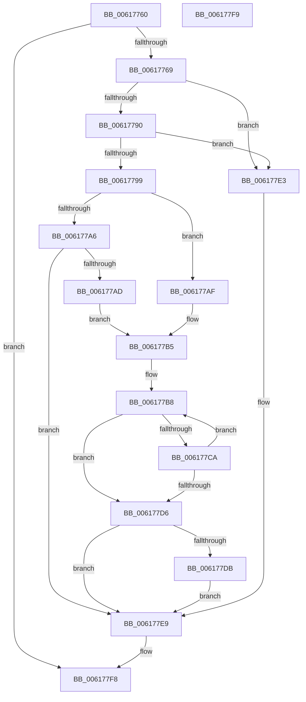

# CarCopyDriverName

- RVA: `0x00617760`–`0x006177FA` (길이 `154` bytes)
- VA: `0x0000000140617760`
- 실행 섹션: `.text`
- PDB 이름 있음: `예`; PDB Function 태그: `아니요`
- unwind 정보 RVA: `0x00067A3C`
- 디코드: `48`개 명령, `154/154` bytes 표시
- 미해석 바이트: `0` (있으면 어셈블리에 `.byte`로 보존)

> 이 문서는 커널 이미지의 기계어와 PDB 기호를 분석해 생성했습니다. 4번과 5번은 함수 원형과 자료형을 바이너리 사용 방식에서 추정한 C 해석이며 원본 소스 복구 결과는 아닙니다.

## 1. Dependencies

- 직접 호출 지점: **1**; 고유 호출 대상: **1**
- 직접 호출자로 확인된 함수: **2**
- RIP 상대 이미지 참조: **0**

### Outgoing calls
- `0x00617786` → [memset](../6C/memset_function_006C6C40.md) (function, `0x006C6C40`)

### Direct callers
- [CarGetDriverInfoFromViolationStack](CarGetDriverInfoFromViolationStack_function_00617ED8.md) at `0x00617F72`
- [CarLoadImageHandler](CarLoadImageHandler_function_00618128.md) at `0x006181A2`

### Static image references
- 디코드된 RIP-relative 메모리 참조가 없습니다.

## 2. Other-region calls and transfers

- 다른 실행 섹션으로 향하는 call: **0**
- 별도 외부 분기/꼬리 이동을 확인하지 못했습니다.

## 3. Assembly (complete function range)

```asm
00617760  48 85 C9                        test rcx, rcx
00617763  0F 84 8F 00 00 00               je 0x1406177f8
00617769  48 89 5C 24 08                  mov qword ptr [rsp + 8], rbx
0061776E  48 89 74 24 10                  mov qword ptr [rsp + 0x10], rsi
00617773  57                              push rdi
00617774  48 83 EC 20                     sub rsp, 0x20
00617778  48 8B FA                        mov rdi, rdx
0061777B  33 F6                           xor esi, esi
0061777D  33 D2                           xor edx, edx
0061777F  48 8B D9                        mov rbx, rcx
00617782  44 8D 46 40                     lea r8d, [rsi + 0x40]
00617786  E8 B5 F4 0A 00                  call 0x1406c6c40
0061778B  48 85 FF                        test rdi, rdi
0061778E  74 53                           je 0x1406177e3
00617790  48 8B 47 08                     mov rax, qword ptr [rdi + 8]
00617794  48 85 C0                        test rax, rax
00617797  74 4A                           je 0x1406177e3
00617799  0F B7 0F                        movzx ecx, word ptr [rdi]
0061779C  44 8B C6                        mov r8d, esi
0061779F  D1 E9                           shr ecx, 1
006177A1  83 F9 20                        cmp ecx, 0x20
006177A4  73 09                           jae 0x1406177af
006177A6  44 8B C9                        mov r9d, ecx
006177A9  85 C9                           test ecx, ecx
006177AB  74 3C                           je 0x1406177e9
006177AD  EB 06                           jmp 0x1406177b5
006177AF  41 B9 1F 00 00 00               mov r9d, 0x1f
006177B5  48 8B D6                        mov rdx, rsi
006177B8  0F B7 04 02                     movzx eax, word ptr [rdx + rax]
006177BC  66 89 04 1A                     mov word ptr [rdx + rbx], ax
006177C0  48 8B 47 08                     mov rax, qword ptr [rdi + 8]
006177C4  66 39 34 02                     cmp word ptr [rdx + rax], si
006177C8  74 0C                           je 0x1406177d6
006177CA  41 FF C0                        inc r8d
006177CD  48 83 C2 02                     add rdx, 2
006177D1  45 3B C1                        cmp r8d, r9d
006177D4  72 E2                           jb 0x1406177b8
006177D6  83 F9 20                        cmp ecx, 0x20
006177D9  72 0E                           jb 0x1406177e9
006177DB  66 C7 43 3C 7E 00               mov word ptr [rbx + 0x3c], 0x7e
006177E1  EB 06                           jmp 0x1406177e9
006177E3  C7 03 4E 00 41 00               mov dword ptr [rbx], 0x41004e
006177E9  48 8B 5C 24 30                  mov rbx, qword ptr [rsp + 0x30]
006177EE  48 8B 74 24 38                  mov rsi, qword ptr [rsp + 0x38]
006177F3  48 83 C4 20                     add rsp, 0x20
006177F7  5F                              pop rdi
006177F8  C3                              ret
006177F9  CC                              int3
```

## 4. C-style interpretation (structured pseudocode)

```c
__int64 __fastcall CarCopyDriverName(__int64 a1, __int64 a2)
{
    __int64 result;
    __int64 v_rsi;
    __int64 v_rsp;
    unsigned __int64 v_stack_p10;
    unsigned __int64 v_stack_p8;

    if (a1 == 0) goto loc_006177F8;
    v_stack_p8 = v_rbx;
    v_stack_p10 = v_rsi;
    v_rsp = (v_rsp) - (32);
    v_rsi = 0;
    a2 = 0;
    result = memset(a1, a2, v_rsi + 64, a4);
    if (0 == 0) goto loc_006177E3;
    if (*(unsigned __int64 *)(a2 + 8) == 0) goto loc_006177E3;
    a1 = (unsigned int)((*(unsigned __int16 *)(a2)) >> (1));
    if (((unsigned int)(a1)) >= 32) goto loc_006177AF;
    if ((unsigned int)(a1) == 0) goto loc_006177E9;
    goto loc_006177B5;
loc_006177AF:
loc_006177B5:
loc_006177B8:
    *(unsigned __int16 *)(0 + a1 * 1) = (unsigned __int16)(*(unsigned __int16 *)(0 + *(unsigned __int64 *)(a2 + 8) * 1));
    if ((*(unsigned __int16 *)(0 + *(unsigned __int64 *)(a2 + 8) * 1)) == 0) goto loc_006177D6;
    a3 = (unsigned int)((0) + 1);
    a2 = (0) + (2);
    if (((unsigned int)(a3)) < 31) goto loc_006177B8;
loc_006177D6:
    if (((unsigned int)(a1)) < 32) goto loc_006177E9;
    *(unsigned __int16 *)(a1 + 60) = 126;
    goto loc_006177E9;
loc_006177E3:
    *(unsigned int *)(a1) = 0x41004EULL;
loc_006177E9:
    v_rsp = (v_rsp) + (32);
loc_006177F8:
    return *(unsigned __int64 *)(a2 + 8);
}
```

## 5. (Beta) C Style

```c
int64_t CarCopyDriverName(int64_t Arg1, int64_t Arg2)
{
    int64_t result;
    int64_t local_rsi;
    int64_t local_rsp;
    uint64_t v_stack_p10;
    uint64_t v_stack_p8;

    if (Arg1 == 0) goto loc_006177F8;
    v_stack_p8 = local_rbx;
    v_stack_p10 = local_rsi;
    local_rsp = (local_rsp) - (32);
    local_rsi = 0;
    Arg2 = 0;
    result = memset(Arg1, Arg2, local_rsi + 64, a4);
    if (0 == 0) goto loc_006177E3;
    if (*(uint64_t *)(Arg2 + 0x8) == 0) goto loc_006177E3;
    Arg1 = (uint32_t)((*(uint16_t *)(Arg2)) >> (1));
    if (((uint32_t)(Arg1)) >= 32) goto loc_006177AF;
    if ((uint32_t)(Arg1) == 0) goto loc_006177E9;
    goto loc_006177B5;
loc_006177AF:
loc_006177B5:
loc_006177B8:
    *(uint16_t *)(0 + Arg1 * 1) = (uint16_t)(*(uint16_t *)(0 + *(uint64_t *)(Arg2 + 0x8) * 1));
    if ((*(uint16_t *)(0 + *(uint64_t *)(Arg2 + 0x8) * 1)) == 0) goto loc_006177D6;
    a3 = (uint32_t)((0) + 1);
    Arg2 = (0) + (2);
    if (((uint32_t)(a3)) < 31) goto loc_006177B8;
loc_006177D6:
    if (((uint32_t)(Arg1)) < 32) goto loc_006177E9;
    *(uint16_t *)(Arg1 + 0x3C) = 126;
    goto loc_006177E9;
loc_006177E3:
    *(uint32_t *)(Arg1) = 0x41004EULL;
loc_006177E9:
    local_rsp = (local_rsp) + (32);
loc_006177F8:
    return *(uint64_t *)(Arg2 + 0x8);
}
```

## 6. Execution-region graph

[열기: 2D/3D 그래프와 함수 탐색 컨트롤 패널](../../../control-panel.html?section=text&rva=0x00617760&view=graph)

- 2D 그래프는 위에서 아래로 흐르고, 3D 그래프는 빈 공간을 드래그해 회전합니다. Shift+드래그는 이동, 휠은 확대·축소, 함수 노드 선택은 대상 보고서 이동입니다.

### Static fallback


