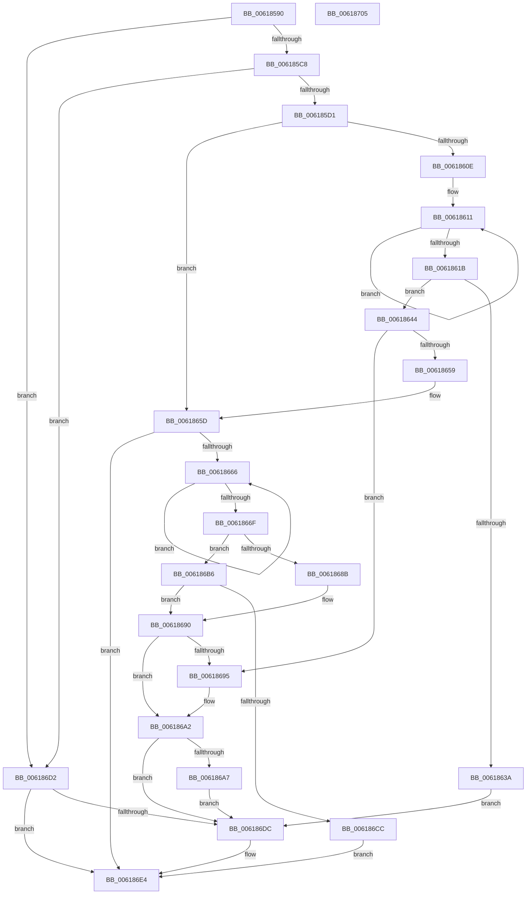

# CarCopyRuleViolationDetails

- RVA: `0x00618590`–`0x00618706` (길이 `374` bytes)
- VA: `0x0000000140618590`
- 실행 섹션: `.text`
- PDB 이름 있음: `예`; PDB Function 태그: `아니요`
- unwind 정보 RVA: `0x0005FEF8`
- 디코드: `107`개 명령, `374/374` bytes 표시
- 미해석 바이트: `0` (있으면 어셈블리에 `.byte`로 보존)

> 이 문서는 커널 이미지의 기계어와 PDB 기호를 분석해 생성했습니다. 4번과 5번은 함수 원형과 자료형을 바이너리 사용 방식에서 추정한 C 해석이며 원본 소스 복구 결과는 아닙니다.

## 1. Dependencies

- 직접 호출 지점: **6**; 고유 호출 대상: **4**
- 직접 호출자로 확인된 함수: **1**
- RIP 상대 이미지 참조: **0**

### Outgoing calls
- `0x0061862D` → [ExAllocatePool2](../../poolcode/B8/ExAllocatePool2_function_00B820F0.md) (function, `0x00B820F0`)
- `0x0061864E` → [RtlStringCchCopyW](../26/RtlStringCchCopyW_function_0026E9A4.md) (function, `0x0026E9A4`)
- `0x0061867E` → [ExAllocatePool2](../../poolcode/B8/ExAllocatePool2_function_00B820F0.md) (function, `0x00B820F0`)
- `0x0061869D` → [ExFreePoolWithTag](../../poolcode/B8/ExFreePoolWithTag_function_00B82870.md) (function, `0x00B82870`)
- `0x006186AF` → [ExFreePoolWithTag](../../poolcode/B8/ExFreePoolWithTag_function_00B82870.md) (function, `0x00B82870`)
- `0x006186C1` → [RtlStringCchCopyA](../46/RtlStringCchCopyA_function_00460628.md) (function, `0x00460628`)

### Direct callers
- [CarReportDifPluginRuleViolation](CarReportDifPluginRuleViolation_function_00619250.md) at `0x00619302`

### Static image references
- 디코드된 RIP-relative 메모리 참조가 없습니다.

## 2. Other-region calls and transfers

- 다른 실행 섹션으로 향하는 call: **4**
  - `0x0061862D` → [ExAllocatePool2](../../poolcode/B8/ExAllocatePool2_function_00B820F0.md) (`.text` → `POOLCODE`)
  - `0x0061867E` → [ExAllocatePool2](../../poolcode/B8/ExAllocatePool2_function_00B820F0.md) (`.text` → `POOLCODE`)
  - `0x0061869D` → [ExFreePoolWithTag](../../poolcode/B8/ExFreePoolWithTag_function_00B82870.md) (`.text` → `POOLCODE`)
  - `0x006186AF` → [ExFreePoolWithTag](../../poolcode/B8/ExFreePoolWithTag_function_00B82870.md) (`.text` → `POOLCODE`)
- 별도 외부 분기/꼬리 이동을 확인하지 못했습니다.

## 3. Assembly (complete function range)

```asm
00618590  48 8B C4                        mov rax, rsp
00618593  48 89 58 08                     mov qword ptr [rax + 8], rbx
00618597  48 89 68 10                     mov qword ptr [rax + 0x10], rbp
0061859B  48 89 70 18                     mov qword ptr [rax + 0x18], rsi
0061859F  48 89 78 20                     mov qword ptr [rax + 0x20], rdi
006185A3  41 54                           push r12
006185A5  41 56                           push r14
006185A7  41 57                           push r15
006185A9  48 83 EC 20                     sub rsp, 0x20
006185AD  45 33 E4                        xor r12d, r12d
006185B0  4C 8B F2                        mov r14, rdx
006185B3  48 8B F9                        mov rdi, rcx
006185B6  41 8B DC                        mov ebx, r12d
006185B9  41 8B F4                        mov esi, r12d
006185BC  45 8B FC                        mov r15d, r12d
006185BF  48 85 C9                        test rcx, rcx
006185C2  0F 84 0A 01 00 00               je 0x1406186d2
006185C8  48 85 D2                        test rdx, rdx
006185CB  0F 84 01 01 00 00               je 0x1406186d2
006185D1  0F 10 02                        movups xmm0, xmmword ptr [rdx]
006185D4  48 83 CD FF                     or rbp, 0xffffffffffffffff
006185D8  0F 11 01                        movups xmmword ptr [rcx], xmm0
006185DB  0F 10 4A 10                     movups xmm1, xmmword ptr [rdx + 0x10]
006185DF  0F 11 49 10                     movups xmmword ptr [rcx + 0x10], xmm1
006185E3  0F 10 42 20                     movups xmm0, xmmword ptr [rdx + 0x20]
006185E7  0F 11 41 20                     movups xmmword ptr [rcx + 0x20], xmm0
006185EB  0F 10 4A 30                     movups xmm1, xmmword ptr [rdx + 0x30]
006185EF  0F 11 49 30                     movups xmmword ptr [rcx + 0x30], xmm1
006185F3  0F 10 42 40                     movups xmm0, xmmword ptr [rdx + 0x40]
006185F7  0F 11 41 40                     movups xmmword ptr [rcx + 0x40], xmm0
006185FB  F2 0F 10 4A 50                  movsd xmm1, qword ptr [rdx + 0x50]
00618600  F2 0F 11 49 50                  movsd qword ptr [rcx + 0x50], xmm1
00618605  48 8B 42 38                     mov rax, qword ptr [rdx + 0x38]
00618609  48 85 C0                        test rax, rax
0061860C  74 4F                           je 0x14061865d
0061860E  48 8B DD                        mov rbx, rbp
00618611  48 FF C3                        inc rbx
00618614  66 44 39 24 58                  cmp word ptr [rax + rbx*2], r12w
00618619  75 F6                           jne 0x140618611
0061861B  48 FF C3                        inc rbx
0061861E  B9 40 00 00 00                  mov ecx, 0x40
00618623  41 B8 43 61 72 4E               mov r8d, 0x4e726143
00618629  48 8D 14 1B                     lea rdx, [rbx + rbx]
0061862D  E8 BE 9A 56 00                  call 0x140b820f0
00618632  4C 8B F8                        mov r15, rax
00618635  48 85 C0                        test rax, rax
00618638  75 0A                           jne 0x140618644
0061863A  BB 17 00 00 C0                  mov ebx, 0xc0000017
0061863F  E9 98 00 00 00                  jmp 0x1406186dc
00618644  4D 8B 46 38                     mov r8, qword ptr [r14 + 0x38]
00618648  48 8B D3                        mov rdx, rbx
0061864B  49 8B CF                        mov rcx, r15
0061864E  E8 51 63 C5 FF                  call 0x14026e9a4
00618653  8B D8                           mov ebx, eax
00618655  85 C0                           test eax, eax
00618657  78 3C                           js 0x140618695
00618659  4C 89 7F 38                     mov qword ptr [rdi + 0x38], r15
0061865D  49 8B 46 18                     mov rax, qword ptr [r14 + 0x18]
00618661  48 85 C0                        test rax, rax
00618664  74 7E                           je 0x1406186e4
00618666  48 FF C5                        inc rbp
00618669  44 38 24 28                     cmp byte ptr [rax + rbp], r12b
0061866D  75 F7                           jne 0x140618666
0061866F  41 B8 43 61 72 4E               mov r8d, 0x4e726143
00618675  48 8D 55 01                     lea rdx, [rbp + 1]
00618679  B9 40 00 00 00                  mov ecx, 0x40
0061867E  E8 6D 9A 56 00                  call 0x140b820f0
00618683  48 8B F0                        mov rsi, rax
00618686  48 85 C0                        test rax, rax
00618689  75 2B                           jne 0x1406186b6
0061868B  BB 17 00 00 C0                  mov ebx, 0xc0000017
00618690  4D 85 FF                        test r15, r15
00618693  74 0D                           je 0x1406186a2
00618695  BA 43 61 72 4E                  mov edx, 0x4e726143
0061869A  49 8B CF                        mov rcx, r15
0061869D  E8 CE A1 56 00                  call 0x140b82870
006186A2  48 85 F6                        test rsi, rsi
006186A5  74 35                           je 0x1406186dc
006186A7  BA 43 61 72 4E                  mov edx, 0x4e726143
006186AC  48 8B CE                        mov rcx, rsi
006186AF  E8 BC A1 56 00                  call 0x140b82870
006186B4  EB 26                           jmp 0x1406186dc
006186B6  4D 8B 46 18                     mov r8, qword ptr [r14 + 0x18]
006186BA  48 8D 55 01                     lea rdx, [rbp + 1]
006186BE  48 8B CE                        mov rcx, rsi
006186C1  E8 62 7F E4 FF                  call 0x140460628
006186C6  8B D8                           mov ebx, eax
006186C8  85 C0                           test eax, eax
006186CA  78 C4                           js 0x140618690
006186CC  48 89 77 18                     mov qword ptr [rdi + 0x18], rsi
006186D0  EB 12                           jmp 0x1406186e4
006186D2  BB 0D 00 00 C0                  mov ebx, 0xc000000d
006186D7  48 85 FF                        test rdi, rdi
006186DA  74 08                           je 0x1406186e4
006186DC  4C 89 67 38                     mov qword ptr [rdi + 0x38], r12
006186E0  4C 89 67 18                     mov qword ptr [rdi + 0x18], r12
006186E4  48 8B 6C 24 48                  mov rbp, qword ptr [rsp + 0x48]
006186E9  8B C3                           mov eax, ebx
006186EB  48 8B 5C 24 40                  mov rbx, qword ptr [rsp + 0x40]
006186F0  48 8B 74 24 50                  mov rsi, qword ptr [rsp + 0x50]
006186F5  48 8B 7C 24 58                  mov rdi, qword ptr [rsp + 0x58]
006186FA  48 83 C4 20                     add rsp, 0x20
006186FE  41 5F                           pop r15
00618700  41 5E                           pop r14
00618702  41 5C                           pop r12
00618704  C3                              ret
00618705  CC                              int3
```

## 4. C-style interpretation (structured pseudocode)

```c
__int64 __fastcall CarCopyRuleViolationDetails(__int64 a1, __int64 a2)
{
    __int64 result;
    __int64 v_r12;
    __int64 v_rbp;
    __int64 v_rbx;
    __int64 v_rsp;
    unsigned __int64 v_stack_p10;
    unsigned __int64 v_stack_p18;
    unsigned __int64 v_stack_p20;
    unsigned __int64 v_stack_p8;

    *(unsigned __int64 *)(v_rsp + 8) = v_rbx;
    *(unsigned __int64 *)(v_rsp + 16) = v_rbp;
    *(unsigned __int64 *)(v_rsp + 24) = v_rsi;
    *(unsigned __int64 *)(v_rsp + 32) = v_rdi;
    v_rsp = (v_rsp) - (32);
    v_r12 = 0;
    if (a1 == 0) goto loc_006186D2;
    if (a2 == 0) goto loc_006186D2;
    v_rbp = (v_rbp) | (-1);
    *(unsigned __int64 *)(a1) = v_xmm0;
    *(unsigned __int64 *)(a1 + 16) = v_xmm1;
    *(unsigned __int64 *)(a1 + 32) = v_xmm0;
    *(unsigned __int64 *)(a1 + 48) = v_xmm1;
    *(unsigned __int64 *)(a1 + 64) = v_xmm0;
    *(unsigned __int64 *)(a1 + 80) = v_xmm1;
    if (*(unsigned __int64 *)(a2 + 56) == 0) goto loc_0061865D;
loc_00618611:
    v_rbx = (v_rbp) + 1;
    if ((*(unsigned __int16 *)(*(unsigned __int64 *)(a2 + 56) + v_rbx * 2)) != 0) goto loc_00618611;
    v_rbx = (v_rbx) + 1;
    result = ExAllocatePool2(64, v_rbx + v_rbx * 1, (unsigned int)(0x4E726143ULL), a4);
    if (result != 0) goto loc_00618644;
    goto loc_006186DC;
loc_00618644:
    result = RtlStringCchCopyW(result, (unsigned int)(0xC0000017ULL), *(unsigned __int64 *)(a2 + 56), a4);
    if (sign_flag) goto loc_00618695;
    *(unsigned __int64 *)(a1 + 56) = result;
loc_0061865D:
    if (*(unsigned __int64 *)(a2 + 24) == 0) goto loc_006186E4;
loc_00618666:
    v_rbp = (v_rbp) + 1;
    if ((*(unsigned __int8 *)(*(unsigned __int64 *)(a2 + 24) + v_rbp * 1)) != 0) goto loc_00618666;
    result = ExAllocatePool2(64, v_rbp + 1, (unsigned int)(0x4E726143ULL), a4);
    if (result != 0) goto loc_006186B6;
loc_00618690:
    if (result != 0) {
        a2 = 0x4E726143ULL;
        a1 = result;
        result = ExFreePoolWithTag(a1, a2, (unsigned int)(0x4E726143ULL), a4);
    }
    if (result == 0) goto loc_006186DC;
    result = ExFreePoolWithTag(result, (unsigned int)(0x4E726143ULL), (unsigned int)(0x4E726143ULL), a4);
    goto loc_006186DC;
loc_006186B6:
    result = RtlStringCchCopyA(result, v_rbp + 1, *(unsigned __int64 *)(a2 + 24), a4);
    if (sign_flag) goto loc_00618690;
    *(unsigned __int64 *)(a1 + 24) = result;
    goto loc_006186E4;
loc_006186D2:
    if (a1 != 0) {
        *(unsigned __int64 *)(a1 + 56) = 0;
        *(unsigned __int64 *)(a1 + 24) = 0;
    }
    v_rsp = (v_rsp) + (32);
    return (unsigned int)((unsigned int)((unsigned int)(0xC000000DULL)));
}
```

## 5. (Beta) C Style

```c
int64_t CarCopyRuleViolationDetails(void *Arg1, void *Arg2)
{
    uint8_t *arg1 = (uint8_t *)Arg1;
    uint8_t *arg2 = (uint8_t *)Arg2;

    int64_t result;
    int64_t local_r12;
    int64_t local_rbp;
    int64_t local_rbx;
    int64_t local_rsp;
    uint64_t v_stack_p10;
    uint64_t v_stack_p18;
    uint64_t v_stack_p20;
    uint64_t v_stack_p8;

    *(uint64_t *)(local_rsp + 0x8) = local_rbx;
    *(uint64_t *)(local_rsp + 0x10) = local_rbp;
    *(uint64_t *)(local_rsp + 0x18) = local_rsi;
    *(uint64_t *)(local_rsp + 0x20) = local_rdi;
    local_rsp = (local_rsp) - (32);
    local_r12 = 0;
    if (Arg1 == NULL) goto loc_006186D2;
    if (Arg2 == NULL) goto loc_006186D2;
    local_rbp = (local_rbp) | (-1);
    *(uint64_t *)(arg1) = v_xmm0;
    *(uint64_t *)(arg1 + 0x10) = v_xmm1;
    *(uint64_t *)(arg1 + 0x20) = v_xmm0;
    *(uint64_t *)(arg1 + 0x30) = v_xmm1;
    *(uint64_t *)(arg1 + 0x40) = v_xmm0;
    *(uint64_t *)(arg1 + 0x50) = v_xmm1;
    if (*(uint64_t *)(arg2 + 0x38) == 0) goto loc_0061865D;
loc_00618611:
    local_rbx = (local_rbp) + 1;
    if ((*(uint16_t *)(*(uint64_t *)(arg2 + 0x38) + local_rbx * 2)) != 0) goto loc_00618611;
    local_rbx = (local_rbx) + 1;
    result = ExAllocatePool2(64, local_rbx + local_rbx * 1, (uint32_t)(0x4E726143ULL), a4);
    if (result != 0) goto loc_00618644;
    goto loc_006186DC;
loc_00618644:
    result = RtlStringCchCopyW(result, (uint32_t)(0xC0000017ULL), *(uint64_t *)(arg2 + 0x38), a4);
    if (sign_flag) goto loc_00618695;
    *(uint64_t *)(arg1 + 0x38) = result;
loc_0061865D:
    if (*(uint64_t *)(arg2 + 0x18) == 0) goto loc_006186E4;
loc_00618666:
    local_rbp = (local_rbp) + 1;
    if ((*(uint8_t *)(*(uint64_t *)(arg2 + 0x18) + local_rbp * 1)) != 0) goto loc_00618666;
    result = ExAllocatePool2(64, local_rbp + 1, (uint32_t)(0x4E726143ULL), a4);
    if (result != 0) goto loc_006186B6;
loc_00618690:
    if (result != 0) {
        Arg2 = 0x4E726143ULL;
        Arg1 = result;
        result = ExFreePoolWithTag(Arg1, Arg2, (uint32_t)(0x4E726143ULL), a4);
    }
    if (result == 0) goto loc_006186DC;
    result = ExFreePoolWithTag(result, (uint32_t)(0x4E726143ULL), (uint32_t)(0x4E726143ULL), a4);
    goto loc_006186DC;
loc_006186B6:
    result = RtlStringCchCopyA(result, local_rbp + 1, *(uint64_t *)(arg2 + 0x18), a4);
    if (sign_flag) goto loc_00618690;
    *(uint64_t *)(arg1 + 0x18) = result;
    goto loc_006186E4;
loc_006186D2:
    if (Arg1 != NULL) {
        *(uint64_t *)(arg1 + 0x38) = 0;
        *(uint64_t *)(arg1 + 0x18) = 0;
    }
    local_rsp = (local_rsp) + (32);
    return (uint32_t)((uint32_t)((uint32_t)(0xC000000DULL)));
}
```

### 관측된 메모리 오프셋

구조체 형식이 확인되지 않은 접근은 인자 기준의 오프셋으로만 기록했습니다.

| 기준 인자 | 오프셋 표현 | 폭 (bit) | 접근 |
|---|---:|---:|---|
| `Arg1` | `+ 0x18` | `64` | `W` |
| `Arg1` | `+ 0x38` | `64` | `W` |
| `Arg2` | `+ 0x18` | `64` | `R` |
| `Arg2` | `+ 0x38` | `64` | `R` |

## 6. Execution-region graph

[열기: 2D/3D 그래프와 함수 탐색 컨트롤 패널](../../../control-panel.html?section=text&rva=0x00618590&view=graph)

- 2D 그래프는 위에서 아래로 흐르고, 3D 그래프는 빈 공간을 드래그해 회전합니다. Shift+드래그는 이동, 휠은 확대·축소, 함수 노드 선택은 대상 보고서 이동입니다.

### Static fallback


