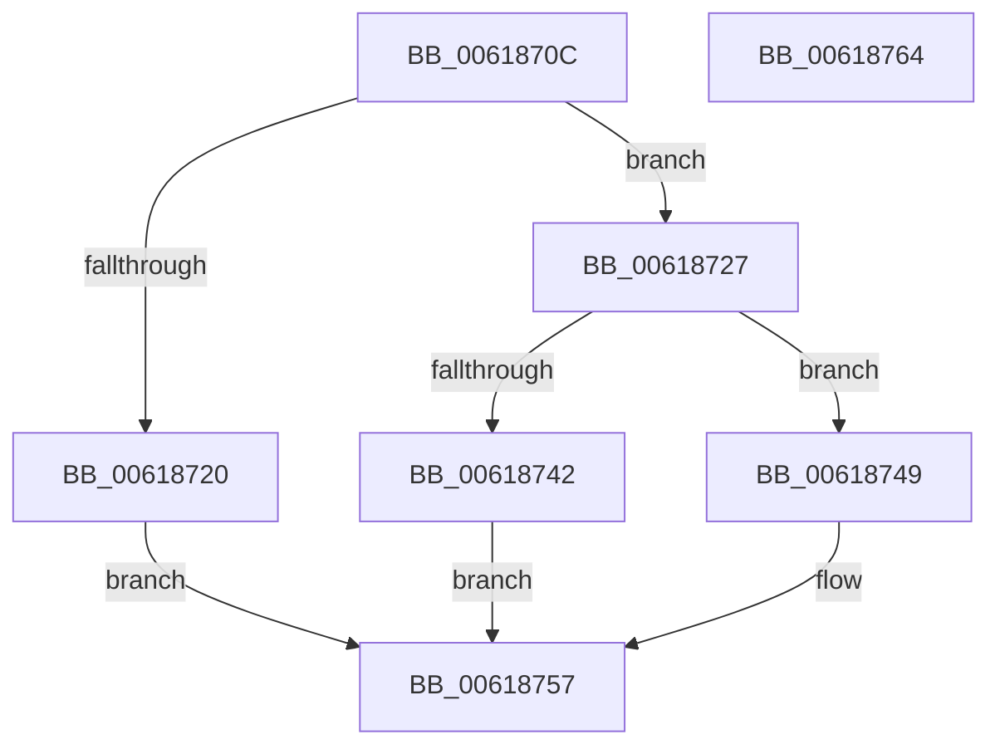

# CarCreateRuleOverrideEntry

- RVA: `0x0061870C`–`0x00618765` (길이 `89` bytes)
- VA: `0x000000014061870C`
- 실행 섹션: `.text`
- PDB 이름 있음: `예`; PDB Function 태그: `아니요`
- unwind 정보 RVA: `0x0005CAAC`
- 디코드: `28`개 명령, `89/89` bytes 표시
- 미해석 바이트: `0` (있으면 어셈블리에 `.byte`로 보존)

> 이 문서는 커널 이미지의 기계어와 PDB 기호를 분석해 생성했습니다. 4번과 5번은 함수 원형과 자료형을 바이너리 사용 방식에서 추정한 C 해석이며 원본 소스 복구 결과는 아닙니다.

## 1. Dependencies

- 직접 호출 지점: **2**; 고유 호출 대상: **2**
- 직접 호출자로 확인된 함수: **2**
- RIP 상대 이미지 참조: **0**

### Outgoing calls
- `0x00618735` → [ExAllocatePool2](../../poolcode/B8/ExAllocatePool2_function_00B820F0.md) (function, `0x00B820F0`)
- `0x00618752` → [memset](../6C/memset_function_006C6C40.md) (function, `0x006C6C40`)

### Direct callers
- [CarRegisterRuleOverride](CarRegisterRuleOverride_function_00619040.md) at `0x006190B1`
- [CarRegisterRuleOverrideAllContexts](CarRegisterRuleOverrideAllContexts_function_00619130.md) at `0x0061917B`

### Static image references
- 디코드된 RIP-relative 메모리 참조가 없습니다.

## 2. Other-region calls and transfers

- 다른 실행 섹션으로 향하는 call: **1**
  - `0x00618735` → [ExAllocatePool2](../../poolcode/B8/ExAllocatePool2_function_00B820F0.md) (`.text` → `POOLCODE`)
- 별도 외부 분기/꼬리 이동을 확인하지 못했습니다.

## 3. Assembly (complete function range)

```asm
0061870C  48 89 5C 24 08                  mov qword ptr [rsp + 8], rbx
00618711  57                              push rdi
00618712  48 83 EC 20                     sub rsp, 0x20
00618716  33 DB                           xor ebx, ebx
00618718  48 8B F9                        mov rdi, rcx
0061871B  48 85 C9                        test rcx, rcx
0061871E  75 07                           jne 0x140618727
00618720  BB 0D 00 00 C0                  mov ebx, 0xc000000d
00618725  EB 30                           jmp 0x140618757
00618727  BA 50 00 00 00                  mov edx, 0x50
0061872C  41 B8 43 61 72 4E               mov r8d, 0x4e726143
00618732  8D 4A F0                        lea ecx, [rdx - 0x10]
00618735  E8 B6 99 56 00                  call 0x140b820f0
0061873A  48 89 07                        mov qword ptr [rdi], rax
0061873D  48 85 C0                        test rax, rax
00618740  75 07                           jne 0x140618749
00618742  BB 17 00 00 C0                  mov ebx, 0xc0000017
00618747  EB 0E                           jmp 0x140618757
00618749  33 D2                           xor edx, edx
0061874B  48 8B C8                        mov rcx, rax
0061874E  44 8D 42 50                     lea r8d, [rdx + 0x50]
00618752  E8 E9 E4 0A 00                  call 0x1406c6c40
00618757  8B C3                           mov eax, ebx
00618759  48 8B 5C 24 30                  mov rbx, qword ptr [rsp + 0x30]
0061875E  48 83 C4 20                     add rsp, 0x20
00618762  5F                              pop rdi
00618763  C3                              ret
00618764  CC                              int3
```

## 4. C-style interpretation (structured pseudocode)

```c
__int64 __fastcall CarCreateRuleOverrideEntry(__int64 a1)
{
    __int64 result;
    __int64 v_rbx;
    __int64 v_rsp;
    unsigned __int64 v_stack_p8;

    v_stack_p8 = v_rbx;
    v_rsp = (v_rsp) - (32);
    v_rbx = 0;
    if (a1 != 0) goto loc_00618727;
    goto loc_00618757;
loc_00618727:
    result = ExAllocatePool2(80 - 16, 80, (unsigned int)(0x4E726143ULL), a4);
    *(unsigned __int64 *)(a1) = result;
    if (result != 0) goto loc_00618749;
    goto loc_00618757;
loc_00618749:
    a2 = 0;
    result = memset(result, a2, a2 + 80, a4);
loc_00618757:
    v_rsp = (v_rsp) + (32);
    return (unsigned int)((unsigned int)((unsigned int)(0xC0000017ULL)));
}
```

## 5. (Beta) C Style

```c
int64_t CarCreateRuleOverrideEntry(void *Arg1)
{
    uint8_t *arg1 = (uint8_t *)Arg1;

    int64_t result;
    int64_t local_rbx;
    int64_t local_rsp;
    uint64_t v_stack_p8;

    v_stack_p8 = local_rbx;
    local_rsp = (local_rsp) - (32);
    local_rbx = 0;
    if (Arg1 != NULL) goto loc_00618727;
    goto loc_00618757;
loc_00618727:
    result = ExAllocatePool2(80 - 16, 80, (uint32_t)(0x4E726143ULL), a4);
    *(uint64_t *)(arg1) = result;
    if (result != 0) goto loc_00618749;
    goto loc_00618757;
loc_00618749:
    a2 = 0;
    result = memset(result, a2, a2 + 80, a4);
loc_00618757:
    local_rsp = (local_rsp) + (32);
    return (uint32_t)((uint32_t)((uint32_t)(0xC0000017ULL)));
}
```

### 관측된 메모리 오프셋

구조체 형식이 확인되지 않은 접근은 인자 기준의 오프셋으로만 기록했습니다.

| 기준 인자 | 오프셋 표현 | 폭 (bit) | 접근 |
|---|---:|---:|---|
| `Arg1` | `+ 0x0` | `64` | `W` |

## 6. Execution-region graph

[열기: 2D/3D 그래프와 함수 탐색 컨트롤 패널](../../../control-panel.html?section=text&rva=0x0061870C&view=graph)

- 2D 그래프는 위에서 아래로 흐르고, 3D 그래프는 빈 공간을 드래그해 회전합니다. Shift+드래그는 이동, 휠은 확대·축소, 함수 노드 선택은 대상 보고서 이동입니다.

### Static fallback


