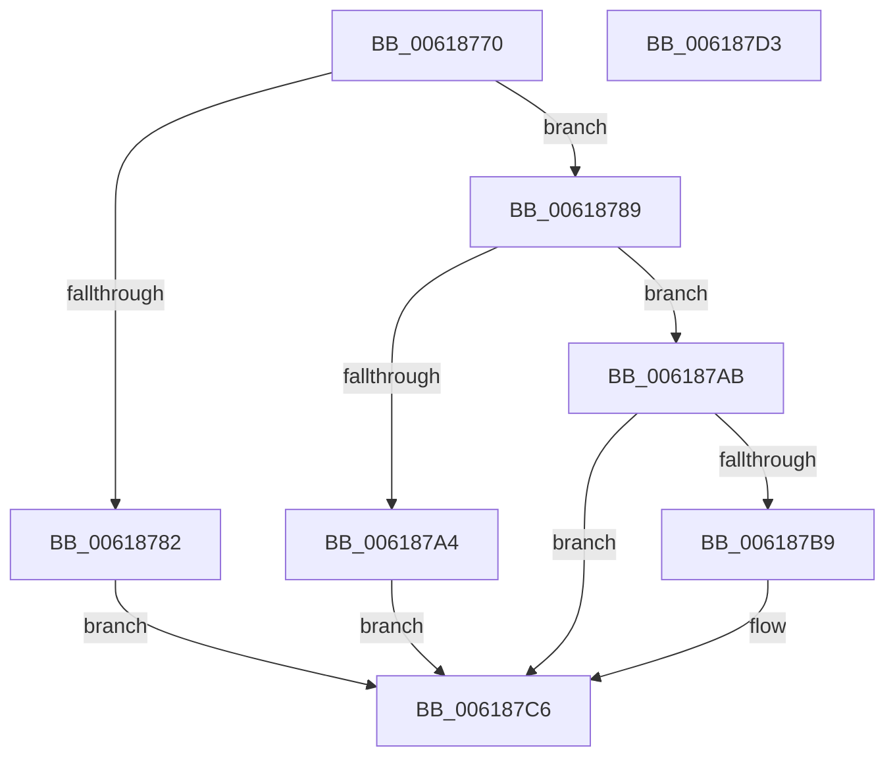

# CarCreateRuleViolationDetails

- RVA: `0x00618770`–`0x006187D4` (길이 `100` bytes)
- VA: `0x0000000140618770`
- 실행 섹션: `.text`
- PDB 이름 있음: `예`; PDB Function 태그: `아니요`
- unwind 정보 RVA: `0x0005CAAC`
- 디코드: `31`개 명령, `100/100` bytes 표시
- 미해석 바이트: `0` (있으면 어셈블리에 `.byte`로 보존)

> 이 문서는 커널 이미지의 기계어와 PDB 기호를 분석해 생성했습니다. 4번과 5번은 함수 원형과 자료형을 바이너리 사용 방식에서 추정한 C 해석이며 원본 소스 복구 결과는 아닙니다.

## 1. Dependencies

- 직접 호출 지점: **3**; 고유 호출 대상: **3**
- 직접 호출자로 확인된 함수: **1**
- RIP 상대 이미지 참조: **0**

### Outgoing calls
- `0x00618797` → [ExAllocatePool2](../../poolcode/B8/ExAllocatePool2_function_00B820F0.md) (function, `0x00B820F0`)
- `0x006187AE` → [CarInitializeRuleViolationDetails](CarInitializeRuleViolationDetails_function_00618B80.md) (function, `0x00618B80`)
- `0x006187C1` → [ExFreePoolWithTag](../../poolcode/B8/ExFreePoolWithTag_function_00B82870.md) (function, `0x00B82870`)

### Direct callers
- [CarReportDifPluginRuleViolation](CarReportDifPluginRuleViolation_function_00619250.md) at `0x006192E5`

### Static image references
- 디코드된 RIP-relative 메모리 참조가 없습니다.

## 2. Other-region calls and transfers

- 다른 실행 섹션으로 향하는 call: **2**
  - `0x00618797` → [ExAllocatePool2](../../poolcode/B8/ExAllocatePool2_function_00B820F0.md) (`.text` → `POOLCODE`)
  - `0x006187C1` → [ExFreePoolWithTag](../../poolcode/B8/ExFreePoolWithTag_function_00B82870.md) (`.text` → `POOLCODE`)
- 별도 외부 분기/꼬리 이동을 확인하지 못했습니다.

## 3. Assembly (complete function range)

```asm
00618770  48 89 5C 24 08                  mov qword ptr [rsp + 8], rbx
00618775  57                              push rdi
00618776  48 83 EC 20                     sub rsp, 0x20
0061877A  48 8B F9                        mov rdi, rcx
0061877D  48 85 C9                        test rcx, rcx
00618780  75 07                           jne 0x140618789
00618782  BB 0D 00 00 C0                  mov ebx, 0xc000000d
00618787  EB 3D                           jmp 0x1406187c6
00618789  BA 58 00 00 00                  mov edx, 0x58
0061878E  41 B8 43 61 72 4E               mov r8d, 0x4e726143
00618794  8D 4A E8                        lea ecx, [rdx - 0x18]
00618797  E8 54 99 56 00                  call 0x140b820f0
0061879C  48 89 07                        mov qword ptr [rdi], rax
0061879F  48 85 C0                        test rax, rax
006187A2  75 07                           jne 0x1406187ab
006187A4  BB 17 00 00 C0                  mov ebx, 0xc0000017
006187A9  EB 1B                           jmp 0x1406187c6
006187AB  48 8B C8                        mov rcx, rax
006187AE  E8 CD 03 00 00                  call 0x140618b80
006187B3  8B D8                           mov ebx, eax
006187B5  85 C0                           test eax, eax
006187B7  79 0D                           jns 0x1406187c6
006187B9  48 8B 0F                        mov rcx, qword ptr [rdi]
006187BC  BA 43 61 72 4E                  mov edx, 0x4e726143
006187C1  E8 AA A0 56 00                  call 0x140b82870
006187C6  8B C3                           mov eax, ebx
006187C8  48 8B 5C 24 30                  mov rbx, qword ptr [rsp + 0x30]
006187CD  48 83 C4 20                     add rsp, 0x20
006187D1  5F                              pop rdi
006187D2  C3                              ret
006187D3  CC                              int3
```

## 4. C-style interpretation (structured pseudocode)

```c
__int64 __fastcall CarCreateRuleViolationDetails(__int64 a1)
{
    __int64 result;
    __int64 v_rsp;
    unsigned __int64 v_stack_p8;

    v_stack_p8 = v_rbx;
    v_rsp = (v_rsp) - (32);
    if (a1 != 0) goto loc_00618789;
    goto loc_006187C6;
loc_00618789:
    result = ExAllocatePool2(88 - 24, 88, (unsigned int)(0x4E726143ULL), a4);
    *(unsigned __int64 *)(a1) = result;
    if (result != 0) goto loc_006187AB;
    goto loc_006187C6;
loc_006187AB:
    result = CarInitializeRuleViolationDetails(result, 88, (unsigned int)(0x4E726143ULL), a4);
    if (sign_flag) {
        a1 = *(unsigned __int64 *)(a1);
        a2 = 0x4E726143ULL;
        result = ExFreePoolWithTag(a1, a2, (unsigned int)(0x4E726143ULL), a4);
    }
    v_rsp = (v_rsp) + (32);
    return (unsigned int)((unsigned int)((unsigned int)((unsigned int)(result))));
}
```

## 5. (Beta) C Style

```c
int64_t CarCreateRuleViolationDetails(void *Arg1)
{
    uint8_t *arg1 = (uint8_t *)Arg1;

    int64_t result;
    int64_t local_rsp;
    uint64_t v_stack_p8;

    v_stack_p8 = local_rbx;
    local_rsp = (local_rsp) - (32);
    if (Arg1 != NULL) goto loc_00618789;
    goto loc_006187C6;
loc_00618789:
    result = ExAllocatePool2(88 - 24, 88, (uint32_t)(0x4E726143ULL), a4);
    *(uint64_t *)(arg1) = result;
    if (result != 0) goto loc_006187AB;
    goto loc_006187C6;
loc_006187AB:
    result = CarInitializeRuleViolationDetails(result, 88, (uint32_t)(0x4E726143ULL), a4);
    if (sign_flag) {
        Arg1 = *(uint64_t *)(arg1);
        a2 = 0x4E726143ULL;
        result = ExFreePoolWithTag(Arg1, a2, (uint32_t)(0x4E726143ULL), a4);
    }
    local_rsp = (local_rsp) + (32);
    return (uint32_t)((uint32_t)((uint32_t)((uint32_t)(result))));
}
```

### 관측된 메모리 오프셋

구조체 형식이 확인되지 않은 접근은 인자 기준의 오프셋으로만 기록했습니다.

| 기준 인자 | 오프셋 표현 | 폭 (bit) | 접근 |
|---|---:|---:|---|
| `Arg1` | `+ 0x0` | `64` | `R` |
| `Arg1` | `+ 0x0` | `64` | `W` |

## 6. Execution-region graph

[열기: 2D/3D 그래프와 함수 탐색 컨트롤 패널](../../../control-panel.html?section=text&rva=0x00618770&view=graph)

- 2D 그래프는 위에서 아래로 흐르고, 3D 그래프는 빈 공간을 드래그해 회전합니다. Shift+드래그는 이동, 휠은 확대·축소, 함수 노드 선택은 대상 보고서 이동입니다.

### Static fallback


