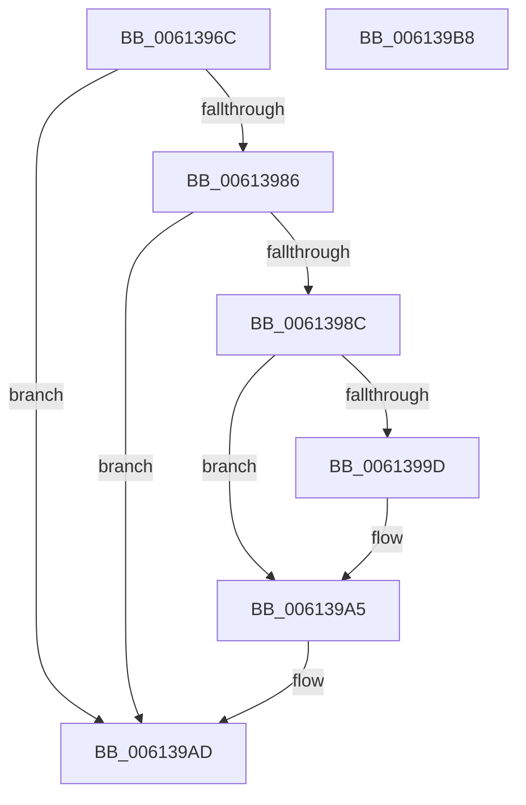

# CarDbRaiseIrqlSafe

- RVA: `0x0061396C`–`0x006139B9` (길이 `77` bytes)
- VA: `0x000000014061396C`
- 실행 섹션: `.text`
- PDB 이름 있음: `예`; PDB Function 태그: `아니요`
- unwind 정보 RVA: `0x0005CAAC`
- 디코드: `23`개 명령, `77/77` bytes 표시
- 미해석 바이트: `0` (있으면 어셈블리에 `.byte`로 보존)

> 이 문서는 커널 이미지의 기계어와 PDB 기호를 분석해 생성했습니다. 4번과 5번은 함수 원형과 자료형을 바이너리 사용 방식에서 추정한 C 해석이며 원본 소스 복구 결과는 아닙니다.

## 1. Dependencies

- 직접 호출 지점: **1**; 고유 호출 대상: **1**
- 직접 호출자로 확인된 함수: **10**
- RIP 상대 이미지 참조: **1**

### Outgoing calls
- `0x006139A0` → [KiRaiseIrqlProcessIrqlFlags](../4F/KiRaiseIrqlProcessIrqlFlags_function_004F56FC.md) (function, `0x004F56FC`)

### Direct callers
- [CarAddUniqueViolation](CarAddUniqueViolation_function_0061B08C.md) at `0x0061B133`
- [CarDeleteDriverRuleViolations](CarDeleteDriverRuleViolations_function_0061B38C.md) at `0x0061B3BB`
- [CarDeletePluginRuleViolations](CarDeletePluginRuleViolations_function_0061B440.md) at `0x0061B467`
- [CarDeleteRuleViolationDB](CarDeleteRuleViolationDB_function_0061B4D0.md) at `0x0061B4F6`
- [CarWriteEarlyRuleViolationEvents](CarWriteEarlyRuleViolationEvents_function_0061B628.md) at `0x0061B65E`
- [VfPtAddStackInfoIfNotExist](../../pagevrfy/B9/VfPtAddStackInfoIfNotExist_function_00B9BD74.md) at `0x00B9BE54`
- [VfPtGenerateTraceInformation](../../pagevrfy/B9/VfPtGenerateTraceInformation_function_00B9BF5C.md) at `0x00B9BFD4`
- [VfPtProcessAllocPoolInfo](../../pagevrfy/B9/VfPtProcessAllocPoolInfo_function_00B9C54C.md) at `0x00B9C58E`
- [VfPtProcessFreePoolInfo](../../pagevrfy/B9/VfPtProcessFreePoolInfo_function_00B9C604.md) at `0x00B9C64A`
- [ViPtDeleteAvlTrees](../../pagevrfy/B9/ViPtDeleteAvlTrees_function_00B9C730.md) at `0x00B9C771`
- [ViPtDeleteAvlTrees](../../pagevrfy/B9/ViPtDeleteAvlTrees_function_00B9C730.md) at `0x00B9C7F5`

### Static image references
- `0x00613994` → RVA `0x00FC6D20` (`ALMOSTRO`; read)

## 2. Other-region calls and transfers

- 다른 실행 섹션으로 향하는 call: **0**
- 별도 외부 분기/꼬리 이동을 확인하지 못했습니다.

## 3. Assembly (complete function range)

```asm
0061396C  48 89 5C 24 08                  mov qword ptr [rsp + 8], rbx
00613971  57                              push rdi
00613972  48 83 EC 20                     sub rsp, 0x20
00613976  48 8B D9                        mov rbx, rcx
00613979  44 0F 20 C0                     mov rax, cr8
0061397D  BA 02 00 00 00                  mov edx, 2
00613982  3A C2                           cmp al, dl
00613984  73 27                           jae 0x1406139ad
00613986  F6 41 09 01                     test byte ptr [rcx + 9], 1
0061398A  75 21                           jne 0x1406139ad
0061398C  44 0F 20 C7                     mov rdi, cr8
00613990  44 0F 22 C2                     mov cr8, rdx
00613994  83 3D 85 33 9B 00 00            cmp dword ptr [rip + 0x9b3385], 0
0061399B  74 08                           je 0x1406139a5
0061399D  40 8A CF                        mov cl, dil
006139A0  E8 57 1D EE FF                  call 0x1404f56fc
006139A5  80 4B 09 01                     or byte ptr [rbx + 9], 1
006139A9  40 88 7B 08                     mov byte ptr [rbx + 8], dil
006139AD  48 8B 5C 24 30                  mov rbx, qword ptr [rsp + 0x30]
006139B2  48 83 C4 20                     add rsp, 0x20
006139B6  5F                              pop rdi
006139B7  C3                              ret
006139B8  CC                              int3
```

## 4. C-style interpretation (structured pseudocode)

```c
__int64 __fastcall CarDbRaiseIrqlSafe(__int64 a1)
{
    __int64 result;
    __int64 v_rsp;
    unsigned __int64 v_stack_p8;

    v_stack_p8 = v_rbx;
    v_rsp = (v_rsp) - (32);
    if (((unsigned __int8)(v_cr8)) >= 2) goto loc_006139AD;
    if (((*(unsigned __int8 *)(a1 + 9)) & (1)) != 0) goto loc_006139AD;
    result = v_cr8;
    if ((*(unsigned int *)(v_rip + 10171269)) != 0) {
        a1 = (unsigned __int8)(v_cr8);
        result = KiRaiseIrqlProcessIrqlFlags(a1, 2, a3, a4);
    }
    *(unsigned __int8 *)(a1 + 8) = (unsigned __int8)(v_cr8);
loc_006139AD:
    v_rsp = (v_rsp) + (32);
    return result;
}
```

## 5. (Beta) C Style

```c
int64_t CarDbRaiseIrqlSafe(void *Arg1)
{
    uint8_t *arg1 = (uint8_t *)Arg1;

    int64_t result;
    int64_t local_rsp;
    uint64_t v_stack_p8;

    v_stack_p8 = local_rbx;
    local_rsp = (local_rsp) - (32);
    if (((uint8_t)(v_cr8)) >= 2) goto loc_006139AD;
    if (((*(uint8_t *)(arg1 + 0x9)) & (1)) != 0) goto loc_006139AD;
    result = v_cr8;
    if ((*(uint32_t *)(v_rip + 0x9B3385)) != 0) {
        Arg1 = (uint8_t)(v_cr8);
        result = KiRaiseIrqlProcessIrqlFlags(Arg1, 2, a3, a4);
    }
    *(uint8_t *)(arg1 + 0x8) = (uint8_t)(v_cr8);
loc_006139AD:
    local_rsp = (local_rsp) + (32);
    return result;
}
```

### 관측된 메모리 오프셋

구조체 형식이 확인되지 않은 접근은 인자 기준의 오프셋으로만 기록했습니다.

| 기준 인자 | 오프셋 표현 | 폭 (bit) | 접근 |
|---|---:|---:|---|
| `Arg1` | `+ 0x8` | `8` | `W` |
| `Arg1` | `+ 0x9` | `8` | `R` |
| `Arg1` | `+ 0x9` | `8` | `R/W` |

## 6. Execution-region graph

[열기: 2D/3D 그래프와 함수 탐색 컨트롤 패널](../../../control-panel.html?section=text&rva=0x0061396C&view=graph)

- 2D 그래프는 위에서 아래로 흐르고, 3D 그래프는 빈 공간을 드래그해 회전합니다. Shift+드래그는 이동, 휠은 확대·축소, 함수 노드 선택은 대상 보고서 이동입니다.

### Static fallback


