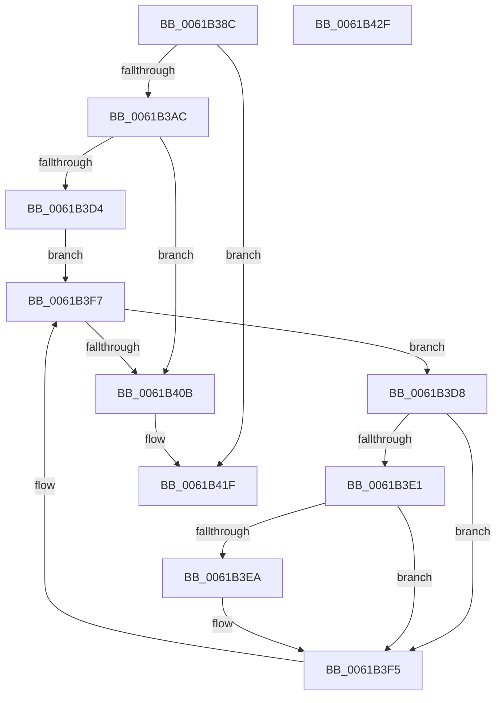

# CarDeleteDriverRuleViolations

- RVA: `0x0061B38C`–`0x0061B430` (길이 `164` bytes)
- VA: `0x000000014061B38C`
- 실행 섹션: `.text`
- PDB 이름 있음: `예`; PDB Function 태그: `아니요`
- unwind 정보 RVA: `0x000733E4`
- 디코드: `46`개 명령, `164/164` bytes 표시
- 미해석 바이트: `0` (있으면 어셈블리에 `.byte`로 보존)

> 이 문서는 커널 이미지의 기계어와 PDB 기호를 분석해 생성했습니다. 4번과 5번은 함수 원형과 자료형을 바이너리 사용 방식에서 추정한 C 해석이며 원본 소스 복구 결과는 아닙니다.

## 1. Dependencies

- 직접 호출 지점: **6**; 고유 호출 대상: **6**
- 직접 호출자로 확인된 함수: **1**
- RIP 상대 이미지 참조: **2**

### Outgoing calls
- `0x0061B3BB` → [CarDbRaiseIrqlSafe](CarDbRaiseIrqlSafe_function_0061396C.md) (function, `0x0061396C`)
- `0x0061B3C5` → [CarAcquireDbLockAtDpcLevelSafe](CarAcquireDbLockAtDpcLevelSafe_function_0061B00C.md) (function, `0x0061B00C`)
- `0x0061B3F0` → [RtlDeleteElementGenericTableAvl](../3E/RtlDeleteElementGenericTableAvl_function_003EE750.md) (function, `0x003EE750`)
- `0x0061B401` → [RtlEnumerateGenericTableAvl](../3E/RtlEnumerateGenericTableAvl_function_003E5AB0.md) (function, `0x003E5AB0`)
- `0x0061B410` → [CarReleaseDbLockFromDpcLevel](CarReleaseDbLockFromDpcLevel_function_0061B5DC.md) (function, `0x0061B5DC`)
- `0x0061B41A` → [CarCleanDbLockContext](CarCleanDbLockContext_function_0061B2E4.md) (function, `0x0061B2E4`)

### Direct callers
- [VfTargetDriversRemove](../3E/VfTargetDriversRemove_function_003EEF9C.md) at `0x003EF164`

### Static image references
- `0x0061B39C` → RVA `0x00F03EA8` (`.data`; read)
- `0x0061B3CA` → RVA `0x00F03EB0` (`.data`; read)

## 2. Other-region calls and transfers

- 다른 실행 섹션으로 향하는 call: **0**
- 별도 외부 분기/꼬리 이동을 확인하지 못했습니다.

## 3. Assembly (complete function range)

```asm
0061B38C  48 8B C4                        mov rax, rsp
0061B38F  48 89 58 08                     mov qword ptr [rax + 8], rbx
0061B393  48 89 70 10                     mov qword ptr [rax + 0x10], rsi
0061B397  57                              push rdi
0061B398  48 83 EC 30                     sub rsp, 0x30
0061B39C  48 83 3D 04 8B 8E 00 00         cmp qword ptr [rip + 0x8e8b04], 0
0061B3A4  48 8B F2                        mov rsi, rdx
0061B3A7  48 8B F9                        mov rdi, rcx
0061B3AA  74 73                           je 0x14061b41f
0061B3AC  0F 57 C0                        xorps xmm0, xmm0
0061B3AF  48 8D 48 E8                     lea rcx, [rax - 0x18]
0061B3B3  0F 11 40 E8                     movups xmmword ptr [rax - 0x18], xmm0
0061B3B7  C6 40 F1 04                     mov byte ptr [rax - 0xf], 4
0061B3BB  E8 AC 85 FF FF                  call 0x14061396c
0061B3C0  48 8D 4C 24 20                  lea rcx, [rsp + 0x20]
0061B3C5  E8 42 FC FF FF                  call 0x14061b00c
0061B3CA  8B 05 E0 8A 8E 00               mov eax, dword ptr [rip + 0x8e8ae0]
0061B3D0  85 C0                           test eax, eax
0061B3D2  74 37                           je 0x14061b40b
0061B3D4  B2 01                           mov dl, 1
0061B3D6  EB 1F                           jmp 0x14061b3f7
0061B3D8  48 8B 48 08                     mov rcx, qword ptr [rax + 8]
0061B3DC  48 3B CF                        cmp rcx, rdi
0061B3DF  72 14                           jb 0x14061b3f5
0061B3E1  48 8D 14 37                     lea rdx, [rdi + rsi]
0061B3E5  48 3B CA                        cmp rcx, rdx
0061B3E8  73 0B                           jae 0x14061b3f5
0061B3EA  48 8B D0                        mov rdx, rax
0061B3ED  48 8B CB                        mov rcx, rbx
0061B3F0  E8 5B 33 DD FF                  call 0x1403ee750
0061B3F5  33 D2                           xor edx, edx
0061B3F7  48 8B 1D AA 8A 8E 00            mov rbx, qword ptr [rip + 0x8e8aaa]
0061B3FE  48 8B CB                        mov rcx, rbx
0061B401  E8 AA A6 DC FF                  call 0x1403e5ab0
0061B406  48 85 C0                        test rax, rax
0061B409  75 CD                           jne 0x14061b3d8
0061B40B  48 8D 4C 24 20                  lea rcx, [rsp + 0x20]
0061B410  E8 C7 01 00 00                  call 0x14061b5dc
0061B415  48 8D 4C 24 20                  lea rcx, [rsp + 0x20]
0061B41A  E8 C5 FE FF FF                  call 0x14061b2e4
0061B41F  48 8B 5C 24 40                  mov rbx, qword ptr [rsp + 0x40]
0061B424  48 8B 74 24 48                  mov rsi, qword ptr [rsp + 0x48]
0061B429  48 83 C4 30                     add rsp, 0x30
0061B42D  5F                              pop rdi
0061B42E  C3                              ret
0061B42F  CC                              int3
```

## 4. C-style interpretation (structured pseudocode)

```c
__int64 __fastcall CarDeleteDriverRuleViolations(__int64 a1, __int64 a2)
{
    __int64 result;
    __int64 v_rsp;
    unsigned __int64 v_stack_m18;
    unsigned __int64 v_stack_p10;
    unsigned __int64 v_stack_p8;

    *(unsigned __int64 *)(v_rsp + 8) = v_rbx;
    *(unsigned __int64 *)(v_rsp + 16) = v_rsi;
    v_rsp = (v_rsp) - (48);
    if ((*(unsigned __int64 *)(v_rip + 9341700)) == 0) goto loc_0061B41F;
    *(unsigned __int64 *)(v_rsp - 24) = v_xmm0;
    *(unsigned __int8 *)(v_rsp - 15) = 4;
    result = CarDbRaiseIrqlSafe(v_rsp - 24, a2, a3, a4);
    result = CarAcquireDbLockAtDpcLevelSafe(v_stack_m18, a2, a3, a4);
    if ((unsigned int)((unsigned int)(*(unsigned int *)(v_rip + 9341664))) == 0) goto loc_0061B40B;
    goto loc_0061B3F7;
loc_0061B3D8:
    if ((*(unsigned __int64 *)((unsigned int)(*(unsigned int *)(v_rip + 9341664)) + 8)) < a1) goto loc_0061B3F5;
    result = (unsigned int)(*(unsigned int *)(v_rip + 9341664));
    if ((*(unsigned __int64 *)((unsigned int)(*(unsigned int *)(v_rip + 9341664)) + 8)) < (a1 + a2 * 1)) {
        a2 = (unsigned int)(*(unsigned int *)(v_rip + 9341664));
        a1 = v_rbx;
        result = RtlDeleteElementGenericTableAvl(a1, a2, a3, a4);
    }
    a2 = 0;
loc_0061B3F7:
    result = RtlEnumerateGenericTableAvl(*(unsigned __int64 *)(v_rip + 9341610), a2, a3, a4);
    if (result != 0) goto loc_0061B3D8;
loc_0061B40B:
    result = CarReleaseDbLockFromDpcLevel(v_stack_m18, a2, a3, a4);
    result = CarCleanDbLockContext(v_stack_m18, a2, a3, a4);
loc_0061B41F:
    v_rsp = (v_rsp) + (48);
    return result;
}
```

## 5. (Beta) C Style

```c
int64_t CarDeleteDriverRuleViolations(void *Arg1, int64_t Arg2)
{
    uint8_t *arg1 = (uint8_t *)Arg1;

    int64_t result;
    int64_t local_rsp;
    uint64_t v_stack_m18;
    uint64_t v_stack_p10;
    uint64_t v_stack_p8;

    *(uint64_t *)(local_rsp + 0x8) = local_rbx;
    *(uint64_t *)(local_rsp + 0x10) = local_rsi;
    local_rsp = (local_rsp) - (48);
    if ((*(uint64_t *)(v_rip + 0x8E8B04)) == 0) goto loc_0061B41F;
    *(uint64_t *)(local_rsp - 0x18) = v_xmm0;
    *(uint8_t *)(local_rsp - 0xF) = 4;
    result = CarDbRaiseIrqlSafe(local_rsp - 24, Arg2, a3, a4);
    result = CarAcquireDbLockAtDpcLevelSafe(v_stack_m18, Arg2, a3, a4);
    if ((uint32_t)((uint32_t)(*(uint32_t *)(v_rip + 0x8E8AE0))) == 0) goto loc_0061B40B;
    goto loc_0061B3F7;
loc_0061B3D8:
    if ((*(uint64_t *)((uint32_t)(*(uint32_t *)(v_rip + 0x8E8AE0)) + 0x8)) < Arg1) goto loc_0061B3F5;
    result = (uint32_t)(*(uint32_t *)(v_rip + 0x8E8AE0));
    if ((*(uint64_t *)((uint32_t)(*(uint32_t *)(v_rip + 0x8E8AE0)) + 0x8)) < (Arg1 + Arg2 * 1)) {
        Arg2 = (uint32_t)(*(uint32_t *)(v_rip + 0x8E8AE0));
        Arg1 = local_rbx;
        result = RtlDeleteElementGenericTableAvl(Arg1, Arg2, a3, a4);
    }
    Arg2 = 0;
loc_0061B3F7:
    result = RtlEnumerateGenericTableAvl(*(uint64_t *)(v_rip + 0x8E8AAA), Arg2, a3, a4);
    if (result != 0) goto loc_0061B3D8;
loc_0061B40B:
    result = CarReleaseDbLockFromDpcLevel(v_stack_m18, Arg2, a3, a4);
    result = CarCleanDbLockContext(v_stack_m18, Arg2, a3, a4);
loc_0061B41F:
    local_rsp = (local_rsp) + (48);
    return result;
}
```

### 관측된 메모리 오프셋

구조체 형식이 확인되지 않은 접근은 인자 기준의 오프셋으로만 기록했습니다.

| 기준 인자 | 오프셋 표현 | 폭 (bit) | 접근 |
|---|---:|---:|---|
| `Arg1` | `+ 0x0 + rsi*1` | `64` | `R` |

## 6. Execution-region graph

[열기: 2D/3D 그래프와 함수 탐색 컨트롤 패널](../../../control-panel.html?section=text&rva=0x0061B38C&view=graph)

- 2D 그래프는 위에서 아래로 흐르고, 3D 그래프는 빈 공간을 드래그해 회전합니다. Shift+드래그는 이동, 휠은 확대·축소, 함수 노드 선택은 대상 보고서 이동입니다.

### Static fallback


