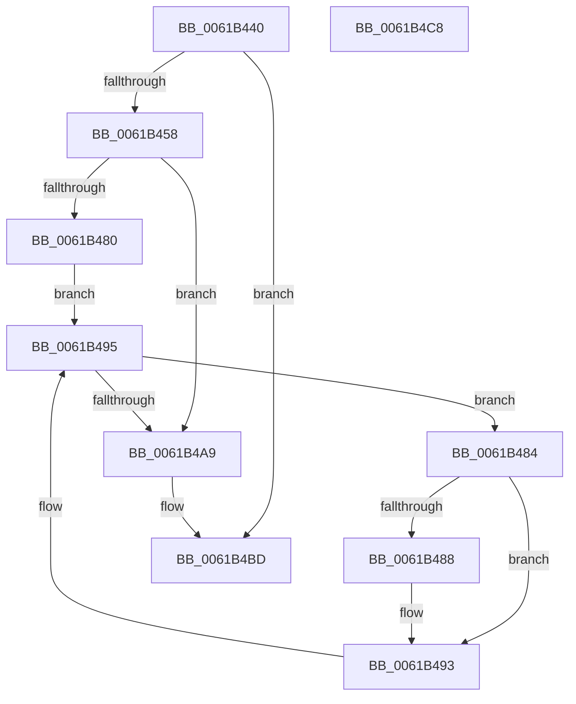

# CarDeletePluginRuleViolations

- RVA: `0x0061B440`–`0x0061B4C9` (길이 `137` bytes)
- VA: `0x000000014061B440`
- 실행 섹션: `.text`
- PDB 이름 있음: `예`; PDB Function 태그: `아니요`
- unwind 정보 RVA: `0x00084AC0`
- 디코드: `39`개 명령, `137/137` bytes 표시
- 미해석 바이트: `0` (있으면 어셈블리에 `.byte`로 보존)

> 이 문서는 커널 이미지의 기계어와 PDB 기호를 분석해 생성했습니다. 4번과 5번은 함수 원형과 자료형을 바이너리 사용 방식에서 추정한 C 해석이며 원본 소스 복구 결과는 아닙니다.

## 1. Dependencies

- 직접 호출 지점: **6**; 고유 호출 대상: **6**
- 직접 호출자로 확인된 함수: **0**
- RIP 상대 이미지 참조: **2**

### Outgoing calls
- `0x0061B467` → [CarDbRaiseIrqlSafe](CarDbRaiseIrqlSafe_function_0061396C.md) (function, `0x0061396C`)
- `0x0061B471` → [CarAcquireDbLockAtDpcLevelSafe](CarAcquireDbLockAtDpcLevelSafe_function_0061B00C.md) (function, `0x0061B00C`)
- `0x0061B48E` → [RtlDeleteElementGenericTableAvl](../3E/RtlDeleteElementGenericTableAvl_function_003EE750.md) (function, `0x003EE750`)
- `0x0061B49F` → [RtlEnumerateGenericTableAvl](../3E/RtlEnumerateGenericTableAvl_function_003E5AB0.md) (function, `0x003E5AB0`)
- `0x0061B4AE` → [CarReleaseDbLockFromDpcLevel](CarReleaseDbLockFromDpcLevel_function_0061B5DC.md) (function, `0x0061B5DC`)
- `0x0061B4B8` → [CarCleanDbLockContext](CarCleanDbLockContext_function_0061B2E4.md) (function, `0x0061B2E4`)

### Direct callers
- 이 함수 시작 RVA로 연결되는 직접 call은 확인되지 않았습니다. 간접 호출은 완전히 역산할 수 없습니다.

### Static image references
- `0x0061B44C` → RVA `0x00F03EA8` (`.data`; read)
- `0x0061B476` → RVA `0x00F03EB0` (`.data`; read)

## 2. Other-region calls and transfers

- 다른 실행 섹션으로 향하는 call: **0**
- 별도 외부 분기/꼬리 이동을 확인하지 못했습니다.

## 3. Assembly (complete function range)

```asm
0061B440  48 8B C4                        mov rax, rsp
0061B443  48 89 58 08                     mov qword ptr [rax + 8], rbx
0061B447  57                              push rdi
0061B448  48 83 EC 30                     sub rsp, 0x30
0061B44C  48 83 3D 54 8A 8E 00 00         cmp qword ptr [rip + 0x8e8a54], 0
0061B454  8B F9                           mov edi, ecx
0061B456  74 65                           je 0x14061b4bd
0061B458  0F 57 C0                        xorps xmm0, xmm0
0061B45B  48 8D 48 E8                     lea rcx, [rax - 0x18]
0061B45F  0F 11 40 E8                     movups xmmword ptr [rax - 0x18], xmm0
0061B463  C6 40 F1 04                     mov byte ptr [rax - 0xf], 4
0061B467  E8 00 85 FF FF                  call 0x14061396c
0061B46C  48 8D 4C 24 20                  lea rcx, [rsp + 0x20]
0061B471  E8 96 FB FF FF                  call 0x14061b00c
0061B476  8B 05 34 8A 8E 00               mov eax, dword ptr [rip + 0x8e8a34]
0061B47C  85 C0                           test eax, eax
0061B47E  74 29                           je 0x14061b4a9
0061B480  B2 01                           mov dl, 1
0061B482  EB 11                           jmp 0x14061b495
0061B484  39 38                           cmp dword ptr [rax], edi
0061B486  75 0B                           jne 0x14061b493
0061B488  48 8B D0                        mov rdx, rax
0061B48B  48 8B CB                        mov rcx, rbx
0061B48E  E8 BD 32 DD FF                  call 0x1403ee750
0061B493  33 D2                           xor edx, edx
0061B495  48 8B 1D 0C 8A 8E 00            mov rbx, qword ptr [rip + 0x8e8a0c]
0061B49C  48 8B CB                        mov rcx, rbx
0061B49F  E8 0C A6 DC FF                  call 0x1403e5ab0
0061B4A4  48 85 C0                        test rax, rax
0061B4A7  75 DB                           jne 0x14061b484
0061B4A9  48 8D 4C 24 20                  lea rcx, [rsp + 0x20]
0061B4AE  E8 29 01 00 00                  call 0x14061b5dc
0061B4B3  48 8D 4C 24 20                  lea rcx, [rsp + 0x20]
0061B4B8  E8 27 FE FF FF                  call 0x14061b2e4
0061B4BD  48 8B 5C 24 40                  mov rbx, qword ptr [rsp + 0x40]
0061B4C2  48 83 C4 30                     add rsp, 0x30
0061B4C6  5F                              pop rdi
0061B4C7  C3                              ret
0061B4C8  CC                              int3
```

## 4. C-style interpretation (structured pseudocode)

```c
__int64 __fastcall CarDeletePluginRuleViolations(int a1)
{
    __int64 result;
    __int64 v_rsp;
    unsigned __int64 v_stack_m18;
    unsigned __int64 v_stack_p8;

    *(unsigned __int64 *)(v_rsp + 8) = v_rbx;
    v_rsp = (v_rsp) - (48);
    if ((*(unsigned __int64 *)(v_rip + 9341524)) == 0) goto loc_0061B4BD;
    *(unsigned __int64 *)(v_rsp - 24) = v_xmm0;
    *(unsigned __int8 *)(v_rsp - 15) = 4;
    result = CarDbRaiseIrqlSafe(v_rsp - 24, a2, a3, a4);
    result = CarAcquireDbLockAtDpcLevelSafe(v_stack_m18, a2, a3, a4);
    if ((unsigned int)((unsigned int)(*(unsigned int *)(v_rip + 9341492))) == 0) goto loc_0061B4A9;
    goto loc_0061B495;
loc_0061B484:
    result = (unsigned int)(*(unsigned int *)(v_rip + 9341492));
    if ((*(unsigned int *)((unsigned int)(*(unsigned int *)(v_rip + 9341492)))) == ((unsigned int)((unsigned int)(a1)))) {
        a2 = (unsigned int)(*(unsigned int *)(v_rip + 9341492));
        a1 = v_rbx;
        result = RtlDeleteElementGenericTableAvl(a1, a2, a3, a4);
    }
    a2 = 0;
loc_0061B495:
    result = RtlEnumerateGenericTableAvl(*(unsigned __int64 *)(v_rip + 9341452), a2, a3, a4);
    if (result != 0) goto loc_0061B484;
loc_0061B4A9:
    result = CarReleaseDbLockFromDpcLevel(v_stack_m18, a2, a3, a4);
    result = CarCleanDbLockContext(v_stack_m18, a2, a3, a4);
loc_0061B4BD:
    v_rsp = (v_rsp) + (48);
    return result;
}
```

## 5. (Beta) C Style

```c
int64_t CarDeletePluginRuleViolations(int32_t Arg1)
{
    int64_t result;
    int64_t local_rsp;
    uint64_t v_stack_m18;
    uint64_t v_stack_p8;

    *(uint64_t *)(local_rsp + 0x8) = local_rbx;
    local_rsp = (local_rsp) - (48);
    if ((*(uint64_t *)(v_rip + 0x8E8A54)) == 0) goto loc_0061B4BD;
    *(uint64_t *)(local_rsp - 0x18) = v_xmm0;
    *(uint8_t *)(local_rsp - 0xF) = 4;
    result = CarDbRaiseIrqlSafe(local_rsp - 24, a2, a3, a4);
    result = CarAcquireDbLockAtDpcLevelSafe(v_stack_m18, a2, a3, a4);
    if ((uint32_t)((uint32_t)(*(uint32_t *)(v_rip + 0x8E8A34))) == 0) goto loc_0061B4A9;
    goto loc_0061B495;
loc_0061B484:
    result = (uint32_t)(*(uint32_t *)(v_rip + 0x8E8A34));
    if ((*(uint32_t *)((uint32_t)(*(uint32_t *)(v_rip + 0x8E8A34)))) == ((uint32_t)((uint32_t)(Arg1)))) {
        a2 = (uint32_t)(*(uint32_t *)(v_rip + 0x8E8A34));
        Arg1 = local_rbx;
        result = RtlDeleteElementGenericTableAvl(Arg1, a2, a3, a4);
    }
    a2 = 0;
loc_0061B495:
    result = RtlEnumerateGenericTableAvl(*(uint64_t *)(v_rip + 0x8E8A0C), a2, a3, a4);
    if (result != 0) goto loc_0061B484;
loc_0061B4A9:
    result = CarReleaseDbLockFromDpcLevel(v_stack_m18, a2, a3, a4);
    result = CarCleanDbLockContext(v_stack_m18, a2, a3, a4);
loc_0061B4BD:
    local_rsp = (local_rsp) + (48);
    return result;
}
```

## 6. Execution-region graph

[열기: 2D/3D 그래프와 함수 탐색 컨트롤 패널](../../../control-panel.html?section=text&rva=0x0061B440&view=graph)

- 2D 그래프는 위에서 아래로 흐르고, 3D 그래프는 빈 공간을 드래그해 회전합니다. Shift+드래그는 이동, 휠은 확대·축소, 함수 노드 선택은 대상 보고서 이동입니다.

### Static fallback


