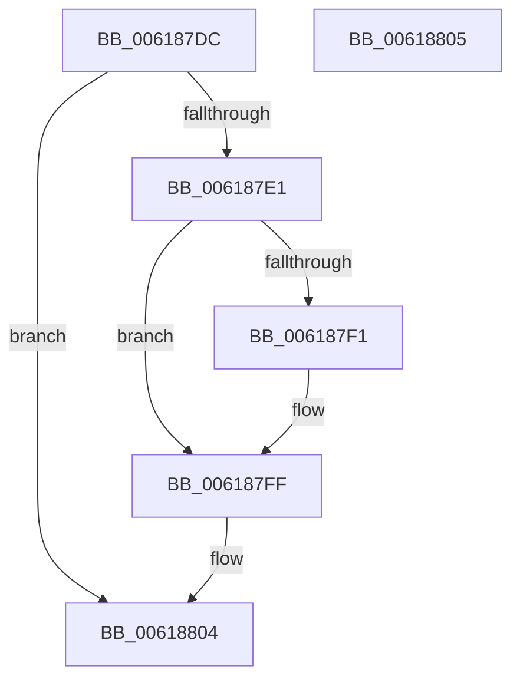

# CarDeleteRuleOverrideEntry

- RVA: `0x006187DC`–`0x00618806` (길이 `42` bytes)
- VA: `0x00000001406187DC`
- 실행 섹션: `.text`
- PDB 이름 있음: `예`; PDB Function 태그: `아니요`
- unwind 정보 RVA: `0x000805BC`
- 디코드: `15`개 명령, `42/42` bytes 표시
- 미해석 바이트: `0` (있으면 어셈블리에 `.byte`로 보존)

> 이 문서는 커널 이미지의 기계어와 PDB 기호를 분석해 생성했습니다. 4번과 5번은 함수 원형과 자료형을 바이너리 사용 방식에서 추정한 C 해석이며 원본 소스 복구 결과는 아닙니다.

## 1. Dependencies

- 직접 호출 지점: **1**; 고유 호출 대상: **1**
- 직접 호출자로 확인된 함수: **2**
- RIP 상대 이미지 참조: **0**

### Outgoing calls
- `0x006187F6` → [ExFreePoolWithTag](../../poolcode/B8/ExFreePoolWithTag_function_00B82870.md) (function, `0x00B82870`)

### Direct callers
- [CarDeregisterRuleClassConfiguration](CarDeregisterRuleClassConfiguration_function_00618870.md) at `0x006188D6`
- [CarDeregisterRuleOverride](CarDeregisterRuleOverride_function_00618910.md) at `0x00618961`

### Static image references
- 디코드된 RIP-relative 메모리 참조가 없습니다.

## 2. Other-region calls and transfers

- 다른 실행 섹션으로 향하는 call: **1**
  - `0x006187F6` → [ExFreePoolWithTag](../../poolcode/B8/ExFreePoolWithTag_function_00B82870.md) (`.text` → `POOLCODE`)
- 별도 외부 분기/꼬리 이동을 확인하지 못했습니다.

## 3. Assembly (complete function range)

```asm
006187DC  48 85 C9                        test rcx, rcx
006187DF  74 23                           je 0x140618804
006187E1  53                              push rbx
006187E2  48 83 EC 20                     sub rsp, 0x20
006187E6  48 8B D9                        mov rbx, rcx
006187E9  48 8B 09                        mov rcx, qword ptr [rcx]
006187EC  48 85 C9                        test rcx, rcx
006187EF  74 0E                           je 0x1406187ff
006187F1  BA 43 61 72 4E                  mov edx, 0x4e726143
006187F6  E8 75 A0 56 00                  call 0x140b82870
006187FB  48 83 23 00                     and qword ptr [rbx], 0
006187FF  48 83 C4 20                     add rsp, 0x20
00618803  5B                              pop rbx
00618804  C3                              ret
00618805  CC                              int3
```

## 4. C-style interpretation (structured pseudocode)

```c
__int64 __fastcall CarDeleteRuleOverrideEntry(__int64 a1)
{
    __int64 result;
    __int64 v_rsp;

    if (a1 == 0) goto loc_00618804;
    v_rsp = (v_rsp) - (32);
    if (*(unsigned __int64 *)(a1) != 0) {
        a2 = 0x4E726143ULL;
        result = ExFreePoolWithTag(*(unsigned __int64 *)(a1), a2, a3, a4);
    }
    v_rsp = (v_rsp) + (32);
loc_00618804:
    return result;
}
```

## 5. (Beta) C Style

```c
int64_t CarDeleteRuleOverrideEntry(int64_t Arg1)
{
    int64_t result;
    int64_t local_rsp;

    if (Arg1 == 0) goto loc_00618804;
    local_rsp = (local_rsp) - (32);
    if (*(uint64_t *)(Arg1) != 0) {
        a2 = 0x4E726143ULL;
        result = ExFreePoolWithTag(*(uint64_t *)(Arg1), a2, a3, a4);
    }
    local_rsp = (local_rsp) + (32);
loc_00618804:
    return result;
}
```

## 6. Execution-region graph

[열기: 2D/3D 그래프와 함수 탐색 컨트롤 패널](../../../control-panel.html?section=text&rva=0x006187DC&view=graph)

- 2D 그래프는 위에서 아래로 흐르고, 3D 그래프는 빈 공간을 드래그해 회전합니다. Shift+드래그는 이동, 휠은 확대·축소, 함수 노드 선택은 대상 보고서 이동입니다.

### Static fallback


