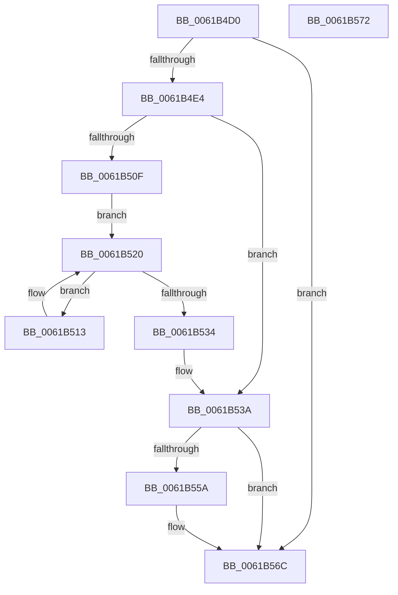

# CarDeleteRuleViolationDB

- RVA: `0x0061B4D0`–`0x0061B573` (길이 `163` bytes)
- VA: `0x000000014061B4D0`
- 실행 섹션: `.text`
- PDB 이름 있음: `예`; PDB Function 태그: `아니요`
- unwind 정보 RVA: `0x00064C80`
- 디코드: `40`개 명령, `163/163` bytes 표시
- 미해석 바이트: `0` (있으면 어셈블리에 `.byte`로 보존)

> 이 문서는 커널 이미지의 기계어와 PDB 기호를 분석해 생성했습니다. 4번과 5번은 함수 원형과 자료형을 바이너리 사용 방식에서 추정한 C 해석이며 원본 소스 복구 결과는 아닙니다.

## 1. Dependencies

- 직접 호출 지점: **7**; 고유 호출 대상: **7**
- 직접 호출자로 확인된 함수: **1**
- RIP 상대 이미지 참조: **4**

### Outgoing calls
- `0x0061B4F6` → [CarDbRaiseIrqlSafe](CarDbRaiseIrqlSafe_function_0061396C.md) (function, `0x0061396C`)
- `0x0061B500` → [CarAcquireDbLockAtDpcLevelSafe](CarAcquireDbLockAtDpcLevelSafe_function_0061B00C.md) (function, `0x0061B00C`)
- `0x0061B519` → [RtlDeleteElementGenericTableAvl](../3E/RtlDeleteElementGenericTableAvl_function_003EE750.md) (function, `0x003EE750`)
- `0x0061B52A` → [RtlEnumerateGenericTableAvl](../3E/RtlEnumerateGenericTableAvl_function_003E5AB0.md) (function, `0x003E5AB0`)
- `0x0061B53F` → [CarReleaseDbLockFromDpcLevel](CarReleaseDbLockFromDpcLevel_function_0061B5DC.md) (function, `0x0061B5DC`)
- `0x0061B549` → [CarCleanDbLockContext](CarCleanDbLockContext_function_0061B2E4.md) (function, `0x0061B2E4`)
- `0x0061B55F` → [ExFreePoolWithTag](../../poolcode/B8/ExFreePoolWithTag_function_00B82870.md) (function, `0x00B82870`)

### Direct callers
- [CarCleanup](CarCleanup_function_0061850C.md) at `0x0061851E`

### Static image references
- `0x0061B4D6` → RVA `0x00F03EA8` (`.data`; read)
- `0x0061B505` → RVA `0x00F03EB0` (`.data`; read)
- `0x0061B534` → RVA `0x00F03EB0` (`.data`; write)
- `0x0061B564` → RVA `0x00F03EA8` (`.data`; read/write)

## 2. Other-region calls and transfers

- 다른 실행 섹션으로 향하는 call: **1**
  - `0x0061B55F` → [ExFreePoolWithTag](../../poolcode/B8/ExFreePoolWithTag_function_00B82870.md) (`.text` → `POOLCODE`)
- 별도 외부 분기/꼬리 이동을 확인하지 못했습니다.

## 3. Assembly (complete function range)

```asm
0061B4D0  40 53                           push rbx
0061B4D2  48 83 EC 30                     sub rsp, 0x30
0061B4D6  48 83 3D CA 89 8E 00 00         cmp qword ptr [rip + 0x8e89ca], 0
0061B4DE  0F 84 88 00 00 00               je 0x14061b56c
0061B4E4  0F 57 C0                        xorps xmm0, xmm0
0061B4E7  48 8D 4C 24 20                  lea rcx, [rsp + 0x20]
0061B4EC  0F 11 44 24 20                  movups xmmword ptr [rsp + 0x20], xmm0
0061B4F1  C6 44 24 29 04                  mov byte ptr [rsp + 0x29], 4
0061B4F6  E8 71 84 FF FF                  call 0x14061396c
0061B4FB  48 8D 4C 24 20                  lea rcx, [rsp + 0x20]
0061B500  E8 07 FB FF FF                  call 0x14061b00c
0061B505  8B 05 A5 89 8E 00               mov eax, dword ptr [rip + 0x8e89a5]
0061B50B  85 C0                           test eax, eax
0061B50D  74 2B                           je 0x14061b53a
0061B50F  B2 01                           mov dl, 1
0061B511  EB 0D                           jmp 0x14061b520
0061B513  48 8B D0                        mov rdx, rax
0061B516  48 8B CB                        mov rcx, rbx
0061B519  E8 32 32 DD FF                  call 0x1403ee750
0061B51E  33 D2                           xor edx, edx
0061B520  48 8B 1D 81 89 8E 00            mov rbx, qword ptr [rip + 0x8e8981]
0061B527  48 8B CB                        mov rcx, rbx
0061B52A  E8 81 A5 DC FF                  call 0x1403e5ab0
0061B52F  48 85 C0                        test rax, rax
0061B532  75 DF                           jne 0x14061b513
0061B534  89 05 76 89 8E 00               mov dword ptr [rip + 0x8e8976], eax
0061B53A  48 8D 4C 24 20                  lea rcx, [rsp + 0x20]
0061B53F  E8 98 00 00 00                  call 0x14061b5dc
0061B544  48 8D 4C 24 20                  lea rcx, [rsp + 0x20]
0061B549  E8 96 FD FF FF                  call 0x14061b2e4
0061B54E  48 8B 0D 53 89 8E 00            mov rcx, qword ptr [rip + 0x8e8953]
0061B555  48 85 C9                        test rcx, rcx
0061B558  74 12                           je 0x14061b56c
0061B55A  BA 43 61 72 4E                  mov edx, 0x4e726143
0061B55F  E8 0C 73 56 00                  call 0x140b82870
0061B564  48 83 25 3C 89 8E 00 00         and qword ptr [rip + 0x8e893c], 0
0061B56C  48 83 C4 30                     add rsp, 0x30
0061B570  5B                              pop rbx
0061B571  C3                              ret
0061B572  CC                              int3
```

## 4. C-style interpretation (structured pseudocode)

```c
__int64 __fastcall CarDeleteRuleViolationDB(void)
{
    __int64 result;
    __int64 v_rsp;
    unsigned __int64 v_stack_m18;
    unsigned __int8 v_stack_mF;

    v_rsp = (v_rsp) - (48);
    if ((*(unsigned __int64 *)(v_rip + 9341386)) == 0) goto loc_0061B56C;
    v_stack_m18 = v_xmm0;
    v_stack_mF = 4;
    result = CarDbRaiseIrqlSafe(v_stack_m18, a2, a3, a4);
    result = CarAcquireDbLockAtDpcLevelSafe(v_stack_m18, a2, a3, a4);
    if ((unsigned int)((unsigned int)(*(unsigned int *)(v_rip + 9341349))) == 0) goto loc_0061B53A;
    goto loc_0061B520;
loc_0061B513:
    result = RtlDeleteElementGenericTableAvl(v_rbx, (unsigned int)(*(unsigned int *)(v_rip + 9341349)), a3, a4);
    a2 = 0;
loc_0061B520:
    result = RtlEnumerateGenericTableAvl(*(unsigned __int64 *)(v_rip + 9341313), a2, a3, a4);
    if (result != 0) goto loc_0061B513;
    *(unsigned int *)(v_rip + 9341302) = (unsigned int)(result);
loc_0061B53A:
    result = CarReleaseDbLockFromDpcLevel(v_stack_m18, a2, a3, a4);
    result = CarCleanDbLockContext(v_stack_m18, a2, a3, a4);
    if (*(unsigned __int64 *)(v_rip + 9341267) != 0) {
        a2 = 0x4E726143ULL;
        result = ExFreePoolWithTag(*(unsigned __int64 *)(v_rip + 9341267), a2, a3, a4);
    }
    v_rsp = (v_rsp) + (48);
    return result;
}
```

## 5. (Beta) C Style

```c
void CarDeleteRuleViolationDB(void)
{
    int64_t result;
    int64_t local_rsp;
    uint64_t v_stack_m18;
    uint8_t v_stack_mF;

    local_rsp = (local_rsp) - (48);
    if ((*(uint64_t *)(v_rip + 0x8E89CA)) == 0) goto loc_0061B56C;
    v_stack_m18 = v_xmm0;
    v_stack_mF = 4;
    result = CarDbRaiseIrqlSafe(v_stack_m18, a2, a3, a4);
    result = CarAcquireDbLockAtDpcLevelSafe(v_stack_m18, a2, a3, a4);
    if ((uint32_t)((uint32_t)(*(uint32_t *)(v_rip + 0x8E89A5))) == 0) goto loc_0061B53A;
    goto loc_0061B520;
loc_0061B513:
    result = RtlDeleteElementGenericTableAvl(local_rbx, (uint32_t)(*(uint32_t *)(v_rip + 0x8E89A5)), a3, a4);
    a2 = 0;
loc_0061B520:
    result = RtlEnumerateGenericTableAvl(*(uint64_t *)(v_rip + 0x8E8981), a2, a3, a4);
    if (result != 0) goto loc_0061B513;
    *(uint32_t *)(v_rip + 0x8E8976) = (uint32_t)(result);
loc_0061B53A:
    result = CarReleaseDbLockFromDpcLevel(v_stack_m18, a2, a3, a4);
    result = CarCleanDbLockContext(v_stack_m18, a2, a3, a4);
    if (*(uint64_t *)(v_rip + 0x8E8953) != 0) {
        a2 = 0x4E726143ULL;
        result = ExFreePoolWithTag(*(uint64_t *)(v_rip + 0x8E8953), a2, a3, a4);
    }
    local_rsp = (local_rsp) + (48);
    return result;
}
```

## 6. Execution-region graph

[열기: 2D/3D 그래프와 함수 탐색 컨트롤 패널](../../../control-panel.html?section=text&rva=0x0061B4D0&view=graph)

- 2D 그래프는 위에서 아래로 흐르고, 3D 그래프는 빈 공간을 드래그해 회전합니다. Shift+드래그는 이동, 휠은 확대·축소, 함수 노드 선택은 대상 보고서 이동입니다.

### Static fallback


