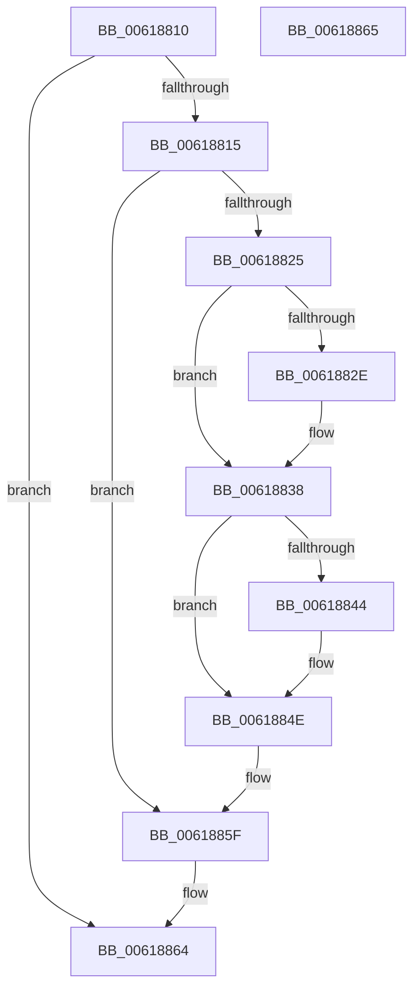

# CarDeleteRuleViolationDetails

- RVA: `0x00618810`–`0x00618866` (길이 `86` bytes)
- VA: `0x0000000140618810`
- 실행 섹션: `.text`
- PDB 이름 있음: `예`; PDB Function 태그: `아니요`
- unwind 정보 RVA: `0x000805BC`
- 디코드: `27`개 명령, `86/86` bytes 표시
- 미해석 바이트: `0` (있으면 어셈블리에 `.byte`로 보존)

> 이 문서는 커널 이미지의 기계어와 PDB 기호를 분석해 생성했습니다. 4번과 5번은 함수 원형과 자료형을 바이너리 사용 방식에서 추정한 C 해석이며 원본 소스 복구 결과는 아닙니다.

## 1. Dependencies

- 직접 호출 지점: **3**; 고유 호출 대상: **1**
- 직접 호출자로 확인된 함수: **1**
- RIP 상대 이미지 참조: **0**

### Outgoing calls
- `0x00618833` → [ExFreePoolWithTag](../../poolcode/B8/ExFreePoolWithTag_function_00B82870.md) (function, `0x00B82870`)
- `0x00618849` → [ExFreePoolWithTag](../../poolcode/B8/ExFreePoolWithTag_function_00B82870.md) (function, `0x00B82870`)
- `0x00618856` → [ExFreePoolWithTag](../../poolcode/B8/ExFreePoolWithTag_function_00B82870.md) (function, `0x00B82870`)

### Direct callers
- [CarReportDifPluginRuleViolation](CarReportDifPluginRuleViolation_function_00619250.md) at `0x006194F6`

### Static image references
- 디코드된 RIP-relative 메모리 참조가 없습니다.

## 2. Other-region calls and transfers

- 다른 실행 섹션으로 향하는 call: **3**
  - `0x00618833` → [ExFreePoolWithTag](../../poolcode/B8/ExFreePoolWithTag_function_00B82870.md) (`.text` → `POOLCODE`)
  - `0x00618849` → [ExFreePoolWithTag](../../poolcode/B8/ExFreePoolWithTag_function_00B82870.md) (`.text` → `POOLCODE`)
  - `0x00618856` → [ExFreePoolWithTag](../../poolcode/B8/ExFreePoolWithTag_function_00B82870.md) (`.text` → `POOLCODE`)
- 별도 외부 분기/꼬리 이동을 확인하지 못했습니다.

## 3. Assembly (complete function range)

```asm
00618810  48 85 C9                        test rcx, rcx
00618813  74 4F                           je 0x140618864
00618815  53                              push rbx
00618816  48 83 EC 20                     sub rsp, 0x20
0061881A  48 8B 01                        mov rax, qword ptr [rcx]
0061881D  48 8B D9                        mov rbx, rcx
00618820  48 85 C0                        test rax, rax
00618823  74 3A                           je 0x14061885f
00618825  48 8B 48 38                     mov rcx, qword ptr [rax + 0x38]
00618829  48 85 C9                        test rcx, rcx
0061882C  74 0A                           je 0x140618838
0061882E  BA 43 61 72 4E                  mov edx, 0x4e726143
00618833  E8 38 A0 56 00                  call 0x140b82870
00618838  48 8B 03                        mov rax, qword ptr [rbx]
0061883B  48 8B 48 18                     mov rcx, qword ptr [rax + 0x18]
0061883F  48 85 C9                        test rcx, rcx
00618842  74 0A                           je 0x14061884e
00618844  BA 43 61 72 4E                  mov edx, 0x4e726143
00618849  E8 22 A0 56 00                  call 0x140b82870
0061884E  48 8B 0B                        mov rcx, qword ptr [rbx]
00618851  BA 43 61 72 4E                  mov edx, 0x4e726143
00618856  E8 15 A0 56 00                  call 0x140b82870
0061885B  48 83 23 00                     and qword ptr [rbx], 0
0061885F  48 83 C4 20                     add rsp, 0x20
00618863  5B                              pop rbx
00618864  C3                              ret
00618865  CC                              int3
```

## 4. C-style interpretation (structured pseudocode)

```c
__int64 __fastcall CarDeleteRuleViolationDetails(__int64 a1)
{
    __int64 result;
    __int64 v_rsp;

    if (a1 == 0) goto loc_00618864;
    v_rsp = (v_rsp) - (32);
    if (*(unsigned __int64 *)(a1) == 0) goto loc_0061885F;
    result = *(unsigned __int64 *)(a1);
    if (*(unsigned __int64 *)(*(unsigned __int64 *)(a1) + 56) != 0) {
        a2 = 0x4E726143ULL;
        result = ExFreePoolWithTag(*(unsigned __int64 *)(*(unsigned __int64 *)(a1) + 56), a2, a3, a4);
    }
    result = *(unsigned __int64 *)(a1);
    if (*(unsigned __int64 *)(*(unsigned __int64 *)(a1) + 24) != 0) {
        a2 = 0x4E726143ULL;
        result = ExFreePoolWithTag(*(unsigned __int64 *)(*(unsigned __int64 *)(a1) + 24), a2, a3, a4);
    }
    result = ExFreePoolWithTag(*(unsigned __int64 *)(a1), (unsigned int)(0x4E726143ULL), a3, a4);
loc_0061885F:
    v_rsp = (v_rsp) + (32);
loc_00618864:
    return result;
}
```

## 5. (Beta) C Style

```c
int64_t CarDeleteRuleViolationDetails(int64_t Arg1)
{
    int64_t result;
    int64_t local_rsp;

    if (Arg1 == 0) goto loc_00618864;
    local_rsp = (local_rsp) - (32);
    if (*(uint64_t *)(Arg1) == 0) goto loc_0061885F;
    result = *(uint64_t *)(Arg1);
    if (*(uint64_t *)(*(uint64_t *)(Arg1) + 0x38) != 0) {
        a2 = 0x4E726143ULL;
        result = ExFreePoolWithTag(*(uint64_t *)(*(uint64_t *)(Arg1) + 0x38), a2, a3, a4);
    }
    result = *(uint64_t *)(Arg1);
    if (*(uint64_t *)(*(uint64_t *)(Arg1) + 0x18) != 0) {
        a2 = 0x4E726143ULL;
        result = ExFreePoolWithTag(*(uint64_t *)(*(uint64_t *)(Arg1) + 0x18), a2, a3, a4);
    }
    result = ExFreePoolWithTag(*(uint64_t *)(Arg1), (uint32_t)(0x4E726143ULL), a3, a4);
loc_0061885F:
    local_rsp = (local_rsp) + (32);
loc_00618864:
    return result;
}
```

## 6. Execution-region graph

[열기: 2D/3D 그래프와 함수 탐색 컨트롤 패널](../../../control-panel.html?section=text&rva=0x00618810&view=graph)

- 2D 그래프는 위에서 아래로 흐르고, 3D 그래프는 빈 공간을 드래그해 회전합니다. Shift+드래그는 이동, 휠은 확대·축소, 함수 노드 선택은 대상 보고서 이동입니다.

### Static fallback


