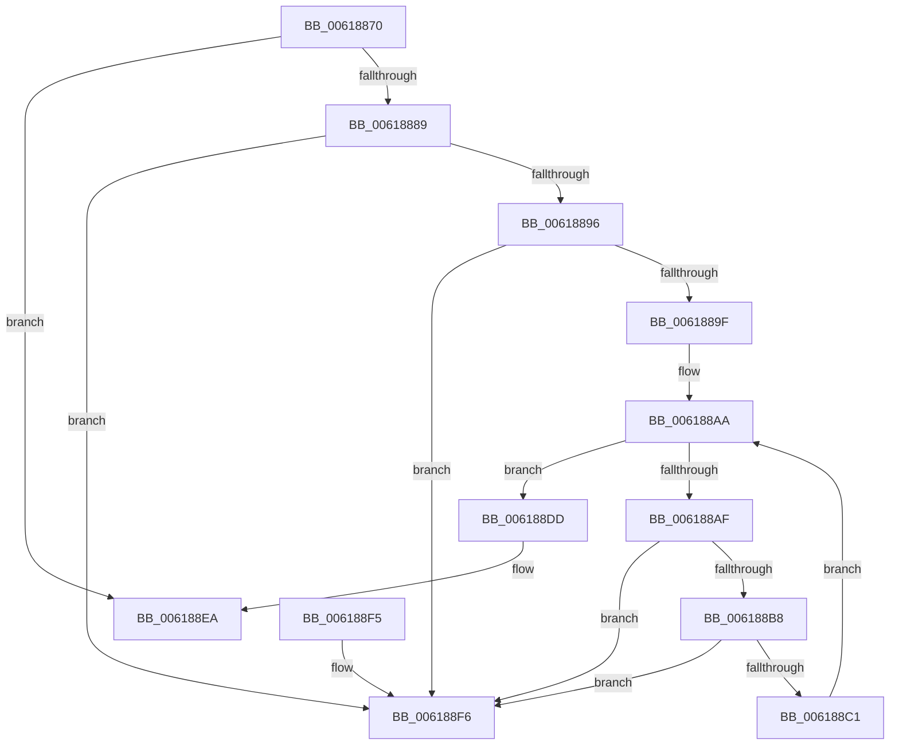

# CarDeregisterRuleClassConfiguration

- RVA: `0x00618870`–`0x006188FD` (길이 `141` bytes)
- VA: `0x0000000140618870`
- 실행 섹션: `.text`
- PDB 이름 있음: `예`; PDB Function 태그: `아니요`
- unwind 정보 RVA: `0x0006CF28`
- 디코드: `43`개 명령, `141/141` bytes 표시
- 미해석 바이트: `0` (있으면 어셈블리에 `.byte`로 보존)

> 이 문서는 커널 이미지의 기계어와 PDB 기호를 분석해 생성했습니다. 4번과 5번은 함수 원형과 자료형을 바이너리 사용 방식에서 추정한 C 해석이며 원본 소스 복구 결과는 아닙니다.

## 1. Dependencies

- 직접 호출 지점: **3**; 고유 호출 대상: **3**
- 직접 호출자로 확인된 함수: **2**
- RIP 상대 이미지 참조: **0**

### Outgoing calls
- `0x0061887C` → [CarFindRuleClassConfigurationEntryByRuleClassId](CarFindRuleClassConfigurationEntryByRuleClassId_function_0061897C.md) (function, `0x0061897C`)
- `0x006188D6` → [CarDeleteRuleOverrideEntry](CarDeleteRuleOverrideEntry_function_006187DC.md) (function, `0x006187DC`)
- `0x006188E5` → [ExFreePoolWithTag](../../poolcode/B8/ExFreePoolWithTag_function_00B82870.md) (function, `0x00B82870`)

### Direct callers
- [VfVolatileClearDifRuleClass](VfVolatileClearDifRuleClass_function_006168E0.md) at `0x00616953`
- [CarRegisterRuleClassConfiguration](CarRegisterRuleClassConfiguration_function_00618F50.md) at `0x00618F76`

### Static image references
- 디코드된 RIP-relative 메모리 참조가 없습니다.

## 2. Other-region calls and transfers

- 다른 실행 섹션으로 향하는 call: **1**
  - `0x006188E5` → [ExFreePoolWithTag](../../poolcode/B8/ExFreePoolWithTag_function_00B82870.md) (`.text` → `POOLCODE`)
- 별도 외부 분기/꼬리 이동을 확인하지 못했습니다.

## 3. Assembly (complete function range)

```asm
00618870  48 89 5C 24 08                  mov qword ptr [rsp + 8], rbx
00618875  57                              push rdi
00618876  48 83 EC 20                     sub rsp, 0x20
0061887A  8B D1                           mov edx, ecx
0061887C  E8 FB 00 00 00                  call 0x14061897c
00618881  48 8B F8                        mov rdi, rax
00618884  48 85 C0                        test rax, rax
00618887  74 61                           je 0x1406188ea
00618889  48 83 C0 58                     add rax, 0x58
0061888D  48 8B 10                        mov rdx, qword ptr [rax]
00618890  48 39 42 08                     cmp qword ptr [rdx + 8], rax
00618894  75 60                           jne 0x1406188f6
00618896  48 8B 48 08                     mov rcx, qword ptr [rax + 8]
0061889A  48 39 01                        cmp qword ptr [rcx], rax
0061889D  75 57                           jne 0x1406188f6
0061889F  48 89 11                        mov qword ptr [rcx], rdx
006188A2  48 8D 5F 48                     lea rbx, [rdi + 0x48]
006188A6  48 89 4A 08                     mov qword ptr [rdx + 8], rcx
006188AA  48 39 1B                        cmp qword ptr [rbx], rbx
006188AD  74 2E                           je 0x1406188dd
006188AF  48 8B 43 08                     mov rax, qword ptr [rbx + 8]
006188B3  48 39 18                        cmp qword ptr [rax], rbx
006188B6  75 3E                           jne 0x1406188f6
006188B8  48 8B 48 08                     mov rcx, qword ptr [rax + 8]
006188BC  48 39 01                        cmp qword ptr [rcx], rax
006188BF  75 35                           jne 0x1406188f6
006188C1  48 89 4B 08                     mov qword ptr [rbx + 8], rcx
006188C5  48 83 C0 C0                     add rax, -0x40
006188C9  48 89 19                        mov qword ptr [rcx], rbx
006188CC  48 8D 4C 24 38                  lea rcx, [rsp + 0x38]
006188D1  48 89 44 24 38                  mov qword ptr [rsp + 0x38], rax
006188D6  E8 01 FF FF FF                  call 0x1406187dc
006188DB  EB CD                           jmp 0x1406188aa
006188DD  BA 43 61 72 4E                  mov edx, 0x4e726143
006188E2  48 8B CF                        mov rcx, rdi
006188E5  E8 86 9F 56 00                  call 0x140b82870
006188EA  48 8B 5C 24 30                  mov rbx, qword ptr [rsp + 0x30]
006188EF  48 83 C4 20                     add rsp, 0x20
006188F3  5F                              pop rdi
006188F4  C3                              ret
006188F5  CC                              int3
006188F6  B9 03 00 00 00                  mov ecx, 3
006188FB  CD 29                           int 0x29
```

## 4. C-style interpretation (structured pseudocode)

```c
__int64 __fastcall CarDeregisterRuleClassConfiguration(int a1)
{
    __int64 result;
    __int64 v_rsp;
    unsigned __int64 v_stack_p10;
    unsigned __int64 v_stack_p8;

    v_stack_p8 = v_rbx;
    v_rsp = (v_rsp) - (32);
    result = CarFindRuleClassConfigurationEntryByRuleClassId(a1, (unsigned int)(a1), a3, a4);
    if (result == 0) goto loc_006188EA;
    result = (result) + (88);
    if ((*(unsigned __int64 *)(*(unsigned __int64 *)(result) + 8)) != result) goto loc_006188F6;
    if ((*(unsigned __int64 *)(*(unsigned __int64 *)(result + 8))) != result) goto loc_006188F6;
    *(unsigned __int64 *)(*(unsigned __int64 *)(result + 8)) = *(unsigned __int64 *)(result);
    *(unsigned __int64 *)(*(unsigned __int64 *)(result) + 8) = *(unsigned __int64 *)(result + 8);
loc_006188AA:
    if ((*(unsigned __int64 *)(result + 72)) == (result + 72)) goto loc_006188DD;
    if ((*(unsigned __int64 *)(*(unsigned __int64 *)(result + 72 + 8))) != (result + 72)) goto loc_006188F6;
    if ((*(unsigned __int64 *)(*(unsigned __int64 *)(*(unsigned __int64 *)(result + 72 + 8) + 8))) != (*(unsigned __int64 *)(result + 72 + 8))) goto loc_006188F6;
    *(unsigned __int64 *)(result + 72 + 8) = *(unsigned __int64 *)(*(unsigned __int64 *)(result + 72 + 8) + 8);
    result = (*(unsigned __int64 *)(result + 72 + 8)) + (-64);
    *(unsigned __int64 *)(*(unsigned __int64 *)(*(unsigned __int64 *)(result + 72 + 8) + 8)) = result + 72;
    v_stack_p10 = result;
    result = CarDeleteRuleOverrideEntry(v_stack_p10, *(unsigned __int64 *)(result), a3, a4);
    goto loc_006188AA;
loc_006188DD:
    result = ExFreePoolWithTag(result, (unsigned int)(0x4E726143ULL), a3, a4);
loc_006188EA:
    v_rsp = (v_rsp) + (32);
    return result;
loc_006188F6:
    return result;
}
```

## 5. (Beta) C Style

```c
int64_t CarDeregisterRuleClassConfiguration(int32_t Arg1)
{
    int64_t result;
    int64_t local_rsp;
    uint64_t v_stack_p10;
    uint64_t v_stack_p8;

    v_stack_p8 = local_rbx;
    local_rsp = (local_rsp) - (32);
    result = CarFindRuleClassConfigurationEntryByRuleClassId(Arg1, (uint32_t)(Arg1), a3, a4);
    if (result == 0) goto loc_006188EA;
    result = (result) + (88);
    if ((*(uint64_t *)(*(uint64_t *)(result) + 0x8)) != result) goto loc_006188F6;
    if ((*(uint64_t *)(*(uint64_t *)(result + 0x8))) != result) goto loc_006188F6;
    *(uint64_t *)(*(uint64_t *)(result + 0x8)) = *(uint64_t *)(result);
    *(uint64_t *)(*(uint64_t *)(result) + 0x8) = *(uint64_t *)(result + 0x8);
loc_006188AA:
    if ((*(uint64_t *)(result + 0x48)) == (result + 72)) goto loc_006188DD;
    if ((*(uint64_t *)(*(uint64_t *)(result + 0x48 + 0x8))) != (result + 72)) goto loc_006188F6;
    if ((*(uint64_t *)(*(uint64_t *)(*(uint64_t *)(result + 0x48 + 0x8) + 0x8))) != (*(uint64_t *)(result + 0x48 + 0x8))) goto loc_006188F6;
    *(uint64_t *)(result + 0x48 + 0x8) = *(uint64_t *)(*(uint64_t *)(result + 0x48 + 0x8) + 0x8);
    result = (*(uint64_t *)(result + 0x48 + 0x8)) + (-64);
    *(uint64_t *)(*(uint64_t *)(*(uint64_t *)(result + 0x48 + 0x8) + 0x8)) = result + 72;
    v_stack_p10 = result;
    result = CarDeleteRuleOverrideEntry(v_stack_p10, *(uint64_t *)(result), a3, a4);
    goto loc_006188AA;
loc_006188DD:
    result = ExFreePoolWithTag(result, (uint32_t)(0x4E726143ULL), a3, a4);
loc_006188EA:
    local_rsp = (local_rsp) + (32);
    return result;
loc_006188F6:
    return result;
}
```

## 6. Execution-region graph

[열기: 2D/3D 그래프와 함수 탐색 컨트롤 패널](../../../control-panel.html?section=text&rva=0x00618870&view=graph)

- 2D 그래프는 위에서 아래로 흐르고, 3D 그래프는 빈 공간을 드래그해 회전합니다. Shift+드래그는 이동, 휠은 확대·축소, 함수 노드 선택은 대상 보고서 이동입니다.

### Static fallback


