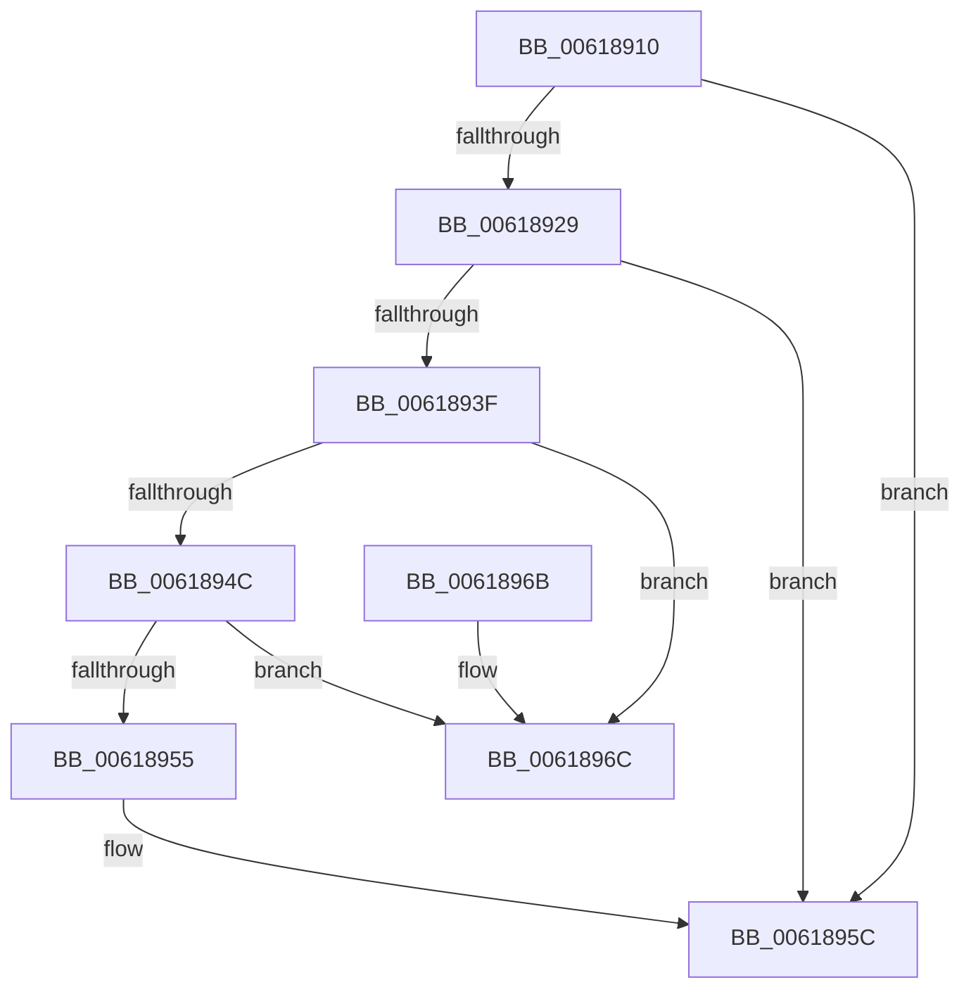

# CarDeregisterRuleOverride

- RVA: `0x00618910`–`0x00618973` (길이 `99` bytes)
- VA: `0x0000000140618910`
- 실행 섹션: `.text`
- PDB 이름 있음: `예`; PDB Function 태그: `아니요`
- unwind 정보 RVA: `0x0005CEE8`
- 디코드: `29`개 명령, `99/99` bytes 표시
- 미해석 바이트: `0` (있으면 어셈블리에 `.byte`로 보존)

> 이 문서는 커널 이미지의 기계어와 PDB 기호를 분석해 생성했습니다. 4번과 5번은 함수 원형과 자료형을 바이너리 사용 방식에서 추정한 C 해석이며 원본 소스 복구 결과는 아닙니다.

## 1. Dependencies

- 직접 호출 지점: **3**; 고유 호출 대상: **3**
- 직접 호출자로 확인된 함수: **1**
- RIP 상대 이미지 참조: **0**

### Outgoing calls
- `0x0061891F` → [CarFindRuleClassConfigurationEntryByRuleClassId](CarFindRuleClassConfigurationEntryByRuleClassId_function_0061897C.md) (function, `0x0061897C`)
- `0x00618930` → [CarFindRuleOverrideEntryByLocalRuleId](CarFindRuleOverrideEntryByLocalRuleId_function_006189D8.md) (function, `0x006189D8`)
- `0x00618961` → [CarDeleteRuleOverrideEntry](CarDeleteRuleOverrideEntry_function_006187DC.md) (function, `0x006187DC`)

### Direct callers
- [CarRegisterRuleOverrideAllContexts](CarRegisterRuleOverrideAllContexts_function_00619130.md) at `0x0061915B`

### Static image references
- 디코드된 RIP-relative 메모리 참조가 없습니다.

## 2. Other-region calls and transfers

- 다른 실행 섹션으로 향하는 call: **0**
- 별도 외부 분기/꼬리 이동을 확인하지 못했습니다.

## 3. Assembly (complete function range)

```asm
00618910  48 83 EC 28                     sub rsp, 0x28
00618914  48 83 64 24 40 00               and qword ptr [rsp + 0x40], 0
0061891A  44 8B CA                        mov r9d, edx
0061891D  8B D1                           mov edx, ecx
0061891F  E8 58 00 00 00                  call 0x14061897c
00618924  48 85 C0                        test rax, rax
00618927  74 33                           je 0x14061895c
00618929  48 8D 48 48                     lea rcx, [rax + 0x48]
0061892D  41 8B D1                        mov edx, r9d
00618930  E8 A3 00 00 00                  call 0x1406189d8
00618935  48 89 44 24 40                  mov qword ptr [rsp + 0x40], rax
0061893A  48 85 C0                        test rax, rax
0061893D  74 1D                           je 0x14061895c
0061893F  48 83 C0 40                     add rax, 0x40
00618943  48 8B 10                        mov rdx, qword ptr [rax]
00618946  48 39 42 08                     cmp qword ptr [rdx + 8], rax
0061894A  75 20                           jne 0x14061896c
0061894C  48 8B 48 08                     mov rcx, qword ptr [rax + 8]
00618950  48 39 01                        cmp qword ptr [rcx], rax
00618953  75 17                           jne 0x14061896c
00618955  48 89 11                        mov qword ptr [rcx], rdx
00618958  48 89 4A 08                     mov qword ptr [rdx + 8], rcx
0061895C  48 8D 4C 24 40                  lea rcx, [rsp + 0x40]
00618961  E8 76 FE FF FF                  call 0x1406187dc
00618966  48 83 C4 28                     add rsp, 0x28
0061896A  C3                              ret
0061896B  CC                              int3
0061896C  B9 03 00 00 00                  mov ecx, 3
00618971  CD 29                           int 0x29
```

## 4. C-style interpretation (structured pseudocode)

```c
__int64 __fastcall CarDeregisterRuleOverride(int a1, int a2)
{
    __int64 result;
    __int64 v_rsp;
    unsigned __int64 v_stack_p18;

    v_rsp = (v_rsp) - (40);
    result = CarFindRuleClassConfigurationEntryByRuleClassId(a1, (unsigned int)(a1), a3, (unsigned int)(a2));
    if (result == 0) goto loc_0061895C;
    result = CarFindRuleOverrideEntryByLocalRuleId(result + 72, (unsigned int)((unsigned int)((unsigned int)(a2))), a3, (unsigned int)(a2));
    v_stack_p18 = result;
    if (result == 0) goto loc_0061895C;
    result = (result) + (64);
    if ((*(unsigned __int64 *)(*(unsigned __int64 *)(result) + 8)) != result) goto loc_0061896C;
    if ((*(unsigned __int64 *)(*(unsigned __int64 *)(result + 8))) != result) goto loc_0061896C;
    *(unsigned __int64 *)(*(unsigned __int64 *)(result + 8)) = *(unsigned __int64 *)(result);
    *(unsigned __int64 *)(*(unsigned __int64 *)(result) + 8) = *(unsigned __int64 *)(result + 8);
loc_0061895C:
    result = CarDeleteRuleOverrideEntry(v_stack_p18, *(unsigned __int64 *)(result), a3, (unsigned int)(a2));
    v_rsp = (v_rsp) + (40);
    return result;
loc_0061896C:
    return result;
}
```

## 5. (Beta) C Style

```c
int64_t CarDeregisterRuleOverride(int32_t Arg1, int32_t Arg2)
{
    int64_t result;
    int64_t local_rsp;
    uint64_t v_stack_p18;

    local_rsp = (local_rsp) - (40);
    result = CarFindRuleClassConfigurationEntryByRuleClassId(Arg1, (uint32_t)(Arg1), a3, (uint32_t)(Arg2));
    if (result == 0) goto loc_0061895C;
    result = CarFindRuleOverrideEntryByLocalRuleId(result + 72, (uint32_t)((uint32_t)((uint32_t)(Arg2))), a3, (uint32_t)(Arg2));
    v_stack_p18 = result;
    if (result == 0) goto loc_0061895C;
    result = (result) + (64);
    if ((*(uint64_t *)(*(uint64_t *)(result) + 0x8)) != result) goto loc_0061896C;
    if ((*(uint64_t *)(*(uint64_t *)(result + 0x8))) != result) goto loc_0061896C;
    *(uint64_t *)(*(uint64_t *)(result + 0x8)) = *(uint64_t *)(result);
    *(uint64_t *)(*(uint64_t *)(result) + 0x8) = *(uint64_t *)(result + 0x8);
loc_0061895C:
    result = CarDeleteRuleOverrideEntry(v_stack_p18, *(uint64_t *)(result), a3, (uint32_t)(Arg2));
    local_rsp = (local_rsp) + (40);
    return result;
loc_0061896C:
    return result;
}
```

## 6. Execution-region graph

[열기: 2D/3D 그래프와 함수 탐색 컨트롤 패널](../../../control-panel.html?section=text&rva=0x00618910&view=graph)

- 2D 그래프는 위에서 아래로 흐르고, 3D 그래프는 빈 공간을 드래그해 회전합니다. Shift+드래그는 이동, 휠은 확대·축소, 함수 노드 선택은 대상 보고서 이동입니다.

### Static fallback


