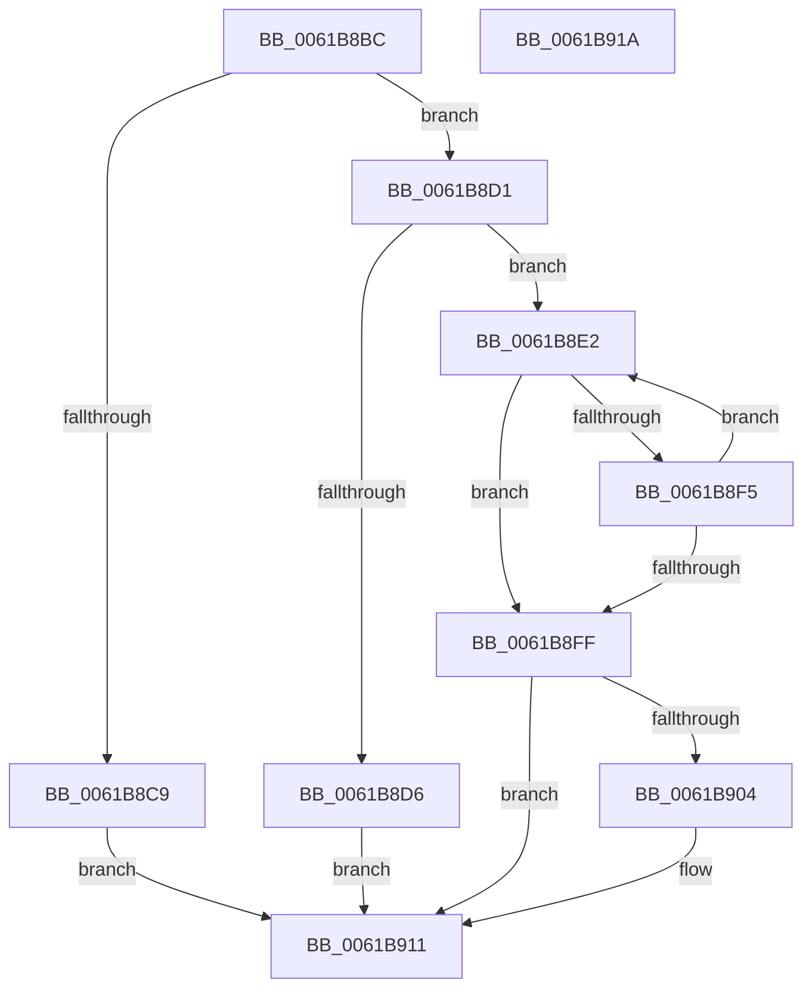

# CarEtwCopyDriverName

- RVA: `0x0061B8BC`–`0x0061B91B` (길이 `95` bytes)
- VA: `0x000000014061B8BC`
- 실행 섹션: `.text`
- PDB 이름 있음: `예`; PDB Function 태그: `아니요`
- unwind 정보 RVA: `0x000D2B54`
- 디코드: `30`개 명령, `95/95` bytes 표시
- 미해석 바이트: `0` (있으면 어셈블리에 `.byte`로 보존)

> 이 문서는 커널 이미지의 기계어와 PDB 기호를 분석해 생성했습니다. 4번과 5번은 함수 원형과 자료형을 바이너리 사용 방식에서 추정한 C 해석이며 원본 소스 복구 결과는 아닙니다.

## 1. Dependencies

- 직접 호출 지점: **0**; 고유 호출 대상: **0**
- 직접 호출자로 확인된 함수: **2**
- RIP 상대 이미지 참조: **0**

### Outgoing calls
- 직접 디코드된 call 명령이 없습니다.

### Direct callers
- [CarGetDriverInfoFromDriverName](CarGetDriverInfoFromDriverName_function_00617E50.md) at `0x00617E7C`
- [CarInitializeTelemetryData](CarInitializeTelemetryData_function_00618BB0.md) at `0x00618D89`

### Static image references
- 디코드된 RIP-relative 메모리 참조가 없습니다.

## 2. Other-region calls and transfers

- 다른 실행 섹션으로 향하는 call: **0**
- 별도 외부 분기/꼬리 이동을 확인하지 못했습니다.

## 3. Assembly (complete function range)

```asm
0061B8BC  48 89 7C 24 08                  mov qword ptr [rsp + 8], rdi
0061B8C1  45 33 C9                        xor r9d, r9d
0061B8C4  48 85 C9                        test rcx, rcx
0061B8C7  75 08                           jne 0x14061b8d1
0061B8C9  41 B9 EF 00 00 C0               mov r9d, 0xc00000ef
0061B8CF  EB 40                           jmp 0x14061b911
0061B8D1  48 85 D2                        test rdx, rdx
0061B8D4  75 0C                           jne 0x14061b8e2
0061B8D6  66 44 89 09                     mov word ptr [rcx], r9w
0061B8DA  41 B9 F0 00 00 C0               mov r9d, 0xc00000f0
0061B8E0  EB 2F                           jmp 0x14061b911
0061B8E2  0F B7 02                        movzx eax, word ptr [rdx]
0061B8E5  49 FF C8                        dec r8
0061B8E8  66 89 01                        mov word ptr [rcx], ax
0061B8EB  48 83 C1 02                     add rcx, 2
0061B8EF  66 44 39 0A                     cmp word ptr [rdx], r9w
0061B8F3  74 0A                           je 0x14061b8ff
0061B8F5  48 83 C2 02                     add rdx, 2
0061B8F9  49 83 F8 01                     cmp r8, 1
0061B8FD  77 E3                           ja 0x14061b8e2
0061B8FF  4D 85 C0                        test r8, r8
0061B902  74 0D                           je 0x14061b911
0061B904  48 8B F9                        mov rdi, rcx
0061B907  41 0F B7 C1                     movzx eax, r9w
0061B90B  49 8B C8                        mov rcx, r8
0061B90E  66 F3 AB                        rep stosw word ptr [rdi], ax
0061B911  48 8B 7C 24 08                  mov rdi, qword ptr [rsp + 8]
0061B916  41 8B C1                        mov eax, r9d
0061B919  C3                              ret
0061B91A  CC                              int3
```

## 4. C-style interpretation (structured pseudocode)

```c
__int64 __fastcall CarEtwCopyDriverName(__int64 a1, __int64 a2, __int64 a3, int a4)
{
    __int64 result;
    __int64 v_rdi;
    unsigned __int64 v_stack_p8;

    v_stack_p8 = v_rdi;
    a4 = 0;
    if (a1 != 0) goto loc_0061B8D1;
    goto loc_0061B911;
loc_0061B8D1:
    if (a2 != 0) goto loc_0061B8E2;
    *(unsigned __int16 *)(a1) = (unsigned __int16)((unsigned int)(0xC00000EFULL));
    goto loc_0061B911;
loc_0061B8E2:
    a3 = (a3) - 1;
    *(unsigned __int16 *)(a1) = (unsigned __int16)(*(unsigned __int16 *)(a2));
    a1 = (a1) + (2);
    if ((*(unsigned __int16 *)(a2)) == ((unsigned __int16)((unsigned int)(0xC00000F0ULL)))) goto loc_0061B8FF;
    a2 = (a2) + (2);
    if (a3 > 1) goto loc_0061B8E2;
loc_0061B8FF:
    result = *(unsigned __int16 *)(a2);
    if (a3 != 0) {
        v_rdi = a1;
        result = (unsigned __int16)((unsigned int)(0xC00000F0ULL));
        a1 = a3;
    }
    return (unsigned int)((unsigned int)((unsigned int)(0xC00000F0ULL)));
}
```

## 5. (Beta) C Style

```c
int64_t CarEtwCopyDriverName(int64_t Arg1, int64_t Arg2, int64_t Arg3, int32_t Arg4)
{
    int64_t result;
    int64_t local_rdi;
    uint64_t v_stack_p8;

    v_stack_p8 = local_rdi;
    Arg4 = 0;
    if (Arg1 != 0) goto loc_0061B8D1;
    goto loc_0061B911;
loc_0061B8D1:
    if (Arg2 != 0) goto loc_0061B8E2;
    *(uint16_t *)(Arg1) = (uint16_t)((uint32_t)(0xC00000EFULL));
    goto loc_0061B911;
loc_0061B8E2:
    Arg3 = (Arg3) - 1;
    *(uint16_t *)(Arg1) = (uint16_t)(*(uint16_t *)(Arg2));
    Arg1 = (Arg1) + (2);
    if ((*(uint16_t *)(Arg2)) == ((uint16_t)((uint32_t)(0xC00000F0ULL)))) goto loc_0061B8FF;
    Arg2 = (Arg2) + (2);
    if (Arg3 > 1) goto loc_0061B8E2;
loc_0061B8FF:
    result = *(uint16_t *)(Arg2);
    if (Arg3 != 0) {
        local_rdi = Arg1;
        result = (uint16_t)((uint32_t)(0xC00000F0ULL));
        Arg1 = Arg3;
    }
    return (uint32_t)((uint32_t)((uint32_t)(0xC00000F0ULL)));
}
```

## 6. Execution-region graph

[열기: 2D/3D 그래프와 함수 탐색 컨트롤 패널](../../../control-panel.html?section=text&rva=0x0061B8BC&view=graph)

- 2D 그래프는 위에서 아래로 흐르고, 3D 그래프는 빈 공간을 드래그해 회전합니다. Shift+드래그는 이동, 휠은 확대·축소, 함수 노드 선택은 대상 보고서 이동입니다.

### Static fallback


