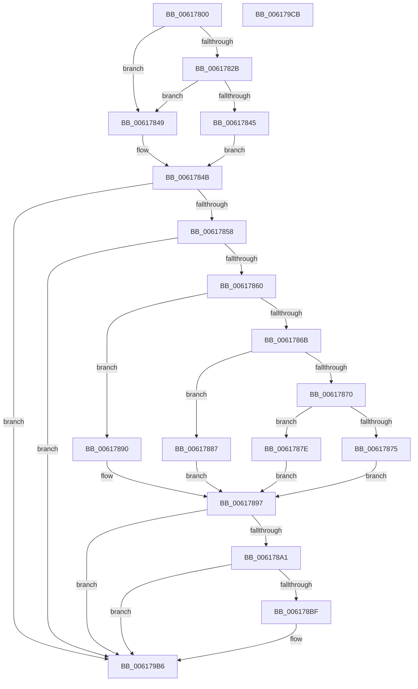

# CarEtwCrashEvent

- RVA: `0x00617800`–`0x006179CC` (길이 `460` bytes)
- VA: `0x0000000140617800`
- 실행 섹션: `.text`
- PDB 이름 있음: `예`; PDB Function 태그: `아니요`
- unwind 정보 RVA: `0x00073684`
- 디코드: `103`개 명령, `460/460` bytes 표시
- 미해석 바이트: `0` (있으면 어셈블리에 `.byte`로 보존)

> 이 문서는 커널 이미지의 기계어와 PDB 기호를 분석해 생성했습니다. 4번과 5번은 함수 원형과 자료형을 바이너리 사용 방식에서 추정한 C 해석이며 원본 소스 복구 결과는 아닙니다.

## 1. Dependencies

- 직접 호출 지점: **6**; 고유 호출 대상: **5**
- 직접 호출자로 확인된 함수: **1**
- RIP 상대 이미지 참조: **10**

### Outgoing calls
- `0x0061783C` → [tlgKeywordOn](../42/tlgKeywordOn_function_0042EAA0.md) (function, `0x0042EAA0`)
- `0x006178B2` → [tlgKeywordOn](../42/tlgKeywordOn_function_0042EAA0.md) (function, `0x0042EAA0`)
- `0x00617936` → [tlgCreate1Sz_wchar_t](../42/tlgCreate1Sz_wchar_t_function_00426198.md) (function, `0x00426198`)
- `0x00617942` → [tlgCreate1Sz_char](../42/tlgCreate1Sz_char_function_00427304.md) (function, `0x00427304`)
- `0x006179B1` → [tlgWriteTransfer_EtwWriteTransfer](../42/tlgWriteTransfer_EtwWriteTransfer_function_004260E0.md) (function, `0x004260E0`)
- `0x006179BD` → [_security_check_cookie](../6A/_security_check_cookie_function_006AC640.md) (function, `0x006AC640`)

### Direct callers
- [CarReportUnusualShutdown](CarReportUnusualShutdown_function_0061951C.md) at `0x00619562`

### Static image references
- `0x0061780E` → RVA `0x00E0A740` (`.data`; read)
- `0x0061781C` → RVA `0x00E090C8` (`.data`; read)
- `0x0061784B` → RVA `0x00F03EE0` (`.data`; read)
- `0x00617875` → RVA `0x006CFB40` (` ?? ::FNODOBFM::`string'`; read)
- `0x0061787E` → RVA `0x006CFB70` (` ?? ::FNODOBFM::`string'`; read)
- `0x00617887` → RVA `0x006CFAE0` (` ?? ::FNODOBFM::`string'`; read)
- `0x00617890` → RVA `0x006CFB10` (` ?? ::FNODOBFM::`string'`; read)
- `0x006178CE` → RVA `0x006CF9F0` (` ?? ::FNODOBFM::`string'`; read)
- `0x00617901` → RVA `0x00F03DA8` (`.data`; read)
- `0x00617953` → RVA `0x0005311F` (`.rdata`; read)

## 2. Other-region calls and transfers

- 다른 실행 섹션으로 향하는 call: **0**
- 별도 외부 분기/꼬리 이동을 확인하지 못했습니다.

## 3. Assembly (complete function range)

```asm
00617800  40 55                           push rbp
00617802  48 8D 6C 24 F0                  lea rbp, [rsp - 0x10]
00617807  48 81 EC 10 01 00 00            sub rsp, 0x110
0061780E  48 8B 05 2B 2F 7F 00            mov rax, qword ptr [rip + 0x7f2f2b]
00617815  48 33 C4                        xor rax, rsp
00617818  48 89 45 00                     mov qword ptr [rbp], rax
0061781C  44 8B 05 A5 18 7F 00            mov r8d, dword ptr [rip + 0x7f18a5]
00617823  4C 8B D1                        mov r10, rcx
00617826  45 85 C0                        test r8d, r8d
00617829  74 1E                           je 0x140617849
0061782B  48 BA 00 00 00 00 00 80 00 00   movabs rdx, 0x800000000000
00617835  48 8D 0D 8C 18 7F 00            lea rcx, [rip + 0x7f188c]
0061783C  E8 5F 72 E1 FF                  call 0x14042eaa0
00617841  84 C0                           test al, al
00617843  74 04                           je 0x140617849
00617845  B0 01                           mov al, 1
00617847  EB 02                           jmp 0x14061784b
00617849  32 C0                           xor al, al
0061784B  80 3D 8E C6 8E 00 00            cmp byte ptr [rip + 0x8ec68e], 0
00617852  0F 84 5E 01 00 00               je 0x1406179b6
00617858  84 C0                           test al, al
0061785A  0F 84 56 01 00 00               je 0x1406179b6
00617860  41 8B 0A                        mov ecx, dword ptr [r10]
00617863  81 E9 C4 00 00 00               sub ecx, 0xc4
00617869  74 25                           je 0x140617890
0061786B  83 E9 05                        sub ecx, 5
0061786E  74 17                           je 0x140617887
00617870  83 F9 1D                        cmp ecx, 0x1d
00617873  74 09                           je 0x14061787e
00617875  4C 8D 0D C4 82 0B 00            lea r9, [rip + 0xb82c4]
0061787C  EB 19                           jmp 0x140617897
0061787E  4C 8D 0D EB 82 0B 00            lea r9, [rip + 0xb82eb]
00617885  EB 10                           jmp 0x140617897
00617887  4C 8D 0D 52 82 0B 00            lea r9, [rip + 0xb8252]
0061788E  EB 07                           jmp 0x140617897
00617890  4C 8D 0D 79 82 0B 00            lea r9, [rip + 0xb8279]
00617897  41 83 F8 05                     cmp r8d, 5
0061789B  0F 86 15 01 00 00               jbe 0x1406179b6
006178A1  48 BA 00 00 00 00 00 80 00 00   movabs rdx, 0x800000000000
006178AB  48 8D 0D 16 18 7F 00            lea rcx, [rip + 0x7f1816]
006178B2  E8 E9 71 E1 FF                  call 0x14042eaa0
006178B7  84 C0                           test al, al
006178B9  0F 84 F7 00 00 00               je 0x1406179b6
006178BF  83 64 24 34 00                  and dword ptr [rsp + 0x34], 0
006178C4  48 8D 44 24 34                  lea rax, [rsp + 0x34]
006178C9  83 64 24 7C 00                  and dword ptr [rsp + 0x7c], 0
006178CE  48 8D 15 1B 81 0B 00            lea rdx, [rip + 0xb811b]
006178D5  83 65 8C 00                     and dword ptr [rbp - 0x74], 0
006178D9  48 8D 4D B0                     lea rcx, [rbp - 0x50]
006178DD  83 65 9C 00                     and dword ptr [rbp - 0x64], 0
006178E1  41 BB 04 00 00 00               mov r11d, 4
006178E7  83 65 AC 00                     and dword ptr [rbp - 0x54], 0
006178EB  48 89 44 24 70                  mov qword ptr [rsp + 0x70], rax
006178F0  41 8B 42 38                     mov eax, dword ptr [r10 + 0x38]
006178F4  89 44 24 38                     mov dword ptr [rsp + 0x38], eax
006178F8  48 8D 44 24 38                  lea rax, [rsp + 0x38]
006178FD  48 89 45 80                     mov qword ptr [rbp - 0x80], rax
00617901  8B 05 A1 C4 8E 00               mov eax, dword ptr [rip + 0x8ec4a1]
00617907  89 44 24 3C                     mov dword ptr [rsp + 0x3c], eax
0061790B  48 8D 44 24 3C                  lea rax, [rsp + 0x3c]
00617910  48 89 45 90                     mov qword ptr [rbp - 0x70], rax
00617914  48 8D 44 24 30                  lea rax, [rsp + 0x30]
00617919  48 89 45 A0                     mov qword ptr [rbp - 0x60], rax
0061791D  44 89 5C 24 78                  mov dword ptr [rsp + 0x78], r11d
00617922  44 89 5D 88                     mov dword ptr [rbp - 0x78], r11d
00617926  44 89 5D 98                     mov dword ptr [rbp - 0x68], r11d
0061792A  C6 44 24 30 00                  mov byte ptr [rsp + 0x30], 0
0061792F  C7 45 A8 01 00 00 00            mov dword ptr [rbp - 0x58], 1
00617936  E8 5D E8 E0 FF                  call 0x140426198
0061793B  49 8B D1                        mov rdx, r9
0061793E  48 8D 4D C0                     lea rcx, [rbp - 0x40]
00617942  E8 BD F9 E0 FF                  call 0x140427304
00617947  41 8B 0A                        mov ecx, dword ptr [r10]
0061794A  48 8D 44 24 40                  lea rax, [rsp + 0x40]
0061794F  83 65 DC 00                     and dword ptr [rbp - 0x24], 0
00617953  48 8D 15 C5 B7 A3 FF            lea rdx, [rip - 0x5c483b]
0061795A  83 65 EC 00                     and dword ptr [rbp - 0x14], 0
0061795E  45 33 C9                        xor r9d, r9d
00617961  83 65 FC 00                     and dword ptr [rbp - 4], 0
00617965  45 33 C0                        xor r8d, r8d
00617968  48 89 45 D0                     mov qword ptr [rbp - 0x30], rax
0061796C  41 8B 42 08                     mov eax, dword ptr [r10 + 8]
00617970  89 44 24 44                     mov dword ptr [rsp + 0x44], eax
00617974  48 8D 44 24 44                  lea rax, [rsp + 0x44]
00617979  48 89 45 E0                     mov qword ptr [rbp - 0x20], rax
0061797D  49 8B 42 28                     mov rax, qword ptr [r10 + 0x28]
00617981  48 89 45 F0                     mov qword ptr [rbp - 0x10], rax
00617985  48 8D 44 24 50                  lea rax, [rsp + 0x50]
0061798A  89 4C 24 40                     mov dword ptr [rsp + 0x40], ecx
0061798E  48 8D 0D 33 17 7F 00            lea rcx, [rip + 0x7f1733]
00617995  48 89 44 24 28                  mov qword ptr [rsp + 0x28], rax
0061799A  C7 44 24 20 0B 00 00 00         mov dword ptr [rsp + 0x20], 0xb
006179A2  44 89 5D D8                     mov dword ptr [rbp - 0x28], r11d
006179A6  44 89 5D E8                     mov dword ptr [rbp - 0x18], r11d
006179AA  C7 45 F8 08 00 00 00            mov dword ptr [rbp - 8], 8
006179B1  E8 2A E7 E0 FF                  call 0x1404260e0
006179B6  48 8B 4D 00                     mov rcx, qword ptr [rbp]
006179BA  48 33 CC                        xor rcx, rsp
006179BD  E8 7E 4C 09 00                  call 0x1406ac640
006179C2  48 81 C4 10 01 00 00            add rsp, 0x110
006179C9  5D                              pop rbp
006179CA  C3                              ret
006179CB  CC                              int3
```

## 4. C-style interpretation (structured pseudocode)

```c
__int64 __fastcall CarEtwCrashEvent(__int64 a1)
{
    __int64 result;
    __int64 v_r11;
    __int64 v_rsp;
    unsigned __int64 v_stack_m18;
    unsigned int v_stack_m1C;
    unsigned int v_stack_m20;
    unsigned __int64 v_stack_m28;
    unsigned int v_stack_m2C;
    unsigned int v_stack_m30;
    unsigned __int64 v_stack_m38;
    unsigned int v_stack_m3C;
    unsigned int v_stack_m40;
    unsigned __int64 v_stack_m48;
    unsigned __int64 v_stack_m58;
    unsigned __int64 v_stack_m68;
    unsigned int v_stack_m6C;
    unsigned int v_stack_m70;
    unsigned __int64 v_stack_m78;
    unsigned int v_stack_m7C;
    unsigned int v_stack_m80;
    unsigned __int64 v_stack_m88;
    unsigned int v_stack_m8C;
    unsigned int v_stack_m90;
    unsigned __int64 v_stack_m98;
    unsigned int v_stack_m9C;
    unsigned int v_stack_mA0;
    unsigned __int64 v_stack_mA8;
    unsigned __int64 v_stack_mC8;
    unsigned int v_stack_mD4;
    unsigned __int64 v_stack_mD8;
    unsigned int v_stack_mDC;
    unsigned int v_stack_mE0;
    unsigned int v_stack_mE4;
    unsigned __int64 v_stack_mE8;
    unsigned __int64 v_stack_mF0;
    unsigned int v_stack_mF8;

    v_rsp = (v_rsp) - (272);
    result = (*(unsigned __int64 *)(v_rip + 8335147)) ^ (v_rsp);
    v_stack_m18 = result;
    if ((unsigned int)((unsigned int)(*(unsigned int *)(v_rip + 8329381))) == 0) goto loc_00617849;
    result = tlgKeywordOn(v_rip + 8329356, a2, (unsigned int)(*(unsigned int *)(v_rip + 8329381)), a4);
    if ((unsigned __int8)(result) == 0) goto loc_00617849;
    goto loc_0061784B;
loc_00617849:
    result = 0;
loc_0061784B:
    if ((*(unsigned __int8 *)(v_rip + 9356942)) == 0) goto loc_006179B6;
    if (0 == 0) goto loc_006179B6;
    a1 = (unsigned int)(((unsigned int)(*(unsigned int *)(a1))) - (196));
    if (condition_is_equal) goto loc_00617890;
    a1 = (unsigned int)((a1) - (5));
    if (condition_is_equal) goto loc_00617887;
    if (((unsigned int)(a1)) == 29) goto loc_0061787E;
    goto loc_00617897;
loc_0061787E:
    goto loc_00617897;
loc_00617887:
    goto loc_00617897;
loc_00617890:
loc_00617897:
    if (((unsigned int)((unsigned int)(*(unsigned int *)(v_rip + 8329381)))) <= 5) goto loc_006179B6;
    result = tlgKeywordOn(v_rip + 8329238, a2, (unsigned int)(*(unsigned int *)(v_rip + 8329381)), v_rip + 754297);
    if ((unsigned __int8)(result) != 0) {
        result = v_stack_mE4;
        a2 = v_rip + 753947;
        a1 = v_stack_m68;
        v_r11 = 4;
        v_stack_mA8 = result;
        result = *(unsigned int *)(a1 + 56);
        v_stack_mE0 = (unsigned int)(result);
        result = v_stack_mE0;
        v_stack_m98 = result;
        result = *(unsigned int *)(v_rip + 9356449);
        v_stack_mDC = (unsigned int)(result);
        result = v_stack_mDC;
        v_stack_m88 = result;
        result = v_stack_mE8;
        v_stack_m78 = result;
        v_stack_mA0 = (unsigned int)(v_r11);
        v_stack_m90 = (unsigned int)(v_r11);
        v_stack_m80 = (unsigned int)(v_r11);
        v_stack_mE8 = 0;
        v_stack_m70 = 1;
        result = tlgCreate1Sz_wchar_t(a1, a2, (unsigned int)(*(unsigned int *)(v_rip + 8329381)), v_rip + 754297);
        a2 = v_rip + 754297;
        a1 = v_stack_m58;
        result = tlgCreate1Sz_char(a1, a2, (unsigned int)(*(unsigned int *)(v_rip + 8329381)), v_rip + 754297);
        a1 = *(unsigned int *)(a1);
        result = v_stack_mD8;
        a2 = v_rip - 6047803;
        a4 = 0;
        a3 = 0;
        v_stack_m48 = result;
        result = *(unsigned int *)(a1 + 8);
        v_stack_mD4 = (unsigned int)(result);
        result = v_stack_mD4;
        v_stack_m38 = result;
        result = *(unsigned __int64 *)(a1 + 40);
        v_stack_m28 = result;
        result = v_stack_mC8;
        v_stack_mD8 = (unsigned int)(a1);
        a1 = v_rip + 8329011;
        v_stack_mF0 = result;
        v_stack_mF8 = 11;
        v_stack_m40 = (unsigned int)(v_r11);
        v_stack_m30 = (unsigned int)(v_r11);
        v_stack_m20 = 8;
        result = tlgWriteTransfer_EtwWriteTransfer(a1, a2, a3, a4);
    }
    a1 = (v_stack_m18) ^ (v_rsp);
    result = _security_check_cookie(a1, a2, a3, a4);
    v_rsp = (v_rsp) + (272);
    return result;
}
```

## 5. (Beta) C Style

```c
int64_t CarEtwCrashEvent(int64_t Arg1)
{
    int64_t result;
    int64_t local_r11;
    int64_t local_rsp;
    uint64_t v_stack_m18;
    uint32_t v_stack_m1C;
    uint32_t v_stack_m20;
    uint64_t v_stack_m28;
    uint32_t v_stack_m2C;
    uint32_t v_stack_m30;
    uint64_t v_stack_m38;
    uint32_t v_stack_m3C;
    uint32_t v_stack_m40;
    uint64_t v_stack_m48;
    uint64_t v_stack_m58;
    uint64_t v_stack_m68;
    uint32_t v_stack_m6C;
    uint32_t v_stack_m70;
    uint64_t v_stack_m78;
    uint32_t v_stack_m7C;
    uint32_t v_stack_m80;
    uint64_t v_stack_m88;
    uint32_t v_stack_m8C;
    uint32_t v_stack_m90;
    uint64_t v_stack_m98;
    uint32_t v_stack_m9C;
    uint32_t v_stack_mA0;
    uint64_t v_stack_mA8;
    uint64_t v_stack_mC8;
    uint32_t v_stack_mD4;
    uint64_t v_stack_mD8;
    uint32_t v_stack_mDC;
    uint32_t v_stack_mE0;
    uint32_t v_stack_mE4;
    uint64_t v_stack_mE8;
    uint64_t v_stack_mF0;
    uint32_t v_stack_mF8;

    local_rsp = (local_rsp) - (272);
    result = (*(uint64_t *)(v_rip + 0x7F2F2B)) ^ (local_rsp);
    v_stack_m18 = result;
    if ((uint32_t)((uint32_t)(*(uint32_t *)(v_rip + 0x7F18A5))) == 0) goto loc_00617849;
    result = tlgKeywordOn(v_rip + 8329356, a2, (uint32_t)(*(uint32_t *)(v_rip + 0x7F18A5)), a4);
    if ((uint8_t)(result) == 0) goto loc_00617849;
    goto loc_0061784B;
loc_00617849:
    result = 0;
loc_0061784B:
    if ((*(uint8_t *)(v_rip + 0x8EC68E)) == 0) goto loc_006179B6;
    if (0 == 0) goto loc_006179B6;
    Arg1 = (uint32_t)(((uint32_t)(*(uint32_t *)(Arg1))) - (196));
    if (condition_is_equal) goto loc_00617890;
    Arg1 = (uint32_t)((Arg1) - (5));
    if (condition_is_equal) goto loc_00617887;
    if (((uint32_t)(Arg1)) == 29) goto loc_0061787E;
    goto loc_00617897;
loc_0061787E:
    goto loc_00617897;
loc_00617887:
    goto loc_00617897;
loc_00617890:
loc_00617897:
    if (((uint32_t)((uint32_t)(*(uint32_t *)(v_rip + 0x7F18A5)))) <= 5) goto loc_006179B6;
    result = tlgKeywordOn(v_rip + 8329238, a2, (uint32_t)(*(uint32_t *)(v_rip + 0x7F18A5)), v_rip + 754297);
    if ((uint8_t)(result) != 0) {
        result = v_stack_mE4;
        a2 = v_rip + 753947;
        Arg1 = v_stack_m68;
        local_r11 = 4;
        v_stack_mA8 = result;
        result = *(uint32_t *)(Arg1 + 0x38);
        v_stack_mE0 = (uint32_t)(result);
        result = v_stack_mE0;
        v_stack_m98 = result;
        result = *(uint32_t *)(v_rip + 0x8EC4A1);
        v_stack_mDC = (uint32_t)(result);
        result = v_stack_mDC;
        v_stack_m88 = result;
        result = v_stack_mE8;
        v_stack_m78 = result;
        v_stack_mA0 = (uint32_t)(local_r11);
        v_stack_m90 = (uint32_t)(local_r11);
        v_stack_m80 = (uint32_t)(local_r11);
        v_stack_mE8 = 0;
        v_stack_m70 = 1;
        result = tlgCreate1Sz_wchar_t(Arg1, a2, (uint32_t)(*(uint32_t *)(v_rip + 0x7F18A5)), v_rip + 754297);
        a2 = v_rip + 754297;
        Arg1 = v_stack_m58;
        result = tlgCreate1Sz_char(Arg1, a2, (uint32_t)(*(uint32_t *)(v_rip + 0x7F18A5)), v_rip + 754297);
        Arg1 = *(uint32_t *)(Arg1);
        result = v_stack_mD8;
        a2 = v_rip - 6047803;
        a4 = 0;
        a3 = 0;
        v_stack_m48 = result;
        result = *(uint32_t *)(Arg1 + 0x8);
        v_stack_mD4 = (uint32_t)(result);
        result = v_stack_mD4;
        v_stack_m38 = result;
        result = *(uint64_t *)(Arg1 + 0x28);
        v_stack_m28 = result;
        result = v_stack_mC8;
        v_stack_mD8 = (uint32_t)(Arg1);
        Arg1 = v_rip + 8329011;
        v_stack_mF0 = result;
        v_stack_mF8 = 11;
        v_stack_m40 = (uint32_t)(local_r11);
        v_stack_m30 = (uint32_t)(local_r11);
        v_stack_m20 = 8;
        result = tlgWriteTransfer_EtwWriteTransfer(Arg1, a2, a3, a4);
    }
    Arg1 = (v_stack_m18) ^ (local_rsp);
    result = _security_check_cookie(Arg1, a2, a3, a4);
    local_rsp = (local_rsp) + (272);
    return result;
}
```

## 6. Execution-region graph

[열기: 2D/3D 그래프와 함수 탐색 컨트롤 패널](../../../control-panel.html?section=text&rva=0x00617800&view=graph)

- 2D 그래프는 위에서 아래로 흐르고, 3D 그래프는 빈 공간을 드래그해 회전합니다. Shift+드래그는 이동, 휠은 확대·축소, 함수 노드 선택은 대상 보고서 이동입니다.

### Static fallback


