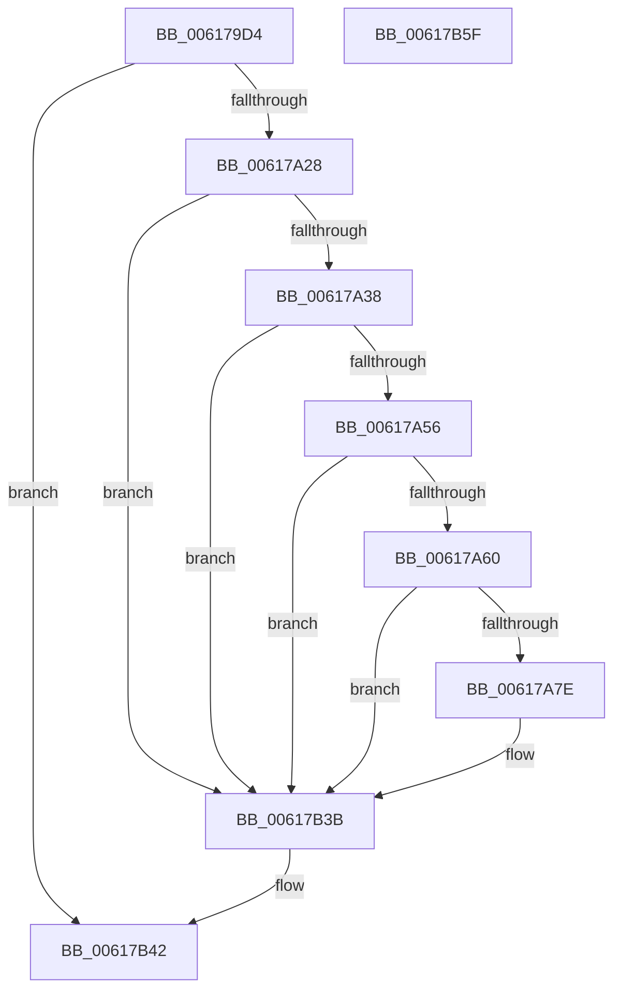

# CarEtwRegister

- RVA: `0x006179D4`–`0x00617B60` (길이 `396` bytes)
- VA: `0x00000001406179D4`
- 실행 섹션: `.text`
- PDB 이름 있음: `예`; PDB Function 태그: `아니요`
- unwind 정보 RVA: `0x000D29F8`
- 디코드: `81`개 명령, `396/396` bytes 표시
- 미해석 바이트: `0` (있으면 어셈블리에 `.byte`로 보존)

> 이 문서는 커널 이미지의 기계어와 PDB 기호를 분석해 생성했습니다. 4번과 5번은 함수 원형과 자료형을 바이너리 사용 방식에서 추정한 C 해석이며 원본 소스 복구 결과는 아닙니다.

## 1. Dependencies

- 직접 호출 지점: **9**; 고유 호출 대상: **7**
- 직접 호출자로 확인된 함수: **1**
- RIP 상대 이미지 참조: **10**

### Outgoing calls
- `0x00617A00` → [TraceLoggingRegisterEx_EtwRegister_EtwSetInformation](../../page/92/TraceLoggingRegisterEx_EtwRegister_EtwSetInformation_function_009208A0.md) (function, `0x009208A0`)
- `0x00617A16` → [McGenEventRegister_EtwRegister](../57/McGenEventRegister_EtwRegister_function_0057EF04.md) (function, `0x0057EF04`)
- `0x00617A49` → [tlgKeywordOn](../42/tlgKeywordOn_function_0042EAA0.md) (function, `0x0042EAA0`)
- `0x00617A71` → [tlgKeywordOn](../42/tlgKeywordOn_function_0042EAA0.md) (function, `0x0042EAA0`)
- `0x00617AB6` → [tlgCreate1Sz_wchar_t](../42/tlgCreate1Sz_wchar_t_function_00426198.md) (function, `0x00426198`)
- `0x00617AC6` → [tlgCreate1Sz_wchar_t](../42/tlgCreate1Sz_wchar_t_function_00426198.md) (function, `0x00426198`)
- `0x00617B36` → [tlgWriteTransfer_EtwWriteTransfer](../42/tlgWriteTransfer_EtwWriteTransfer_function_004260E0.md) (function, `0x004260E0`)
- `0x00617B3B` → [CarTipLogDriverLoad](CarTipLogDriverLoad_function_006182C0.md) (function, `0x006182C0`)
- `0x00617B49` → [_security_check_cookie](../6A/_security_check_cookie_function_006AC640.md) (function, `0x006AC640`)

### Direct callers
- [CarInitLogging](CarInitLogging_function_006180B0.md) at `0x006180F4`

### Static image references
- `0x006179E6` → RVA `0x00E0A740` (`.data`; read)
- `0x006179F7` → RVA `0x00E090C8` (`.data`; read)
- `0x00617A05` → RVA `0x00E09080` (`.data`; read)
- `0x00617A0F` → RVA `0x000382D0` (`.rdata`; read)
- `0x00617A7E` → RVA `0x00F03DA8` (`.data`; read)
- `0x00617A84` → RVA `0x00F025A0` (`.data`; read)
- `0x00617ABB` → RVA `0x006CFA80` (` ?? ::FNODOBFM::`string'`; read)
- `0x00617AD7` → RVA `0x00053347` (`.rdata`; read)
- `0x00617ADE` → RVA `0x00F02584` (`.data`; read)
- `0x00617B04` → RVA `0x00F03DA0` (`.data`; read)

## 2. Other-region calls and transfers

- 다른 실행 섹션으로 향하는 call: **1**
  - `0x00617A00` → [TraceLoggingRegisterEx_EtwRegister_EtwSetInformation](../../page/92/TraceLoggingRegisterEx_EtwRegister_EtwSetInformation_function_009208A0.md) (`.text` → `PAGE`)
- 별도 외부 분기/꼬리 이동을 확인하지 못했습니다.

## 3. Assembly (complete function range)

```asm
006179D4  48 89 5C 24 08                  mov qword ptr [rsp + 8], rbx
006179D9  55                              push rbp
006179DA  48 8D 6C 24 A9                  lea rbp, [rsp - 0x57]
006179DF  48 81 EC F0 00 00 00            sub rsp, 0xf0
006179E6  48 8B 05 53 2D 7F 00            mov rax, qword ptr [rip + 0x7f2d53]
006179ED  48 33 C4                        xor rax, rsp
006179F0  48 89 45 47                     mov qword ptr [rbp + 0x47], rax
006179F4  45 33 C0                        xor r8d, r8d
006179F7  48 8D 0D CA 16 7F 00            lea rcx, [rip + 0x7f16ca]
006179FE  33 D2                           xor edx, edx
00617A00  E8 9B 8E 30 00                  call 0x1409208a0
00617A05  4C 8D 05 74 16 7F 00            lea r8, [rip + 0x7f1674]
00617A0C  4D 8B C8                        mov r9, r8
00617A0F  48 8D 0D BA 08 A2 FF            lea rcx, [rip - 0x5df746]
00617A16  E8 E9 74 F6 FF                  call 0x14057ef04
00617A1B  45 33 D2                        xor r10d, r10d
00617A1E  8B D8                           mov ebx, eax
00617A20  85 C0                           test eax, eax
00617A22  0F 88 1A 01 00 00               js 0x140617b42
00617A28  44 8B 05 99 16 7F 00            mov r8d, dword ptr [rip + 0x7f1699]
00617A2F  45 85 C0                        test r8d, r8d
00617A32  0F 84 03 01 00 00               je 0x140617b3b
00617A38  48 BA 00 00 00 00 00 80 00 00   movabs rdx, 0x800000000000
00617A42  48 8D 0D 7F 16 7F 00            lea rcx, [rip + 0x7f167f]
00617A49  E8 52 70 E1 FF                  call 0x14042eaa0
00617A4E  84 C0                           test al, al
00617A50  0F 84 E5 00 00 00               je 0x140617b3b
00617A56  41 83 F8 05                     cmp r8d, 5
00617A5A  0F 86 DB 00 00 00               jbe 0x140617b3b
00617A60  48 BA 00 00 00 00 00 40 00 00   movabs rdx, 0x400000000000
00617A6A  48 8D 0D 57 16 7F 00            lea rcx, [rip + 0x7f1657]
00617A71  E8 2A 70 E1 FF                  call 0x14042eaa0
00617A76  84 C0                           test al, al
00617A78  0F 84 BD 00 00 00               je 0x140617b3b
00617A7E  8B 05 24 C3 8E 00               mov eax, dword ptr [rip + 0x8ec324]
00617A84  48 8D 15 15 AB 8E 00            lea rdx, [rip + 0x8eab15]
00617A8B  89 45 97                        mov dword ptr [rbp - 0x69], eax
00617A8E  48 8D 4D F7                     lea rcx, [rbp - 9]
00617A92  48 8D 45 97                     lea rax, [rbp - 0x69]
00617A96  48 C7 45 DF 04 00 00 00         mov qword ptr [rbp - 0x21], 4
00617A9E  48 89 45 D7                     mov qword ptr [rbp - 0x29], rax
00617AA2  48 8D 45 A7                     lea rax, [rbp - 0x59]
00617AA6  48 89 45 E7                     mov qword ptr [rbp - 0x19], rax
00617AAA  4C 89 55 A7                     mov qword ptr [rbp - 0x59], r10
00617AAE  48 C7 45 EF 08 00 00 00         mov qword ptr [rbp - 0x11], 8
00617AB6  E8 DD E6 E0 FF                  call 0x140426198
00617ABB  48 8D 15 BE 7F 0B 00            lea rdx, [rip + 0xb7fbe]
00617AC2  48 8D 4D 07                     lea rcx, [rbp + 7]
00617AC6  E8 CD E6 E0 FF                  call 0x140426198
00617ACB  48 8D 45 9B                     lea rax, [rbp - 0x65]
00617ACF  44 89 55 9B                     mov dword ptr [rbp - 0x65], r10d
00617AD3  48 89 45 17                     mov qword ptr [rbp + 0x17], rax
00617AD7  48 8D 15 69 B8 A3 FF            lea rdx, [rip - 0x5c4797]
00617ADE  8B 05 A0 AA 8E 00               mov eax, dword ptr [rip + 0x8eaaa0]
00617AE4  48 8D 0D DD 15 7F 00            lea rcx, [rip + 0x7f15dd]
00617AEB  89 45 9F                        mov dword ptr [rbp - 0x61], eax
00617AEE  45 33 C9                        xor r9d, r9d
00617AF1  48 8D 45 9F                     lea rax, [rbp - 0x61]
00617AF5  48 C7 45 1F 04 00 00 00         mov qword ptr [rbp + 0x1f], 4
00617AFD  48 89 45 27                     mov qword ptr [rbp + 0x27], rax
00617B01  45 33 C0                        xor r8d, r8d
00617B04  8B 05 96 C2 8E 00               mov eax, dword ptr [rip + 0x8ec296]
00617B0A  89 45 A3                        mov dword ptr [rbp - 0x5d], eax
00617B0D  48 8D 45 A3                     lea rax, [rbp - 0x5d]
00617B11  48 89 45 37                     mov qword ptr [rbp + 0x37], rax
00617B15  48 8D 45 B7                     lea rax, [rbp - 0x49]
00617B19  48 89 44 24 28                  mov qword ptr [rsp + 0x28], rax
00617B1E  C7 44 24 20 09 00 00 00         mov dword ptr [rsp + 0x20], 9
00617B26  48 C7 45 2F 04 00 00 00         mov qword ptr [rbp + 0x2f], 4
00617B2E  48 C7 45 3F 04 00 00 00         mov qword ptr [rbp + 0x3f], 4
00617B36  E8 A5 E5 E0 FF                  call 0x1404260e0
00617B3B  E8 80 07 00 00                  call 0x1406182c0
00617B40  8B C3                           mov eax, ebx
00617B42  48 8B 4D 47                     mov rcx, qword ptr [rbp + 0x47]
00617B46  48 33 CC                        xor rcx, rsp
00617B49  E8 F2 4A 09 00                  call 0x1406ac640
00617B4E  48 8B 9C 24 00 01 00 00         mov rbx, qword ptr [rsp + 0x100]
00617B56  48 81 C4 F0 00 00 00            add rsp, 0xf0
00617B5D  5D                              pop rbp
00617B5E  C3                              ret
00617B5F  CC                              int3
```

## 4. C-style interpretation (structured pseudocode)

```c
__int64 __fastcall CarEtwRegister(__int64 a1, int a2, int a3)
{
    __int64 result;
    __int64 v_r10;
    __int64 v_rsp;
    unsigned __int64 v_stack_m18;
    unsigned __int64 v_stack_m20;
    unsigned __int64 v_stack_m28;
    unsigned __int64 v_stack_m30;
    unsigned __int64 v_stack_m38;
    unsigned __int64 v_stack_m40;
    unsigned __int64 v_stack_m48;
    unsigned __int64 v_stack_m58;
    unsigned __int64 v_stack_m5F;
    unsigned __int64 v_stack_m68;
    unsigned __int64 v_stack_m70;
    unsigned __int64 v_stack_m78;
    unsigned __int64 v_stack_m80;
    unsigned __int64 v_stack_m88;
    unsigned __int64 v_stack_mA8;
    unsigned __int64 v_stack_mB8;
    unsigned int v_stack_mBC;
    unsigned int v_stack_mC0;
    unsigned __int64 v_stack_mC4;
    unsigned int v_stack_mC8;
    unsigned __int64 v_stack_mD0;
    unsigned int v_stack_mD8;
    unsigned __int64 v_stack_p8;

    v_stack_p8 = v_rbx;
    v_rsp = (v_rsp) - (240);
    result = (*(unsigned __int64 *)(v_rip + 8334675)) ^ (v_rsp);
    v_stack_m18 = result;
    a3 = 0;
    a2 = 0;
    result = TraceLoggingRegisterEx_EtwRegister_EtwSetInformation(v_rip + 8328906, a2, a3, a4);
    result = McGenEventRegister_EtwRegister(v_rip - 6158150, a2, v_rip + 8328820, v_rip + 8328820);
    v_r10 = 0;
    if (sign_flag) goto loc_00617B42;
    if ((unsigned int)((unsigned int)(*(unsigned int *)(v_rip + 8328857))) == 0) goto loc_00617B3B;
    result = tlgKeywordOn(v_rip + 8328831, a2, (unsigned int)(*(unsigned int *)(v_rip + 8328857)), v_rip + 8328820);
    if ((unsigned __int8)(result) == 0) goto loc_00617B3B;
    if (((unsigned int)((unsigned int)(*(unsigned int *)(v_rip + 8328857)))) <= 5) goto loc_00617B3B;
    result = tlgKeywordOn(v_rip + 8328791, a2, (unsigned int)(*(unsigned int *)(v_rip + 8328857)), v_rip + 8328820);
    if ((unsigned __int8)(result) != 0) {
        result = *(unsigned int *)(v_rip + 9356068);
        a2 = v_rip + 9349909;
        v_stack_mC8 = (unsigned int)(result);
        a1 = v_stack_m68;
        result = v_stack_mC8;
        v_stack_m80 = 4;
        v_stack_m88 = result;
        result = v_stack_mB8;
        v_stack_m78 = result;
        v_stack_mB8 = 0;
        v_stack_m70 = 8;
        result = tlgCreate1Sz_wchar_t(a1, a2, (unsigned int)(*(unsigned int *)(v_rip + 8328857)), v_rip + 8328820);
        a2 = v_rip + 753598;
        a1 = v_stack_m58;
        result = tlgCreate1Sz_wchar_t(a1, a2, (unsigned int)(*(unsigned int *)(v_rip + 8328857)), v_rip + 8328820);
        result = v_stack_mC4;
        v_stack_mC4 = 0;
        v_stack_m48 = result;
        a2 = v_rip - 6047639;
        result = *(unsigned int *)(v_rip + 9349792);
        a1 = v_rip + 8328669;
        v_stack_mC0 = (unsigned int)(result);
        a4 = 0;
        result = v_stack_mC0;
        v_stack_m40 = 4;
        v_stack_m38 = result;
        a3 = 0;
        result = *(unsigned int *)(v_rip + 9355926);
        v_stack_mBC = (unsigned int)(result);
        result = v_stack_mBC;
        v_stack_m28 = result;
        result = v_stack_mA8;
        v_stack_mD0 = result;
        v_stack_mD8 = 9;
        v_stack_m30 = 4;
        v_stack_m20 = 4;
        result = tlgWriteTransfer_EtwWriteTransfer(a1, a2, a3, a4);
    }
    result = CarTipLogDriverLoad(a1, a2, a3, a4);
loc_00617B42:
    a1 = (v_stack_m18) ^ (v_rsp);
    result = _security_check_cookie(a1, a2, a3, a4);
    v_rsp = (v_rsp) + (240);
    return result;
}
```

## 5. (Beta) C Style

```c
int64_t CarEtwRegister(int64_t Arg1, int32_t Arg2, int32_t Arg3)
{
    int64_t result;
    int64_t local_r10;
    int64_t local_rsp;
    uint64_t v_stack_m18;
    uint64_t v_stack_m20;
    uint64_t v_stack_m28;
    uint64_t v_stack_m30;
    uint64_t v_stack_m38;
    uint64_t v_stack_m40;
    uint64_t v_stack_m48;
    uint64_t v_stack_m58;
    uint64_t v_stack_m5F;
    uint64_t v_stack_m68;
    uint64_t v_stack_m70;
    uint64_t v_stack_m78;
    uint64_t v_stack_m80;
    uint64_t v_stack_m88;
    uint64_t v_stack_mA8;
    uint64_t v_stack_mB8;
    uint32_t v_stack_mBC;
    uint32_t v_stack_mC0;
    uint64_t v_stack_mC4;
    uint32_t v_stack_mC8;
    uint64_t v_stack_mD0;
    uint32_t v_stack_mD8;
    uint64_t v_stack_p8;

    v_stack_p8 = local_rbx;
    local_rsp = (local_rsp) - (240);
    result = (*(uint64_t *)(v_rip + 0x7F2D53)) ^ (local_rsp);
    v_stack_m18 = result;
    Arg3 = 0;
    Arg2 = 0;
    result = TraceLoggingRegisterEx_EtwRegister_EtwSetInformation(v_rip + 8328906, Arg2, Arg3, a4);
    result = McGenEventRegister_EtwRegister(v_rip - 6158150, Arg2, v_rip + 8328820, v_rip + 8328820);
    local_r10 = 0;
    if (sign_flag) goto loc_00617B42;
    if ((uint32_t)((uint32_t)(*(uint32_t *)(v_rip + 0x7F1699))) == 0) goto loc_00617B3B;
    result = tlgKeywordOn(v_rip + 8328831, Arg2, (uint32_t)(*(uint32_t *)(v_rip + 0x7F1699)), v_rip + 8328820);
    if ((uint8_t)(result) == 0) goto loc_00617B3B;
    if (((uint32_t)((uint32_t)(*(uint32_t *)(v_rip + 0x7F1699)))) <= 5) goto loc_00617B3B;
    result = tlgKeywordOn(v_rip + 8328791, Arg2, (uint32_t)(*(uint32_t *)(v_rip + 0x7F1699)), v_rip + 8328820);
    if ((uint8_t)(result) != 0) {
        result = *(uint32_t *)(v_rip + 0x8EC324);
        Arg2 = v_rip + 9349909;
        v_stack_mC8 = (uint32_t)(result);
        Arg1 = v_stack_m68;
        result = v_stack_mC8;
        v_stack_m80 = 4;
        v_stack_m88 = result;
        result = v_stack_mB8;
        v_stack_m78 = result;
        v_stack_mB8 = 0;
        v_stack_m70 = 8;
        result = tlgCreate1Sz_wchar_t(Arg1, Arg2, (uint32_t)(*(uint32_t *)(v_rip + 0x7F1699)), v_rip + 8328820);
        Arg2 = v_rip + 753598;
        Arg1 = v_stack_m58;
        result = tlgCreate1Sz_wchar_t(Arg1, Arg2, (uint32_t)(*(uint32_t *)(v_rip + 0x7F1699)), v_rip + 8328820);
        result = v_stack_mC4;
        v_stack_mC4 = 0;
        v_stack_m48 = result;
        Arg2 = v_rip - 6047639;
        result = *(uint32_t *)(v_rip + 0x8EAAA0);
        Arg1 = v_rip + 8328669;
        v_stack_mC0 = (uint32_t)(result);
        a4 = 0;
        result = v_stack_mC0;
        v_stack_m40 = 4;
        v_stack_m38 = result;
        Arg3 = 0;
        result = *(uint32_t *)(v_rip + 0x8EC296);
        v_stack_mBC = (uint32_t)(result);
        result = v_stack_mBC;
        v_stack_m28 = result;
        result = v_stack_mA8;
        v_stack_mD0 = result;
        v_stack_mD8 = 9;
        v_stack_m30 = 4;
        v_stack_m20 = 4;
        result = tlgWriteTransfer_EtwWriteTransfer(Arg1, Arg2, Arg3, a4);
    }
    result = CarTipLogDriverLoad(Arg1, Arg2, Arg3, a4);
loc_00617B42:
    Arg1 = (v_stack_m18) ^ (local_rsp);
    result = _security_check_cookie(Arg1, Arg2, Arg3, a4);
    local_rsp = (local_rsp) + (240);
    return result;
}
```

## 6. Execution-region graph

[열기: 2D/3D 그래프와 함수 탐색 컨트롤 패널](../../../control-panel.html?section=text&rva=0x006179D4&view=graph)

- 2D 그래프는 위에서 아래로 흐르고, 3D 그래프는 빈 공간을 드래그해 회전합니다. Shift+드래그는 이동, 휠은 확대·축소, 함수 노드 선택은 대상 보고서 이동입니다.

### Static fallback


