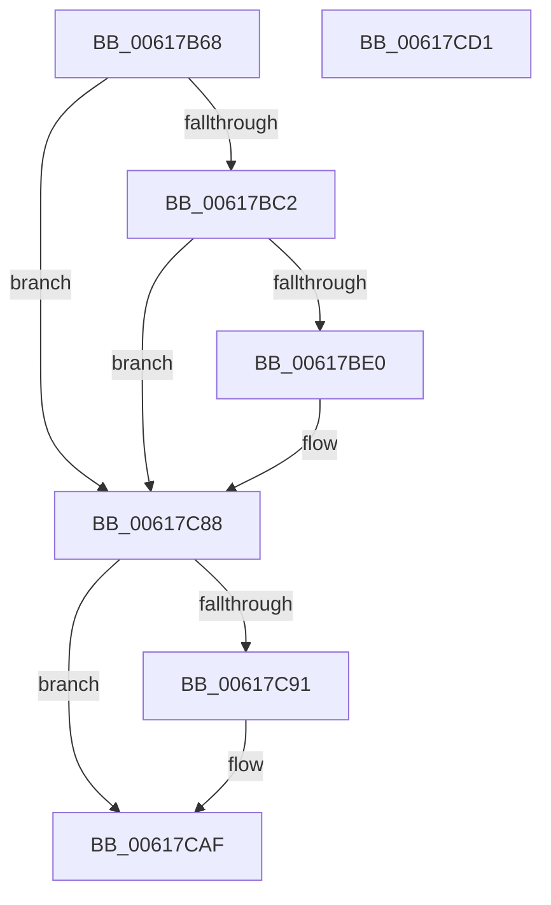

# CarEtwWriteBugCheckEvent

- RVA: `0x00617B68`–`0x00617CD2` (길이 `362` bytes)
- VA: `0x0000000140617B68`
- 실행 섹션: `.text`
- PDB 이름 있음: `예`; PDB Function 태그: `아니요`
- unwind 정보 RVA: `0x000C6DB4`
- 디코드: `91`개 명령, `362/362` bytes 표시
- 미해석 바이트: `0` (있으면 어셈블리에 `.byte`로 보존)

> 이 문서는 커널 이미지의 기계어와 PDB 기호를 분석해 생성했습니다. 4번과 5번은 함수 원형과 자료형을 바이너리 사용 방식에서 추정한 C 해석이며 원본 소스 복구 결과는 아닙니다.

## 1. Dependencies

- 직접 호출 지점: **7**; 고유 호출 대상: **7**
- 직접 호출자로 확인된 함수: **2**
- RIP 상대 이미지 참조: **5**

### Outgoing calls
- `0x00617B98` → [VfUtilGetDriverFullName](../../pagevrfy/B9/VfUtilGetDriverFullName_function_00B93280.md) (function, `0x00B93280`)
- `0x00617BD3` → [tlgKeywordOn](../42/tlgKeywordOn_function_0042EAA0.md) (function, `0x0042EAA0`)
- `0x00617C25` → [tlgCreate1Sz_wchar_t](../42/tlgCreate1Sz_wchar_t_function_00426198.md) (function, `0x00426198`)
- `0x00617C31` → [tlgCreate1Sz_char](../42/tlgCreate1Sz_char_function_00427304.md) (function, `0x00427304`)
- `0x00617C7F` → [tlgWriteTransfer_EtwWriteTransfer](../42/tlgWriteTransfer_EtwWriteTransfer_function_004260E0.md) (function, `0x004260E0`)
- `0x00617CA8` → [McTemplateK0dszud_EtwWriteTransfer](McTemplateK0dszud_EtwWriteTransfer_function_006183FC.md) (function, `0x006183FC`)
- `0x00617CB8` → [_security_check_cookie](../6A/_security_check_cookie_function_006AC640.md) (function, `0x006AC640`)

### Direct callers
- [CarHandleEtwEvent](CarHandleEtwEvent_function_00617FBC.md) at `0x00618076`
- [CarWriteEarlyRuleViolationEvents](CarWriteEarlyRuleViolationEvents_function_0061B628.md) at `0x0061B6A1`

### Static image references
- `0x00617B81` → RVA `0x00E0A740` (`.data`; read)
- `0x00617BB1` → RVA `0x00E090C8` (`.data`; read)
- `0x00617BF1` → RVA `0x00F03DA8` (`.data`; read)
- `0x00617C43` → RVA `0x000531A3` (`.rdata`; read)
- `0x00617C88` → RVA `0x00F03EE4` (`.data`; reference)

## 2. Other-region calls and transfers

- 다른 실행 섹션으로 향하는 call: **1**
  - `0x00617B98` → [VfUtilGetDriverFullName](../../pagevrfy/B9/VfUtilGetDriverFullName_function_00B93280.md) (`.text` → `PAGEVRFY`)
- 별도 외부 분기/꼬리 이동을 확인하지 못했습니다.

## 3. Assembly (complete function range)

```asm
00617B68  40 55                           push rbp
00617B6A  53                              push rbx
00617B6B  56                              push rsi
00617B6C  57                              push rdi
00617B6D  41 54                           push r12
00617B6F  41 55                           push r13
00617B71  41 56                           push r14
00617B73  41 57                           push r15
00617B75  48 8D 6C 24 F8                  lea rbp, [rsp - 8]
00617B7A  48 81 EC 08 01 00 00            sub rsp, 0x108
00617B81  48 8B 05 B8 2B 7F 00            mov rax, qword ptr [rip + 0x7f2bb8]
00617B88  48 33 C4                        xor rax, rsp
00617B8B  48 89 45 F0                     mov qword ptr [rbp - 0x10], rax
00617B8F  4D 8B F1                        mov r14, r9
00617B92  41 8B F0                        mov esi, r8d
00617B95  4C 8B EA                        mov r13, rdx
00617B98  E8 E3 B6 57 00                  call 0x140b93280
00617B9D  44 8B 7D 78                     mov r15d, dword ptr [rbp + 0x78]
00617BA1  33 DB                           xor ebx, ebx
00617BA3  44 8A 65 70                     mov r12b, byte ptr [rbp + 0x70]
00617BA7  48 85 C0                        test rax, rax
00617BAA  48 8B F8                        mov rdi, rax
00617BAD  49 0F 44 FD                     cmove rdi, r13
00617BB1  83 3D 10 15 7F 00 05            cmp dword ptr [rip + 0x7f1510], 5
00617BB8  44 8D 4B 04                     lea r9d, [rbx + 4]
00617BBC  0F 86 C6 00 00 00               jbe 0x140617c88
00617BC2  48 BA 00 00 00 00 00 80 00 00   movabs rdx, 0x800000000000
00617BCC  48 8D 0D F5 14 7F 00            lea rcx, [rip + 0x7f14f5]
00617BD3  E8 C8 6E E1 FF                  call 0x14042eaa0
00617BD8  84 C0                           test al, al
00617BDA  0F 84 A8 00 00 00               je 0x140617c88
00617BE0  48 8D 44 24 44                  lea rax, [rsp + 0x44]
00617BE5  89 5C 24 44                     mov dword ptr [rsp + 0x44], ebx
00617BE9  48 89 45 80                     mov qword ptr [rbp - 0x80], rax
00617BED  48 8D 4D B0                     lea rcx, [rbp - 0x50]
00617BF1  8B 05 B1 C1 8E 00               mov eax, dword ptr [rip + 0x8ec1b1]
00617BF7  49 8B D5                        mov rdx, r13
00617BFA  89 44 24 48                     mov dword ptr [rsp + 0x48], eax
00617BFE  48 8D 44 24 48                  lea rax, [rsp + 0x48]
00617C03  48 89 45 90                     mov qword ptr [rbp - 0x70], rax
00617C07  48 8D 44 24 40                  lea rax, [rsp + 0x40]
00617C0C  48 89 45 A0                     mov qword ptr [rbp - 0x60], rax
00617C10  4C 89 4D 88                     mov qword ptr [rbp - 0x78], r9
00617C14  4C 89 4D 98                     mov qword ptr [rbp - 0x68], r9
00617C18  44 88 64 24 40                  mov byte ptr [rsp + 0x40], r12b
00617C1D  48 C7 45 A8 01 00 00 00         mov qword ptr [rbp - 0x58], 1
00617C25  E8 6E E5 E0 FF                  call 0x140426198
00617C2A  49 8B D6                        mov rdx, r14
00617C2D  48 8D 4D C0                     lea rcx, [rbp - 0x40]
00617C31  E8 CE F6 E0 FF                  call 0x140427304
00617C36  48 8D 44 24 4C                  lea rax, [rsp + 0x4c]
00617C3B  4C 89 4D D8                     mov qword ptr [rbp - 0x28], r9
00617C3F  48 89 45 D0                     mov qword ptr [rbp - 0x30], rax
00617C43  48 8D 15 59 B5 A3 FF            lea rdx, [rip - 0x5c4aa7]
00617C4A  48 8D 44 24 50                  lea rax, [rsp + 0x50]
00617C4F  4C 89 4D E8                     mov qword ptr [rbp - 0x18], r9
00617C53  48 89 45 E0                     mov qword ptr [rbp - 0x20], rax
00617C57  48 8D 0D 6A 14 7F 00            lea rcx, [rip + 0x7f146a]
00617C5E  48 8D 44 24 60                  lea rax, [rsp + 0x60]
00617C63  89 74 24 4C                     mov dword ptr [rsp + 0x4c], esi
00617C67  48 89 44 24 28                  mov qword ptr [rsp + 0x28], rax
00617C6C  45 33 C9                        xor r9d, r9d
00617C6F  45 33 C0                        xor r8d, r8d
00617C72  C7 44 24 20 09 00 00 00         mov dword ptr [rsp + 0x20], 9
00617C7A  44 89 7C 24 50                  mov dword ptr [rsp + 0x50], r15d
00617C7F  E8 5C E4 E0 FF                  call 0x1404260e0
00617C84  44 8D 4B 04                     lea r9d, [rbx + 4]
00617C88  44 84 0D 55 C2 8E 00            test byte ptr [rip + 0x8ec255], r9b
00617C8F  74 1E                           je 0x140617caf
00617C91  44 89 7C 24 38                  mov dword ptr [rsp + 0x38], r15d
00617C96  44 8B CE                        mov r9d, esi
00617C99  44 88 64 24 30                  mov byte ptr [rsp + 0x30], r12b
00617C9E  48 89 7C 24 28                  mov qword ptr [rsp + 0x28], rdi
00617CA3  4C 89 74 24 20                  mov qword ptr [rsp + 0x20], r14
00617CA8  E8 4F 07 00 00                  call 0x1406183fc
00617CAD  8B D8                           mov ebx, eax
00617CAF  8B C3                           mov eax, ebx
00617CB1  48 8B 4D F0                     mov rcx, qword ptr [rbp - 0x10]
00617CB5  48 33 CC                        xor rcx, rsp
00617CB8  E8 83 49 09 00                  call 0x1406ac640
00617CBD  48 81 C4 08 01 00 00            add rsp, 0x108
00617CC4  41 5F                           pop r15
00617CC6  41 5E                           pop r14
00617CC8  41 5D                           pop r13
00617CCA  41 5C                           pop r12
00617CCC  5F                              pop rdi
00617CCD  5E                              pop rsi
00617CCE  5B                              pop rbx
00617CCF  5D                              pop rbp
00617CD0  C3                              ret
00617CD1  CC                              int3
```

## 4. C-style interpretation (structured pseudocode)

```c
__int64 __fastcall CarEtwWriteBugCheckEvent(__int64 a1, __int64 a2, int a3, __int64 a4, unsigned __int8 a5, unsigned int a6)
{
    __int64 result;
    __int64 v_rbx;
    __int64 v_rdi;
    __int64 v_rsp;
    unsigned int v_stack_m100;
    unsigned __int64 v_stack_m104;
    unsigned __int64 v_stack_m108;
    unsigned int v_stack_m110;
    unsigned __int8 v_stack_m118;
    unsigned __int64 v_stack_m120;
    unsigned int v_stack_m128;
    unsigned __int64 v_stack_m48;
    unsigned __int64 v_stack_m58;
    unsigned __int64 v_stack_m60;
    unsigned __int64 v_stack_m68;
    unsigned __int64 v_stack_m70;
    unsigned __int64 v_stack_m78;
    unsigned __int64 v_stack_m88;
    unsigned __int64 v_stack_m98;
    unsigned __int64 v_stack_mA0;
    unsigned __int64 v_stack_mA8;
    unsigned __int64 v_stack_mB0;
    unsigned __int64 v_stack_mB8;
    unsigned __int64 v_stack_mC0;
    unsigned __int64 v_stack_mC8;
    unsigned __int64 v_stack_mE8;
    unsigned __int64 v_stack_mF8;
    unsigned __int64 v_stack_mFC;

    v_rsp = (v_rsp) - (264);
    result = (*(unsigned __int64 *)(v_rip + 8334264)) ^ (v_rsp);
    v_stack_m58 = result;
    result = VfUtilGetDriverFullName(a1, a2, a3, a4);
    v_rbx = 0;
    v_rdi = result;
    if (result == 0) { v_rdi = a2; }
    if ((*(unsigned int *)(v_rip + 8328464)) <= 5) goto loc_00617C88;
    result = tlgKeywordOn(v_rip + 8328437, a2, a3, v_rbx + 4);
    if ((unsigned __int8)(result) != 0) {
        result = v_stack_m104;
        v_stack_m104 = 0;
        v_stack_mC8 = result;
        a1 = v_stack_m98;
        result = *(unsigned int *)(v_rip + 9355697);
        a2 = a2;
        v_stack_m100 = (unsigned int)(result);
        result = v_stack_m100;
        v_stack_mB8 = result;
        result = v_stack_m108;
        v_stack_mA8 = result;
        v_stack_mC0 = v_rbx + 4;
        v_stack_mB0 = v_rbx + 4;
        v_stack_m108 = a5;
        v_stack_mA0 = 1;
        result = tlgCreate1Sz_wchar_t(a1, a2, a3, v_rbx + 4);
        a2 = a4;
        a1 = v_stack_m88;
        result = tlgCreate1Sz_char(a1, a2, a3, v_rbx + 4);
        result = v_stack_mFC;
        v_stack_m70 = v_rbx + 4;
        v_stack_m78 = result;
        a2 = v_rip - 6048423;
        result = v_stack_mF8;
        v_stack_m60 = v_rbx + 4;
        v_stack_m68 = result;
        a1 = v_rip + 8328298;
        result = v_stack_mE8;
        v_stack_mFC = (unsigned int)((unsigned int)(a3));
        v_stack_m120 = result;
        a4 = 0;
        a3 = 0;
        v_stack_m128 = 9;
        v_stack_mF8 = (unsigned int)((unsigned int)(a6));
        result = tlgWriteTransfer_EtwWriteTransfer(a1, a2, a3, a4);
        a4 = v_rbx + 4;
    }
    if (((*(unsigned __int8 *)(v_rip + 9355861)) & ((unsigned __int8)(a4))) != 0) {
        v_stack_m110 = (unsigned int)((unsigned int)(a6));
        a4 = (unsigned int)((unsigned int)(a3));
        v_stack_m118 = a5;
        v_stack_m120 = v_rdi;
        v_stack_m128 = a4;
        result = McTemplateK0dszud_EtwWriteTransfer(a1, a2, a3, a4);
        v_rbx = (unsigned int)(result);
    }
    a1 = (v_stack_m58) ^ (v_rsp);
    result = _security_check_cookie(a1, a2, a3, a4);
    v_rsp = (v_rsp) + (264);
    return result;
}
```

## 5. (Beta) C Style

```c
int64_t CarEtwWriteBugCheckEvent(int64_t Arg1, int64_t Arg2, int32_t Arg3, int64_t Arg4, uint8_t Arg5, uint32_t Arg6)
{
    int64_t result;
    int64_t local_rbx;
    int64_t local_rdi;
    int64_t local_rsp;
    uint32_t v_stack_m100;
    uint64_t v_stack_m104;
    uint64_t v_stack_m108;
    uint32_t v_stack_m110;
    uint8_t v_stack_m118;
    uint64_t v_stack_m120;
    uint32_t v_stack_m128;
    uint64_t v_stack_m48;
    uint64_t v_stack_m58;
    uint64_t v_stack_m60;
    uint64_t v_stack_m68;
    uint64_t v_stack_m70;
    uint64_t v_stack_m78;
    uint64_t v_stack_m88;
    uint64_t v_stack_m98;
    uint64_t v_stack_mA0;
    uint64_t v_stack_mA8;
    uint64_t v_stack_mB0;
    uint64_t v_stack_mB8;
    uint64_t v_stack_mC0;
    uint64_t v_stack_mC8;
    uint64_t v_stack_mE8;
    uint64_t v_stack_mF8;
    uint64_t v_stack_mFC;

    local_rsp = (local_rsp) - (264);
    result = (*(uint64_t *)(v_rip + 0x7F2BB8)) ^ (local_rsp);
    v_stack_m58 = result;
    result = VfUtilGetDriverFullName(Arg1, Arg2, Arg3, Arg4);
    local_rbx = 0;
    local_rdi = result;
    if (result == 0) { local_rdi = Arg2; }
    if ((*(uint32_t *)(v_rip + 0x7F1510)) <= 5) goto loc_00617C88;
    result = tlgKeywordOn(v_rip + 8328437, Arg2, Arg3, local_rbx + 4);
    if ((uint8_t)(result) != 0) {
        result = v_stack_m104;
        v_stack_m104 = 0;
        v_stack_mC8 = result;
        Arg1 = v_stack_m98;
        result = *(uint32_t *)(v_rip + 0x8EC1B1);
        Arg2 = Arg2;
        v_stack_m100 = (uint32_t)(result);
        result = v_stack_m100;
        v_stack_mB8 = result;
        result = v_stack_m108;
        v_stack_mA8 = result;
        v_stack_mC0 = local_rbx + 4;
        v_stack_mB0 = local_rbx + 4;
        v_stack_m108 = Arg5;
        v_stack_mA0 = 1;
        result = tlgCreate1Sz_wchar_t(Arg1, Arg2, Arg3, local_rbx + 4);
        Arg2 = Arg4;
        Arg1 = v_stack_m88;
        result = tlgCreate1Sz_char(Arg1, Arg2, Arg3, local_rbx + 4);
        result = v_stack_mFC;
        v_stack_m70 = local_rbx + 4;
        v_stack_m78 = result;
        Arg2 = v_rip - 6048423;
        result = v_stack_mF8;
        v_stack_m60 = local_rbx + 4;
        v_stack_m68 = result;
        Arg1 = v_rip + 8328298;
        result = v_stack_mE8;
        v_stack_mFC = (uint32_t)((uint32_t)(Arg3));
        v_stack_m120 = result;
        Arg4 = 0;
        Arg3 = 0;
        v_stack_m128 = 9;
        v_stack_mF8 = (uint32_t)((uint32_t)(Arg6));
        result = tlgWriteTransfer_EtwWriteTransfer(Arg1, Arg2, Arg3, Arg4);
        Arg4 = local_rbx + 4;
    }
    if (((*(uint8_t *)(v_rip + 0x8EC255)) & ((uint8_t)(Arg4))) != 0) {
        v_stack_m110 = (uint32_t)((uint32_t)(Arg6));
        Arg4 = (uint32_t)((uint32_t)(Arg3));
        v_stack_m118 = Arg5;
        v_stack_m120 = local_rdi;
        v_stack_m128 = Arg4;
        result = McTemplateK0dszud_EtwWriteTransfer(Arg1, Arg2, Arg3, Arg4);
        local_rbx = (uint32_t)(result);
    }
    Arg1 = (v_stack_m58) ^ (local_rsp);
    result = _security_check_cookie(Arg1, Arg2, Arg3, Arg4);
    local_rsp = (local_rsp) + (264);
    return result;
}
```

## 6. Execution-region graph

[열기: 2D/3D 그래프와 함수 탐색 컨트롤 패널](../../../control-panel.html?section=text&rva=0x00617B68&view=graph)

- 2D 그래프는 위에서 아래로 흐르고, 3D 그래프는 빈 공간을 드래그해 회전합니다. Shift+드래그는 이동, 휠은 확대·축소, 함수 노드 선택은 대상 보고서 이동입니다.

### Static fallback


