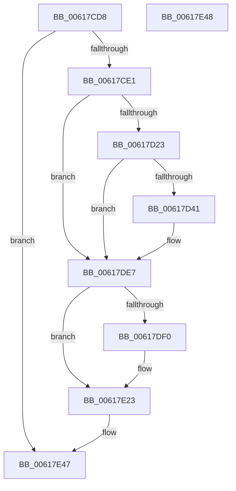

# CarEtwWriteLiveDumpEvent

- RVA: `0x00617CD8`–`0x00617E49` (길이 `369` bytes)
- VA: `0x0000000140617CD8`
- 실행 섹션: `.text`
- PDB 이름 있음: `예`; PDB Function 태그: `아니요`
- unwind 정보 RVA: `0x000D29D4`
- 디코드: `83`개 명령, `369/369` bytes 표시
- 미해석 바이트: `0` (있으면 어셈블리에 `.byte`로 보존)

> 이 문서는 커널 이미지의 기계어와 PDB 기호를 분석해 생성했습니다. 4번과 5번은 함수 원형과 자료형을 바이너리 사용 방식에서 추정한 C 해석이며 원본 소스 복구 결과는 아닙니다.

## 1. Dependencies

- 직접 호출 지점: **6**; 고유 호출 대상: **6**
- 직접 호출자로 확인된 함수: **1**
- RIP 상대 이미지 참조: **6**

### Outgoing calls
- `0x00617D34` → [tlgKeywordOn](../42/tlgKeywordOn_function_0042EAA0.md) (function, `0x0042EAA0`)
- `0x00617D72` → [tlgCreate1Sz_char](../42/tlgCreate1Sz_char_function_00427304.md) (function, `0x00427304`)
- `0x00617D91` → [tlgCreate1Sz_wchar_t](../42/tlgCreate1Sz_wchar_t_function_00426198.md) (function, `0x00426198`)
- `0x00617DE2` → [tlgWriteTransfer_EtwWriteTransfer](../42/tlgWriteTransfer_EtwWriteTransfer_function_004260E0.md) (function, `0x004260E0`)
- `0x00617E1E` → [McTemplateK0dszud_EtwWriteTransfer](McTemplateK0dszud_EtwWriteTransfer_function_006183FC.md) (function, `0x006183FC`)
- `0x00617E2A` → [_security_check_cookie](../6A/_security_check_cookie_function_006AC640.md) (function, `0x006AC640`)

### Direct callers
- [CarLiveDump](CarLiveDump_function_0061BB30.md) at `0x0061BBD2`

### Static image references
- `0x00617CFC` → RVA `0x00E0A740` (`.data`; read)
- `0x00617D11` → RVA `0x00E090C8` (`.data`; read)
- `0x00617DA1` → RVA `0x00053262` (`.rdata`; read)
- `0x00617DE7` → RVA `0x00F03EE4` (`.data`; reference)
- `0x00617E01` → RVA `0x006CF9C0` (` ?? ::FNODOBFM::`string'`; read)
- `0x00617E12` → RVA `0x006CFA10` (` ?? ::FNODOBFM::`string'`; read)

## 2. Other-region calls and transfers

- 다른 실행 섹션으로 향하는 call: **0**
- 별도 외부 분기/꼬리 이동을 확인하지 못했습니다.

## 3. Assembly (complete function range)

```asm
00617CD8  48 85 C9                        test rcx, rcx
00617CDB  0F 84 66 01 00 00               je 0x140617e47
00617CE1  48 8B C4                        mov rax, rsp
00617CE4  48 89 58 10                     mov qword ptr [rax + 0x10], rbx
00617CE8  48 89 70 18                     mov qword ptr [rax + 0x18], rsi
00617CEC  48 89 78 20                     mov qword ptr [rax + 0x20], rdi
00617CF0  55                              push rbp
00617CF1  48 8D 68 A1                     lea rbp, [rax - 0x5f]
00617CF5  48 81 EC 00 01 00 00            sub rsp, 0x100
00617CFC  48 8B 05 3D 2A 7F 00            mov rax, qword ptr [rip + 0x7f2a3d]
00617D03  48 33 C4                        xor rax, rsp
00617D06  48 89 45 47                     mov qword ptr [rbp + 0x47], rax
00617D0A  48 8B D9                        mov rbx, rcx
00617D0D  44 0F 20 C7                     mov rdi, cr8
00617D11  83 3D B0 13 7F 00 05            cmp dword ptr [rip + 0x7f13b0], 5
00617D18  BE 04 00 00 00                  mov esi, 4
00617D1D  0F 86 C4 00 00 00               jbe 0x140617de7
00617D23  48 BA 00 00 00 00 00 80 00 00   movabs rdx, 0x800000000000
00617D2D  48 8D 0D 94 13 7F 00            lea rcx, [rip + 0x7f1394]
00617D34  E8 67 6D E1 FF                  call 0x14042eaa0
00617D39  84 C0                           test al, al
00617D3B  0F 84 A6 00 00 00               je 0x140617de7
00617D41  8B 03                           mov eax, dword ptr [rbx]
00617D43  48 8D 4D F7                     lea rcx, [rbp - 9]
00617D47  48 8B 93 58 04 00 00            mov rdx, qword ptr [rbx + 0x458]
00617D4E  89 45 97                        mov dword ptr [rbp - 0x69], eax
00617D51  48 8D 45 97                     lea rax, [rbp - 0x69]
00617D55  48 89 45 D7                     mov qword ptr [rbp - 0x29], rax
00617D59  8B 83 60 04 00 00               mov eax, dword ptr [rbx + 0x460]
00617D5F  89 45 9B                        mov dword ptr [rbp - 0x65], eax
00617D62  48 8D 45 9B                     lea rax, [rbp - 0x65]
00617D66  48 89 45 E7                     mov qword ptr [rbp - 0x19], rax
00617D6A  48 89 75 DF                     mov qword ptr [rbp - 0x21], rsi
00617D6E  48 89 75 EF                     mov qword ptr [rbp - 0x11], rsi
00617D72  E8 8D F5 E0 FF                  call 0x140427304
00617D77  8B 4B 54                        mov ecx, dword ptr [rbx + 0x54]
00617D7A  48 8D 45 9F                     lea rax, [rbp - 0x61]
00617D7E  89 4D 9F                        mov dword ptr [rbp - 0x61], ecx
00617D81  48 8D 53 04                     lea rdx, [rbx + 4]
00617D85  48 8D 4D 17                     lea rcx, [rbp + 0x17]
00617D89  48 89 45 07                     mov qword ptr [rbp + 7], rax
00617D8D  48 89 75 0F                     mov qword ptr [rbp + 0xf], rsi
00617D91  E8 02 E4 E0 FF                  call 0x140426198
00617D96  8B 4B 44                        mov ecx, dword ptr [rbx + 0x44]
00617D99  48 8D 45 A3                     lea rax, [rbp - 0x5d]
00617D9D  48 89 45 27                     mov qword ptr [rbp + 0x27], rax
00617DA1  48 8D 15 BA B4 A3 FF            lea rdx, [rip - 0x5c4b46]
00617DA8  8B 83 64 04 00 00               mov eax, dword ptr [rbx + 0x464]
00617DAE  45 33 C9                        xor r9d, r9d
00617DB1  89 45 A7                        mov dword ptr [rbp - 0x59], eax
00617DB4  45 33 C0                        xor r8d, r8d
00617DB7  48 8D 45 A7                     lea rax, [rbp - 0x59]
00617DBB  89 4D A3                        mov dword ptr [rbp - 0x5d], ecx
00617DBE  48 89 45 37                     mov qword ptr [rbp + 0x37], rax
00617DC2  48 8D 0D FF 12 7F 00            lea rcx, [rip + 0x7f12ff]
00617DC9  48 8D 45 B7                     lea rax, [rbp - 0x49]
00617DCD  48 89 75 2F                     mov qword ptr [rbp + 0x2f], rsi
00617DD1  48 89 44 24 28                  mov qword ptr [rsp + 0x28], rax
00617DD6  C7 44 24 20 09 00 00 00         mov dword ptr [rsp + 0x20], 9
00617DDE  48 89 75 3F                     mov qword ptr [rbp + 0x3f], rsi
00617DE2  E8 F9 E2 E0 FF                  call 0x1404260e0
00617DE7  40 84 35 F6 C0 8E 00            test byte ptr [rip + 0x8ec0f6], sil
00617DEE  74 33                           je 0x140617e23
00617DF0  8B 83 64 04 00 00               mov eax, dword ptr [rbx + 0x464]
00617DF6  44 8B 8B 60 04 00 00            mov r9d, dword ptr [rbx + 0x460]
00617DFD  89 44 24 38                     mov dword ptr [rsp + 0x38], eax
00617E01  48 8D 05 B8 7B 0B 00            lea rax, [rip + 0xb7bb8]
00617E08  40 88 7C 24 30                  mov byte ptr [rsp + 0x30], dil
00617E0D  48 89 44 24 28                  mov qword ptr [rsp + 0x28], rax
00617E12  48 8D 05 F7 7B 0B 00            lea rax, [rip + 0xb7bf7]
00617E19  48 89 44 24 20                  mov qword ptr [rsp + 0x20], rax
00617E1E  E8 D9 05 00 00                  call 0x1406183fc
00617E23  48 8B 4D 47                     mov rcx, qword ptr [rbp + 0x47]
00617E27  48 33 CC                        xor rcx, rsp
00617E2A  E8 11 48 09 00                  call 0x1406ac640
00617E2F  4C 8D 9C 24 00 01 00 00         lea r11, [rsp + 0x100]
00617E37  49 8B 5B 18                     mov rbx, qword ptr [r11 + 0x18]
00617E3B  49 8B 73 20                     mov rsi, qword ptr [r11 + 0x20]
00617E3F  49 8B 7B 28                     mov rdi, qword ptr [r11 + 0x28]
00617E43  49 8B E3                        mov rsp, r11
00617E46  5D                              pop rbp
00617E47  C3                              ret
00617E48  CC                              int3
```

## 4. C-style interpretation (structured pseudocode)

```c
__int64 __fastcall CarEtwWriteLiveDumpEvent(__int64 a1, __int64 a2, int a3, int a4)
{
    __int64 result;
    __int64 v_rsp;
    unsigned __int64 v_stack_m8;
    unsigned int v_stack_mD0;
    unsigned __int8 v_stack_mD8;
    unsigned __int64 v_stack_mE0;
    unsigned int v_stack_mE8;

    if (a1 == 0) goto loc_00617E47;
    *(unsigned __int64 *)(v_rsp + 16) = v_rbx;
    *(unsigned __int64 *)(v_rsp + 24) = v_rsi;
    *(unsigned __int64 *)(v_rsp + 32) = v_rdi;
    v_rsp = (v_rsp) - (256);
    result = (*(unsigned __int64 *)(v_rip + 8333885)) ^ (v_rsp);
    *(unsigned __int64 *)(v_rsp - 95 + 71) = result;
    if ((*(unsigned int *)(v_rip + 8328112)) <= 5) goto loc_00617DE7;
    result = tlgKeywordOn(v_rip + 8328084, a2, a3, a4);
    if ((unsigned __int8)(result) != 0) {
        result = *(unsigned int *)(a1);
        a1 = v_rsp - 95 - 9;
        a2 = *(unsigned __int64 *)(a1 + 1112);
        *(unsigned int *)(v_rsp - 95 - 105) = (unsigned int)(result);
        result = v_rsp - 95 - 105;
        *(unsigned __int64 *)(v_rsp - 95 - 41) = result;
        result = *(unsigned int *)(a1 + 1120);
        *(unsigned int *)(v_rsp - 95 - 101) = (unsigned int)(result);
        result = v_rsp - 95 - 101;
        *(unsigned __int64 *)(v_rsp - 95 - 25) = result;
        *(unsigned __int64 *)(v_rsp - 95 - 33) = 4;
        *(unsigned __int64 *)(v_rsp - 95 - 17) = 4;
        result = tlgCreate1Sz_char(a1, a2, a3, a4);
        a1 = *(unsigned int *)(a1 + 84);
        result = v_rsp - 95 - 97;
        *(unsigned int *)(v_rsp - 95 - 97) = (unsigned int)(a1);
        a2 = a1 + 4;
        a1 = v_rsp - 95 + 23;
        *(unsigned __int64 *)(v_rsp - 95 + 7) = result;
        *(unsigned __int64 *)(v_rsp - 95 + 15) = 4;
        result = tlgCreate1Sz_wchar_t(a1, a2, a3, a4);
        a1 = *(unsigned int *)(a1 + 68);
        result = v_rsp - 95 - 93;
        *(unsigned __int64 *)(v_rsp - 95 + 39) = result;
        a2 = v_rip - 6048582;
        result = *(unsigned int *)(a1 + 1124);
        a4 = 0;
        *(unsigned int *)(v_rsp - 95 - 89) = (unsigned int)(result);
        a3 = 0;
        result = v_rsp - 95 - 89;
        *(unsigned int *)(v_rsp - 95 - 93) = (unsigned int)(a1);
        *(unsigned __int64 *)(v_rsp - 95 + 55) = result;
        a1 = v_rip + 8327935;
        result = v_rsp - 95 - 73;
        *(unsigned __int64 *)(v_rsp - 95 + 47) = 4;
        v_stack_mE0 = result;
        v_stack_mE8 = 9;
        *(unsigned __int64 *)(v_rsp - 95 + 63) = 4;
        result = tlgWriteTransfer_EtwWriteTransfer(a1, a2, a3, a4);
    }
    if (((*(unsigned __int8 *)(v_rip + 9355510)) & (4)) != 0) {
        result = *(unsigned int *)(a1 + 1124);
        a4 = *(unsigned int *)(a1 + 1120);
        v_stack_mD0 = (unsigned int)(result);
        result = v_rip + 752568;
        v_stack_mD8 = (unsigned __int8)(v_cr8);
        v_stack_mE0 = result;
        result = v_rip + 752631;
        v_stack_mE8 = result;
        result = McTemplateK0dszud_EtwWriteTransfer(a1, a2, a3, a4);
    }
    a1 = (*(unsigned __int64 *)(v_rsp - 95 + 71)) ^ (v_rsp);
    result = _security_check_cookie(a1, a2, a3, a4);
loc_00617E47:
    return result;
}
```

## 5. (Beta) C Style

```c
int64_t CarEtwWriteLiveDumpEvent(int64_t Arg1, int64_t Arg2, int32_t Arg3, int32_t Arg4)
{
    int64_t result;
    int64_t local_rsp;
    uint64_t v_stack_m8;
    uint32_t v_stack_mD0;
    uint8_t v_stack_mD8;
    uint64_t v_stack_mE0;
    uint32_t v_stack_mE8;

    if (Arg1 == 0) goto loc_00617E47;
    *(uint64_t *)(local_rsp + 0x10) = local_rbx;
    *(uint64_t *)(local_rsp + 0x18) = local_rsi;
    *(uint64_t *)(local_rsp + 0x20) = local_rdi;
    local_rsp = (local_rsp) - (256);
    result = (*(uint64_t *)(v_rip + 0x7F2A3D)) ^ (local_rsp);
    *(uint64_t *)(local_rsp - 0x5F + 0x47) = result;
    if ((*(uint32_t *)(v_rip + 0x7F13B0)) <= 5) goto loc_00617DE7;
    result = tlgKeywordOn(v_rip + 8328084, Arg2, Arg3, Arg4);
    if ((uint8_t)(result) != 0) {
        result = *(uint32_t *)(Arg1);
        Arg1 = local_rsp - 95 - 9;
        Arg2 = *(uint64_t *)(Arg1 + 0x458);
        *(uint32_t *)(local_rsp - 0x5F - 0x69) = (uint32_t)(result);
        result = local_rsp - 95 - 105;
        *(uint64_t *)(local_rsp - 0x5F - 0x29) = result;
        result = *(uint32_t *)(Arg1 + 0x460);
        *(uint32_t *)(local_rsp - 0x5F - 0x65) = (uint32_t)(result);
        result = local_rsp - 95 - 101;
        *(uint64_t *)(local_rsp - 0x5F - 0x19) = result;
        *(uint64_t *)(local_rsp - 0x5F - 0x21) = 4;
        *(uint64_t *)(local_rsp - 0x5F - 0x11) = 4;
        result = tlgCreate1Sz_char(Arg1, Arg2, Arg3, Arg4);
        Arg1 = *(uint32_t *)(Arg1 + 0x54);
        result = local_rsp - 95 - 97;
        *(uint32_t *)(local_rsp - 0x5F - 0x61) = (uint32_t)(Arg1);
        Arg2 = Arg1 + 4;
        Arg1 = local_rsp - 95 + 23;
        *(uint64_t *)(local_rsp - 0x5F + 0x7) = result;
        *(uint64_t *)(local_rsp - 0x5F + 0xF) = 4;
        result = tlgCreate1Sz_wchar_t(Arg1, Arg2, Arg3, Arg4);
        Arg1 = *(uint32_t *)(Arg1 + 0x44);
        result = local_rsp - 95 - 93;
        *(uint64_t *)(local_rsp - 0x5F + 0x27) = result;
        Arg2 = v_rip - 6048582;
        result = *(uint32_t *)(Arg1 + 0x464);
        Arg4 = 0;
        *(uint32_t *)(local_rsp - 0x5F - 0x59) = (uint32_t)(result);
        Arg3 = 0;
        result = local_rsp - 95 - 89;
        *(uint32_t *)(local_rsp - 0x5F - 0x5D) = (uint32_t)(Arg1);
        *(uint64_t *)(local_rsp - 0x5F + 0x37) = result;
        Arg1 = v_rip + 8327935;
        result = local_rsp - 95 - 73;
        *(uint64_t *)(local_rsp - 0x5F + 0x2F) = 4;
        v_stack_mE0 = result;
        v_stack_mE8 = 9;
        *(uint64_t *)(local_rsp - 0x5F + 0x3F) = 4;
        result = tlgWriteTransfer_EtwWriteTransfer(Arg1, Arg2, Arg3, Arg4);
    }
    if (((*(uint8_t *)(v_rip + 0x8EC0F6)) & (4)) != 0) {
        result = *(uint32_t *)(Arg1 + 0x464);
        Arg4 = *(uint32_t *)(Arg1 + 0x460);
        v_stack_mD0 = (uint32_t)(result);
        result = v_rip + 752568;
        v_stack_mD8 = (uint8_t)(v_cr8);
        v_stack_mE0 = result;
        result = v_rip + 752631;
        v_stack_mE8 = result;
        result = McTemplateK0dszud_EtwWriteTransfer(Arg1, Arg2, Arg3, Arg4);
    }
    Arg1 = (*(uint64_t *)(local_rsp - 0x5F + 0x47)) ^ (local_rsp);
    result = _security_check_cookie(Arg1, Arg2, Arg3, Arg4);
loc_00617E47:
    return result;
}
```

## 6. Execution-region graph

[열기: 2D/3D 그래프와 함수 탐색 컨트롤 패널](../../../control-panel.html?section=text&rva=0x00617CD8&view=graph)

- 2D 그래프는 위에서 아래로 흐르고, 3D 그래프는 빈 공간을 드래그해 회전합니다. Shift+드래그는 이동, 휠은 확대·축소, 함수 노드 선택은 대상 보고서 이동입니다.

### Static fallback


