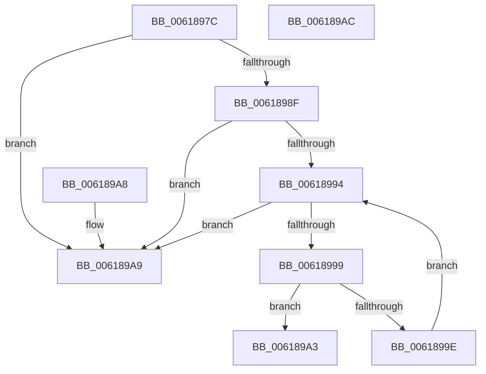

# CarFindRuleClassConfigurationEntryByRuleClassId

- RVA: `0x0061897C`–`0x006189AD` (길이 `49` bytes)
- VA: `0x000000014061897C`
- 실행 섹션: `.text`
- PDB 이름 있음: `예`; PDB Function 태그: `아니요`
- unwind 정보 RVA: `0x000DB714`
- 디코드: `18`개 명령, `49/49` bytes 표시
- 미해석 바이트: `0` (있으면 어셈블리에 `.byte`로 보존)

> 이 문서는 커널 이미지의 기계어와 PDB 기호를 분석해 생성했습니다. 4번과 5번은 함수 원형과 자료형을 바이너리 사용 방식에서 추정한 C 해석이며 원본 소스 복구 결과는 아닙니다.

## 1. Dependencies

- 직접 호출 지점: **0**; 고유 호출 대상: **0**
- 직접 호출자로 확인된 함수: **7**
- RIP 상대 이미지 참조: **1**

### Outgoing calls
- 직접 디코드된 call 명령이 없습니다.

### Direct callers
- [CarDeregisterRuleClassConfiguration](CarDeregisterRuleClassConfiguration_function_00618870.md) at `0x0061887C`
- [CarDeregisterRuleOverride](CarDeregisterRuleOverride_function_00618910.md) at `0x0061891F`
- [CarRegisterRuleOverride](CarRegisterRuleOverride_function_00619040.md) at `0x00619074`
- [CarRegisterRuleOverrideAllContexts](CarRegisterRuleOverrideAllContexts_function_00619130.md) at `0x00619162`
- [CarReportDifPluginRuleViolation](CarReportDifPluginRuleViolation_function_00619250.md) at `0x006192B0`
- [CarSetCustomIdInRuleOverride](CarSetCustomIdInRuleOverride_function_00619580.md) at `0x0061958F`
- [CarSetCustomRuleIdRange](CarSetCustomRuleIdRange_function_006195D0.md) at `0x006195DF`

### Static image references
- `0x0061897C` → RVA `0x00F03ED0` (`.data`; read)

## 2. Other-region calls and transfers

- 다른 실행 섹션으로 향하는 call: **0**
- 별도 외부 분기/꼬리 이동을 확인하지 못했습니다.

## 3. Assembly (complete function range)

```asm
0061897C  48 8B 05 4D B5 8E 00            mov rax, qword ptr [rip + 0x8eb54d]
00618983  4C 8D 05 46 B5 8E 00            lea r8, [rip + 0x8eb546]
0061898A  49 3B C0                        cmp rax, r8
0061898D  74 1A                           je 0x1406189a9
0061898F  48 85 C0                        test rax, rax
00618992  74 15                           je 0x1406189a9
00618994  49 3B C0                        cmp rax, r8
00618997  74 10                           je 0x1406189a9
00618999  39 50 AC                        cmp dword ptr [rax - 0x54], edx
0061899C  74 05                           je 0x1406189a3
0061899E  48 8B 00                        mov rax, qword ptr [rax]
006189A1  EB F1                           jmp 0x140618994
006189A3  48 83 C0 A8                     add rax, -0x58
006189A7  C3                              ret
006189A8  CC                              int3
006189A9  33 C0                           xor eax, eax
006189AB  C3                              ret
006189AC  CC                              int3
```

## 4. C-style interpretation (structured pseudocode)

```c
__int64 __fastcall CarFindRuleClassConfigurationEntryByRuleClassId(__int64 a1, int a2)
{
    __int64 result;

    if ((*(unsigned __int64 *)(v_rip + 9352525)) == (v_rip + 9352518)) goto loc_006189A9;
    if (*(unsigned __int64 *)(v_rip + 9352525) == 0) goto loc_006189A9;
loc_00618994:
    if ((*(unsigned __int64 *)(v_rip + 9352525)) == (v_rip + 9352518)) goto loc_006189A9;
    if ((*(unsigned int *)(*(unsigned __int64 *)(v_rip + 9352525) - 84)) == a2) goto loc_006189A3;
    goto loc_00618994;
loc_006189A3:
    result = (*(unsigned __int64 *)(*(unsigned __int64 *)(v_rip + 9352525))) + (-88);
    return result;
loc_006189A9:
    result = 0;
    return result;
}
```

## 5. (Beta) C Style

```c
int64_t CarFindRuleClassConfigurationEntryByRuleClassId(int64_t Arg1, int32_t Arg2)
{
    int64_t result;

    if ((*(uint64_t *)(v_rip + 0x8EB54D)) == (v_rip + 9352518)) goto loc_006189A9;
    if (*(uint64_t *)(v_rip + 0x8EB54D) == 0) goto loc_006189A9;
loc_00618994:
    if ((*(uint64_t *)(v_rip + 0x8EB54D)) == (v_rip + 9352518)) goto loc_006189A9;
    if ((*(uint32_t *)(*(uint64_t *)(v_rip + 0x8EB54D) - 0x54)) == Arg2) goto loc_006189A3;
    goto loc_00618994;
loc_006189A3:
    result = (*(uint64_t *)(*(uint64_t *)(v_rip + 0x8EB54D))) + (-88);
    return result;
loc_006189A9:
    result = 0;
    return result;
}
```

## 6. Execution-region graph

[열기: 2D/3D 그래프와 함수 탐색 컨트롤 패널](../../../control-panel.html?section=text&rva=0x0061897C&view=graph)

- 2D 그래프는 위에서 아래로 흐르고, 3D 그래프는 빈 공간을 드래그해 회전합니다. Shift+드래그는 이동, 휠은 확대·축소, 함수 노드 선택은 대상 보고서 이동입니다.

### Static fallback


