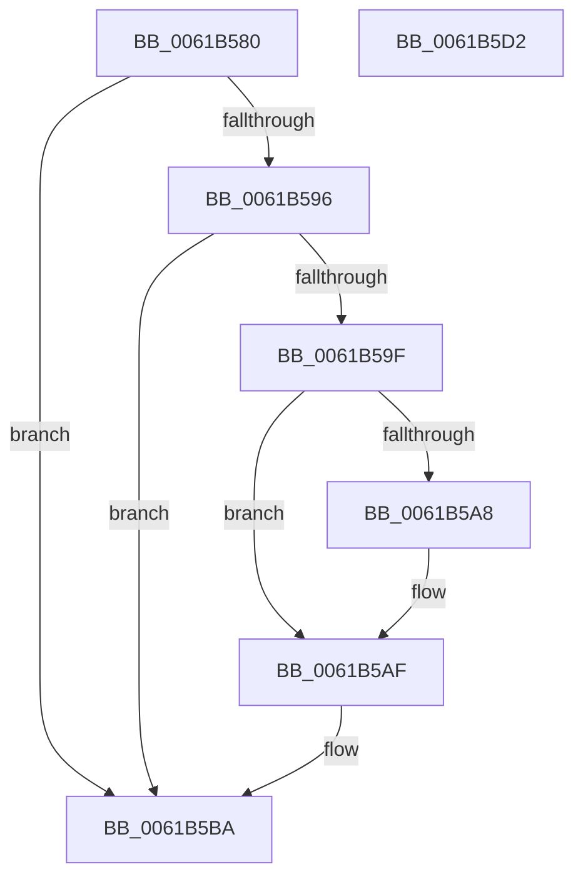

# CarFreeDbNode

- RVA: `0x0061B580`–`0x0061B5D3` (길이 `83` bytes)
- VA: `0x000000014061B580`
- 실행 섹션: `.text`
- PDB 이름 있음: `예`; PDB Function 태그: `아니요`
- unwind 정보 RVA: `0x0005CAAC`
- 디코드: `26`개 명령, `83/83` bytes 표시
- 미해석 바이트: `0` (있으면 어셈블리에 `.byte`로 보존)

> 이 문서는 커널 이미지의 기계어와 PDB 기호를 분석해 생성했습니다. 4번과 5번은 함수 원형과 자료형을 바이너리 사용 방식에서 추정한 C 해석이며 원본 소스 복구 결과는 아닙니다.

## 1. Dependencies

- 직접 호출 지점: **3**; 고유 호출 대상: **1**
- 직접 호출자로 확인된 함수: **0**
- RIP 상대 이미지 참조: **0**

### Outgoing calls
- `0x0061B5AA` → [ExFreePoolWithTag](../../poolcode/B8/ExFreePoolWithTag_function_00B82870.md) (function, `0x00B82870`)
- `0x0061B5B5` → [ExFreePoolWithTag](../../poolcode/B8/ExFreePoolWithTag_function_00B82870.md) (function, `0x00B82870`)
- `0x0061B5C2` → [ExFreePoolWithTag](../../poolcode/B8/ExFreePoolWithTag_function_00B82870.md) (function, `0x00B82870`)

### Direct callers
- 이 함수 시작 RVA로 연결되는 직접 call은 확인되지 않았습니다. 간접 호출은 완전히 역산할 수 없습니다.

### Static image references
- 디코드된 RIP-relative 메모리 참조가 없습니다.

## 2. Other-region calls and transfers

- 다른 실행 섹션으로 향하는 call: **3**
  - `0x0061B5AA` → [ExFreePoolWithTag](../../poolcode/B8/ExFreePoolWithTag_function_00B82870.md) (`.text` → `POOLCODE`)
  - `0x0061B5B5` → [ExFreePoolWithTag](../../poolcode/B8/ExFreePoolWithTag_function_00B82870.md) (`.text` → `POOLCODE`)
  - `0x0061B5C2` → [ExFreePoolWithTag](../../poolcode/B8/ExFreePoolWithTag_function_00B82870.md) (`.text` → `POOLCODE`)
- 별도 외부 분기/꼬리 이동을 확인하지 못했습니다.

## 3. Assembly (complete function range)

```asm
0061B580  48 89 5C 24 08                  mov qword ptr [rsp + 8], rbx
0061B585  57                              push rdi
0061B586  48 83 EC 20                     sub rsp, 0x20
0061B58A  48 8D 5A 20                     lea rbx, [rdx + 0x20]
0061B58E  48 8B FA                        mov rdi, rdx
0061B591  48 85 DB                        test rbx, rbx
0061B594  74 24                           je 0x14061b5ba
0061B596  48 8B 4B 18                     mov rcx, qword ptr [rbx + 0x18]
0061B59A  48 85 C9                        test rcx, rcx
0061B59D  74 1B                           je 0x14061b5ba
0061B59F  48 8B 49 48                     mov rcx, qword ptr [rcx + 0x48]
0061B5A3  48 85 C9                        test rcx, rcx
0061B5A6  74 07                           je 0x14061b5af
0061B5A8  33 D2                           xor edx, edx
0061B5AA  E8 C1 72 56 00                  call 0x140b82870
0061B5AF  48 8B 4B 18                     mov rcx, qword ptr [rbx + 0x18]
0061B5B3  33 D2                           xor edx, edx
0061B5B5  E8 B6 72 56 00                  call 0x140b82870
0061B5BA  BA 43 61 4E 6F                  mov edx, 0x6f4e6143
0061B5BF  48 8B CF                        mov rcx, rdi
0061B5C2  E8 A9 72 56 00                  call 0x140b82870
0061B5C7  48 8B 5C 24 30                  mov rbx, qword ptr [rsp + 0x30]
0061B5CC  48 83 C4 20                     add rsp, 0x20
0061B5D0  5F                              pop rdi
0061B5D1  C3                              ret
0061B5D2  CC                              int3
```

## 4. C-style interpretation (structured pseudocode)

```c
__int64 __fastcall CarFreeDbNode(__int64 a1, __int64 a2)
{
    __int64 result;
    __int64 v_rsp;
    unsigned __int64 v_stack_p8;

    v_stack_p8 = v_rbx;
    v_rsp = (v_rsp) - (32);
    if (a2 + 32 == 0) goto loc_0061B5BA;
    if (*(unsigned __int64 *)(a2 + 32 + 24) == 0) goto loc_0061B5BA;
    if (*(unsigned __int64 *)(*(unsigned __int64 *)(a2 + 32 + 24) + 72) != 0) {
        a2 = 0;
        result = ExFreePoolWithTag(*(unsigned __int64 *)(*(unsigned __int64 *)(a2 + 32 + 24) + 72), a2, a3, a4);
    }
    a2 = 0;
    result = ExFreePoolWithTag(*(unsigned __int64 *)(a2 + 32 + 24), a2, a3, a4);
loc_0061B5BA:
    result = ExFreePoolWithTag(0, (unsigned int)(0x6F4E6143ULL), a3, a4);
    v_rsp = (v_rsp) + (32);
    return result;
}
```

## 5. (Beta) C Style

```c
int64_t CarFreeDbNode(int64_t Arg1, void *Arg2)
{
    uint8_t *arg2 = (uint8_t *)Arg2;

    int64_t result;
    int64_t local_rsp;
    uint64_t v_stack_p8;

    v_stack_p8 = local_rbx;
    local_rsp = (local_rsp) - (32);
    if (Arg2 + 32 == 0) goto loc_0061B5BA;
    if (*(uint64_t *)(arg2 + 0x20 + 0x18) == 0) goto loc_0061B5BA;
    if (*(uint64_t *)(*(uint64_t *)(arg2 + 0x20 + 0x18) + 0x48) != 0) {
        Arg2 = 0;
        result = ExFreePoolWithTag(*(uint64_t *)(*(uint64_t *)(arg2 + 0x20 + 0x18) + 0x48), Arg2, a3, a4);
    }
    Arg2 = 0;
    result = ExFreePoolWithTag(*(uint64_t *)(arg2 + 0x20 + 0x18), Arg2, a3, a4);
loc_0061B5BA:
    result = ExFreePoolWithTag(0, (uint32_t)(0x6F4E6143ULL), a3, a4);
    local_rsp = (local_rsp) + (32);
    return result;
}
```

### 관측된 메모리 오프셋

구조체 형식이 확인되지 않은 접근은 인자 기준의 오프셋으로만 기록했습니다.

| 기준 인자 | 오프셋 표현 | 폭 (bit) | 접근 |
|---|---:|---:|---|
| `Arg2` | `+ 0x20` | `64` | `R` |

## 6. Execution-region graph

[열기: 2D/3D 그래프와 함수 탐색 컨트롤 패널](../../../control-panel.html?section=text&rva=0x0061B580&view=graph)

- 2D 그래프는 위에서 아래로 흐르고, 3D 그래프는 빈 공간을 드래그해 회전합니다. Shift+드래그는 이동, 휠은 확대·축소, 함수 노드 선택은 대상 보고서 이동입니다.

### Static fallback


