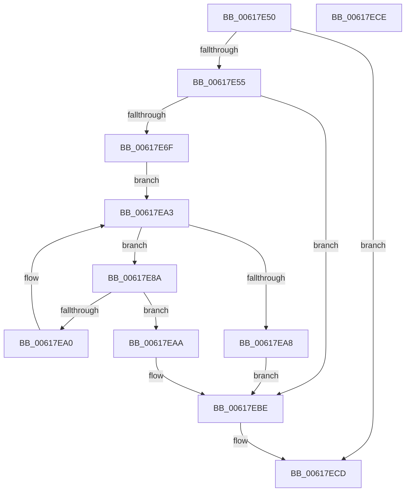

# CarGetDriverInfoFromDriverName

- RVA: `0x00617E50`–`0x00617ECF` (길이 `127` bytes)
- VA: `0x0000000140617E50`
- 실행 섹션: `.text`
- PDB 이름 있음: `예`; PDB Function 태그: `아니요`
- unwind 정보 RVA: `0x000ADC24`
- 디코드: `38`개 명령, `127/127` bytes 표시
- 미해석 바이트: `0` (있으면 어셈블리에 `.byte`로 보존)

> 이 문서는 커널 이미지의 기계어와 PDB 기호를 분석해 생성했습니다. 4번과 5번은 함수 원형과 자료형을 바이너리 사용 방식에서 추정한 C 해석이며 원본 소스 복구 결과는 아닙니다.

## 1. Dependencies

- 직접 호출 지점: **2**; 고유 호출 대상: **2**
- 직접 호출자로 확인된 함수: **1**
- RIP 상대 이미지 참조: **1**

### Outgoing calls
- `0x00617E7C` → [CarEtwCopyDriverName](CarEtwCopyDriverName_function_0061B8BC.md) (function, `0x0061B8BC`)
- `0x00617E97` → [wcsncmp](../50/wcsncmp_function_00501CA0.md) (function, `0x00501CA0`)

### Direct callers
- [CarInitializeTelemetryData](CarInitializeTelemetryData_function_00618BB0.md) at `0x00618CAC`
- [CarInitializeTelemetryData](CarInitializeTelemetryData_function_00618BB0.md) at `0x00618D3D`

### Static image references
- `0x00617E81` → RVA `0x00E681C8` (`.data`; read)

## 2. Other-region calls and transfers

- 다른 실행 섹션으로 향하는 call: **0**
- 별도 외부 분기/꼬리 이동을 확인하지 못했습니다.

## 3. Assembly (complete function range)

```asm
00617E50  48 85 C9                        test rcx, rcx
00617E53  74 78                           je 0x140617ecd
00617E55  48 89 5C 24 08                  mov qword ptr [rsp + 8], rbx
00617E5A  48 89 74 24 10                  mov qword ptr [rsp + 0x10], rsi
00617E5F  57                              push rdi
00617E60  48 83 EC 20                     sub rsp, 0x20
00617E64  48 8B FA                        mov rdi, rdx
00617E67  48 8B F1                        mov rsi, rcx
00617E6A  48 85 D2                        test rdx, rdx
00617E6D  74 4F                           je 0x140617ebe
00617E6F  48 8D 4A 04                     lea rcx, [rdx + 4]
00617E73  41 B8 20 00 00 00               mov r8d, 0x20
00617E79  48 8B D6                        mov rdx, rsi
00617E7C  E8 3B 3A 00 00                  call 0x14061b8bc
00617E81  48 8B 1D 40 03 85 00            mov rbx, qword ptr [rip + 0x850340]
00617E88  EB 19                           jmp 0x140617ea3
00617E8A  48 8D 4B 08                     lea rcx, [rbx + 8]
00617E8E  41 B8 20 00 00 00               mov r8d, 0x20
00617E94  48 8B D6                        mov rdx, rsi
00617E97  E8 04 9E EE FF                  call 0x140501ca0
00617E9C  85 C0                           test eax, eax
00617E9E  74 0A                           je 0x140617eaa
00617EA0  48 8B 1B                        mov rbx, qword ptr [rbx]
00617EA3  48 85 DB                        test rbx, rbx
00617EA6  75 E2                           jne 0x140617e8a
00617EA8  EB 14                           jmp 0x140617ebe
00617EAA  48 8B 43 48                     mov rax, qword ptr [rbx + 0x48]
00617EAE  48 89 47 48                     mov qword ptr [rdi + 0x48], rax
00617EB2  8B 43 50                        mov eax, dword ptr [rbx + 0x50]
00617EB5  89 47 50                        mov dword ptr [rdi + 0x50], eax
00617EB8  8B 43 58                        mov eax, dword ptr [rbx + 0x58]
00617EBB  89 47 44                        mov dword ptr [rdi + 0x44], eax
00617EBE  48 8B 5C 24 30                  mov rbx, qword ptr [rsp + 0x30]
00617EC3  48 8B 74 24 38                  mov rsi, qword ptr [rsp + 0x38]
00617EC8  48 83 C4 20                     add rsp, 0x20
00617ECC  5F                              pop rdi
00617ECD  C3                              ret
00617ECE  CC                              int3
```

## 4. C-style interpretation (structured pseudocode)

```c
__int64 __fastcall CarGetDriverInfoFromDriverName(__int64 a1, __int64 a2)
{
    __int64 result;
    __int64 v_rsp;
    unsigned __int64 v_stack_p10;
    unsigned __int64 v_stack_p8;

    if (a1 == 0) goto loc_00617ECD;
    v_stack_p8 = v_rbx;
    v_stack_p10 = v_rsi;
    v_rsp = (v_rsp) - (32);
    if (a2 == 0) goto loc_00617EBE;
    result = CarEtwCopyDriverName(a2 + 4, a1, 32, a4);
    goto loc_00617EA3;
loc_00617E8A:
    result = wcsncmp(*(unsigned __int64 *)(v_rip + 8717120) + 8, a1, 32, a4);
    if ((unsigned int)(result) == 0) goto loc_00617EAA;
loc_00617EA3:
    if (*(unsigned __int64 *)(*(unsigned __int64 *)(v_rip + 8717120)) != 0) goto loc_00617E8A;
    goto loc_00617EBE;
loc_00617EAA:
    *(unsigned __int64 *)(a2 + 72) = *(unsigned __int64 *)(*(unsigned __int64 *)(*(unsigned __int64 *)(v_rip + 8717120)) + 72);
    *(unsigned int *)(a2 + 80) = (unsigned int)((unsigned int)(*(unsigned int *)(*(unsigned __int64 *)(*(unsigned __int64 *)(v_rip + 8717120)) + 80)));
    *(unsigned int *)(a2 + 68) = (unsigned int)((unsigned int)(*(unsigned int *)(*(unsigned __int64 *)(*(unsigned __int64 *)(v_rip + 8717120)) + 88)));
loc_00617EBE:
    v_rsp = (v_rsp) + (32);
loc_00617ECD:
    return (unsigned int)(*(unsigned int *)(*(unsigned __int64 *)(*(unsigned __int64 *)(v_rip + 8717120)) + 88));
}
```

## 5. (Beta) C Style

```c
int64_t CarGetDriverInfoFromDriverName(int64_t Arg1, void *Arg2)
{
    uint8_t *arg2 = (uint8_t *)Arg2;

    int64_t result;
    int64_t local_rsp;
    uint64_t v_stack_p10;
    uint64_t v_stack_p8;

    if (Arg1 == 0) goto loc_00617ECD;
    v_stack_p8 = local_rbx;
    v_stack_p10 = local_rsi;
    local_rsp = (local_rsp) - (32);
    if (Arg2 == NULL) goto loc_00617EBE;
    result = CarEtwCopyDriverName(Arg2 + 4, Arg1, 32, a4);
    goto loc_00617EA3;
loc_00617E8A:
    result = wcsncmp(*(uint64_t *)(v_rip + 0x850340) + 8, Arg1, 32, a4);
    if ((uint32_t)(result) == 0) goto loc_00617EAA;
loc_00617EA3:
    if (*(uint64_t *)(*(uint64_t *)(v_rip + 0x850340)) != 0) goto loc_00617E8A;
    goto loc_00617EBE;
loc_00617EAA:
    *(uint64_t *)(arg2 + 0x48) = *(uint64_t *)(*(uint64_t *)(*(uint64_t *)(v_rip + 0x850340)) + 0x48);
    *(uint32_t *)(arg2 + 0x50) = (uint32_t)((uint32_t)(*(uint32_t *)(*(uint64_t *)(*(uint64_t *)(v_rip + 0x850340)) + 0x50)));
    *(uint32_t *)(arg2 + 0x44) = (uint32_t)((uint32_t)(*(uint32_t *)(*(uint64_t *)(*(uint64_t *)(v_rip + 0x850340)) + 0x58)));
loc_00617EBE:
    local_rsp = (local_rsp) + (32);
loc_00617ECD:
    return (uint32_t)(*(uint32_t *)(*(uint64_t *)(*(uint64_t *)(v_rip + 0x850340)) + 0x58));
}
```

### 관측된 메모리 오프셋

구조체 형식이 확인되지 않은 접근은 인자 기준의 오프셋으로만 기록했습니다.

| 기준 인자 | 오프셋 표현 | 폭 (bit) | 접근 |
|---|---:|---:|---|
| `Arg2` | `+ 0x44` | `32` | `W` |
| `Arg2` | `+ 0x48` | `64` | `W` |
| `Arg2` | `+ 0x50` | `32` | `W` |

## 6. Execution-region graph

[열기: 2D/3D 그래프와 함수 탐색 컨트롤 패널](../../../control-panel.html?section=text&rva=0x00617E50&view=graph)

- 2D 그래프는 위에서 아래로 흐르고, 3D 그래프는 빈 공간을 드래그해 회전합니다. Shift+드래그는 이동, 휠은 확대·축소, 함수 노드 선택은 대상 보고서 이동입니다.

### Static fallback


