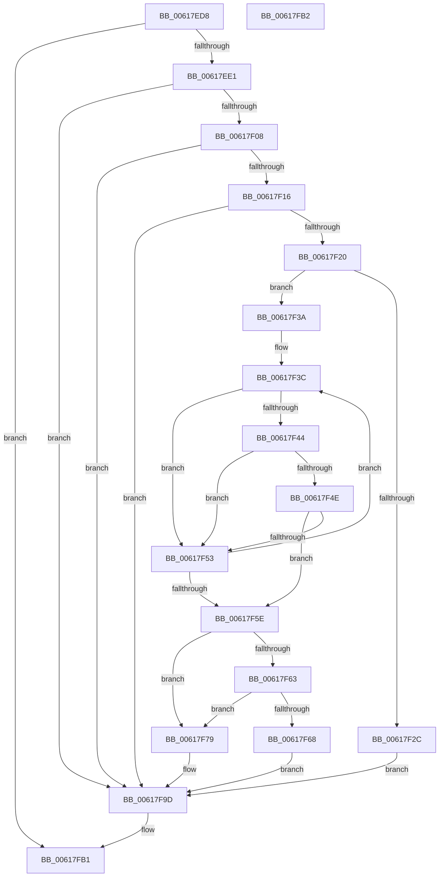

# CarGetDriverInfoFromViolationStack

- RVA: `0x00617ED8`–`0x00617FB3` (길이 `219` bytes)
- VA: `0x0000000140617ED8`
- 실행 섹션: `.text`
- PDB 이름 있음: `예`; PDB Function 태그: `아니요`
- unwind 정보 RVA: `0x000BEAEC`
- 디코드: `63`개 명령, `219/219` bytes 표시
- 미해석 바이트: `0` (있으면 어셈블리에 `.byte`로 보존)

> 이 문서는 커널 이미지의 기계어와 PDB 기호를 분석해 생성했습니다. 4번과 5번은 함수 원형과 자료형을 바이너리 사용 방식에서 추정한 C 해석이며 원본 소스 복구 결과는 아닙니다.

## 1. Dependencies

- 직접 호출 지점: **2**; 고유 호출 대상: **2**
- 직접 호출자로 확인된 함수: **1**
- RIP 상대 이미지 참조: **3**

### Outgoing calls
- `0x00617F44` → [VfTargetDriversGetVerifierData](../../pagevrfy/BB/VfTargetDriversGetVerifierData_function_00BB7E6C.md) (function, `0x00BB7E6C`)
- `0x00617F72` → [CarCopyDriverName](CarCopyDriverName_function_00617760.md) (function, `0x00617760`)

### Direct callers
- [CarInitializeTelemetryData](CarInitializeTelemetryData_function_00618BB0.md) at `0x00618CDE`

### Static image references
- `0x00617F79` → RVA `0x006CB480` (` ?? ::FNODOBFM::`string'`; read)
- `0x00617F85` → RVA `0x006CB488` (`.text`; read)
- `0x00617F8E` → RVA `0x006CB48C` (`.text`; read)

## 2. Other-region calls and transfers

- 다른 실행 섹션으로 향하는 call: **1**
  - `0x00617F44` → [VfTargetDriversGetVerifierData](../../pagevrfy/BB/VfTargetDriversGetVerifierData_function_00BB7E6C.md) (`.text` → `PAGEVRFY`)
- 별도 외부 분기/꼬리 이동을 확인하지 못했습니다.

## 3. Assembly (complete function range)

```asm
00617ED8  4D 85 C0                        test r8, r8
00617EDB  0F 84 D0 00 00 00               je 0x140617fb1
00617EE1  48 89 5C 24 08                  mov qword ptr [rsp + 8], rbx
00617EE6  48 89 6C 24 10                  mov qword ptr [rsp + 0x10], rbp
00617EEB  48 89 74 24 18                  mov qword ptr [rsp + 0x18], rsi
00617EF0  57                              push rdi
00617EF1  48 83 EC 20                     sub rsp, 0x20
00617EF5  33 ED                           xor ebp, ebp
00617EF7  49 8B D8                        mov rbx, r8
00617EFA  48 8B F1                        mov rsi, rcx
00617EFD  8B C5                           mov eax, ebp
00617EFF  4D 85 C9                        test r9, r9
00617F02  0F 84 95 00 00 00               je 0x140617f9d
00617F08  48 8B 4C 24 50                  mov rcx, qword ptr [rsp + 0x50]
00617F0D  48 85 C9                        test rcx, rcx
00617F10  0F 84 87 00 00 00               je 0x140617f9d
00617F16  48 8B 54 24 58                  mov rdx, qword ptr [rsp + 0x58]
00617F1B  48 85 D2                        test rdx, rdx
00617F1E  74 7D                           je 0x140617f9d
00617F20  49 89 29                        mov qword ptr [r9], rbp
00617F23  89 29                           mov dword ptr [rcx], ebp
00617F25  89 2A                           mov dword ptr [rdx], ebp
00617F27  48 85 F6                        test rsi, rsi
00617F2A  75 0E                           jne 0x140617f3a
00617F2C  41 C7 00 4E 00 41 00            mov dword ptr [r8], 0x41004e
00617F33  66 41 89 68 04                  mov word ptr [r8 + 4], bp
00617F38  EB 63                           jmp 0x140617f9d
00617F3A  8B FD                           mov edi, ebp
00617F3C  48 8B 0E                        mov rcx, qword ptr [rsi]
00617F3F  48 85 C9                        test rcx, rcx
00617F42  74 0F                           je 0x140617f53
00617F44  E8 23 FF 59 00                  call 0x140bb7e6c
00617F49  48 85 C0                        test rax, rax
00617F4C  74 05                           je 0x140617f53
00617F4E  48 39 28                        cmp qword ptr [rax], rbp
00617F51  75 0B                           jne 0x140617f5e
00617F53  FF C7                           inc edi
00617F55  48 83 C6 08                     add rsi, 8
00617F59  83 FF 14                        cmp edi, 0x14
00617F5C  72 DE                           jb 0x140617f3c
00617F5E  83 FF 14                        cmp edi, 0x14
00617F61  74 16                           je 0x140617f79
00617F63  48 85 C0                        test rax, rax
00617F66  74 11                           je 0x140617f79
00617F68  48 8B 10                        mov rdx, qword ptr [rax]
00617F6B  48 8B CB                        mov rcx, rbx
00617F6E  48 83 C2 28                     add rdx, 0x28
00617F72  E8 E9 F7 FF FF                  call 0x140617760
00617F77  EB 24                           jmp 0x140617f9d
00617F79  F2 0F 10 05 FF 34 0B 00         movsd xmm0, qword ptr [rip + 0xb34ff]
00617F81  F2 0F 11 03                     movsd qword ptr [rbx], xmm0
00617F85  8B 05 FD 34 0B 00               mov eax, dword ptr [rip + 0xb34fd]
00617F8B  89 43 08                        mov dword ptr [rbx + 8], eax
00617F8E  0F B7 05 F7 34 0B 00            movzx eax, word ptr [rip + 0xb34f7]
00617F95  66 89 43 0C                     mov word ptr [rbx + 0xc], ax
00617F99  66 89 6B 0E                     mov word ptr [rbx + 0xe], bp
00617F9D  48 8B 5C 24 30                  mov rbx, qword ptr [rsp + 0x30]
00617FA2  48 8B 6C 24 38                  mov rbp, qword ptr [rsp + 0x38]
00617FA7  48 8B 74 24 40                  mov rsi, qword ptr [rsp + 0x40]
00617FAC  48 83 C4 20                     add rsp, 0x20
00617FB0  5F                              pop rdi
00617FB1  C3                              ret
00617FB2  CC                              int3
```

## 4. C-style interpretation (structured pseudocode)

```c
__int64 __fastcall CarGetDriverInfoFromViolationStack(__int64 a1, __int64 a2, __int64 a3, __int64 a4, __int64 a5, __int64 a6)
{
    __int64 result;
    __int64 v_rbp;
    __int64 v_rdi;
    __int64 v_rsi;
    __int64 v_rsp;
    unsigned __int64 v_stack_p10;
    unsigned __int64 v_stack_p18;
    unsigned __int64 v_stack_p8;

    if (a3 == 0) goto loc_00617FB1;
    v_stack_p8 = v_rbx;
    v_stack_p10 = v_rbp;
    v_stack_p18 = v_rsi;
    v_rsp = (v_rsp) - (32);
    v_rbp = 0;
    if (a4 == 0) goto loc_00617F9D;
    if (a5 == 0) goto loc_00617F9D;
    if (a6 == 0) goto loc_00617F9D;
    *(unsigned __int64 *)(a4) = 0;
    *(unsigned int *)(a5) = 0;
    *(unsigned int *)(a6) = 0;
    if (a1 != 0) goto loc_00617F3A;
    *(unsigned int *)(a3) = 0x41004EULL;
    *(unsigned __int16 *)(a3 + 4) = 0;
    goto loc_00617F9D;
loc_00617F3A:
loc_00617F3C:
    if (*(unsigned __int64 *)(a1) == 0) goto loc_00617F53;
    result = VfTargetDriversGetVerifierData(*(unsigned __int64 *)(a1), a6, a3, a4);
    if (result == 0) goto loc_00617F53;
    if ((*(unsigned __int64 *)(result)) != 0) goto loc_00617F5E;
loc_00617F53:
    v_rdi = (unsigned int)((0) + 1);
    v_rsi = (a1) + (8);
    if (((unsigned int)(v_rdi)) < 20) goto loc_00617F3C;
loc_00617F5E:
    if (((unsigned int)(v_rdi)) == 20) goto loc_00617F79;
    if (result == 0) goto loc_00617F79;
    a2 = (*(unsigned __int64 *)(result)) + (40);
    result = CarCopyDriverName(a3, a2, a3, a4);
    goto loc_00617F9D;
loc_00617F79:
    *(unsigned __int64 *)(a3) = v_xmm0;
    *(unsigned int *)(a3 + 8) = (unsigned int)((unsigned int)(*(unsigned int *)(v_rip + 734461)));
    *(unsigned __int16 *)(a3 + 12) = (unsigned __int16)(*(unsigned __int16 *)(v_rip + 734455));
    *(unsigned __int16 *)(a3 + 14) = 0;
loc_00617F9D:
    v_rsp = (v_rsp) + (32);
loc_00617FB1:
    return *(unsigned __int16 *)(v_rip + 734455);
}
```

## 5. (Beta) C Style

```c
int64_t CarGetDriverInfoFromViolationStack(int64_t Arg1, int64_t Arg2, int64_t Arg3, int64_t Arg4, int64_t Arg5, int64_t Arg6)
{
    int64_t result;
    int64_t local_rbp;
    int64_t local_rdi;
    int64_t local_rsi;
    int64_t local_rsp;
    uint64_t v_stack_p10;
    uint64_t v_stack_p18;
    uint64_t v_stack_p8;

    if (Arg3 == 0) goto loc_00617FB1;
    v_stack_p8 = local_rbx;
    v_stack_p10 = local_rbp;
    v_stack_p18 = local_rsi;
    local_rsp = (local_rsp) - (32);
    local_rbp = 0;
    if (Arg4 == 0) goto loc_00617F9D;
    if (Arg5 == 0) goto loc_00617F9D;
    if (Arg6 == 0) goto loc_00617F9D;
    *(uint64_t *)(Arg4) = 0;
    *(uint32_t *)(Arg5) = 0;
    *(uint32_t *)(Arg6) = 0;
    if (Arg1 != 0) goto loc_00617F3A;
    *(uint32_t *)(Arg3) = 0x41004EULL;
    *(uint16_t *)(Arg3 + 0x4) = 0;
    goto loc_00617F9D;
loc_00617F3A:
loc_00617F3C:
    if (*(uint64_t *)(Arg1) == 0) goto loc_00617F53;
    result = VfTargetDriversGetVerifierData(*(uint64_t *)(Arg1), Arg6, Arg3, Arg4);
    if (result == 0) goto loc_00617F53;
    if ((*(uint64_t *)(result)) != 0) goto loc_00617F5E;
loc_00617F53:
    local_rdi = (uint32_t)((0) + 1);
    local_rsi = (Arg1) + (8);
    if (((uint32_t)(local_rdi)) < 20) goto loc_00617F3C;
loc_00617F5E:
    if (((uint32_t)(local_rdi)) == 20) goto loc_00617F79;
    if (result == 0) goto loc_00617F79;
    Arg2 = (*(uint64_t *)(result)) + (40);
    result = CarCopyDriverName(Arg3, Arg2, Arg3, Arg4);
    goto loc_00617F9D;
loc_00617F79:
    *(uint64_t *)(Arg3) = v_xmm0;
    *(uint32_t *)(Arg3 + 0x8) = (uint32_t)((uint32_t)(*(uint32_t *)(v_rip + 0xB34FD)));
    *(uint16_t *)(Arg3 + 0xC) = (uint16_t)(*(uint16_t *)(v_rip + 0xB34F7));
    *(uint16_t *)(Arg3 + 0xE) = 0;
loc_00617F9D:
    local_rsp = (local_rsp) + (32);
loc_00617FB1:
    return *(uint16_t *)(v_rip + 0xB34F7);
}
```

## 6. Execution-region graph

[열기: 2D/3D 그래프와 함수 탐색 컨트롤 패널](../../../control-panel.html?section=text&rva=0x00617ED8&view=graph)

- 2D 그래프는 위에서 아래로 흐르고, 3D 그래프는 빈 공간을 드래그해 회전합니다. Shift+드래그는 이동, 휠은 확대·축소, 함수 노드 선택은 대상 보고서 이동입니다.

### Static fallback


