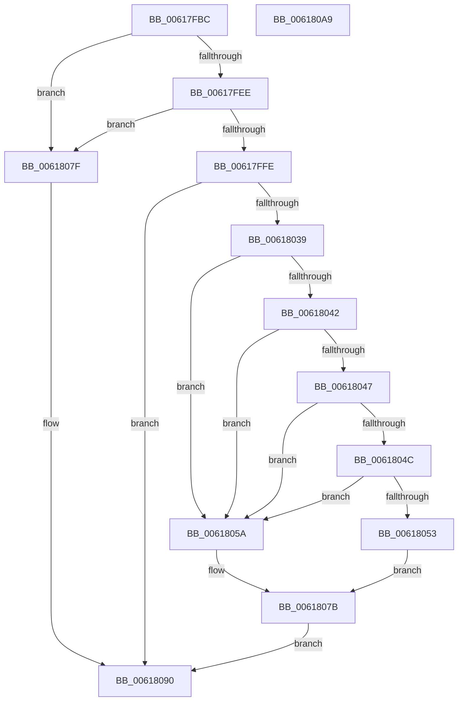

# CarHandleEtwEvent

- RVA: `0x00617FBC`–`0x006180AA` (길이 `238` bytes)
- VA: `0x0000000140617FBC`
- 실행 섹션: `.text`
- PDB 이름 있음: `예`; PDB Function 태그: `아니요`
- unwind 정보 RVA: `0x000BDE04`
- 디코드: `65`개 명령, `238/238` bytes 표시
- 미해석 바이트: `0` (있으면 어셈블리에 `.byte`로 보존)

> 이 문서는 커널 이미지의 기계어와 PDB 기호를 분석해 생성했습니다. 4번과 5번은 함수 원형과 자료형을 바이너리 사용 방식에서 추정한 C 해석이며 원본 소스 복구 결과는 아닙니다.

## 1. Dependencies

- 직접 호출 지점: **3**; 고유 호출 대상: **3**
- 직접 호출자로 확인된 함수: **1**
- RIP 상대 이미지 참조: **1**

### Outgoing calls
- `0x0061802E` → [CarAddUniqueViolation](CarAddUniqueViolation_function_0061B08C.md) (function, `0x0061B08C`)
- `0x00618076` → [CarEtwWriteBugCheckEvent](CarEtwWriteBugCheckEvent_function_00617B68.md) (function, `0x00617B68`)
- `0x00618086` → [CarpDbgPrint](CarpDbgPrint_function_0061B7B4.md) (function, `0x0061B7B4`)

### Direct callers
- [CarReportDifPluginRuleViolation](CarReportDifPluginRuleViolation_function_00619250.md) at `0x006193DF`

### Static image references
- `0x0061807F` → RVA `0x006CFAC0` (` ?? ::FNODOBFM::`string'`; read)

## 2. Other-region calls and transfers

- 다른 실행 섹션으로 향하는 call: **0**
- 별도 외부 분기/꼬리 이동을 확인하지 못했습니다.

## 3. Assembly (complete function range)

```asm
00617FBC  4C 8B DC                        mov r11, rsp
00617FBF  49 89 5B 10                     mov qword ptr [r11 + 0x10], rbx
00617FC3  49 89 6B 18                     mov qword ptr [r11 + 0x18], rbp
00617FC7  49 89 73 20                     mov qword ptr [r11 + 0x20], rsi
00617FCB  57                              push rdi
00617FCC  41 56                           push r14
00617FCE  41 57                           push r15
00617FD0  48 83 EC 40                     sub rsp, 0x40
00617FD4  83 64 24 60 00                  and dword ptr [rsp + 0x60], 0
00617FD9  41 8A F1                        mov sil, r9b
00617FDC  49 8B E8                        mov rbp, r8
00617FDF  44 8B F2                        mov r14d, edx
00617FE2  48 8B F9                        mov rdi, rcx
00617FE5  48 85 C9                        test rcx, rcx
00617FE8  0F 84 91 00 00 00               je 0x14061807f
00617FEE  48 8D 81 68 04 00 00            lea rax, [rcx + 0x468]
00617FF5  48 85 C0                        test rax, rax
00617FF8  0F 84 81 00 00 00               je 0x14061807f
00617FFE  4C 8B BC 24 88 00 00 00         mov r15, qword ptr [rsp + 0x88]
00618006  49 8D 43 08                     lea rax, [r11 + 8]
0061800A  49 89 43 E0                     mov qword ptr [r11 - 0x20], rax
0061800E  4C 8B C9                        mov r9, rcx
00618011  8B 84 24 90 00 00 00            mov eax, dword ptr [rsp + 0x90]
00618018  8B 8C 24 80 00 00 00            mov ecx, dword ptr [rsp + 0x80]
0061801F  89 44 24 30                     mov dword ptr [rsp + 0x30], eax
00618023  4D 89 7B D0                     mov qword ptr [r11 - 0x30], r15
00618027  4D 89 43 C8                     mov qword ptr [r11 - 0x38], r8
0061802B  44 8A C6                        mov r8b, sil
0061802E  E8 59 30 00 00                  call 0x14061b08c
00618033  8B D8                           mov ebx, eax
00618035  85 C0                           test eax, eax
00618037  78 57                           js 0x140618090
00618039  8B 44 24 60                     mov eax, dword ptr [rsp + 0x60]
0061803D  83 F8 02                        cmp eax, 2
00618040  76 18                           jbe 0x14061805a
00618042  83 F8 0A                        cmp eax, 0xa
00618045  74 13                           je 0x14061805a
00618047  83 F8 64                        cmp eax, 0x64
0061804A  74 0E                           je 0x14061805a
0061804C  3D E8 03 00 00                  cmp eax, 0x3e8
00618051  74 07                           je 0x14061805a
00618053  BB 80 00 00 00                  mov ebx, 0x80
00618058  EB 21                           jmp 0x14061807b
0061805A  8B 87 64 04 00 00               mov eax, dword ptr [rdi + 0x464]
00618060  48 8D 57 04                     lea rdx, [rdi + 4]
00618064  89 44 24 28                     mov dword ptr [rsp + 0x28], eax
00618068  4C 8B CD                        mov r9, rbp
0061806B  45 8B C6                        mov r8d, r14d
0061806E  40 88 74 24 20                  mov byte ptr [rsp + 0x20], sil
00618073  49 8B CF                        mov rcx, r15
00618076  E8 ED FA FF FF                  call 0x140617b68
0061807B  8B C3                           mov eax, ebx
0061807D  EB 11                           jmp 0x140618090
0061807F  48 8D 0D 3A 7A 0B 00            lea rcx, [rip + 0xb7a3a]
00618086  E8 29 37 00 00                  call 0x14061b7b4
0061808B  B8 0D 00 00 C0                  mov eax, 0xc000000d
00618090  48 8B 5C 24 68                  mov rbx, qword ptr [rsp + 0x68]
00618095  48 8B 6C 24 70                  mov rbp, qword ptr [rsp + 0x70]
0061809A  48 8B 74 24 78                  mov rsi, qword ptr [rsp + 0x78]
0061809F  48 83 C4 40                     add rsp, 0x40
006180A3  41 5F                           pop r15
006180A5  41 5E                           pop r14
006180A7  5F                              pop rdi
006180A8  C3                              ret
006180A9  CC                              int3
```

## 4. C-style interpretation (structured pseudocode)

```c
__int64 __fastcall CarHandleEtwEvent(__int64 a1, int a2, __int64 a3, unsigned __int8 a4, unsigned int a5, __int64 a6, unsigned int a7)
{
    __int64 result;
    __int64 v_rsp;
    unsigned int v_stack_m28;
    unsigned int v_stack_m30;
    unsigned __int8 v_stack_m38;
    unsigned __int64 v_stack_p10;
    unsigned __int64 v_stack_p18;
    unsigned __int64 v_stack_p20;
    unsigned int v_stack_p8;

    *(unsigned __int64 *)(v_rsp + 16) = v_rbx;
    *(unsigned __int64 *)(v_rsp + 24) = v_rbp;
    *(unsigned __int64 *)(v_rsp + 32) = v_rsi;
    v_rsp = (v_rsp) - (64);
    if (a1 == 0) goto loc_0061807F;
    if (a1 + 1128 == 0) goto loc_0061807F;
    *(unsigned __int64 *)(v_rsp - 32) = v_rsp + 8;
    v_stack_m28 = (unsigned int)((unsigned int)(a7));
    *(unsigned __int64 *)(v_rsp - 48) = a6;
    *(unsigned __int64 *)(v_rsp - 56) = a3;
    result = CarAddUniqueViolation((unsigned int)(a5), a2, a4, a1);
    if (sign_flag) goto loc_00618090;
    if (((unsigned int)((unsigned int)(v_stack_p8))) <= 2) goto loc_0061805A;
    if (((unsigned int)((unsigned int)(v_stack_p8))) == 10) goto loc_0061805A;
    if (((unsigned int)((unsigned int)(v_stack_p8))) == 100) goto loc_0061805A;
    if (((unsigned int)((unsigned int)(v_stack_p8))) == 1000) goto loc_0061805A;
    goto loc_0061807B;
loc_0061805A:
    v_stack_m30 = (unsigned int)((unsigned int)(*(unsigned int *)(a1 + 1124)));
    v_stack_m38 = a4;
    result = CarEtwWriteBugCheckEvent(a6, a1 + 4, (unsigned int)((unsigned int)((unsigned int)(a2))), a3);
loc_0061807B:
    goto loc_00618090;
loc_0061807F:
    result = CarpDbgPrint(v_rip + 752186, a1 + 4, (unsigned int)((unsigned int)((unsigned int)(a2))), a3);
loc_00618090:
    v_rsp = (v_rsp) + (64);
    return (unsigned int)(0xC000000DULL);
}
```

## 5. (Beta) C Style

```c
int64_t CarHandleEtwEvent(void *Arg1, int32_t Arg2, int64_t Arg3, uint8_t Arg4, uint32_t Arg5, int64_t Arg6, uint32_t Arg7)
{
    uint8_t *arg1 = (uint8_t *)Arg1;

    int64_t result;
    int64_t local_rsp;
    uint32_t v_stack_m28;
    uint32_t v_stack_m30;
    uint8_t v_stack_m38;
    uint64_t v_stack_p10;
    uint64_t v_stack_p18;
    uint64_t v_stack_p20;
    uint32_t v_stack_p8;

    *(uint64_t *)(local_rsp + 0x10) = local_rbx;
    *(uint64_t *)(local_rsp + 0x18) = local_rbp;
    *(uint64_t *)(local_rsp + 0x20) = local_rsi;
    local_rsp = (local_rsp) - (64);
    if (Arg1 == NULL) goto loc_0061807F;
    if (Arg1 + 1128 == 0) goto loc_0061807F;
    *(uint64_t *)(local_rsp - 0x20) = local_rsp + 8;
    v_stack_m28 = (uint32_t)((uint32_t)(Arg7));
    *(uint64_t *)(local_rsp - 0x30) = Arg6;
    *(uint64_t *)(local_rsp - 0x38) = Arg3;
    result = CarAddUniqueViolation((uint32_t)(Arg5), Arg2, Arg4, Arg1);
    if (sign_flag) goto loc_00618090;
    if (((uint32_t)((uint32_t)(v_stack_p8))) <= 2) goto loc_0061805A;
    if (((uint32_t)((uint32_t)(v_stack_p8))) == 10) goto loc_0061805A;
    if (((uint32_t)((uint32_t)(v_stack_p8))) == 100) goto loc_0061805A;
    if (((uint32_t)((uint32_t)(v_stack_p8))) == 1000) goto loc_0061805A;
    goto loc_0061807B;
loc_0061805A:
    v_stack_m30 = (uint32_t)((uint32_t)(*(uint32_t *)(arg1 + 0x464)));
    v_stack_m38 = Arg4;
    result = CarEtwWriteBugCheckEvent(Arg6, Arg1 + 4, (uint32_t)((uint32_t)((uint32_t)(Arg2))), Arg3);
loc_0061807B:
    goto loc_00618090;
loc_0061807F:
    result = CarpDbgPrint(v_rip + 752186, Arg1 + 4, (uint32_t)((uint32_t)((uint32_t)(Arg2))), Arg3);
loc_00618090:
    local_rsp = (local_rsp) + (64);
    return (uint32_t)(0xC000000DULL);
}
```

### 관측된 메모리 오프셋

구조체 형식이 확인되지 않은 접근은 인자 기준의 오프셋으로만 기록했습니다.

| 기준 인자 | 오프셋 표현 | 폭 (bit) | 접근 |
|---|---:|---:|---|
| `Arg1` | `+ 0x4` | `64` | `R` |
| `Arg1` | `+ 0x464` | `32` | `R` |

## 6. Execution-region graph

[열기: 2D/3D 그래프와 함수 탐색 컨트롤 패널](../../../control-panel.html?section=text&rva=0x00617FBC&view=graph)

- 2D 그래프는 위에서 아래로 흐르고, 3D 그래프는 빈 공간을 드래그해 회전합니다. Shift+드래그는 이동, 휠은 확대·축소, 함수 노드 선택은 대상 보고서 이동입니다.

### Static fallback


