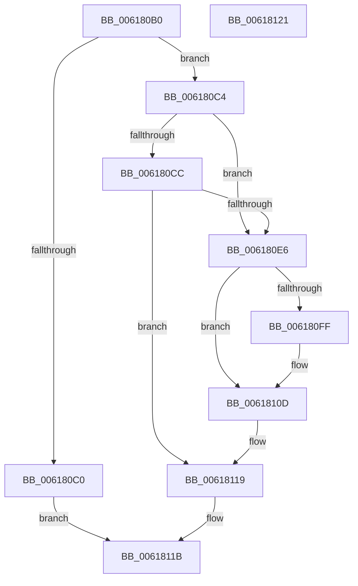

# CarInitLogging

- RVA: `0x006180B0`–`0x00618122` (길이 `114` bytes)
- VA: `0x00000001406180B0`
- 실행 섹션: `.text`
- PDB 이름 있음: `예`; PDB Function 태그: `아니요`
- unwind 정보 RVA: `0x0005CF00`
- 디코드: `31`개 명령, `114/114` bytes 표시
- 미해석 바이트: `0` (있으면 어셈블리에 `.byte`로 보존)

> 이 문서는 커널 이미지의 기계어와 PDB 기호를 분석해 생성했습니다. 4번과 5번은 함수 원형과 자료형을 바이너리 사용 방식에서 추정한 C 해석이며 원본 소스 복구 결과는 아닙니다.

## 1. Dependencies

- 직접 호출 지점: **5**; 고유 호출 대상: **5**
- 직접 호출자로 확인된 함수: **3**
- RIP 상대 이미지 참조: **5**

### Outgoing calls
- `0x006180DD` → [tlgKeywordOn](../42/tlgKeywordOn_function_0042EAA0.md) (function, `0x0042EAA0`)
- `0x006180E8` → [KeQueryPerformanceCounter](../37/KeQueryPerformanceCounter_function_0037E7E0.md) (function, `0x0037E7E0`)
- `0x006180F4` → [CarEtwRegister](CarEtwRegister_function_006179D4.md) (function, `0x006179D4`)
- `0x00618108` → [CarpDbgPrint](CarpDbgPrint_function_0061B7B4.md) (function, `0x0061B7B4`)
- `0x00618114` → [CarWriteEarlyRuleViolationEvents](CarWriteEarlyRuleViolationEvents_function_0061B628.md) (function, `0x0061B628`)

### Direct callers
- [CarInit](CarInit_function_006189FC.md) at `0x00618B50`
- [CarReportUnusualShutdown](CarReportUnusualShutdown_function_0061951C.md) at `0x00619529`
- [Phase1InitializationIoReady](../../init/C7/Phase1InitializationIoReady_function_00C70458.md) at `0x00C7075E`

### Static image references
- `0x006180B8` → RVA `0x00F03EE0` (`.data`; read)
- `0x006180C4` → RVA `0x00E090C8` (`.data`; read)
- `0x006180ED` → RVA `0x00E681D0` (`.data`; write)
- `0x00618101` → RVA `0x006CFA90` (` ?? ::FNODOBFM::`string'`; read)
- `0x0061810D` → RVA `0x00F03EE0` (`.data`; write)

## 2. Other-region calls and transfers

- 다른 실행 섹션으로 향하는 call: **0**
- 별도 외부 분기/꼬리 이동을 확인하지 못했습니다.

## 3. Assembly (complete function range)

```asm
006180B0  40 53                           push rbx
006180B2  48 83 EC 20                     sub rsp, 0x20
006180B6  33 DB                           xor ebx, ebx
006180B8  38 1D 22 BE 8E 00               cmp byte ptr [rip + 0x8ebe22], bl
006180BE  74 04                           je 0x1406180c4
006180C0  33 C0                           xor eax, eax
006180C2  EB 57                           jmp 0x14061811b
006180C4  39 1D FE 0F 7F 00               cmp dword ptr [rip + 0x7f0ffe], ebx
006180CA  76 1A                           jbe 0x1406180e6
006180CC  48 BA 00 00 00 00 00 80 00 00   movabs rdx, 0x800000000000
006180D6  48 8D 0D EB 0F 7F 00            lea rcx, [rip + 0x7f0feb]
006180DD  E8 BE 69 E1 FF                  call 0x14042eaa0
006180E2  84 C0                           test al, al
006180E4  75 33                           jne 0x140618119
006180E6  33 C9                           xor ecx, ecx
006180E8  E8 F3 66 D6 FF                  call 0x14037e7e0
006180ED  48 89 05 DC 00 85 00            mov qword ptr [rip + 0x8500dc], rax
006180F4  E8 DB F8 FF FF                  call 0x1406179d4
006180F9  8B D8                           mov ebx, eax
006180FB  85 C0                           test eax, eax
006180FD  79 0E                           jns 0x14061810d
006180FF  8B D0                           mov edx, eax
00618101  48 8D 0D 88 79 0B 00            lea rcx, [rip + 0xb7988]
00618108  E8 A7 36 00 00                  call 0x14061b7b4
0061810D  C6 05 CC BD 8E 00 01            mov byte ptr [rip + 0x8ebdcc], 1
00618114  E8 0F 35 00 00                  call 0x14061b628
00618119  8B C3                           mov eax, ebx
0061811B  48 83 C4 20                     add rsp, 0x20
0061811F  5B                              pop rbx
00618120  C3                              ret
00618121  CC                              int3
```

## 4. C-style interpretation (structured pseudocode)

```c
__int64 __fastcall CarInitLogging(void)
{
    __int64 result;
    __int64 v_rbx;
    __int64 v_rsp;

    v_rsp = (v_rsp) - (32);
    v_rbx = 0;
    if ((*(unsigned __int8 *)(v_rip + 9354786)) == 0) goto loc_006180C4;
    result = 0;
    goto loc_0061811B;
loc_006180C4:
    if ((*(unsigned int *)(v_rip + 8327166)) <= 0) goto loc_006180E6;
    result = tlgKeywordOn(v_rip + 8327147, a2, a3, a4);
    if ((unsigned __int8)(result) != 0) goto loc_00618119;
loc_006180E6:
    a1 = 0;
    result = KeQueryPerformanceCounter(a1, a2, a3, a4);
    *(unsigned __int64 *)(v_rip + 8716508) = result;
    result = CarEtwRegister(a1, a2, a3, a4);
    if (sign_flag) {
        a2 = (unsigned int)(result);
        a1 = v_rip + 752008;
        result = CarpDbgPrint(a1, a2, a3, a4);
    }
    *(unsigned __int8 *)(v_rip + 9354700) = 1;
    result = CarWriteEarlyRuleViolationEvents(a1, a2, a3, a4);
loc_00618119:
loc_0061811B:
    v_rsp = (v_rsp) + (32);
    return (unsigned int)((unsigned int)((unsigned int)((unsigned int)(result))));
}
```

## 5. (Beta) C Style

```c
void CarInitLogging(void)
{
    int64_t result;
    int64_t local_rbx;
    int64_t local_rsp;

    local_rsp = (local_rsp) - (32);
    local_rbx = 0;
    if ((*(uint8_t *)(v_rip + 0x8EBE22)) == 0) goto loc_006180C4;
    result = 0;
    goto loc_0061811B;
loc_006180C4:
    if ((*(uint32_t *)(v_rip + 0x7F0FFE)) <= 0) goto loc_006180E6;
    result = tlgKeywordOn(v_rip + 8327147, a2, a3, a4);
    if ((uint8_t)(result) != 0) goto loc_00618119;
loc_006180E6:
    a1 = 0;
    result = KeQueryPerformanceCounter(a1, a2, a3, a4);
    *(uint64_t *)(v_rip + 0x8500DC) = result;
    result = CarEtwRegister(a1, a2, a3, a4);
    if (sign_flag) {
        a2 = (uint32_t)(result);
        a1 = v_rip + 752008;
        result = CarpDbgPrint(a1, a2, a3, a4);
    }
    *(uint8_t *)(v_rip + 0x8EBDCC) = 1;
    result = CarWriteEarlyRuleViolationEvents(a1, a2, a3, a4);
loc_00618119:
loc_0061811B:
    local_rsp = (local_rsp) + (32);
    return (uint32_t)((uint32_t)((uint32_t)((uint32_t)(result))));
}
```

## 6. Execution-region graph

[열기: 2D/3D 그래프와 함수 탐색 컨트롤 패널](../../../control-panel.html?section=text&rva=0x006180B0&view=graph)

- 2D 그래프는 위에서 아래로 흐르고, 3D 그래프는 빈 공간을 드래그해 회전합니다. Shift+드래그는 이동, 휠은 확대·축소, 함수 노드 선택은 대상 보고서 이동입니다.

### Static fallback


