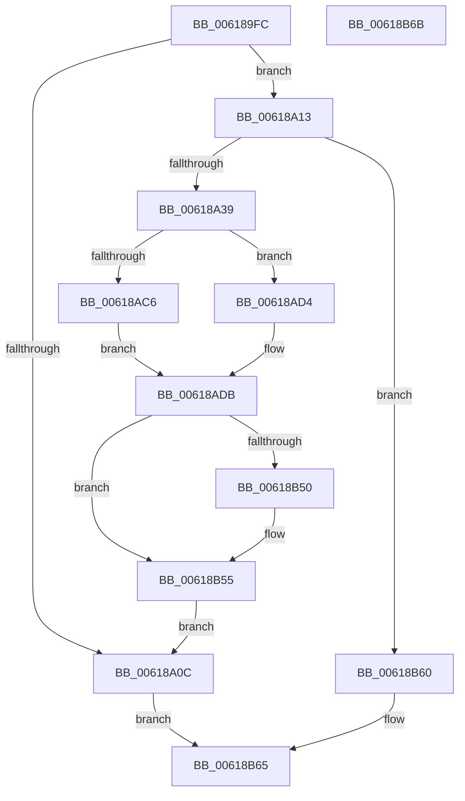

# CarInit

- RVA: `0x006189FC`–`0x00618B6C` (길이 `368` bytes)
- VA: `0x00000001406189FC`
- 실행 섹션: `.text`
- PDB 이름 있음: `예`; PDB Function 태그: `아니요`
- unwind 정보 RVA: `0x0005CF00`
- 디코드: `75`개 명령, `368/368` bytes 표시
- 미해석 바이트: `0` (있으면 어셈블리에 `.byte`로 보존)

> 이 문서는 커널 이미지의 기계어와 PDB 기호를 분석해 생성했습니다. 4번과 5번은 함수 원형과 자료형을 바이너리 사용 방식에서 추정한 C 해석이며 원본 소스 복구 결과는 아닙니다.

## 1. Dependencies

- 직접 호출 지점: **8**; 고유 호출 대상: **6**
- 직접 호출자로 확인된 함수: **3**
- RIP 상대 이미지 참조: **31**

### Outgoing calls
- `0x00618A21` → [ExAllocatePool2](../../poolcode/B8/ExAllocatePool2_function_00B820F0.md) (function, `0x00B820F0`)
- `0x00618A42` → [memset](../6C/memset_function_006C6C40.md) (function, `0x006C6C40`)
- `0x00618A9C` → [memset](../6C/memset_function_006C6C40.md) (function, `0x006C6C40`)
- `0x00618AC8` → [CarLoadFromDV](CarLoadFromDV_function_0061B924.md) (function, `0x0061B924`)
- `0x00618ACD` → [CarReadRegistry](CarReadRegistry_function_0061B978.md) (function, `0x0061B978`)
- `0x00618AD6` → [CarLoadFromDV](CarLoadFromDV_function_0061B924.md) (function, `0x0061B924`)
- `0x00618B42` → [KeRegisterBugCheckReasonCallback](../47/KeRegisterBugCheckReasonCallback_function_004720A0.md) (function, `0x004720A0`)
- `0x00618B50` → [CarInitLogging](CarInitLogging_function_006180B0.md) (function, `0x006180B0`)

### Direct callers
- [VfVolatileSetDifRuleClass](VfVolatileSetDifRuleClass_function_00616AA4.md) at `0x00616CAE`
- [CarReportUnusualShutdown](CarReportUnusualShutdown_function_0061951C.md) at `0x00619524`
- [VfInitBootDriversLoaded](../../init/C4/VfInitBootDriversLoaded_function_00C4BD0C.md) at `0x00C4BD2B`

### Static image references
- `0x00618A02` → RVA `0x00F03EC0` (`.data`; read)
- `0x00618A26` → RVA `0x00F03EA8` (`.data`; write)
- `0x00618A4A` → RVA `0x00F03ED0` (`.data`; read)
- `0x00618A51` → RVA `0x0061B340` (`CarComparRuleViolation`; read)
- `0x00618A64` → RVA `0x0061B2C0` (`CarAllocDbNode`; read)
- `0x00618A6F` → RVA `0x0061B580` (`CarFreeDbNode`; read)
- `0x00618A81` → RVA `0x00F03EB0` (`.data`; read/write)
- `0x00618A87` → RVA `0x00F03ED8` (`.data`; write)
- `0x00618A8E` → RVA `0x00F03ED0` (`.data`; write)
- `0x00618A95` → RVA `0x00F025A0` (`.data`; read)
- `0x00618AA1` → RVA `0x00F03DA8` (`.data`; read/write)
- `0x00618AA8` → RVA `0x00F02584` (`.data`; read/write)
- `0x00618AAF` → RVA `0x00F03DA0` (`.data`; read/write)
- `0x00618AB7` → RVA `0x00FC41A0` (`.data`; read)
- `0x00618ABE` → RVA `0x00F02580` (`.data`; write)
- `0x00618ADB` → RVA `0x00F03DA8` (`.data`; read)
- `0x00618AE1` → RVA `0x00E0EAC0` (`.data`; read)
- `0x00618AE8` → RVA `0x00F0252C` (`.data`; write)
- `0x00618AEE` → RVA `0x0061BB00` (`CarpSecondaryDataCallback`; read)
- `0x00618AF5` → RVA `0x00F02580` (`.data`; read)
- `0x00618B01` → RVA `0x00F02530` (`.data`; write)
- `0x00618B07` → RVA `0x00E0A74C` (`.data`; read)
- `0x00618B10` → RVA `0x00F03DA0` (`.data`; read)
- `0x00618B17` → RVA `0x00F02528` (`.data`; write)
- `0x00618B1D` → RVA `0x00F024C0` (`.data`; read)
- `0x00618B24` → RVA `0x00F02500` (`.data`; write)
- `0x00618B2A` → RVA `0x00F02504` (`.data`; write)
- `0x00618B34` → RVA `0x00F02534` (`.data`; write)
- `0x00618B3B` → RVA `0x00F024EC` (`.data`; write)
- `0x00618B47` → RVA `0x00F03E78` (`.data`; read)
- `0x00618B55` → RVA `0x00F03EC0` (`.data`; write)

## 2. Other-region calls and transfers

- 다른 실행 섹션으로 향하는 call: **1**
  - `0x00618A21` → [ExAllocatePool2](../../poolcode/B8/ExAllocatePool2_function_00B820F0.md) (`.text` → `POOLCODE`)
- 별도 외부 분기/꼬리 이동을 확인하지 못했습니다.

## 3. Assembly (complete function range)

```asm
006189FC  40 53                           push rbx
006189FE  48 83 EC 20                     sub rsp, 0x20
00618A02  8B 05 B8 B4 8E 00               mov eax, dword ptr [rip + 0x8eb4b8]
00618A08  85 C0                           test eax, eax
00618A0A  74 07                           je 0x140618a13
00618A0C  33 C0                           xor eax, eax
00618A0E  E9 52 01 00 00                  jmp 0x140618b65
00618A13  BA C0 00 00 00                  mov edx, 0xc0
00618A18  41 B8 43 61 72 4E               mov r8d, 0x4e726143
00618A1E  8D 4A 80                        lea ecx, [rdx - 0x80]
00618A21  E8 CA 96 56 00                  call 0x140b820f0
00618A26  48 89 05 7B B4 8E 00            mov qword ptr [rip + 0x8eb47b], rax
00618A2D  48 8B D8                        mov rbx, rax
00618A30  48 85 C0                        test rax, rax
00618A33  0F 84 27 01 00 00               je 0x140618b60
00618A39  33 D2                           xor edx, edx
00618A3B  48 8B C8                        mov rcx, rax
00618A3E  44 8D 42 68                     lea r8d, [rdx + 0x68]
00618A42  E8 F9 E1 0A 00                  call 0x1406c6c40
00618A47  48 89 1B                        mov qword ptr [rbx], rbx
00618A4A  48 8D 0D 7F B4 8E 00            lea rcx, [rip + 0x8eb47f]
00618A51  48 8D 05 E8 28 00 00            lea rax, [rip + 0x28e8]
00618A58  33 D2                           xor edx, edx
00618A5A  48 89 43 48                     mov qword ptr [rbx + 0x48], rax
00618A5E  41 B8 00 18 00 00               mov r8d, 0x1800
00618A64  48 8D 05 55 28 00 00            lea rax, [rip + 0x2855]
00618A6B  48 89 43 50                     mov qword ptr [rbx + 0x50], rax
00618A6F  48 8D 05 0A 2B 00 00            lea rax, [rip + 0x2b0a]
00618A76  48 89 43 58                     mov qword ptr [rbx + 0x58], rax
00618A7A  BB 01 00 00 00                  mov ebx, 1
00618A7F  8B C3                           mov eax, ebx
00618A81  87 05 29 B4 8E 00               xchg dword ptr [rip + 0x8eb429], eax
00618A87  48 89 0D 4A B4 8E 00            mov qword ptr [rip + 0x8eb44a], rcx
00618A8E  48 89 0D 3B B4 8E 00            mov qword ptr [rip + 0x8eb43b], rcx
00618A95  48 8D 0D 04 9B 8E 00            lea rcx, [rip + 0x8e9b04]
00618A9C  E8 9F E1 0A 00                  call 0x1406c6c40
00618AA1  83 25 00 B3 8E 00 00            and dword ptr [rip + 0x8eb300], 0
00618AA8  83 25 D5 9A 8E 00 00            and dword ptr [rip + 0x8e9ad5], 0
00618AAF  48 83 25 E9 B2 8E 00 00         and qword ptr [rip + 0x8eb2e9], 0
00618AB7  83 3D E2 B6 9A 00 00            cmp dword ptr [rip + 0x9ab6e2], 0
00618ABE  89 1D BC 9A 8E 00               mov dword ptr [rip + 0x8e9abc], ebx
00618AC4  76 0E                           jbe 0x140618ad4
00618AC6  8A CB                           mov cl, bl
00618AC8  E8 57 2E 00 00                  call 0x14061b924
00618ACD  E8 A6 2E 00 00                  call 0x14061b978
00618AD2  EB 07                           jmp 0x140618adb
00618AD4  33 C9                           xor ecx, ecx
00618AD6  E8 49 2E 00 00                  call 0x14061b924
00618ADB  8B 05 C7 B2 8E 00               mov eax, dword ptr [rip + 0x8eb2c7]
00618AE1  4C 8D 0D D8 5F 7F 00            lea r9, [rip + 0x7f5fd8]
00618AE8  89 05 3E 9A 8E 00               mov dword ptr [rip + 0x8e9a3e], eax
00618AEE  48 8D 15 0B 30 00 00            lea rdx, [rip + 0x300b]
00618AF5  8B 05 85 9A 8E 00               mov eax, dword ptr [rip + 0x8e9a85]
00618AFB  41 B8 02 00 00 00               mov r8d, 2
00618B01  89 05 29 9A 8E 00               mov dword ptr [rip + 0x8e9a29], eax
00618B07  8B 05 3F 1C 7F 00               mov eax, dword ptr [rip + 0x7f1c3f]
00618B0D  0F B7 C8                        movzx ecx, ax
00618B10  48 8B 05 89 B2 8E 00            mov rax, qword ptr [rip + 0x8eb289]
00618B17  89 0D 0B 9A 8E 00               mov dword ptr [rip + 0x8e9a0b], ecx
00618B1D  48 8D 0D 9C 99 8E 00            lea rcx, [rip + 0x8e999c]
00618B24  89 1D D6 99 8E 00               mov dword ptr [rip + 0x8e99d6], ebx
00618B2A  C7 05 D0 99 8E 00 80 00 00 00   mov dword ptr [rip + 0x8e99d0], 0x80
00618B34  48 89 05 F9 99 8E 00            mov qword ptr [rip + 0x8e99f9], rax
00618B3B  C6 05 AA 99 8E 00 00            mov byte ptr [rip + 0x8e99aa], 0
00618B42  E8 59 95 E5 FF                  call 0x1404720a0
00618B47  80 3D 2A B3 8E 00 00            cmp byte ptr [rip + 0x8eb32a], 0
00618B4E  74 05                           je 0x140618b55
00618B50  E8 5B F5 FF FF                  call 0x1406180b0
00618B55  89 1D 65 B3 8E 00               mov dword ptr [rip + 0x8eb365], ebx
00618B5B  E9 AC FE FF FF                  jmp 0x140618a0c
00618B60  B8 17 00 00 C0                  mov eax, 0xc0000017
00618B65  48 83 C4 20                     add rsp, 0x20
00618B69  5B                              pop rbx
00618B6A  C3                              ret
00618B6B  CC                              int3
```

## 4. C-style interpretation (structured pseudocode)

```c
__int64 __fastcall CarInit(void)
{
    __int64 result;
    __int64 v_rsp;

    v_rsp = (v_rsp) - (32);
    if ((unsigned int)((unsigned int)(*(unsigned int *)(v_rip + 9352376))) == 0) goto loc_00618A13;
loc_00618A0C:
    result = 0;
    goto loc_00618B65;
loc_00618A13:
    result = ExAllocatePool2(192 - 128, 192, (unsigned int)(0x4E726143ULL), a4);
    *(unsigned __int64 *)(v_rip + 9352315) = result;
    if (result == 0) goto loc_00618B60;
    a2 = 0;
    result = memset(result, a2, a2 + 104, a4);
    *(unsigned __int64 *)(result) = result;
    a2 = 0;
    *(unsigned __int64 *)(result + 72) = v_rip + 10472;
    *(unsigned __int64 *)(result + 80) = v_rip + 10325;
    *(unsigned __int64 *)(result + 88) = v_rip + 11018;
    *(unsigned __int64 *)(v_rip + 9352266) = v_rip + 9352319;
    *(unsigned __int64 *)(v_rip + 9352251) = v_rip + 9352319;
    result = memset(v_rip + 9345796, a2, (unsigned int)(0x1800ULL), a4);
    *(unsigned int *)(v_rip + 9345724) = 1;
    if ((*(unsigned int *)(v_rip + 10139362)) <= 0) goto loc_00618AD4;
    result = CarLoadFromDV(1, a2, (unsigned int)(0x1800ULL), a4);
    result = CarReadRegistry(1, a2, (unsigned int)(0x1800ULL), a4);
    goto loc_00618ADB;
loc_00618AD4:
    a1 = 0;
    result = CarLoadFromDV(a1, a2, (unsigned int)(0x1800ULL), a4);
loc_00618ADB:
    *(unsigned int *)(v_rip + 9345598) = (unsigned int)((unsigned int)(*(unsigned int *)(v_rip + 9351879)));
    *(unsigned int *)(v_rip + 9345577) = (unsigned int)((unsigned int)(*(unsigned int *)(v_rip + 9345669)));
    *(unsigned int *)(v_rip + 9345547) = (unsigned int)((unsigned __int16)((unsigned int)(*(unsigned int *)(v_rip + 8330303))));
    *(unsigned int *)(v_rip + 9345494) = 1;
    *(unsigned int *)(v_rip + 9345488) = 128;
    *(unsigned __int64 *)(v_rip + 9345529) = *(unsigned __int64 *)(v_rip + 9351817);
    *(unsigned __int8 *)(v_rip + 9345450) = 0;
    result = KeRegisterBugCheckReasonCallback(v_rip + 9345436, v_rip + 12299, 2, v_rip + 8347608);
    if ((*(unsigned __int8 *)(v_rip + 9351978)) != 0) {
        result = CarInitLogging(v_rip + 9345436, v_rip + 12299, 2, v_rip + 8347608);
    }
    *(unsigned int *)(v_rip + 9352037) = 1;
    goto loc_00618A0C;
loc_00618B60:
loc_00618B65:
    v_rsp = (v_rsp) + (32);
    return (unsigned int)(0xC0000017ULL);
}
```

## 5. (Beta) C Style

```c
void CarInit(void)
{
    int64_t result;
    int64_t local_rsp;

    local_rsp = (local_rsp) - (32);
    if ((uint32_t)((uint32_t)(*(uint32_t *)(v_rip + 0x8EB4B8))) == 0) goto loc_00618A13;
loc_00618A0C:
    result = 0;
    goto loc_00618B65;
loc_00618A13:
    result = ExAllocatePool2(192 - 128, 192, (uint32_t)(0x4E726143ULL), a4);
    *(uint64_t *)(v_rip + 0x8EB47B) = result;
    if (result == 0) goto loc_00618B60;
    a2 = 0;
    result = memset(result, a2, a2 + 104, a4);
    *(uint64_t *)(result) = result;
    a2 = 0;
    *(uint64_t *)(result + 0x48) = v_rip + 10472;
    *(uint64_t *)(result + 0x50) = v_rip + 10325;
    *(uint64_t *)(result + 0x58) = v_rip + 11018;
    *(uint64_t *)(v_rip + 0x8EB44A) = v_rip + 9352319;
    *(uint64_t *)(v_rip + 0x8EB43B) = v_rip + 9352319;
    result = memset(v_rip + 9345796, a2, (uint32_t)(0x1800ULL), a4);
    *(uint32_t *)(v_rip + 0x8E9ABC) = 1;
    if ((*(uint32_t *)(v_rip + 0x9AB6E2)) <= 0) goto loc_00618AD4;
    result = CarLoadFromDV(1, a2, (uint32_t)(0x1800ULL), a4);
    result = CarReadRegistry(1, a2, (uint32_t)(0x1800ULL), a4);
    goto loc_00618ADB;
loc_00618AD4:
    a1 = 0;
    result = CarLoadFromDV(a1, a2, (uint32_t)(0x1800ULL), a4);
loc_00618ADB:
    *(uint32_t *)(v_rip + 0x8E9A3E) = (uint32_t)((uint32_t)(*(uint32_t *)(v_rip + 0x8EB2C7)));
    *(uint32_t *)(v_rip + 0x8E9A29) = (uint32_t)((uint32_t)(*(uint32_t *)(v_rip + 0x8E9A85)));
    *(uint32_t *)(v_rip + 0x8E9A0B) = (uint32_t)((uint16_t)((uint32_t)(*(uint32_t *)(v_rip + 0x7F1C3F))));
    *(uint32_t *)(v_rip + 0x8E99D6) = 1;
    *(uint32_t *)(v_rip + 0x8E99D0) = 128;
    *(uint64_t *)(v_rip + 0x8E99F9) = *(uint64_t *)(v_rip + 0x8EB289);
    *(uint8_t *)(v_rip + 0x8E99AA) = 0;
    result = KeRegisterBugCheckReasonCallback(v_rip + 9345436, v_rip + 12299, 2, v_rip + 8347608);
    if ((*(uint8_t *)(v_rip + 0x8EB32A)) != 0) {
        result = CarInitLogging(v_rip + 9345436, v_rip + 12299, 2, v_rip + 8347608);
    }
    *(uint32_t *)(v_rip + 0x8EB365) = 1;
    goto loc_00618A0C;
loc_00618B60:
loc_00618B65:
    local_rsp = (local_rsp) + (32);
    return (uint32_t)(0xC0000017ULL);
}
```

## 6. Execution-region graph

[열기: 2D/3D 그래프와 함수 탐색 컨트롤 패널](../../../control-panel.html?section=text&rva=0x006189FC&view=graph)

- 2D 그래프는 위에서 아래로 흐르고, 3D 그래프는 빈 공간을 드래그해 회전합니다. Shift+드래그는 이동, 휠은 확대·축소, 함수 노드 선택은 대상 보고서 이동입니다.

### Static fallback


